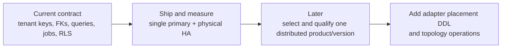
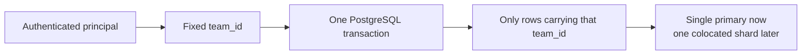
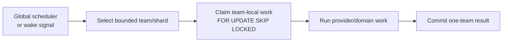
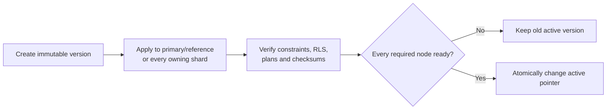

# PostgreSQL Cluster-Safe Schema

Single-primary and physical HA compatibility are current requirements.
Distributed-by-team execution remains a future capability-gated adapter, not a
claim of shipped cluster support.

This page is the single source of truth for Dense-Mem's cluster-safe PostgreSQL
key, constraint, table-placement, query-routing, queue, and topology-specific
RLS shape. Semantic field meaning remains in
[Data Model And Storage](Data-Model-And-Storage), Entity identity in
[Entity Identity And Resolution](Entity-Identity-And-Resolution), Relationship
identity/lifecycle in
[Relationship Model And Lifecycle](Relationship-Model-And-Lifecycle), and
principal/authorization semantics in
[Request Lifecycle And Security](Request-Lifecycle-And-Security). Exact/ANN
topology and index behavior remains in
[ANN, HNSW, And Halfvec](ANN-HNSW-And-Halfvec).

## Outcome And Boundary

The schema runs unchanged as ordinary tables on one PostgreSQL primary and
through a physical-HA writer endpoint. Its tenant-owned rows can later be
distributed and colocated by `team_id` without changing semantic identities,
rewriting row ownership, or adding a missing tenant column to populated tables.

Cluster-safe does not mean cluster-enabled:

```text
cluster-safe schema
  = keys, constraints, queries, jobs, and RLS preserve one-team locality

supported distributed adapter
  = one named product/version also passes DDL, RLS, pgvector, backup,
    rebalance, failover, and exact-versus-ANN integration gates
```

The initial implementation must not import a distributed-database SDK into the
domain layer. PostgreSQL adapters expose the same team-scoped repository ports
whether the configured writer endpoint is standalone, HA-managed, or a future
distributed coordinator.

Logical multi-primary writes are outside this contract. Physical HA may move
the writer role, and a future distributed topology may have many shard writers,
but one team routes to one authoritative writer for a transaction.

## Before And After

| Single-primary-only shape | Cluster-safe shape |
| --- | --- |
| tenant table may use `PRIMARY KEY (id)` | tenant table uses `PRIMARY KEY (team_id, id)` |
| foreign key carries only record ID | foreign key carries matching `(team_id, record_id)` |
| repository may load by record ID alone | repository requires authenticated team plus record ID |
| tenant may be derived through another join | every tenant-owned row stores non-null `team_id` directly |
| worker searches one global queue | scheduler selects a team, then claims team-local durable work |
| auth, shared definitions, and semantic rows have no placement class | coordinator, reference, tenant-owned, and derived-observation classes are explicit |
| future sharding requires row backfill and identity-key rewrites | future adapter adds placement DDL without semantic re-verification |

```text
PostgreSQL logical schema
├── coordinator control
│   ├── authentication / SSO / secret references
│   ├── global configuration
│   └── migration and topology control
├── shared reference
│   ├── predicate and model/search definitions
│   └── immutable active-version metadata
└── tenant-owned by team_id
    ├── non-secret team/profile integrity projections
    ├── semantic state and append-only history
    ├── placement/review/import/Conflict queues
    ├── search documents and embedding jobs
    └── feedback, dream/community, and tenant audit
```

## Delivery Split And Lift



| Delivery slice | Decision | Relative lift | Why |
| --- | --- | --- | --- |
| cluster-safe logical schema | required | medium-high | adding tenant columns/composite constraints before rows exist avoids a later table and identity-key rewrite |
| single-primary runtime | implement first | baseline | establishes the correctness oracle and simplest operating mode |
| physical HA compatibility | implement with the baseline; qualify standby reads separately | medium | writer-endpoint failover keeps the same schema; replica reads add lag/freshness and query-cancel concerns |
| horizontally distributed runtime | defer behind a named adapter | high, mostly operational and integration work | requires product/version-specific placement, routing, RLS, pgvector, index, backup, failover, and rebalance proof |
| splitting one large team across shards | out of scope until measured need | very high | breaks the one-team transaction/search locality invariant and needs a different consistency and candidate-merge design |

The required implementation boundary is the first three rows. It includes
topology-neutral repository ports and configuration, but no vendor distribution
functions or SDK. The later distributed adapter may add physical placement and
routing; it may not weaken or reinterpret the logical contract.

## One-Team Transaction Invariant

Every normal memory operation has one authenticated team before it reaches a
repository. Its semantic reads and writes stay inside that team.



Normal paths include remember intake, placement, review resolution, Entity
correction, Relationship lifecycle, recall, trace, feedback, dreaming,
community work, imports, and tenant audit. They never open a transaction that
mutates semantic rows for two teams.

Cross-team control operations enumerate teams from the control plane and invoke
one independently committed, idempotent per-team operation. They do not create
distributed semantic transactions.

## Table Placement Classes

The logical schema classifies each table before a distributed adapter maps it
to product-specific placement.

| Class | Responsibility | Single primary | Future distributed adapter |
| --- | --- | --- | --- |
| tenant-owned | non-secret integrity projection, semantic, workflow, derived search, tenant feedback/audit | ordinary PostgreSQL table | distributed by and colocated on `team_id` |
| shared reference | small immutable/versioned definitions used by tenant-local queries | ordinary PostgreSQL table | replicated reference table or equivalent |
| coordinator control | authentication discovery, secrets metadata, global config, migration/cluster control | ordinary PostgreSQL table | coordinator/local control table |
| derived cluster observation | shard/index/profile health summaries | ordinary derived rows | coordinator summaries; never durable knowledge authority |

### Tenant-owned families

The following logical families carry non-null `team_id` from creation:

- `semantic_team_refs` and `semantic_profile_refs`, which project only stable
  control-plane ownership IDs for tenant-local integrity
- ingests, evidence fragments, placement runs/items, and review tasks
- Entity records, Entity names, Entity resolution/correction events
- typed Value records
- Relationship observations, verification events, current records, evidence
  support/decision rows, transitions, and cross-references
- team Conflict cases, position membership, append-only events, and nightly run
  reservations
- Hypotheses and their review/run rows
- search documents and embedding jobs
- recall events/feedback and tenant-scoped evaluation run records
- memory-pack import runs/change ledgers
- team community/dream schedules and results
- team audit and operation events

No tenant-owned table uses nullable `team_id`. An event with no team belongs in
a separate system/control table rather than a tenant table with `team_id=NULL`.

### Shared-reference families

Small immutable/versioned definitions required inside team-local queries may be
replicated by a future adapter:

- predicate registry versions and immutable definitions
- embedding contracts
- search-index generations and global/default ranking contract definitions
- assessor closed-contract, prompt, and assessment-policy definitions/hashes
- closed enum/reference definitions that cannot differ by shard

Reference data activation follows a cluster-wide barrier. A predicate,
embedding, search-index, or ranking version cannot become active until every
required database node can read the same immutable version.

Team-specific profile-selection/override rows remain tenant-owned and carry
`team_id`; only their immutable shared definitions are reference data.

### Coordinator-control families

Records needed before an authenticated `team_id` exists remain in the control
plane:

- authoritative `teams` and `team_profiles`, including credential and SSO
  fields
- API-key hash/prefix lookup and revocation directory
- SSO providers, identities, sessions, and entitlement mappings
- encrypted-secret references
- global `app_config` and topology declarations
- schema migrations, team placement epochs, and cluster build/activation
  records
- global scheduler leadership and redacted system audit

Authentication resolves key/session to team, profile, role, and scopes before
opening a tenant semantic transaction. The hot semantic query does not join a
distributed memory table to the global key or SSO tables.

The existing `teams` and `team_profiles` rows remain the only identity,
authorization, and credential authority. The semantic schema adds only these non-secret
integrity projections:

```sql
CREATE TABLE semantic_team_refs (
  team_id uuid PRIMARY KEY
);

CREATE TABLE semantic_profile_refs (
  team_id uuid NOT NULL,
  profile_id uuid NOT NULL,
  PRIMARY KEY (team_id, profile_id),
  FOREIGN KEY (team_id)
    REFERENCES semantic_team_refs (team_id)
);
```

On one primary, team/profile creation writes the authority and its integrity
projection in the same transaction. A future distributed adapter routes the
projection to the team-owning shard and must record it ready before enabling
semantic writes for that team/profile. Projection rows carry no hashes,
prefixes, scopes, roles, SSO claims, or mutable entitlement decisions. They are
retained while semantic history can reference them; runtime authorization
always reads the control authority. Readiness reconciliation rejects an orphan
projection, a missing projection, or a `(team_id, profile_id)` pair that does
not match the control authority; the semantic adapter never repairs one by
inference.

## Tenant-Owned Key Contract

Every tenant-owned row has:

```text
team_id       UUID NOT NULL
record_id     opaque UUID or other bounded opaque ID generated before insert
```

Its relational identity starts with `team_id`:

```sql
PRIMARY KEY (team_id, record_id)
```

The opaque record ID remains the public handle, but it is never sufficient for
a database lookup. The authenticated team is always the first key:

```sql
SELECT ...
FROM relationship_records
WHERE team_id = $1
  AND relationship_id = $2;
```

Repository signatures make omission difficult:

```go
GetRelationship(ctx context.Context, teamID, relationshipID string)
ListEntityRelationships(ctx context.Context, teamID, entityID string, limit int)
```

There is no unscoped `GetRelationship(ctx, relationshipID)` implementation for
normal application code.

### Unique constraints

Every tenant-owned unique constraint contains `team_id`, even when IDs are
random enough to be globally collision-resistant:

```sql
UNIQUE (team_id, owner_profile_id, relationship_identity_hash)
UNIQUE (team_id, value_type, canonical_value_hash)
UNIQUE (team_id, ingest_id, evidence_index)
```

Detailed Relationship and Value identity fields remain owned by their semantic
pages. This rule only adds the tenant prefix.

A genuinely global uniqueness requirement belongs in a coordinator-control or
shared-reference table. API-key prefixes and provider names must not force a
cross-shard unique constraint on semantic tables.

### Foreign keys

Every foreign key between tenant-owned tables carries the same `team_id` on
both sides:

```sql
FOREIGN KEY (team_id, subject_entity_id)
  REFERENCES entity_records (team_id, entity_id)

FOREIGN KEY (team_id, relationship_id)
  REFERENCES relationship_records (team_id, relationship_id)
```

This makes a cross-team reference structurally impossible, not merely hidden by
RLS. Cross-profile references are allowed only when both Relationships share
the same composite team key.

Profile ownership uses a composite reference to the non-secret integrity
projection:

```sql
FOREIGN KEY (team_id, owner_profile_id)
  REFERENCES semantic_profile_refs (team_id, profile_id)
```

The projection preserves the existing team/profile IDs without replicating the
secret-bearing `team_profiles` table. A future distributed adapter colocates it
with the semantic rows by `team_id` and must prove its distributed foreign-key
behavior; it cannot silently drop ownership or same-team integrity or promote
this projection into a second profile authority.

## Representative Semantic Shape

This fragment demonstrates tenant keys and references only. Canonical semantic
fields and lifecycle constraints remain in their owning pages.

```sql
CREATE TABLE entity_records (
  team_id uuid NOT NULL,
  entity_id uuid NOT NULL,
  entity_kind text NOT NULL,
  version bigint NOT NULL,
  PRIMARY KEY (team_id, entity_id)
);

CREATE TABLE relationship_records (
  team_id uuid NOT NULL,
  relationship_id uuid NOT NULL,
  owner_profile_id uuid NOT NULL,
  subject_entity_id uuid NOT NULL,
  object_entity_id uuid,
  object_value_id uuid,
  predicate_key text NOT NULL,
  version bigint NOT NULL,
  PRIMARY KEY (team_id, relationship_id),
  FOREIGN KEY (team_id, subject_entity_id)
    REFERENCES entity_records (team_id, entity_id),
  FOREIGN KEY (team_id, object_entity_id)
    REFERENCES entity_records (team_id, entity_id),
  CHECK ((object_entity_id IS NULL) <> (object_value_id IS NULL))
);

CREATE INDEX relationship_team_subject_idx
  ON relationship_records (team_id, subject_entity_id, predicate_key);
```

The real schema adds the composite Value and profile references, owner-scoped
semantic uniqueness, polarity/scope/time identity, append-only ledgers, partial
eligibility indexes, and RLS from their canonical contracts.

## Search And Embedding Shape

Search rows remain team-owned even though embedding contracts/search-index generations are
shared reference data:

```sql
CREATE TABLE search_documents (
  team_id uuid NOT NULL,
  source_kind text NOT NULL,
  source_id uuid NOT NULL,
  embedding_contract_id uuid NOT NULL,
  embedding_dimensions integer NOT NULL,
  source_version bigint NOT NULL,
  projection_format_version integer NOT NULL,
  search_text_hash text NOT NULL,
  document_version bigint NOT NULL,
  search_state text NOT NULL,
  embedding vector,
  PRIMARY KEY (
    team_id,
    source_kind,
    source_id,
    embedding_contract_id
  ),
  CHECK (
    embedding IS NULL
    OR vector_dims(embedding) = embedding_dimensions
  )
);
```

Every exact/ANN query includes `team_id`. A future row-sharded adapter routes it
to the team-owning shard before the shard-local pgvector index runs. HNSW
expression, filtering, and index-profile rules belong in
[ANN, HNSW, And Halfvec](ANN-HNSW-And-Halfvec#postgresql-storage-and-query-shape).

Embedding work is also tenant-local:

```sql
PRIMARY KEY (team_id, embedding_job_id)
UNIQUE (
  team_id,
  source_kind,
  source_id,
  source_version,
  document_version,
  embedding_contract_id
)
```

Relationship release projection state is team-owned:

```sql
PRIMARY KEY (team_id, projection_generation_id)
UNIQUE (team_id, source_kind, projection_format_version)
```

A generation-tagged embedding job uses a nullable composite foreign key
`(team_id, projection_generation_id)`. It cannot point at another team's
generation. Foreground and generation job classes share the same team-local
queue, leases, and version fences.

An embedding worker never needs to scan or lock every team's queue in one
transaction. The worker first picks a ready team, then claims a bounded batch
for that team with `FOR UPDATE SKIP LOCKED`. A provider batch never mixes
teams, which keeps request accounting, failure isolation, and future team-shard
routing tenant-local.

Within one team, claims reserve capacity for each non-empty foreground or
generation class, then fill remaining capacity foreground-first. This
starvation-free class policy does not require a global cross-team ordering.

## Index Contract

Tenant-owned B-tree, GIN, and adjacency indexes lead with `team_id` when the
query is team-scoped:

```text
(team_id, record_id)
(team_id, status, created_at)
(team_id, subject_entity_id, predicate_key)
(team_id, object_entity_id, predicate_key)
(team_id, owner_profile_id, updated_at)
```

This is useful on one primary and lets a future coordinator prune/route work.
Do not add one physical partition or partial index per small team; that creates
catalog/planner overhead and is not a substitute for a measured distribution
strategy.

HNSW is the exception to the ordinary composite-index shape because pgvector's
ANN index is over the vector expression. `team_id` remains in the query/RLS, and
the distributed topology reduces the candidate universe to one owning shard.
Exact/ANN filtering risks and large-team placement remain owned by the ANN page.

## Join And Repository Contract

Every join between tenant-owned tables includes equality on `team_id`:

```sql
SELECT relationship.relationship_id, subject.entity_id
FROM relationship_records AS relationship
JOIN entity_records AS subject
  ON subject.team_id = relationship.team_id
 AND subject.entity_id = relationship.subject_entity_id
WHERE relationship.team_id = $1
  AND relationship.relationship_id = $2;
```

Requirements:

1. request/application code fixes `team_id` before repository entry
2. repository SQL uses an explicit team predicate even when RLS also applies
3. every tenant join repeats the team equality
4. ID lists remain paired with one team; a list from one team cannot hydrate
   against another
5. pagination cursors include team scope indirectly through authenticated route
   and are rejected under a different team
6. no latency-sensitive semantic path executes cross-team aggregation

Cross-team management reports use coordinator/control queries or explicit
bounded per-team fan-out. They are not recall or placement repository methods.

## RLS And Worker Context

RLS is defense in depth, not the shard router. Tenant-owned tables use forced
RLS plus explicit predicates:

```sql
ALTER TABLE relationship_records ENABLE ROW LEVEL SECURITY;
ALTER TABLE relationship_records FORCE ROW LEVEL SECURITY;

CREATE POLICY relationship_team_policy ON relationship_records
USING (
  team_id = nullif(
    current_setting('app.current_team_id', true),
    ''
  )::uuid
)
WITH CHECK (
  team_id = nullif(
    current_setting('app.current_team_id', true),
    ''
  )::uuid
);
```

A missing/invalid team setting fails closed. Pooled connections set it with
transaction-local `set_config`, never session-global state.

Normal internal workers also run with one explicit `team_id`. An unrestricted
system mode is reserved for migrations and narrow audited control operations;
it is not the default placement, embedding, dream, community, or cleanup mode.

A future distributed adapter must prove that roles, policies, `set_config`, and
`FORCE ROW LEVEL SECURITY` behave on owning workers. If its coordinator cannot
guarantee that contract, the adapter is unsupported even when queries appear to
route correctly.

## Durable Queue And Scheduler Shape

Queue truth remains PostgreSQL. Every tenant work row and idempotency key carries
`team_id`:



The scheduler first selects a bounded team from rebuildable per-team work
summaries/signals, then calls a repository claim that requires that `team_id`.
The team-local queue index starts with `(team_id, status, available_at)`. A
future distributed adapter performs the same claim on one shard/team routing
context at a time. It does not promise a globally exact oldest-job ordering
across shards.

Nightly Conflict review follows the same shape. The scheduler durably reserves
one `(team_id, local_run_date)` run, then claims due `open`/`overdue` cases from
an index beginning `(team_id, status, next_review_at)` with case-version and
lease predicates. A claim never scans or locks every team's Relationship rows.
Only system/team transaction mode may update the team-owned case materialization
or close losing Relationship episodes selected by a locked resolved case. Profile
writes affect cases indirectly inside the same placement service transaction and
append the authenticated actor to the case event.

Small coordinator summaries or Redis signals may indicate which shard has work,
but they are derived hints. Losing them cannot lose, complete, or reassign the
durable PostgreSQL job.

Fairness is enforced through bounded per-team concurrency, round-robin/deficit
scheduling, oldest-age alerts, and hard global worker caps. One noisy team
cannot consume every placement or embedding worker indefinitely.

## Version And Activation Barrier

Schema, predicate, embedding, search-index, ranking, and assessor versions are
immutable records with one explicit active pointer per applicable scope.



An HA standby may serve qualified reads only after replaying the active pointer
and required schema/index state. A distributed profile cannot activate when one
shard reports an absent or incompatible version.

## Single, HA, And Distributed Mapping

| Concern | Single primary | Physical HA | Future distributed-by-team adapter |
| --- | --- | --- | --- |
| tenant tables | ordinary tables | primary tables replicated by WAL | distributed/colocated by `team_id` |
| reference data | ordinary tables | replicated by WAL | replicated reference/equivalent |
| auth/control | ordinary tables | writer primary plus HA | coordinator/local control plane |
| semantic write | primary transaction | writer transaction | one team-owning shard transaction |
| recall | primary exact/ANN | primary initially; qualified standby later | one team-owning shard exact/ANN |
| queue claim | primary `SKIP LOCKED` | writer only | shard/team-local claim |
| migration/index build | primary | writer plus replay gate | every required shard plus activation barrier |

The schema does not use product-specific distribution functions in baseline
migrations. A named distributed adapter owns additive placement DDL after it
passes qualification. This keeps ordinary PostgreSQL and physical HA as first-
class deployments.

That adapter also owns a coordinator-control placement record containing the
team, opaque target placement, epoch, and transition state. Routing and shard
movement are fenced by the epoch; application repositories never guess a shard
or retry a write against another placement.

## Failure Semantics

| Failure | Required behavior |
| --- | --- |
| tenant-owned insert lacks `team_id` | database rejects it; no inferred default |
| ID exists under another team | return not found/forbidden by public policy; never retry unscoped |
| composite FK detects another-team endpoint | reject the transaction and alert integrity telemetry |
| worker lacks team context | claim/run fails before provider or semantic work |
| ownership projection disagrees with control authority | block that team/profile's semantic writes and surface reconciliation failure |
| shared definition or search-index generation missing on a shard | keep the old version active; shard/topology not ready |
| team route/placement epoch is stale | reject the write and refresh routing; never write an alternate shard speculatively |
| distributed adapter cannot enforce RLS/FK contract | adapter unsupported; continue single/HA only |
| global batch partially completes | preserve per-team checkpoints and retry incomplete teams idempotently |
| shard unavailable | fail that team's required operation visibly; do not write another shard or Redis |

## Risks And Mitigations

| Risk | Concrete failure mode | Mitigation |
| --- | --- | --- |
| schema called cluster-safe but query is not | `GetRelationship(id)` scatters to every shard or finds another team | repository requires `(team_id, id)` and integration scan forbids unscoped methods |
| global UUID PK blocks distribution | tenant table has `PRIMARY KEY(id)` and cannot enforce it locally after sharding | composite `(team_id, id)` from the table's first migration |
| tenant prefixes inflate write/index cost | redundant composite indexes increase WAL, cache pressure, and insert latency on one primary | keep only measured query-driven indexes, avoid per-team indexes, and gate on index-size/buffer/write benchmarks |
| cross-team FK survives RLS | row in team A references Entity from team B that RLS merely hides | composite tenant foreign keys on both sides |
| nullable tenant mixes system data | `team_id=NULL` rows cannot route and bypass tenant assumptions | separate coordinator system/control tables; tenant rows require non-null |
| auth lookup scatters | API key is searched on every semantic shard before team is known | coordinator auth directory resolves team before semantic routing |
| credential hashes replicate to every worker | a profile/key table is made reference data without separating secret-bearing columns | keep auth/control coordinator-local; distribute only the non-secret ownership projection by team |
| ownership projection lags control state | a new profile authenticates but its semantic insert fails on the owning-shard FK | create atomically on one primary; require projection readiness before distributed semantic writes |
| RLS stops at coordinator | distributed worker executes without the expected transaction-local setting | adapter-specific worker RLS tests and capability gate |
| global queue ordering becomes bottleneck | coordinator locks/scans every shard for oldest work | per-shard/team claims, bounded fairness scheduler, durable local age metrics |
| Conflict scheduler crosses tenants | a nightly worker claims the globally oldest case without a routed team and writes another shard | reserve/select a bounded team first, then require `team_id` on case/run/lease/version predicates |
| reference data diverges | one shard uses another predicate or index profile version | immutable version checksum and all-node activation barrier |
| stale routing creates split authority | two shards accept writes for one team during movement/failover | fenced placement epochs and one authoritative writer per team transaction |
| large team remains hot | all team data correctly colocates but exhausts one worker | skew telemetry, dedicated placement/shard, separate intra-team design before splitting |
| generic cluster abstraction over-engineers the domain | domain code carries Citus/vendor types before any adapter exists | product-neutral repository contract; product DDL stays in optional adapter |
| existing credentials are rewritten | cluster preparation reissues keys or breaks SSO ownership | keep auth/control rows coordinator-local; migrate only new semantic shape and non-secret integrity IDs |

## Acceptance Invariants

1. Every tenant-owned row has non-null `team_id` from its first insert.
2. Every tenant-owned primary key, unique constraint, foreign key, hot join, and
   normal lookup contains `team_id`.
3. Composite foreign keys make cross-team semantic references impossible.
4. Authentication resolves team/profile before a semantic repository call.
5. API key/SSO/control lookup never requires semantic-shard fan-out.
6. Normal semantic transactions read/write exactly one team.
7. One placement epoch routes that team transaction to one authoritative
   writer; stale routes fail instead of falling back.
8. Normal workers claim and commit with explicit team context.
9. Cross-team administration decomposes into bounded idempotent per-team work.
10. RLS is forced and fails closed in addition to explicit query predicates.
11. One-primary and physical-HA deployments need no product-specific sharding
    extension.
12. A distributed adapter is supported only after named product/version gates
    prove key/FK, RLS, pgvector, queue, migration, backup, rebalance, and failover
    behavior.
13. Existing teams, profiles, keys, SSO, and control records remain stable
    through schema changes.
14. Non-secret integrity projections validate team/profile ownership but never
    authorize a request or duplicate credential/entitlement authority.
15. Future distribution by `team_id` requires placement DDL and data movement,
    but not semantic ID changes, AI re-verification, or tenant backfill.
16. Conflict cases, positions, events, and nightly run rows use composite
    team-leading keys/FKs and cannot reference another team's Relationship.
17. Nightly Conflict review reserves and claims one team at a time with durable
    lease/version predicates; no global semantic-row scan is a supported path.
18. Projection generations and tagged embedding jobs use composite team keys;
    foreground and generation work make bounded progress without cross-team
    batches.

## Primary References

- [PostgreSQL constraints](https://www.postgresql.org/docs/current/ddl-constraints.html)
- [PostgreSQL row security](https://www.postgresql.org/docs/current/ddl-rowsecurity.html)
- [Citus distributed/reference/local table concepts](https://docs.citusdata.com/en/stable/get_started/concepts.html)
- [Citus multi-tenant data model](https://docs.citusdata.com/en/stable/use_cases/multi_tenant.html)

These references describe capabilities and constraints. Dense-Mem does not
claim Citus or another sharding product is supported until its exact selected
version passes this page's adapter gates.
