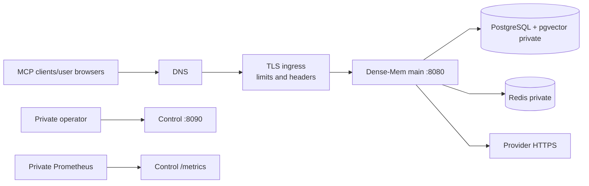
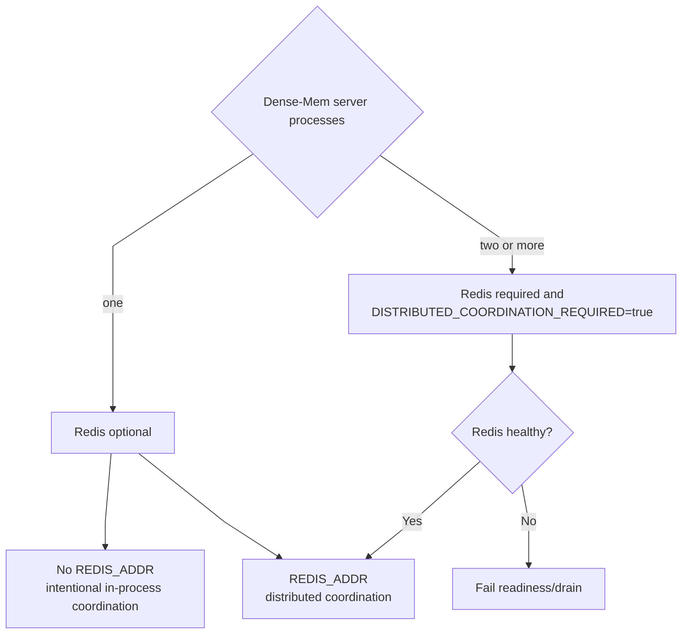
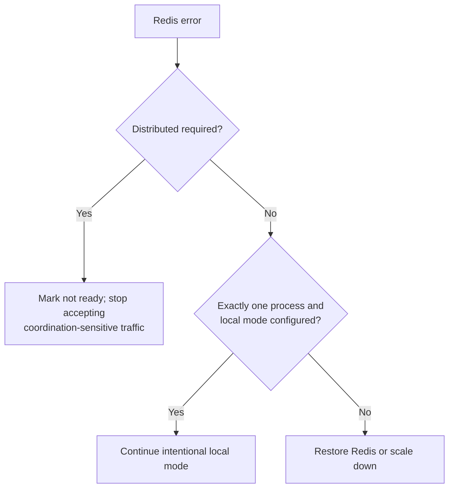

# Public HTTPS And Redis

The base deployment binds locally. Use the expert deployment when the main
listener needs public HTTPS or when replicas need distributed coordination.

Exact setting names/defaults are in [Configuration](Configuration).

## Network Boundary



Only the intended main routes are public. Control, metrics, PostgreSQL, Redis,
and Docker administration remain private.

## HTTPS

Use a pinned release's expert Compose example. Configure the domain/contact
values required by its ingress implementation, then enable its TLS profile.
The bundled Traefik profile uses an explicit Compose file-provider config that
routes to `http://server:8080`; it does not mount or require the Docker socket.
An external ingress may be used instead and remains responsible for its own
discovery and exposure policy.

Protected requests may carry an MCP or user-portal API-key bearer credential,
an opaque user-portal API-key session cookie, or a user-portal SSO session
cookie. Do not expose plain HTTP outside loopback/private networks.

The expert Traefik route matches the configured host and forwards the original
request path to the Dense-Mem listener on port `8080`; it must not strip or
rewrite `/ui` or `/ui/api`. The portal cookies are host-only and scoped to
`/ui`, so a custom domain works without a cookie `Domain` override. Set the
runtime `SSO_COOKIE_SECURE` setting to `true` for the HTTPS custom-domain
deployment. The setting is PostgreSQL-backed and changed through the private
control portal; it is not an authoritative Compose environment variable.

Public edge controls include:

- request rate/burst
- body size
- in-flight requests
- TLS/protocol/cipher policy
- security headers
- timeouts
- access-log redaction

They are defense in depth; application authentication, scopes, RLS, and
team-scoped full-text/vector/topic reads remain required.

## Forwarded Client IP

Dense-Mem extracts the first client address from `X-Forwarded-For` on its main,
control, and metrics listeners. The deployment ingress must overwrite and
validate that header before forwarding requests. Dense-Mem intentionally does
not maintain a trusted-proxy CIDR allowlist: operators own the proxy trust
boundary, and automatic security bans are applied to the resulting real client
IP rather than a changing pod or proxy address.

## Public Surface

| Surface | Public? |
| --- | --- |
| `/mcp` | only intentionally over HTTPS |
| `/ui` and its first-party browser handlers | only for authenticated users when intended |
| `/health` | according to ingress/orchestrator policy |
| `/ready` | usually internal load-balancer probe |
| control `:8090` | no |
| `/metrics` | no |
| PostgreSQL/Redis | no |

Ingress allowlists should expose only the selected MCP, user-portal, and probe
surfaces. The private control listener is never part of the main wildcard.

## Redis Decision



Redis coordinates:

- rate-limit counters
- SSE concurrency
- bounded wakeups/leases/cleanup coordination
- coordination through the implemented distributed ports

Rate-limit policy remains in the access application boundary. Redis implements
the distributed coordination port when replicas require it; a single process
may use the equivalent in-process implementation. Neither coordination backend
authenticates callers, chooses a team, or becomes the source of identity,
credential, session, or audit truth.

Redis never owns:

- evidence or ingests
- occurrences, source revisions, and lifecycle records
- Topics, memberships, equivalence, and publication history
- verifier/submission assessment decisions
- terminal write results and durable background operations
- API keys/audit

Compose Redis healthchecks authenticate with `REDISCLI_AUTH` so the password is
not placed in the `redis-cli` argument list. Keep the healthcheck and server
credentials in the same secret environment or secret-manager scope.

PostgreSQL remains the authoritative workflow and knowledge ledger. Redis loss does not remove
memory.

## Single Instance

Leaving `REDIS_ADDR` empty is a valid intentional mode for one server process.
Health should state `coordination_mode=in_process`. It need not call the
deployment degraded when the topology matches.

Do not add a second process until all coordination contracts use a shared
backend.

## Replicas

All replicas use:

- the same Redis deployment/key namespace policy
- consistent rate/SSE/provider limit config
- the same PostgreSQL/pgvector/embedding contracts
- unique process identity for leases/telemetry
- readiness that fails when distributed coordination is unavailable

Never let one replica use Redis while another uses local counters.

## Redis Security

- private network only
- authentication and TLS for untrusted networks
- dedicated logical key prefix/instance
- no public port
- eviction policy compatible with coordination TTLs
- bounded key TTLs
- do not log values/secrets
- monitor memory, latency, errors, and evictions

A Redis database number is not a strong tenant boundary. Keys still include
purpose/team where applicable, and application authorization happens first.

## Failure Sequence



A running distributed instance must not silently switch to local counters after
Redis loss.

## Checks

```bash
docker compose ps
docker compose logs --since=15m server
curl -fsS https://dense-mem.example.com/health
curl -fsS https://dense-mem.example.com/ready
```

Verify:

- certificate/hostname and HTTP-to-HTTPS behavior
- control/metrics/data ports are unreachable publicly
- current `tools/list` routes/tools work
- wrong/missing keys fail safely
- body/rate/in-flight limits
- Redis outage drains replicas
- no knowledge is lost after Redis restart
- submission/search/recall continue after coordination recovery

## Risks And Mitigations

| Risk | Concrete failure mode | Mitigation |
| --- | --- | --- |
| Control listener exposed | public caller gains cross-team operations | separate private listener/ingress and network policy |
| Plaintext bearer key | key captured outside loopback | HTTPS-only public edge |
| Redis becomes memory store | Redis restart removes Evidence/submission state | coordination-only interfaces and persistence tests |
| Silent replica fallback | global limits split per process | distributed-required readiness |
| Wildcard route exposes compatibility/admin | ingress publishes unintended path | explicit route allowlist and external scan |
| Proxy logs secrets | Authorization header appears in access logs | header redaction and log validation |

## Acceptance Invariants

1. only intended main routes are public
2. control/metrics/data stores remain private
3. every public protected request uses HTTPS
4. replicas require shared coordination
5. Redis contains no canonical memory
6. Redis outage cannot silently weaken multi-instance guarantees
