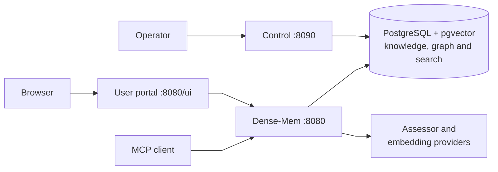
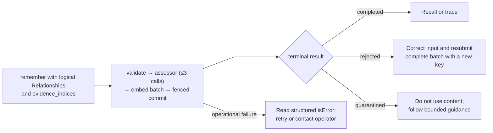

# Quick Start

This is the local PostgreSQL setup and current closed-schema smoke test. Use a
pinned release and discover its authorized catalog with MCP `tools/list`.

## Local Shape



One local server needs no Redis or public HTTPS. Redis becomes required when
multiple server processes need shared coordination.

## 1. Get A Pinned Release

```bash
mkdir dense-mem-local
cd dense-mem-local

export DENSE_MEM_VERSION="vX.Y.Z"

curl -fsSLo docker-compose.yml \
  "https://raw.githubusercontent.com/markhuangai/dense-mem/$DENSE_MEM_VERSION/examples/docker-compose.base.yml"
curl -fsSLo .env.example \
  "https://raw.githubusercontent.com/markhuangai/dense-mem/$DENSE_MEM_VERSION/examples/.env.example"

cp .env.example .env
```

Verify the release tag, artifact checksum/signature, and release notes. Stop if
the release does not advertise PostgreSQL authority or its `tools/list` catalog
does not match the expected closed schemas.

Release candidates use `vX.Y.Z-rc.N` for the release image and
`demo-vX.Y.Z-rc.N` for the demo image. Stable promotion reuses those exact
manifests as `vX.Y.Z` plus `latest`, and as `demo-vX.Y.Z`; no rolling `demo` tag
is published.

### Upgrading an existing installation

An installation upgrading from a version earlier than `2.1.1` must first
deploy `2.1.1` and complete its guided migration. After that succeeds, upgrade
to the current release.

This prerequisite does not apply to a fresh installation starting on `2.2.0`
or later, or to an installation whose `2.1.1` migration already completed.

```text
source before 2.1.1 -> run 2.1.1 migration -> current release
fresh install 2.2.0+ -----------------------> current release
```

The Relationship projection upgrade is an exclusive restart: complete the
blocking format-2 text projection and verify the active-contract vectors before
traffic. Follow
[Relationship projection upgrade](Operations-Runbook#relationship-projection-upgrade).

Only after that prerequisite is complete, apply the V2.4 secure-submission
upgrade and then the current v2.6.1 synchronous Remember migration. The v2.6.1
migration is a hard restart boundary: it preserves accepted canonical state,
terminalizes unfinished pre-v2.6 Remember work with an internal
`contract_superseded` migration stage, and does not create a cutover marker or a
queue/hold table. Stop every Dense-Mem service before applying it, then start
only the v2.6.1 API and control service. Do not run mixed-version nodes, retain
a fallback reader, or expose historical submissions through the current contract.

## 2. Configure Required Values

```bash
vi .env
```

Complete [Required Startup Settings](Configuration#required-startup-settings):

- non-template PostgreSQL credentials
- embedding provider, model, dimensions, document/normalization contract
- pgvector distance and compatible exact/ANN search-index strategy
- integrated-assessor model, prompt, and closed contract
- control authentication/encryption secrets
- Redis only when the chosen topology requires it

Keep `.env` private. An embedding-contract change after data exists requires a
vector rebuild. A search-index construction change requires reindexing but no
provider calls. See [ANN, HNSW, And Halfvec](ANN-HNSW-And-Halfvec).

## 3. Start And Wait For Readiness

```bash
docker compose up -d
docker compose ps

curl -fsS http://127.0.0.1:8080/health
curl -fsS http://127.0.0.1:8080/ready
```

Continue only when readiness confirms PostgreSQL migrations, `pgvector`,
embedding/assessor contracts, and required coordination.

The image contains one project executable, `/app/server`. It obtains a
PostgreSQL session lock and applies pending migrations before opening the HTTP
listeners, so no separate migration container is required. Replicas sharing
one writable primary serialize this step. Keep migrations backward compatible
during rolling deployment, and start a server against every independent
database.

Local surfaces:

```text
MCP:            http://127.0.0.1:8080/mcp
User portal:    http://127.0.0.1:8080/ui
Control portal: http://127.0.0.1:8090/
```

## 4. Create A Team And Credential

Open the private control portal with `CONTROL_PORTAL_TOKEN`, create a team, then
create its first credential/API key. Automation may call the same private control
API:

```bash
control_token="<CONTROL_PORTAL_TOKEN from .env>"

team_json="$(curl -fsS -X POST http://127.0.0.1:8090/control/api/teams \
  -H "Authorization: Bearer ${control_token}" \
  -H "Content-Type: application/json" \
  -d '{"name":"primary-memory"}')"
team_id="$(printf '%s' "$team_json" | jq -r '.data.id')"

curl -fsS -X POST \
  "http://127.0.0.1:8090/control/api/teams/${team_id}/credentials" \
  -H "Authorization: Bearer ${control_token}" \
  -H "Content-Type: application/json" \
  -d '{"name":"default credential"}'
```

The release image does not include standalone administration commands. Store
the one-time raw key returned by the portal/API in a secret manager:

```bash
export DENSE_MEM_API_KEY="dm_..."
```

## 5. Connect And Discover

Follow [MCP Clients](MCP-Clients) and connect the LLM host. The host initializes
the server and calls `tools/list`; verify:

- one current closed schema discovered through `tools/list`; callers cannot select a contract version
- `remember` requires evidence plus logical Relationships whose
  `evidence_indices` cover every evidence item
- `remember` returns a complete terminal outcome; `get_submission_status` is
  removed and calls to it return method/tool not found
- legacy placement and review tools are absent
- `retract_evidence` is visible to a write-scoped key
- `recall_memory` returns ranked Evidence contexts plus
  `related_relationships[]`, `related_communities[]`, `conflicts[]`,
  `related_hypotheses[]`, `search_states`, and `degradations[]`
- `trace_memory` accepts `relationship_id`
- the tool list matches key scopes

When the model selects one of these tools, the host sends `tools/call` with its
name and schema-valid arguments. See
[MCP Memory Interface](Request-Lifecycle-And-Security#mcp-memory-interface).

Do not interpret older lifecycle or projection fields using this manual.

## 6. Remember Evidence

Ask the client:

```text
Remember that I prefer concise explanations with concrete examples.
```



Valid v2.6.1 outcomes:

- completed canonical promotion with active eligible support
- a rejected terminal run with zero semantic commit and either
  `no_supported_memory` or `stale_input`
- an MCP `isError` result with a typed operational error and no semantic commit
- explicit rejected or quarantined terminal outcome
- `search_state` is only `current` or `not_required`
- no client approval task, placement selection, or quarantine-release action;
  unsupported Relationship hints are reported as `not_stored` when stored
  splits still cover every evidence item

The authoritative terminal contract is in
[Technical Reference](Technical-Reference#response). Do not add a polling loop.

## 7. Recall And Trace

Ask:

```text
What do you remember about my explanation preferences?
```

Default recall returns ranked Evidence contexts plus separate compact
Relationship discovery results. Then ask:

```text
Trace that preference Relationship and show its supporting evidence.
```

The client passes the returned `relationship_id` to `trace_memory`.

## 8. Test Identity Reuse

Remember:

```text
Dense-Mem is also called DM.
DM uses PostgreSQL.
```

Expected:

- one Dense-Mem Entity
- `DM` as supported name metadata, not a node/edge
- one `uses` Relationship to the PostgreSQL Entity

Do not use an ambiguous first name for this initial smoke.

## 9. Test Forget

Use the traced caller-owned `relationship_id` and ask to forget that one
Relationship. To correct another owner, remember new evidence under the
caller, include the recall-supplied Conflict ID/version on the relevant proposal
when present, and let Dense-Mem create the cross-reference/case update. Nightly
Conflict review owns any automatic cross-profile stale-state closure.

Expected:

- an append-only retraction decision
- no SemanticEdge/default recall result after commit
- Entity/Value nodes and evidence/verification/history still available to
  authorized trace

## 10. Verify Boundaries

The smoke passes when:

- PostgreSQL contains durable ingest, identity, Relationship, and history state
- eligible SemanticEdges are readable without another graph database
- Redis is absent and one-process coordination is intentional
- restart preserves memory
- normal recall excludes pending Relationships, assessor history, and Hypotheses
- trace returns exact provenance
- portal graph shows only Entity/Value nodes and eligible SemanticEdges
- pending/failed vector work does not change semantic truth

## Stop And Restart

```bash
docker compose down
docker compose up -d
```

Named volumes preserve PostgreSQL. Do not use `docker compose down -v` unless
data destruction is explicitly intended, backed up, and approved.

## Risk

| Failure mode | Mitigation |
| --- | --- |
| moving `main` uses a different schema/runtime | pin a release and verify discovery/version |
| example secrets reach production | replace every template value and keep files private |
| destructive Compose flag deletes memory | omit `-v`; back up and confirm before destructive cleanup |
| required vector work fails | read the original structured `isError` result and retry with the same idempotency key |

## Next

- [Using Dense-Mem](Using-Dense-Mem)
- [Configuration](Configuration)
- [Operations Runbook](Operations-Runbook)
- [Vector Search And Ranking](Vector-Search-And-Ranking)
- [Public HTTPS And Redis](Public-HTTPS-And-Redis)
