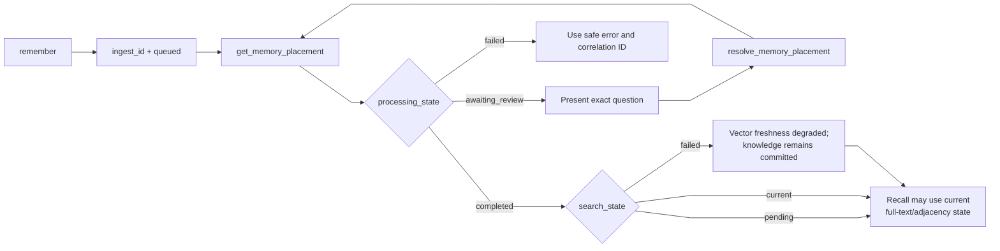

# Quick Start

This is the local PostgreSQL setup and contract-v2 smoke test. Use a pinned
release that advertises contract version 2.

## Local Shape


One local server needs no Redis or public HTTPS. Redis becomes required when
multiple server processes need shared coordination.

## 1. Get A Pinned Release

```bash
mkdir dense-mem-local
cd dense-mem-local

export DENSE_MEM_VERSION="vX.Y.Z"

curl -fsSLo docker-compose.yml \
  "https://raw.githubusercontent.com/markhuangai/dense-mem/$DENSE_MEM_VERSION/examples/docker-compose.base.yml"
curl -fsSLo .env.example \
  "https://raw.githubusercontent.com/markhuangai/dense-mem/$DENSE_MEM_VERSION/examples/.env.example"

cp .env.example .env
```

Verify the release tag, artifact checksum/signature, and release notes. Stop if
the release does not advertise contract v2 and PostgreSQL authority.

### Upgrading an existing installation

An installation upgrading from a version earlier than `2.1.1` must first
deploy `2.1.1` and complete its guided migration. After that succeeds, upgrade
to the current release.

This prerequisite does not apply to a fresh installation starting on `2.2.0`
or later, or to an installation whose `2.1.1` migration already completed.

```text
source before 2.1.1 -> run 2.1.1 migration -> current release
fresh install 2.2.0+ -----------------------> current release
```

## 2. Configure Required Values

```bash
vi .env
```

Complete [Required Startup Settings](Configuration#required-startup-settings):

- non-template PostgreSQL credentials
- embedding provider, model, dimensions, document/normalization contract
- pgvector distance and compatible exact/ANN search-index strategy
- structure-reviewer and strict-verifier model contract
- control authentication/encryption secrets
- Redis only when the chosen topology requires it

Keep `.env` private. An embedding-contract change after data exists requires a
vector rebuild. A search-index construction change requires reindexing but no
provider calls. See [ANN, HNSW, And Halfvec](ANN-HNSW-And-Halfvec).

## 3. Start And Wait For Readiness

```bash
docker compose up -d
docker compose ps

curl -fsS http://127.0.0.1:8080/health
curl -fsS http://127.0.0.1:8080/ready
```

Continue only when readiness confirms PostgreSQL migrations, `pgvector`,
embedding/verifier contracts, and required coordination.

Local surfaces:

```text
MCP:            http://127.0.0.1:8080/mcp
User portal:    http://127.0.0.1:8080/ui
Control portal: http://127.0.0.1:8090/
```

## 4. Create A Team And Key

Use the exact release's CLI and verify `--help`:

```bash
docker compose exec server /app/provision-team \
  --name "primary-memory"
```

The image may also expose `/app/provision-profile` as a compatibility name.
Store the one-time raw key in a secret manager:

```bash
export DENSE_MEM_API_KEY="dm_..."
```

## 5. Connect And Discover

Follow [MCP Clients](MCP-Clients) and connect the LLM host. The host initializes
the server and calls `tools/list`; verify:

- contract version 2
- `remember` accepts evidence plus optional hints
- `get_memory_placement` returns processing and search state
- `recall_memory` returns ranked evidence contexts, required `conflicts[]`, and compact Relationship discovery paths
- `trace_memory` accepts `relationship_id`
- the tool list matches key scopes

When the model selects one of these tools, the host sends `tools/call` with its
name and schema-valid arguments. See
[MCP Memory Interface](Request-Lifecycle-And-Security#mcp-memory-interface).

Do not interpret older lifecycle or projection fields using this manual.

## 6. Remember Evidence

Ask the client:

```text
Remember that I prefer concise explanations with concrete examples.
```



Valid outcomes:

- active `validated_claim` or `fact`
- `candidate/pending_evidence` retained but excluded from active/default recall
- owner-scoped review for identity, predicate, same-owner conflict, scope, or time
- an open team Conflict case for a material cross-profile disagreement; placement
  may still complete while that case awaits nightly review
- explicit rejected/quarantined/failed outcome

The authoritative categories are in
[Technical Reference](Technical-Reference#placement-contract).

## 7. Recall And Trace

Ask:

```text
What do you remember about my explanation preferences?
```

Default recall returns ranked evidence contexts plus compact Relationship
discovery paths. Then ask:

```text
Trace that preference Relationship and show its supporting evidence.
```

The client passes the returned `relationship_id` to `trace_memory`.

## 8. Test Identity Reuse

Remember:

```text
Dense-Mem is also called DM.
DM uses PostgreSQL.
```

Expected:

- one Dense-Mem Entity
- `DM` as supported name metadata, not a node/edge
- one `uses` Relationship to the PostgreSQL Entity

Do not use an ambiguous first name for this initial smoke.

## 9. Test Forget

Use the traced caller-owned `relationship_id` and ask to forget that one
Relationship. To correct another profile, remember new evidence under the
caller, include the recall-supplied Conflict ID/version on the relevant proposal
when present, and let Dense-Mem create the cross-reference/case update. Nightly
Conflict review owns any automatic cross-profile stale-state closure.

Expected:

- an append-only retraction decision
- no SemanticEdge/default recall result after commit
- Entity/Value nodes and evidence/verification/history still available to
  authorized trace

## 10. Verify Boundaries

The smoke passes when:

- PostgreSQL contains durable ingest, identity, Relationship, and history state
- eligible SemanticEdges are readable without another graph database
- Redis is absent and one-process coordination is intentional
- restart preserves memory
- normal recall excludes candidates/evidence/history/Hypotheses
- trace returns exact provenance
- portal graph shows only Entity/Value nodes and eligible SemanticEdges
- pending/failed vector work does not change semantic truth

## Stop And Restart

```bash
docker compose down
docker compose up -d
```

Named volumes preserve PostgreSQL. Do not use `docker compose down -v` unless
data destruction is explicitly intended, backed up, and approved.

## Risk

| Failure mode | Mitigation |
| --- | --- |
| moving `main` uses a different schema/runtime | pin a release and verify discovery/version |
| example secrets reach production | replace every template value and keep files private |
| destructive Compose flag deletes memory | omit `-v`; back up and confirm before destructive cleanup |
| vector pending is mistaken for failed remember | poll both processing and search state; trace source state |

## Next

- [Using Dense-Mem](Using-Dense-Mem)
- [Configuration](Configuration)
- [Operations Runbook](Operations-Runbook)
- [Vector Search And Ranking](Vector-Search-And-Ranking)
- [Public HTTPS And Redis](Public-HTTPS-And-Redis)
