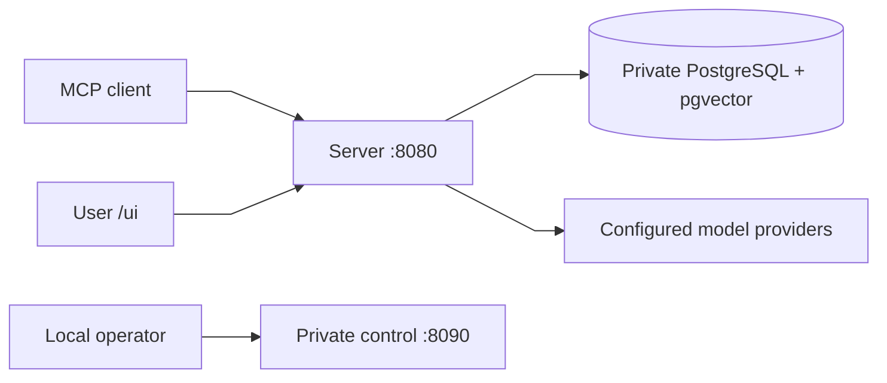

# Quick Start

Set up a fresh local server, connect a client, and verify one Evidence workflow. Choose a published image whose discovered contract matches this wiki. An older deployed image can differ from current source.

## Local Shape



Redis is optional for this one-process setup. [Public HTTPS And Redis](Public-HTTPS-And-Redis) covers public access and replicas.

## 1. Pin Deployment Inputs

This fresh-install example selects the published stable release `v2.8.0`:

```bash
mkdir dense-mem-local
cd dense-mem-local
export DENSE_MEM_VERSION=v2.8.0
export DENSE_MEM_IMAGE="ghcr.io/markhuangai/dense-mem:${DENSE_MEM_VERSION}"
curl -fsSLo docker-compose.yml \
  "https://raw.githubusercontent.com/markhuangai/dense-mem/${DENSE_MEM_VERSION}/examples/docker-compose.base.yml"
curl -fsSLo .env.example \
  "https://raw.githubusercontent.com/markhuangai/dense-mem/${DENSE_MEM_VERSION}/examples/.env.example"
cp .env.example .env
```

Retain the image pin for later starts. The [deployment examples guide](https://github.com/markhuangai/dense-mem/blob/main/examples/README.md) identifies the Compose variants and overlays. When testing source before its release, build the matching repository image rather than assuming a published tag contains it.

## 2. Configure And Start

Set the private `.env` values for `POSTGRES_PASSWORD`, `CONTROL_PORTAL_TOKEN`, `AI_API_KEY`, and `AI_VERIFIER_MODEL`. The example supplies embedding endpoint/model/dimensions; change applicable values together for another provider. [Configuration](Configuration) owns defaults and bounds.

```bash
docker compose up -d
docker compose ps
curl -fsS http://127.0.0.1:8080/health
curl -fsS http://127.0.0.1:8080/ready
```

Startup applies pending migrations and verifies required dependencies before readiness. Existing databases need the backup/compatibility checks in [Operations Runbook](Operations-Runbook#destructive-migration-boundary).

## 3. Create A Credential And Connect

Open `http://127.0.0.1:8090/` privately with the control token. Create a team and credential, saving the one-time raw key. For a shared smoke test, grant read/write.

Open `http://127.0.0.1:8080/ui`, sign in, and copy the team-scoped MCP URL from **Connect**. Configure the host using [MCP Clients](MCP-Clients), or use [Framework Integrations](Framework-Integrations) for Python/ADK/LangChain.

## 4. Discover And Test Memory

Confirm authenticated `tools/list` exposes Evidence-only inputs. Then ask:

```text
Remember the exact note “This project uses PostgreSQL” in team-shared memory.
Retain the complete request and operation key for recovery.
```

Inspect the terminal Evidence outcome. Ask which database the project uses, then trace a returned Evidence ID. Relevant accepted Evidence can be recalled directly; no graph proposal is required. Read degradations and trace omissions before claiming a complete result.

To withdraw the smoke source, retract its owned Evidence ID with a reason and a fresh retained key. This retains provenance. See [Using Dense-Mem](Using-Dense-Mem).

## Stop And Restart

```bash
docker compose stop
docker compose start
```

These preserve the named PostgreSQL volume. Verify readiness after restart. Backup and restore procedures belong to [Operations Runbook](Operations-Runbook#backup).
