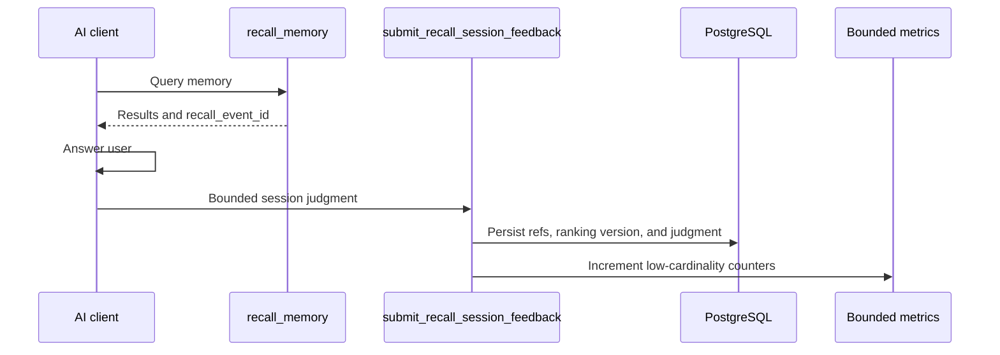
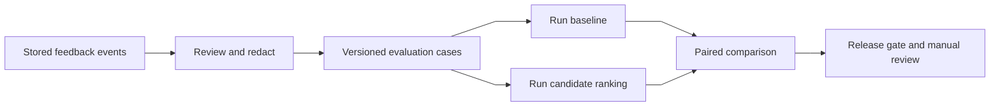

# Recall Feedback

Recall feedback records bounded host judgments about a completed recall. It is
observational: it does not mutate Relationships, evidence, Entity identity,
Hypotheses, embeddings, indexes, or ranking weights.

Retrieval eligibility and response behavior live in
[Recall Ranking](Recall-Ranking). Distance, fusion, RRF, deterministic reranking,
and ranking-contract versioning live in
[Vector Search And Ranking](Vector-Search-And-Ranking). Metrics presentation
lives in [Telemetry](Telemetry).

## Flow



Feedback is submitted after the host has enough context to judge whether recall
helped the answer.

## Record-Only Boundary

Submitting feedback does not:

- create, promote, retract, or correct a Relationship
- grant, revoke, or reinstate evidence support
- merge or split an Entity
- reinforce/reject a Hypothesis
- update a search document or embedding
- modify a ranking contract
- train a model

A quality problem changes behavior only after it becomes an evaluated case, an
explicit code/config change is made, and release gates pass.

## Submission

```json
{
  "recalls": [
    {
      "recall_event_id": "rec_01J...",
      "used": true,
      "answer_supported": false,
      "quality": "low",
      "missing_context": true,
      "irrelevant": true,
      "feedback_comment": "Returned stale UI Relationships instead of the button behavior.",
      "irrelevant_result_refs": [
        {
          "type": "relationship",
          "id": "r_stale_ui",
          "rank": 1
        }
      ],
      "hypothesis_feedback": [
        {
          "hypothesis_id": "hyp_01J...",
          "used": false,
          "quality": "low",
          "contradicted": true,
          "feedback_comment": "The source Relationships were stale."
        }
      ]
    }
  ]
}
```

Allowed result ref types are `relationship`, `fragment`, `community`, and
`hypothesis`. Each ID is revalidated against the original same-team recall
event.

A comment is required for low-quality, missing-context, irrelevant, or
contradicted judgments. Comments are bounded and should describe the retrieval
failure without copying private user content.

Hypothesis quality feedback remains observational. Use `resolve_dream_feedback`
with new evidence for a status-changing dream decision.

## Stored Event

The durable event records:

```text
feedback_event_id
recall_event_id
team_id and profile_id
query fingerprint or approved bounded query text
ranking_profile_version and fusion_mode
embedding_contract_version
search_index_profile_version
search freshness and degraded branches
returned result refs and ranks
semantic groups, authored alternatives, and clarification outcome
used/support/quality flags
missing/irrelevant refs
bounded comments
Hypothesis judgments
actor and timestamps
```

Retention and text-storage policy must be explicit because queries/comments may
contain sensitive information.

## Metrics

Low-cardinality aggregates include:

| Metric meaning | Example measure |
| --- | --- |
| recall used rate | events where the host used at least one result |
| answer supported rate | events where memory supported the final answer |
| average quality | bounded ordinal score |
| missing context rate | events reporting important missing knowledge |
| irrelevant result rate | events reporting one or more bad results |
| search-freshness correlation | quality grouped by bounded pending/failed-vector state |
| tier usefulness | used/irrelevant rate by validated-claim/fact |
| authored-conflict usefulness | quality when recall preferred, retained, or asked about conflicting profile-owned Relationships |
| fusion-contract comparison | paired quality by approved ranking-contract version and fusion mode |

Metric labels must not contain queries, comments, result IDs, Entity names, or
Relationship text. Exact metric names are owned by [Telemetry](Telemetry).

## Offline Use



Feedback is not automatically a gold label. A reviewer must resolve ambiguous
queries, stale source data, host misuse, and privacy before adding a case.

## Feature Gate And Access

The tool is visible only when database-backed configuration enables recall
feedback. Submission needs `write` scope. Detailed event inspection needs
`read` plus `feedback:read` and the appropriate same-team/control role.

Disabling collection stops new events; it does not silently delete retained
events.

## Risks And Mitigations

| Risk | Concrete failure mode | Mitigation |
| --- | --- | --- |
| Feedback changes truth | low score demotes a valid Relationship | record-only service boundary and no knowledge repository dependency |
| Label cardinality explosion | result IDs/comments become Prometheus labels | fixed enums and bounded buckets only |
| Privacy leak | raw user query is retained indefinitely | configurable redaction/retention and restricted detail access |
| Host self-bias | one model judges its own retrieval as ground truth | human review and paired offline cases before ranking changes |
| Cross-team reference | feedback names a result from another recall/team | bind refs to the stored recall event and authenticated team |
| Stale vector misdiagnosed | ranking is blamed for pending/failed embedding work | store search freshness, branch path, and source/vector versions with the event |
| Authored conflict hidden by feedback | a low score on B's result is treated as permission to demote B's knowledge | retain the authored result set and keep feedback observational |

## Acceptance Invariants

1. feedback writes no knowledge, search, or Hypothesis state
2. every result ref belonged to the original recall event
3. Prometheus labels remain low-cardinality
4. detailed text follows retention and authorization policy
5. ranking changes require separate evaluation and release approval
6. feedback never changes another profile's Relationship or conflict position
