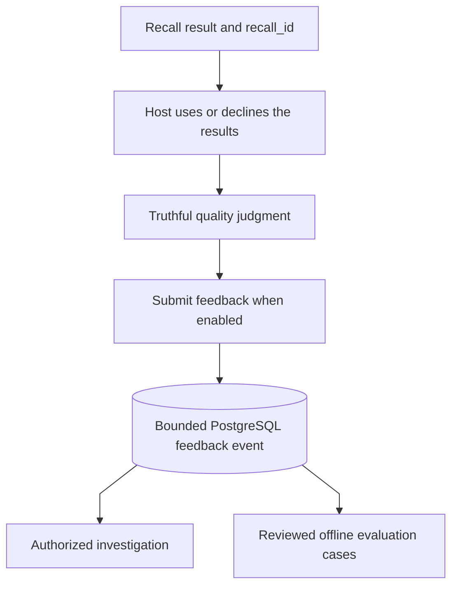
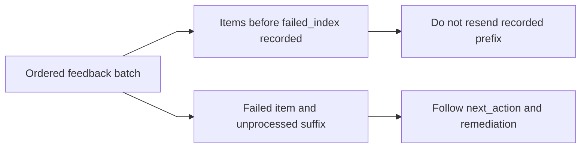

# Recall Feedback

Recall feedback records what happened after a host used memory. It is voluntary and observational: it does not change Evidence, topic membership, conflict decisions, or live ranking.

## Flow

## Submission

Use the returned `recall_id` as `recall_event_id`. Record actual use, answer support, and quality. Optional comments and irrelevant references can identify returned Evidence or Topics; they cannot invent new sources or ask the server to correct memory.

Complete arguments and bounds are in [Technical Reference](Technical-Reference#submit_recall_session_feedback). The tool requires write scope and effective feedback enablement. Ordinary recall does not require submitting feedback.

## Partial Failure

Inspect `recorded_count`, `partial_success`, `failed_index`, and the returned action. For correct-and-resubmit, repair the failed item and include later unprocessed items. For retry-same-request, resend the failed and later unprocessed items unchanged. Do not fabricate feedback to fill a missing receipt.

## Stored Investigation Record

| Material | Meaning |
| --- | --- |
| Recall identity and actor/space context | Authorizes association and protects private-generation boundaries. |
| Query and tool arguments | Bounded investigation data outside metric labels. |
| Result references | Content-free Evidence/Topic IDs and ranks, plus equivalent-source references where captured. |
| Contract/search/ranking identities | Context for reproducibility and degradation. |
| Host judgment | Use, support, quality, missing-context, irrelevant flags, comment, and judged references. |

A captured snapshot and a `feedback_only` event are different states. Authorized operator readers resolve references under current access; erased/sealed private generations cannot be revived through old feedback.

## Offline Use And Retention

Review and redact retained examples before turning them into versioned evaluation cases. Compare baseline and candidate with frozen identities; feedback never automatically trains a model or changes weights.

[Configuration](Configuration#recall-feedback) owns enablement/retention. [Telemetry](Telemetry) owns aggregate metrics and exposure rules. Queries/comments can contain sensitive information and stay within their authorized diagnostic boundary.
