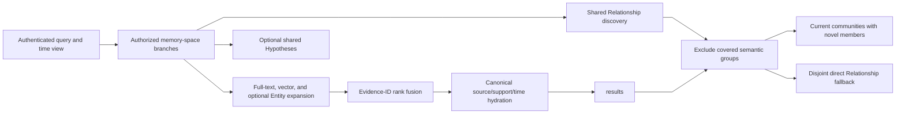

# Recall Ranking

Recall returns authorized evidence contexts in `results`, plus separate
Relationship, community, conflict, and Hypothesis fields. Stored evidence must
pass final active-support and time-view eligibility before entering primary
results.

## Read Shapes

| Operation | Result |
| --- | --- |
| `recall_memory` | Ranked evidence contexts, related frontiers, conflicts, search states, degradations, and suggested actions. |
| `trace_memory` | One authorized Relationship's bounded evidence, support decisions, transitions, and graph/conflict lineage. |

Array order conveys rank. Public results do not expose raw vector distances,
fusion scores, or provider attempts. Exact schemas are in
[Technical Reference](Technical-Reference#recall_memory-and-trace_memory).

## Default Pipeline

A query embedding is reused across allowed-space branches. Candidate queries
retain team and space scope before IDs leave the adapter. Search text never
replaces canonical evidence hydration.

## Eligibility

Evidence needs an eligible active Relationship support path for the requested
view. Hydration checks evidence/source lifecycle, support decisions,
Relationship status, authorization, memory-space generation, and conflict
disposition.

`valid_at` selects real-world time; `known_at` selects system knowledge time.
A later source withdrawal or conflict resolution must not rewrite what an
authorized earlier knowledge view reports.

Safe evidence stored without a Relationship can have a current search document
while remaining absent from default recall. Candidates and Hypotheses do not
satisfy the support requirement.

## Evidence Frontier

The evidence adapter combines full-text and vector ranks with weight 1 each,
and explicit Entity expansion with weight 0.5, using RRF constant 60. Known
evidence IDs are excluded. Stable equal-score order uses evidence ID.

A bounded overfetch supplies candidates for canonical hydration. Ineligible
hits are discarded; errors loading authoritative state fail visibly rather
than becoming an empty result.

## Relationship Discovery

Shared Relationship discovery retrieves active supported candidates from
lexical and eligible vector branches with equal-weight RRF. Equivalent authored
Relationships collapse by semantic group without merging ownership. Returned
handles retain representative and equivalent IDs.

Current and known evidence plus known Relationship IDs establish covered
semantic groups. Later related frontiers suppress those groups to avoid
repeating the same supported meaning.

`expand_from_entity_ids` requests bounded direct expansion, not unbounded
multi-hop traversal. Source authority and supporter count are provenance and
conflict-policy inputs, not an arbitrary popularity boost to query ranking.

## Community Frontier

Community selection uses the current authorized snapshot and uncovered semantic
groups. Returned communities contain novel Relationship members. Emitted
community groups are removed from the direct fallback; singletons or members
omitted by community limits can remain eligible for that fallback.

Community output has an independent budget and does not replace evidence
results. Temporal recall skips communities with an explicit degradation.
Missing, stale, failed, or oversized enabled snapshots also degrade explicitly.

See [Community Memory](Community-And-Dreaming).

## Conflict Disposition

Relationship conflict cases retain authored alternatives and supporter
summaries. Resolved preference affects eligible current support paths;
temporal views reconstruct the applicable earlier case state.

Evidence conflicts are separate `kind: evidence_conflict` entries with exact
occurrence citations. Only conflicts reachable from authorized evidence are
projected. Case preference does not turn a quote into independently submitted
evidence. See [Conflicts And Corrections](Conflicts-And-Corrections).

## Independent Space Branches And Fusion

Each authenticated principal can read shared memory and its own membership-private
branch. Evidence search and hydration run independently in each space. The
service fuses authorized results with equal-weight RRF constant 60; stable ties
prefer private, then shared, then immutable ID.

The current related Relationship/community/Hypothesis expansion is restricted
to the shared branch. Do not infer a full private graph frontier from the fact
that private evidence is searchable.

Results expose `space_kind`, not an internal space UUID. Neither Entity
resolution nor graph expansion joins the shared and private branches.

## Failure, Degradation, And Freshness

Required repository or hydration failures remain errors. Optional vector or
derived-frontier loss is reported in `degradations` with bounded code,
frontier, and message. Inspect these fields before describing a result as a
complete search.

Relationship vector readiness is gated by its projection generation. Pending
or failed vectors can leave valid lexical discovery available with explicit
state and degradation. Successful Remember writes have already completed their
required embeddings; this is not a post-response Remember queue.

Recall-feedback snapshot failure preserves usable recall but omits its feedback
suggestion and reports `recall_feedback_snapshot_unavailable`.

## Trace And Suggested Actions

Use `trace_memory` for support, decisions, and lifecycle details of a returned
Relationship. Respect its bounds and `stopped_reason`. A partial lineage view
cannot establish a complete correction support set.

When feedback is enabled and its snapshot persists, `suggested_actions`
provides the recall event ID for `submit_recall_session_feedback`. Effective
Dreaming can suggest `resolve_dream_feedback` for returned Hypotheses.
Feedback records use; it does not change ranking or lifecycle.

## Risks And Verification

Test stale search hits, revoked support, known-equivalent suppression,
community/direct disjointness, temporal conflict views, private/shared
fusion, and required/optional failures. Include different owners and another
team in real PostgreSQL cases.

All returned text remains untrusted. The host's action and disclosure policy
must not be replaced by instructions embedded in recalled evidence.
