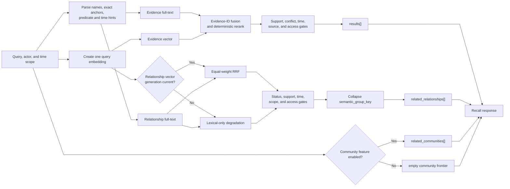
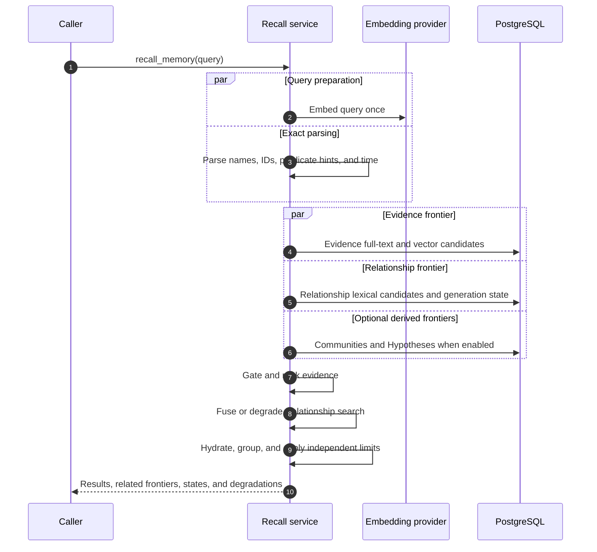
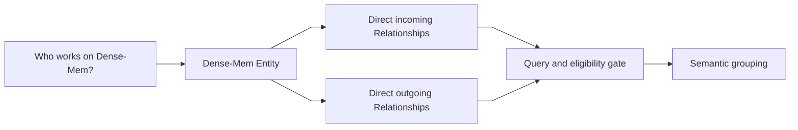
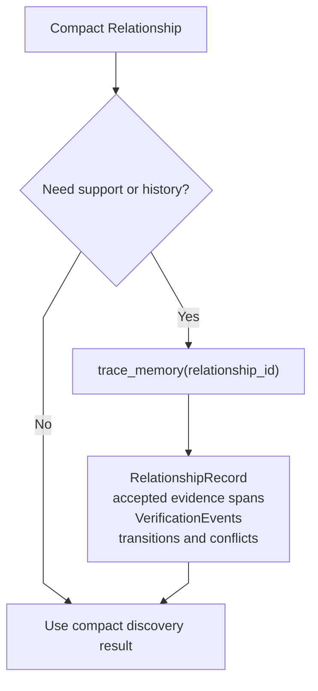

# Recall Ranking

Dense-Mem returns bounded evidence contexts as the primary recall result.
Relationships are a separate correlation and discovery frontier. Communities
and Hypotheses are separate derived frontiers and never replace evidence or
Relationships.

This page owns recall eligibility, frontier flow, grouping, and degradation.
Cosine distance and RRF are defined in
[Vector Search And Ranking](Vector-Search-And-Ranking). Exact public fields and
limits are defined in [Technical Reference](Technical-Reference#recall_memory).
Relationship lifecycle eligibility is defined in
[Relationship Model And Lifecycle](Relationship-Model-And-Lifecycle#status-and-effective-support).

## Read Shapes

| Operation | Primary result | Additional frontiers |
| --- | --- | --- |
| `recall_memory(query)` | ranked evidence `results[]` | `related_relationships[]`, `related_communities[]`, `conflicts[]`, and `related_hypotheses[]` |
| `trace_memory(relationship_id)` | one Relationship with evidence and history | bounded graph, conflict, correction, and supersession context |

The public API has no client-selected ranking mode. Array order is rank. Public
responses omit raw scores, embedding details, provider attempts, support counts,
and lifecycle history.

## Default Pipeline



Evidence, Relationship, and Community limits are independent. An empty or
disabled frontier never donates capacity to another frontier.

## PostgreSQL Read Sequence



PostgreSQL row-level security and explicit team predicates apply to every
source, search-document, adjacency, community, and trace read. Hydrated source
rows are authorized again before return.

## Eligibility

An evidence fragment enters `results[]` only when:

```text
team_id = authenticated team
owner_profile_id belongs to an active profile in that team
at least one query-relevant Relationship support path is active
the requested valid_at and known_at view includes that path
the source revision, when stable, is current
evidence is not quarantined, superseded, retracted, or erased
request filters and exact anchors match
```

A Relationship enters `related_relationships[]` only when:

```text
team_id = authenticated team
owner_profile_id belongs to an active profile in that team
status = active
effective_support_count > 0
validity and recorded-time filters match
predicate, endpoint, polarity, and scope filters match
the applicable Conflict disposition does not suppress the path
```

`pending_evidence`, `needs_review`, `quarantined`, `superseded`, `disputed`,
`retracted`, and `rejected` Relationships are excluded. Search documents
provide candidate IDs only; authoritative Relationship rows decide eligibility.

## Evidence Frontier

Evidence remains the only answer-context frontier. Full-text and vector
branches return Evidence IDs, fuse under the configured Evidence ranking
contract, apply exact-anchor and temporal intent, then hydrate only the selected
bounded contexts.

Search freshness never decides whether committed evidence is valid. Full-text
may use a valid current document while its vector is pending. The vector branch
requires a vector whose source, document, and embedding-contract versions match.
Evidence documents and vectors are independent from Relationship projection
generations.

## Relationship Discovery

Relationship discovery measures query correlation, not truth, maturity,
authority, corroboration, or popularity.

### Semantic search document

Every searchable Relationship uses projection format `2`:

```text
relationship
subject: Mark Huang
predicate: works on
object: Dense-Mem
polarity: positive
scope: dense-mem project
valid_from: 2026-07-01T00:00:00Z
```

The renderer uses canonical Entity names, registered predicate wording and
aliases, canonical typed Value display/unit, polarity, supported scope, and
validity. It omits absent optional lines. IDs, owner/profile identity,
`semantic_group_key`, support counts, authority, status, and evidence text are
not embedded. Those fields remain source metadata or hydration gates.

### Lexical and vector fusion

- Full-text and vector branches retrieve only `source_kind=relationship`.
- Each branch contributes ordinal rank, not a normalized provider score.
- Equal-weight RRF fuses the two lists.
- Deterministic tie-break order is RRF score, best individual branch rank,
  earliest Relationship creation time, then Relationship UUID.
- No support count, source count, profile count, authority, conflict count, or
  community membership changes the score.
- Array order is the only public rank representation.

When the team's Relationship projection generation is not `current`, the
complete vector branch is disabled. Lexical-only ranking prevents already
rebuilt documents from receiving an extra RRF contribution while other
Relationships remain pending.

### Direct Entity expansion

`expand_from_entity_ids` restricts the frontier to eligible Relationships that
directly touch one supplied Entity. It does not recursively traverse another
Relationship.



Configured seed, per-Entity fan-out, total-edge, time, and byte bounds still
apply. A future multi-hop feature requires a separate contract.

### Semantic grouping

Equivalent cross-profile Relationships remain separate durable records but
consume one response slot:

1. filter and rank eligible authored Relationships;
2. group by the existing team-wide `semantic_group_key`;
3. choose the earliest-created eligible Relationship, then lowest UUID, as the
   representative;
4. sort remaining eligible IDs by UUID into
   `equivalent_relationship_ids`;
5. union authorized supporting Evidence IDs;
6. apply `relationship_limit` after grouping.

`known_relationship_ids` suppresses the complete semantic group when it
contains the representative or any equivalent ID. Grouping never merges
ownership, support, lifecycle, conflict history, or trace.

## Conflict Disposition

Evidence selection and Relationship discovery apply the Conflict case visible
at the requested `valid_at` and `known_at`:

| Case view | Behavior |
| --- | --- |
| no material case | normal eligibility and ranking |
| `open` or `overdue` | keep bounded material alternatives and return the actionable case |
| resolved current interval | exclude suppressed current paths; keep the preferred eligible path |
| historical view | reconstruct the position and case-event state visible then |
| dismissed | apply ordinary lifecycle eligibility; retain the case in trace |

Disposition filters a support path, not the Evidence fragment. Evidence that
has another unrelated eligible support path remains eligible. Truncation never
implies a preferred position. The exact resolution policy belongs in
[Conflicts And Corrections](Conflicts-And-Corrections#deterministic-resolution-policy).

## Community Frontier

Communities are optional derived clusters of eligible Relationships. The
feature remains disabled by default.

When enabled:

- community results use `community_limit`, independent from Evidence and
  Relationship limits;
- the frontier returns only current community snapshots built from active,
  effectively supported Relationships;
- communities do not replace direct results, add Relationship score, become
  evidence, or enter the semantic graph;
- `community_limit=0` disables the frontier for that request.

The canonical record and detection contract belongs in
[Community And Dreaming](Community-And-Dreaming).

## Recall Response

```json
{
  "recall_id": "rec_01J...",
  "results": [
    {
      "evidence_id": "e1",
      "context": "Mark works on Dense-Mem."
    }
  ],
  "conflicts": [],
  "related_relationships": [
    {
      "relationship_id": "r1",
      "equivalent_relationship_ids": ["r2"],
      "subject": {"entity_id": "mark-1", "name": "Mark Huang"},
      "predicate": "works_on",
      "object": {"entity_id": "dense-mem", "name": "Dense-Mem"},
      "polarity": "+",
      "evidence_ids": ["e1"]
    }
  ],
  "related_communities": [
    {
      "community_id": "community-1",
      "summary": "Dense-Mem project work and storage choices.",
      "top_entities": [
        {"entity_id": "dense-mem", "name": "Dense-Mem"}
      ],
      "top_predicates": ["works_on", "uses"],
      "member_count": 4,
      "source_count": 3
    }
  ],
  "related_hypotheses": [],
  "search_states": {
    "evidence": "current",
    "relationships": "pending"
  },
  "degradations": [
    {
      "frontier": "relationships",
      "code": "relationship_vector_warming",
      "optional": true,
      "message": "Relationship vector projection is warming; lexical discovery was used."
    }
  ]
}
```

`relationship_id` is the representative trace handle.
`equivalent_relationship_ids` excludes the representative. Detailed evidence,
verification, ownership, comparisons, and history require `trace_memory`.

## Trace Mode



Trace reads authoritative PostgreSQL history, never Redis or search-document
text. Use it for sources, corrections, forget, identity uncertainty, Conflict
inspection, or high-stakes decisions.

## Related Hypotheses

Hypotheses are returned only in `related_hypotheses[]`. They never enter
Evidence or Relationship ranking, count as support, or become graph edges.
See [Dreaming](Dreaming).

## Failure, Degradation, And Freshness

Required failures fail the request. Optional-frontier failures are explicit:

| Condition | Required behavior |
| --- | --- |
| authentication or team context invalid | reject |
| required Evidence branch fails | return the branch error |
| Relationship text projection not converged before startup | remain unready; do not serve incomplete lexical discovery |
| Relationship generation `embedding` | lexical-only Relationship discovery; state `pending`; emit `relationship_vector_warming` |
| Relationship generation `failed` | lexical-only Relationship discovery; state `failed`; emit `relationship_vector_failed` |
| Relationship generation `current` | enable equal-weight lexical/vector RRF |
| optional Community or Hypothesis lookup fails | return other frontiers and append a bounded degradation |
| authoritative source hydration fails | fail; never reconstruct knowledge from search text |
| trace read fails | fail trace; never synthesize history |

`search_states.relationships` describes the team-wide release projection gate,
not ordinary truth. After generation activation, a newly written individual
Relationship may be lexically available while its normal vector job is pending
without reopening the release generation.

## Recall Feedback And Evaluation

Feedback records query, result IDs, ranks, ranking version, judgment, and actor.
It does not mutate weights or Relationship state directly. See
[Recall Feedback](Recall-Feedback).

Ranking changes require matched baseline/candidate data, stable seeds and
providers, Evidence Recall@K/MRR/nDCG, Relationship Recall@5 and grouping
precision, separate Community exposure, cross-team leakage checks, temporal and
exact-anchor slices, warm-up/failure cases, and latency percentiles. Release
policy belongs in [Evaluation](Evaluation).

## Risks And Mitigations

| Risk | Concrete failure mode | Mitigation |
| --- | --- | --- |
| Pending-state contamination | an insufficient observation appears as a normal edge | hydrate authoritative rows and require active status plus effective support |
| Correlation becomes truth scoring | source or profile count pushes a weak query match upward | equal-weight lexical/vector RRF only; provenance stays trace metadata |
| Partial vector bias | early rebuilt rows receive two branch contributions while others receive one | gate the complete team vector branch until atomic generation activation |
| Equivalent authors flood results | three matching authored records consume three slots | collapse by `semantic_group_key` before top-K and preserve equivalent IDs |
| Known equivalent repeats | caller excludes one ID but another author copy reappears | suppress the complete semantic group |
| Search seed leaks stale state | old search text returns after support is revoked | source hydration rechecks status, effective support, time, and conflict disposition |
| Filtered ANN misses | vector search returns an incomplete authorized set | apply the exact/ANN oracle contract in [ANN, HNSW, And Halfvec](ANN-HNSW-And-Halfvec) |
| Community crowds direct discovery | a summary consumes Relationship capacity | independent fields and limits; no leftover-slot filling |
| Unbounded traversal | a hub Entity expands millions of edges | direct one-edge expansion plus indexed fan-out and total bounds |
| Vector failure hides valid knowledge | terminal embedding state removes a valid lexical document | keep valid format-2 text lexically eligible and emit an explicit degradation |

## Recall Acceptance Invariants

1. `results[]` contains only eligible Evidence contexts.
2. Relationship discovery cannot change Evidence rank or budget.
3. Related Relationships require active status and effective support.
4. Relationship scoring uses equal-weight lexical/vector RRF and no lifecycle,
   provenance, authority, or popularity boost.
5. Equivalent authored Relationships consume one slot and remain traceable.
6. Known Relationship IDs suppress their complete semantic group.
7. `expand_from_entity_ids` performs direct one-edge expansion only.
8. Partial migration never enables partial vector fusion.
9. Pending or failed Relationship vectors retain lexical discovery and expose
   public state/degradation.
10. Evidence documents and vectors are independent from Relationship projection
    generations.
11. Communities and Hypotheses remain separate optional frontiers.
12. Required branch failures and optional degradation are explicit.
13. Search hits and graph context never become evidence.
14. Historical `valid_at` and `known_at` reconstruct applicable lifecycle and
    Conflict state.
15. Every returned representative and equivalent ID remains authorized and
    traceable.
