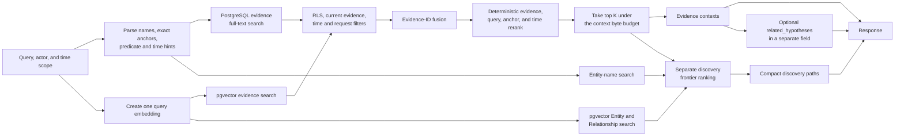
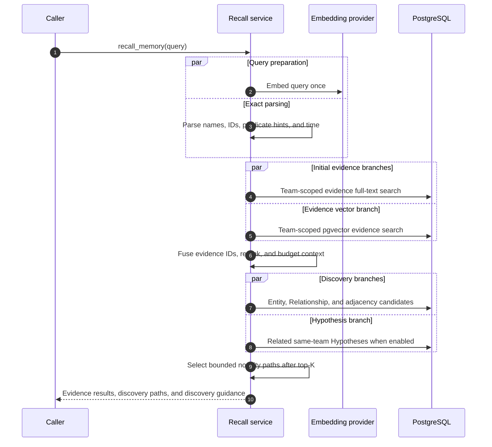
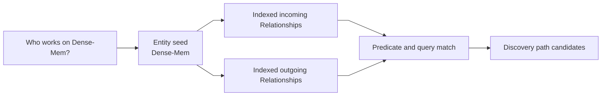
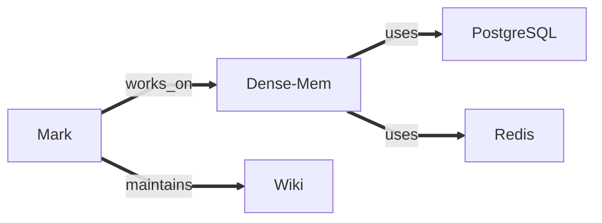
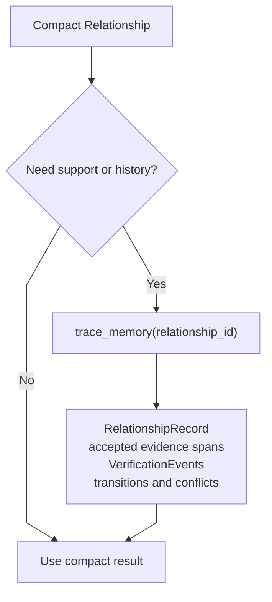
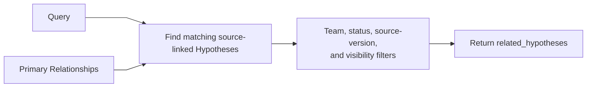

# Recall Ranking

Dense-Mem returns bounded evidence contexts as the primary recall result.
Relationships remain the durable semantic graph and trace handle, but public
recall exposes them as compact discovery paths instead of answer-sized result
items. Verifier decisions and lifecycle history are loaded through trace reads.
Hypotheses remain a separate result type.

This page is the single source of truth for the target recall path, eligibility,
read shapes, and degradation contract. Cosine distance, vector query behavior,
RRF, and post-fusion reranking are defined only in
[Vector Search And Ranking](Vector-Search-And-Ranking). Public fields are in
[Technical Reference](Technical-Reference#recall_memory). Relationship
eligibility is owned by
[Relationship Model And Lifecycle](Relationship-Model-And-Lifecycle).

## Read Shapes

| Operation | Primary result | Use |
| --- | --- | --- |
| `recall_memory(query)` | ranked evidence contexts plus compact Relationship discovery paths | normal answering and graph discovery |
| `trace_memory(relationship_id)` | one Relationship with evidence and history | explanation, conflict, correction, and high-stakes inspection |

Public recall has no client-selected mode. Evidence text appears only in the
top-level ranked `results[]` array. Relationship paths explain discovery and
follow-up options; they are not the direct top-K scoring unit.

## Default Pipeline



Initial recall ranks only directly searchable evidence. Relationship, Entity,
and adjacency candidates form a separate discovery frontier after the evidence
budget is chosen. Equivalent Relationships remain independently authored and
traceable; public recall ranks evidence contexts that the client can read and
uses Relationships as compact follow-up handles.

## PostgreSQL Read Sequence



PostgreSQL row-level security and explicit team predicates apply to source,
search-document, and adjacency queries. The service authorizes hydrated rows
again before returning them.

## Eligibility

An evidence fragment enters default recall only when:

```text
team_id = authenticated team
owner_profile_id = any active profile in that team
evidence is current for the requested valid_at and known_at
its stable source revision, when present, is current
evidence is not quarantined, supersession-pending, superseded, retracted, or erased
request filters and exact anchors match this evidence
```

Search freshness never decides whether committed evidence is true. Full-text
and exact branches may use current committed evidence while vector rows are
still pending. The vector branch requires a current vector whose source,
document, and embedding-contract versions match.

A Relationship enters discovery paths or trace-near context only when:

```text
team_id = authenticated team
owner_profile_id = any active profile in that team
status = active
tier IN (validated_claim, fact)
validity and recorded-time filters match the request
predicate, endpoint, and scope filters match
```

`candidate` Relationships are never eligible, even when their
`status=pending_evidence` record is retained for dreaming or review.
`retracted`, `superseded`, `rejected`, `quarantined`, `disputed`, and
review-held records are also excluded.

Canonical tier and status meanings belong only in
[Relationship Model And Lifecycle](Relationship-Model-And-Lifecycle#tier-and-status).

## Retrieval Branches

### Evidence full-text/vector

One compact search document represents each searchable evidence source:

```text
evidence: exact source text, stable source/revision handles, source group, and provenance
```

Evidence search documents contain source text and provenance fields needed for
authorized retrieval. They do not contain verifier rationale, Relationship
tiers, or graph-derived summaries.

### Relationship and Entity discovery

Separate compact search documents may represent eligible Relationships and
Entities for discovery. Relationship documents contain endpoint display names,
predicate, object/value display, polarity, temporal bounds, owner, semantic
group, and `relationship_id`. Entity documents contain canonical name, aliases,
kind, and `entity_id`.

Relationship documents do not concatenate evidence content or verifier
rationales. Entity and Relationship discovery cannot move evidence up or down
inside initial top-K.

Search documents are derived PostgreSQL rows. Their source evidence,
Relationship, or Entity remains authoritative. Vector eligibility additionally
requires a vector whose source, document, and embedding-contract versions
match.

### Entity seeds and adjacency

Entity search finds possible endpoints. PostgreSQL then expands only eligible
Relationships touching those Entity IDs.



Expansion enforces configured seed, per-Entity fan-out, total-edge, depth,
time, and byte budgets. It returns supporting evidence IDs plus compact
relationship paths, and never runs an unbounded recursive traversal.

### Exact anchors

Server IDs, issue keys, versions, paths, scopes, hashes, and other hard
identifiers use tested deterministic grammars. If the query contains a hard
anchor, one candidate must itself satisfy every required anchor. Separate
results cannot combine partial matches.

An anchor parser must not use a broad “hex-looking word” rule that classifies
ordinary language as an identifier.

## Filtered `pgvector` Retrieval

The initial vector branch searches only evidence search documents under the
same team/time/contract scope. Discovery may separately search Relationship and
Entity documents to choose follow-up paths. Exact/HNSW selection, cosine
calculation, operators, iterative scans, half precision, exact reranking, and
topology are defined only in
[ANN, HNSW, And Halfvec](ANN-HNSW-And-Halfvec). Embedding and distance meaning
remains in
[Vector Search And Ranking](Vector-Search-And-Ranking#cosine-similarity-and-distance).

## Fusion And Ranking

The active database-backed ranking profile selects RRF or explicit
branch-priority fusion, then bounded deterministic reranking. The initial
fusion unit is `(branch, evidence_id)`.

Final selection applies required hard-anchor matching, query-derived phrase and
exact signals, bounded support/source-group signals, and temporal intent.
Hydration is not a second retrieval; it is a bounded `WHERE evidence_id IN (...)`
read for already-selected evidence. Discovery paths are selected separately
from bounded Relationship candidates after direct evidence ranking, exclude
already-returned or caller-supplied known IDs where possible, may point at
relevant evidence outside `results[]`, and remain follow-up hints rather than
direct answer context.

The formula, controls, worked examples, conflict treatment, tie-breaking, and
optional future model-reranker boundary are defined only in
[Vector Search And Ranking](Vector-Search-And-Ranking#reciprocal-rank-fusion).
Score components, ranking/index profile versions, embedding-contract details,
and branch health remain internal telemetry. The public result contains only
context and stable trace/discovery handles.

## Evidence Result And Discovery Path

```json
{
  "results": [
    {
      "evidence_id": "e1",
      "context": "Mark works on Dense-Mem."
    }
  ],
  "discovery_paths": [
    {
      "relationships": [
        {
          "relationship_id": "r1",
          "subject": {"entity_id": "mark-1", "name": "Mark"},
          "predicate": "works_on",
          "object": {"entity_id": "dense-mem", "name": "Dense-Mem"},
          "polarity": "+"
        }
      ],
      "evidence_ids": ["e1"]
    }
  ]
}
```

The result excludes scores, tiers, embedding details, verifier rationale,
failed provider attempts, and lifecycle transitions. `relationship_id` remains
the trace handle inside discovery paths; detailed comparisons require trace.
Direct ranking metrics score only `results[]`, not `discovery_paths[]`.

## Discovery Paths

A response may include bounded `discovery_paths` near the returned evidence or
requested expansion entities. They are selected for relevance and novelty after
the direct result budget is set, not as extra ranked answer rows.



Each path contains at most two compact Relationship edges plus supporting
evidence IDs. A path may identify relevant evidence not returned in
`results[]`, but it must not include unseen evidence text. It is a discovery
hint, not evidence or automatic recursive expansion.

The response tells the client to issue another focused `recall_memory` call
when a specific part remains uncertain. The client may pass up to 200 UUIDs in
`known_evidence_ids` and up to 200 UUIDs in `known_relationship_ids` so
already-seen context does not occupy the next bounded result set. The client may
also pass specific `expand_from_entity_ids` to ask for adjacent context. These
fields are request-local and do not mutate memory.

## Trace Mode



Trace is appropriate when the user asks why, requests sources, corrects or
forgets knowledge, encounters conflict/identity uncertainty, or handles a
high-stakes decision. Trace reads authoritative PostgreSQL history, not Redis
or search documents.

## Related Hypotheses

Optional Hypothesis retrieval runs after primary ranking.



Hypotheses never enter the Relationship list, receive a tier weight, or count as
evidence. See [Dreaming](Dreaming).

## Community Expansion

A community is an optional derived cluster of eligible Relationships for
discovery. It is unrelated to predicate behavior and does not replace the
removed `policy_family` field.

When explicitly enabled, community summaries may fill unused result slots only
after direct ranking. They cannot replace a direct Relationship, become
evidence, change tier, or become semantic nodes. The canonical boundary is in
[Community And Dreaming](Community-And-Dreaming).

## Failure, Degradation, And Freshness

Ranking profiles declare which branches are required. An outage cannot silently
change the profile.

| Condition | Required behavior |
| --- | --- |
| authentication or team context invalid | reject |
| required query embedding unavailable | return a dependency error |
| optional vector branch unavailable | omit it and record the degraded branch in internal telemetry |
| required full-text or Entity branch fails | return the branch error |
| optional community or Hypothesis lookup fails | omit it and record degradation internally |
| source Relationship read fails | fail; never reconstruct truth from a search document |
| a document has `search_state=pending` | exact/full-text/adjacency may use current source state; vector branch uses only version-matched vectors |
| trace read fails | fail trace; do not synthesize history |

Internal telemetry:

```text
ranking_profile_version
search_index_profile_version
degraded_branches[]
query_embedding_contract_version
search_freshness:
  pending_document_count
  failed_document_count
  oldest_pending_age_seconds
```

This reports derived search freshness to operators, not to the public recall
client, and is not graph projection lag. Eligible SemanticEdges are read
directly from committed PostgreSQL state.

## Recall Feedback And Evaluation

Feedback records query, result IDs, ranks, ranking version, judgment, and actor.
It does not mutate weights or Relationship state directly. See
[Recall Feedback](Recall-Feedback).

Ranking changes require matched baseline/candidate data, the same seed and
provider configuration, direct initial-response Recall@K/MRR/nDCG, separately
reported frontier/discovery exposure, cross-team leakage checks,
temporal/exact-anchor/graph/Hypothesis slices, and latency percentiles. Commands
and release-policy decisions belong in [Evaluation](Evaluation).

## Risks And Mitigations

| Risk | Concrete failure mode | Mitigation |
| --- | --- | --- |
| Candidate contamination | an insufficient observation appears as a normal edge | database eligibility requires `active` plus `validated_claim/fact` |
| Tier overwhelms relevance | unrelated fact outranks a direct validated claim | apply bounded tier weight after relevance fusion |
| Evidence slows fast recall | every result joins verifier history and unbounded support rows | hydrate only selected evidence and compact discovery paths; trace explicitly by ID |
| Filtered ANN misses | the vector branch returns an incomplete authorized candidate set | apply the team-shaped execution and exact-oracle contract in [ANN, HNSW, And Halfvec](ANN-HNSW-And-Halfvec) |
| Same evidence repeats | several Relationships from one source produce many hits | deduplicate by `(branch, evidence_id)` before fusion |
| Same meaning from several authors floods results | A, B, and C confirmations consume three top-K slots | rank evidence contexts while retaining author positions and trace handles in discovery/trace |
| Strong correction hides history | B outranks A and A disappears completely | return bounded conflict refs and retain both in authorized trace/clarification |
| Stale vector wins | an embedding from before a correction ranks the old meaning | require matching source/document/contract versions |
| Hypothesis contaminates truth | dream output enters primary results | separate table, response field, eligibility path, and no tier weight |
| Unbounded traversal | a hub Entity expands millions of Relationships | indexed adjacency plus strict seed, fan-out, depth, edge, time, and byte limits |

## Recall Acceptance Invariants

The recall refactor is incomplete until tests prove:

1. default results contain current eligible evidence contexts without requiring
   an active Relationship
2. each evidence ID contributes at most once per retrieval branch before fusion
3. public recall returns ranked evidence contexts and compact discovery paths,
   not verifier history
4. trace reconstructs accepted evidence and lifecycle lineage
5. tier cannot bypass query relevance
6. search hits, stored facts, and graph context never become evidence
7. candidates, quarantined, disputed, superseded, retracted, and review-held
   records never enter primary recall
8. same-name Entity seeds cannot cross tenant or identity boundaries
9. optional Hypotheses and communities never replace direct evidence results
10. required-branch failures and optional degradation are explicit
11. vector results match current source, embedding-contract, and active
    search-index-profile versions
12. bounded PostgreSQL adjacency terminates on hubs and cycles
13. same-team eligible Relationships remain traceable regardless of author
14. discovery paths identify owner profile when authorship affects meaning,
    grouping, or conflict
15. fragments from non-current source revisions never enter default recall or
    contribute effective Relationship support
15. cross-profile corroboration or challenge changes ranking only through
    verified evidence and validated cross-references
16. a preferred correction never deletes or mutates the lower-ranked author's
    knowledge
