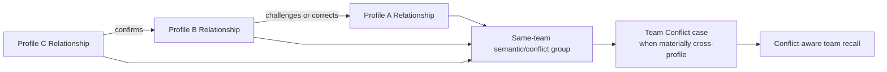
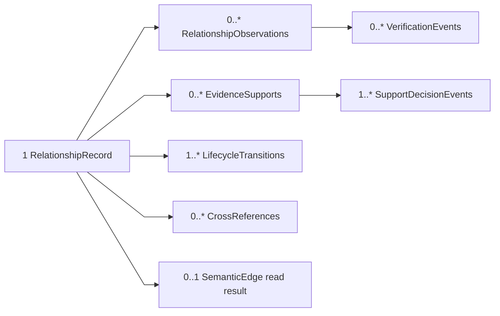
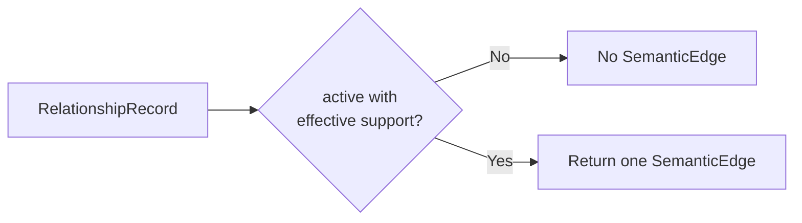
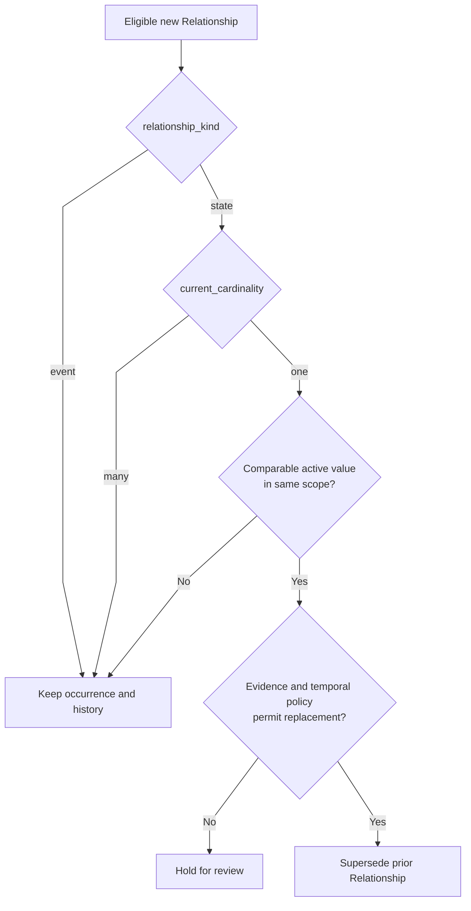
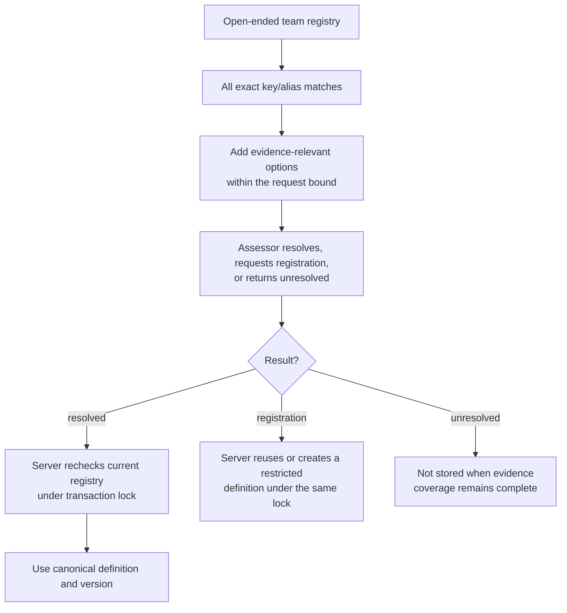
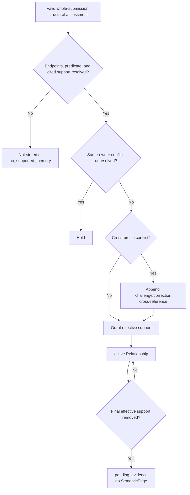
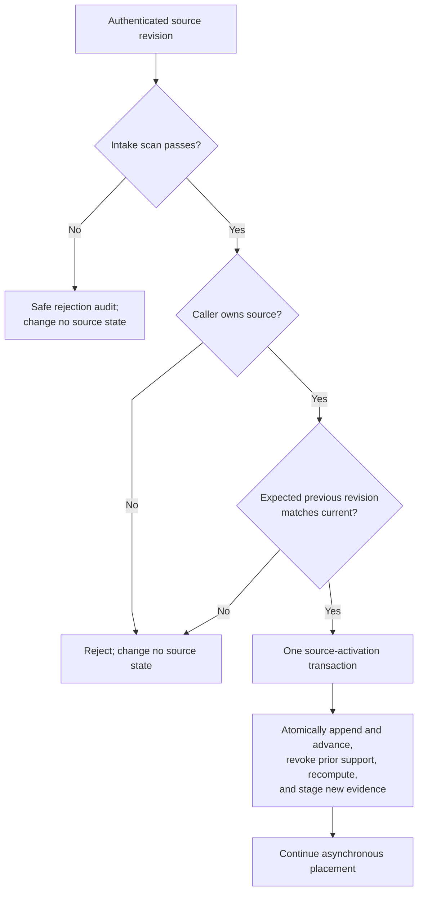
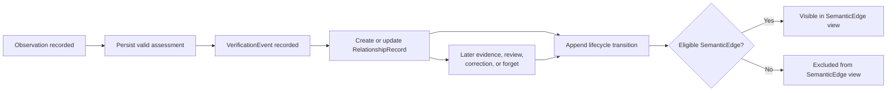
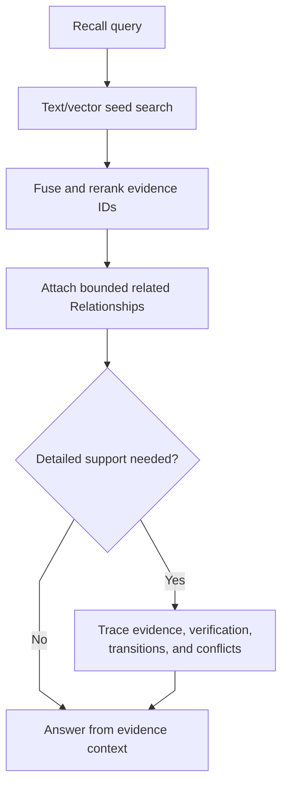
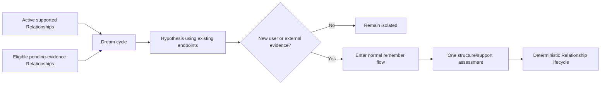

# Relationship Model And Lifecycle

This page is the single source of truth for Dense-Mem's target Relationship
architecture.

The former `Assertion` model and terminology are retired. Evidence,
verification, current knowledge, graph-shaped reads, and speculation are
separate records with one responsibility each.

## Contract Summary

```text
RelationshipObservation -> VerificationEvent -> RelationshipRecord -> SemanticEdge
```

- a `RelationshipObservation` records what one evidence submission expressed
- a `VerificationEvent` records the first schema-valid assessor result and
  provenance used for the placement claim; legacy verdict fields are nullable
  historical metadata, not part of the v2.6 Remember response
- a `RelationshipRecord` owns one profile's canonical
  subject-predicate-object lifecycle
- a `SemanticEdge` is the graph-shaped read view of an eligible Relationship
- a `RelationshipCrossReference` records one profile confirming, challenging,
  correcting, or adopting evidence from another profile's Relationship without
  mutating it
- a `Hypothesis` is dream-generated speculation outside active knowledge

The semantic layer is the server-owned assessment and lifecycle boundary: it
resolves staged observations to registered predicates and canonical endpoints,
computes Relationship identity, applies support/source policy, and updates
status and effective-support state. It is not a derived-knowledge logic engine
and does not turn stored Relationships into new evidence.

PostgreSQL stores every durable record and serves the SemanticEdge view.
`pgvector` and PostgreSQL full-text indexes provide retrieval seeds. A graph
database is not part of the target runtime.

Aliases are identity metadata, never Relationships. Entity identity and names
are defined in
[Entity Identity And Resolution](Entity-Identity-And-Resolution).

## Canonical Vocabulary

| Term | Meaning |
| --- | --- |
| Entity | One canonical team-scoped real-world identity. |
| Entity name | Canonical, alias, or former name attached to one Entity. |
| Value | Typed scalar node such as a number, boolean, date, date-time, or string. |
| Semantic node | Storage-independent graph view of an Entity or typed Value. |
| Predicate | Canonical Relationship meaning such as `works_on`; not a prediction. |
| Relationship kind | Predicate behavior: a continuing `state` or an occurrence `event`. |
| Current cardinality | Whether one or many current objects may coexist for a subject, predicate, and scope. |
| Relationship observation | One source-specific extracted statement with exact evidence spans; its Relationship link is nullable until endpoints and predicate resolve. |
| Verification event | Append-only persisted assessor result and provider provenance for one observation. v2.6 Remember stores structural acceptance and exact support lineage; legacy verdict/confidence fields remain nullable historical metadata. Provider failures and transport retries are operational telemetry. |
| Relationship record | Durable authored semantic episode, lifecycle, and current status for one Relationship. |
| Semantic edge | Read representation of one `active` Relationship with effective accepted support. |
| Semantic group key | Server-derived key that groups equivalent Relationship meaning across profiles without merging ownership or lifecycle. |
| Conflict set | Derived group of materially incompatible authored positions connected by verified cross-references, competing single-current values, or unresolved Entity alternatives. It is not a new semantic edge or truth record. |
| Conflict case | Durable team-scoped workflow and recall-disposition record for one material cross-profile Relationship conflict set. It never owns evidence, but the system reviewer may close losing stale Relationship episodes after deterministic resolution. |
| Relationship cross-reference | Append-only same-team link by which one profile confirms, challenges, corrects, or adopts evidence from another profile's Relationship. It is ledger metadata, not a semantic edge. |
| Evidence source | Stable team-scoped origin owned by one authenticated profile or integration; only that owner may advance its revision. |
| Source revision | Append-only immutable snapshot in one Evidence source lineage, linked by an expected previous-revision token. |
| Evidence fragment | Immutable verbatim evidence item or bounded slice plus provenance; Relationships cite exact spans within it. |
| Source group | Server-derived provenance identity that groups fragments copied, summarized, revised, or derived from one origin so they count as one source. |
| Evidence authority | Policy classification of the submitted source and actor; it is not an assessor confidence score. |
| Evidence support | Immutable link recording that one exact fragment span and source group was accepted for a Relationship at a point in time. |
| Support decision | Append-only `grant`, `revoke`, or `reinstate` event controlling whether policy currently counts an EvidenceSupport. |
| Evidence security event | Append-only pass scan for an accepted fragment, worker/assessor signal, quarantine, or authorized release decision. A pre-stage rejection has no fragment and is recorded only as a safe audit event. |
| Lifecycle transition | Append-only record of a status or validity-bound change. |
| Hypothesis | Dream-generated possibility that cannot become knowledge without new evidence entering `remember`. |

`Node` and `edge` are graph-domain terms, not database requirements. The target
semantic nodes are Entity and Value records. Evidence, observations,
verification events, transitions, reviews, Conflict cases, and Hypotheses remain
ledger/workflow records and never become semantic nodes.

The subject is an Entity. The object is exactly one Entity or typed Value.
Entities and Values are team-scoped. Relationship author ownership and ordinary
lifecycle writes are profile-scoped inside that team.

Evidence, fragments, observations, and verification history are never rewritten.
Support and lifecycle changes update the status of the same RelationshipRecord
and append support/lifecycle decisions. A fragment may stop being effective
because it is quarantined, explicitly superseded, or belongs to a non-current
source revision, while its bytes and provenance remain immutable.

## Profile Ownership And Team Visibility

Every RelationshipRecord has an immutable `owner_profile_id`, which records the
profile that authored the episode. Ordinary writes set it from the authenticated
profile. The owner controls normal support decisions, direct supersession,
retraction, and profile-local identity corrections.

Every active team profile with `read` scope may recall and trace same-team
Relationships regardless of owner. A profile with `write` scope may:

- create or update its own RelationshipRecord through `remember`
- confirm, challenge, or correct another profile's Relationship by creating its
  own evidence-backed Relationship and cross-reference
- adopt another profile's exact same-team evidence through normal assessment
  and deterministic policy
- merge or split only the observations and Relationships it owns

It cannot change another profile's status, support, validity, Entity resolution,
or history. Manager role does not bypass this ordinary ownership rule; separate
privacy and security quarantine powers remain administrative workflows.

A system Conflict reviewer may close a losing stale episode by setting its
current `status=superseded` and `valid_to` after deterministic team-case
resolution. That transition does not transfer ownership, edit evidence, copy
support, or change author attribution. The complete rule belongs in
[Conflicts And Corrections](Conflicts-And-Corrections#durable-team-conflict-cases).

Source currentness is a separate team-wide evidence invariant. When the
authenticated owner of an Evidence source advances its revision, system policy
makes the prior revision ineffective for every profile that adopted it and
recomputes those profiles' current Relationship states. The source owner cannot
select arbitrary Relationship IDs or edit their history; the server follows
indexed support dependencies and appends every resulting support decision and
lifecycle transition. This is not a cross-profile correction shortcut.



The cross-profile arrows above are ledger cross-references. They do not become
domain predicates or SemanticEdges.

```text
RelationshipCrossReference
  cross_reference_id
  team_id
  author_profile_id
  source_relationship_id
  source_relationship_version
  target_relationship_id
  target_relationship_version
  kind: confirms | challenges | corrects | adopts_evidence_from
  verification_event_id
  created_at
```

`source_relationship_id` belongs to the profile making the statement.
`target_relationship_id` may belong to another profile in the same team. The
server validates both IDs, evidence visibility, and ownership. Cross-references
are append-only; a later change appends another event. They do not copy evidence
IDs or text: trace follows `verification_event_id` and the source
Relationship's normalized supports. Evidence adoption creates an ordinary
support on the adopting Relationship that points to the original fragment and
source group.

## Cardinality



Repeated evidence from the same owner must not create another Relationship when
the semantic identity already exists. Accepted evidence attaches to that
profile's existing record and may change its effective support or status.
Another profile creates its own RelationshipRecord; the team recall layer
groups equivalent meaning without collapsing authorship.

Pending or otherwise inactive records have no SemanticEdge. An eligible active
record with effective support has exactly one graph-shaped edge representation
when queried.

## Relationship Identity

A Relationship is identified by:

```text
team_id
owner_profile_id
subject_entity_id
predicate_key
object_entity_id OR object_value_id
polarity
valid_from
scope_key
```

`scope_key` is a normalized optional discriminator such as environment,
repository, role, or jurisdiction when the evidence supports that scope.
`valid_from` is the immutable episode start. It comes from evidence-supported
time when available, otherwise from the server-recorded first placement time
when policy allows `recorded_fallback`.

The same key without `owner_profile_id` is the `semantic_group_key`. It is used
for cross-profile grouping, corroboration, and conflict comparison, never for a
cross-owner upsert.

A conflict set is broader than one semantic group. It may connect different
subject/object Entity IDs or polarities when an accepted cross-reference says
the authored positions compete, or when registered single-current behavior and
scope/time make them mutually exclusive. This is how a later Mark identity
split remains comparable with the earlier combined-Mark Relationships. The
recall service builds the set from durable Relationships, identity history, and
cross-references; no model may invent it from text similarity alone. A material
cross-profile Relationship set also has one durable team Conflict case for
versioned review, deadline, and read-disposition state. Identity-only and
same-owner placement ambiguity continue to use their existing review records.

`valid_to` is not an identity field. Closing a stale episode updates current
materialized state and appends a transition; it does not create a different
Relationship identity. A later return to the same semantic state creates a new
episode with a new `valid_from`.

Status, confidence, evidence count, source count, assessor model, recording
time, Relationship kind, current cardinality, and `valid_to` are not identity
fields.

These observations from one profile converge on one Relationship only after
identity and predicate resolution:

```text
Mark works on Dense-Mem.
Mark is working on Dense-Mem.
Mark Huang works on Dense-Mem.
```

`Mark Huang` must resolve to the same Entity as `Mark`, and both predicate
surfaces must resolve to `works_on`.

## Relationship Record

```json
{
  "relationship_id": "r1",
  "team_id": "team-1",
  "owner_profile_id": "profile-a",
  "semantic_group_key": "sg1",
  "subject_entity_id": "mark-1",
  "predicate_key": "works_on",
  "predicate_version": 3,
  "object_entity_id": "dense-mem",
  "object_value_id": null,
  "relationship_kind": "state",
  "current_cardinality": "many",
  "status": "active",
  "polarity": "+",
  "scope_key": null,
  "valid_from": null,
  "valid_to": null,
  "valid_from_basis": "evidence_time",
  "effective_support_count": 3,
  "source_group_count": 2,
  "version": 4,
  "recorded_at": "2026-07-11T00:00:00Z",
  "recorded_to": null
}
```

Exactly one object form is present. The record is current materialized state;
observations, supports, verification events, and transitions explain how it
reached that state. `valid_to` may be set later by the owner or by the system
Conflict reviewer; the raw evidence and immutable episode identity do not
change.

## SemanticEdge Read View

An edge is returned only when:

```text
status = active
effective_support_count > 0
```

Conceptually:

```text
(Mark:Entity)-[WORKS_ON {
  relationship_id: "r1",
  owner_profile_id: "profile-a",
  polarity: "+",
  effective_support_count: 3,
  source_group_count: 2,
  valid_from: null,
  valid_to: null,
  valid_from_basis: "evidence_time",
  version: 4
}]->(Dense-Mem:Entity)
```

This is an API/query shape derived directly from PostgreSQL. It is not a
separate durable record and does not require projection or reconciliation.



The endpoints encode subject and object. The predicate key encodes edge
meaning. The owner identifies whose knowledge lifecycle the edge represents.
Status controls whether that authored edge exists in normal reads.

Equivalent active Relationships from several profiles may therefore produce
several authored SemanticEdges. Recall groups them by semantic meaning and
returns author/corroboration metadata rather than pretending they are one
mutable record.

## Predicate Registry

A predicate is the canonical verb or relation meaning, for example `works_on`,
`uses`, or `primary_database`. Predicate aliases and behavior live in a
PostgreSQL registry:

```text
PredicateDefinition
  predicate_key
  aliases[]
  allowed_subject_kinds[]
  allowed_object_kinds[]
  relationship_kind: state | event
  current_cardinality: one | many
  lifecycle_state
  version
```

Once a predicate key is used, its semantic meaning is immutable. Additive
aliases may create a new registry version, but changing endpoint meaning,
`relationship_kind`, or `current_cardinality` requires a new key or an explicit
data migration with impact review. Each Relationship stores the applied
`predicate_version` and behavior snapshot so a registry edit cannot silently
reinterpret history.

`is_working_on` may normalize to `works_on`; the original wording remains on
the observation.

The former `policy_family` field is removed. It combined cardinality and
temporal behavior under an opaque name and was easily confused with graph
communities. All Relationships retain append-only history, so `versioned` is
not a separate policy family.

### Behavior examples

| Predicate | Kind | Cardinality | Result |
| --- | --- | --- | --- |
| `uses` | `state` | `many` | Dense-Mem may currently use PostgreSQL and Redis. |
| `primary_database` | `state` | `one` | One eligible replacement may supersede the prior current value in the same scope. |
| `works_on` | `state` | `many` | Mark may work on several current projects. |
| `released` | `event` | `many` | Supported release events coexist and are not auto-replaced. |



The team registry is open-ended; the assessor request is bounded. Before the
call, Dense-Mem loads every exact active key/alias match, then fills the
remaining 100-option default request capacity with evidence-relevant active
definitions. Each option carries its key, version, aliases, allowed endpoint
kinds, `relationship_kind`, and `current_cardinality`. The assessor may select
only a supplied compatible option or return a typed `registration_required`
result for the submitted key.



The assessor cannot define a durable version, endpoint allowlist, Relationship
behavior, lifecycle status, or truth. Exact keys and aliases are rechecked under
a team/key transaction lock. An existing compatible definition wins; otherwise
server policy may register only a restricted definition with append-only
provenance in the atomic semantic transaction. Exact-match overflow fails before
the provider call as `input_budget_exceeded`. Key/alias collisions, ambiguous
aliases, and incompatible endpoint kinds are repaired in the same assessor
session or recorded as `not_stored`; if stored support cannot cover all
evidence, the complete submission is `rejected/no_supported_memory`.

## Observation And Evidence

A Relationship observation is immutable processing history:

```json
{
  "observation_id": "o1",
  "relationship_id": "r1",
  "ingest_id": "ingest-1",
  "subject_ref": "person-1",
  "original_predicate": "is_working_on",
  "object_ref": "project-1",
  "polarity": "+",
  "evidence": [
    {
      "evidence_id": "e1",
      "start": 0,
      "end": 24,
      "source_group": "source:project-conversation",
      "source_key": "project-conversation",
      "source_revision": "turn-42"
    }
  ],
  "observed_at": "2026-07-11T00:00:00Z"
}
```

`relationship_id` remains null while an endpoint or predicate is unresolved.
Once both endpoints and the predicate resolve, an insufficient but
schema-valid observation may link to a RelationshipRecord with
`status=pending_evidence`.

An observation is not current truth. A v2.6 Remember observation either gains
server-accepted exact support and can produce an active Relationship, or remains
staged/not-stored; quarantined and failed submissions create no Relationship.
Legacy Dream and correction workflows may retain pending or review-oriented
observations without creating a SemanticEdge.

Evidence support is granted only after a schema-valid Remember assessor result
selects an exact cited span and deterministic server policy accepts it. The
Remember assessor does not emit a verdict, confidence, rationale, modality, or
scope decision; the server owns support disposition and lifecycle. Repeated
spans and source groups are deduplicated. The immutable support link receives
an initial `grant` event. Legacy Dream/correction verification may retain its
older verdict and confidence metadata.

Support is effective only while its latest decision is `grant` or `reinstate`,
its evidence is not quarantined, and its source revision remains current. If a
correction, source revision, source review, or import rollback invalidates
current use, Dense-Mem appends a `revoke` event; it does not delete or edit the
support. A separately authorized reconsideration may append `reinstate`.
Current support and independent-source counts include only effective links.
Relationship status, materialized counts, transitions, and search intent change
atomically with the source or support decision.

## Assessment And Verification Events

One bounded assessor conversation returns separate `entity_results` and
`relationship_results`. Entity grounding/resolution, predicate grounding and
selection, Relationship normalization, and evidence support judgment share that
conversation.
A malformed HTTP 200 response may be replaced in the same history for at most
five provider turns; provider failures instead use the durable placement retry
budget with fresh history. The closed response schema, persisted-response rule,
and no-coercion rule are defined in
[Memory Write Pipeline](Write-Pipeline#server-owned-assessment).

For Remember, the assessor returns bounded structural selections: one grounded
Entity result per submitted endpoint, one predicate status and cited range per
Relationship, exact object/value ranges, one or more support ranges, and the
submitted validity bounds unchanged. It emits no confidence, rationale,
evidence verdict, temporal verdict, scope status, or public modality.

The assessor also returns a separate bounded `security_signals` control array.
A non-empty valid array quarantines the complete submission and creates no
`VerificationEvent` or semantic subset.

Stored Relationships are not assessor inputs. The request contains only the
complete staged submission, server-generated Entity occurrence groundings,
complete same-team candidate sets for the submitted names and active aliases,
all exact active predicate key/alias matches, and bounded evidence-relevant
predicate options. Exact candidate or predicate overflow is terminal before a
provider call and is never silently truncated. The assessor cannot invent a
range, predicate, or stored Relationship. After the first schema-valid response
is persisted, the
server recomputes canonical identity and loads bounded current state for
deduplication, conflict, update, and cross-reference policy. A same-owner match
attaches support to the existing record. A cross-owner conflict creates an
append-only cross-reference and opens or updates a team Conflict case; placement
never changes the referenced owner's record.

```text
VerificationEvent
  verification_event_id
  observation_id
  model
  response_hash
  assessment_id
  structural_support_accepted
  verified_at
```

Legacy verdict, confidence, rationale, temporal, and policy columns remain
internal nullable audit data for older Dream/correction records. Public
submission status returns only bounded processing, search, error, and
disposition fields.

Transport, rate-limit, HTTP-status, and provider-protocol failures remain
operational telemetry and consume durable placement attempts. A malformed HTTP
200 response triggers a same-history correction turn but creates no material
event. Five malformed turns exhaust that conversation with zero partial commit.

One submission placement run appends at most one material `VerificationEvent`
per observation, derived from its first valid persisted assessment. Worker
restart, lease reclaim, and commit retry reuse that assessment. V2.4 migration
preserves legacy events as written and does not rescore them.

## Status And Effective Support

Status controls lifecycle participation:

```text
pending_evidence | active | needs_review | quarantined
superseded | disputed | retracted | rejected
```

An EvidenceSupport is effective only when its latest decision is `grant` or
`reinstate`, the referenced evidence is usable, the source revision is current,
and its accepted structural assessor result satisfies the server's
stored-support policy. Remember v2.6 does not expose or manufacture model
confidence; legacy audit values are not used to gate Remember support.

The ordinary support-recomputation invariant is:

```text
effective_support_count > 0  => status = active
effective_support_count = 0  => status = pending_evidence
```

Explicit `needs_review`, `quarantined`, `superseded`, `disputed`, `retracted`,
and `rejected` decisions take precedence and are not cleared by support
recomputation. A contradicted or insufficient new observation creates no new
support and does not deactivate an existing Relationship that still has
effective support.

The assessor does not assign status. Deterministic application policy combines
support usability, identity/predicate resolution, conflicts, temporal rules, and
explicit user/system decisions. Remember's unsupported hints are recorded as
`not_stored` when every evidence item remains covered; otherwise the complete
submission is `rejected/no_supported_memory`.



Adding or removing effective support updates the same authored Relationship
episode. It never creates a second edge for that owner. A cross-profile conflict
does not prevent an otherwise supported Relationship from becoming active;
both authored positions remain active and traceable while the case is open.
Nightly Conflict resolution may later supersede losing stale episodes and
controls which support paths enter primary current recall.

Legacy Dream and correction verification may use a team confidence threshold
for their own review policy. That setting is not loaded by the v2.6 Remember
worker, is not a Remember request field, and never creates a client repair
obligation. Remember support depends on exact assessor-selected spans and
deterministic server policy instead.

## Source Independence And Support Policy

One accepted EvidenceSupport is sufficient for ordinary active eligibility.
Additional independent sources improve provenance, traceability, conflict
analysis, and evaluation coverage, but do not change lifecycle class or add a
recall-ranking boost.

`Authority` classifies an allowed source and actor, not the AI assessor. The
assessor decides whether exact submitted evidence entails the observation; it
cannot make itself a source, upgrade an unauthorized source, or supply missing
evidence. The server validates both dimensions before lifecycle policy runs.

`source_type` describes origin only: `conversation`, `document`, `observation`,
or `manual`. It never establishes authority or independence. In particular,
`manual` does not mean authoritative. Client `source_group` is a bounded hint;
the server derives the group used by support policy and provenance.

| `source_type` | Typical origin | Why retain it |
| --- | --- | --- |
| `conversation` | a user/assistant turn submitted by the client LLM | provenance display, conversational retention, and evaluation slices |
| `document` | a file, page, record, or imported corpus item | source locator/revision handling, document retention, and trace |
| `observation` | a bounded application, sensor, or workflow observation | distinguish measured/event provenance from authored prose |
| `manual` | an explicit user or operator entry outside normal ingestion | audit how the evidence entered the system |

These values may select retention, redaction, export, display, or evaluation
policy. Authority is a separate actor-and-source authorization decision; a
manual entry remains non-authoritative unless that separate policy allows it.

For example, one accepted commit authored by Mark may make Mark's
`works_on Dense-Mem` Relationship active when the assessor selects exact
support spans and server policy accepts them. A second genuinely independent
accepted source adds another support path and remains visible in trace, but it
does not change the Relationship's status or rank merely because the source
count increased.

Two fragments are not independent merely because they are separate rows.
Mirrors, repeated conversation turns, summaries of the same document,
citations that trace to one origin, and every revision of one stable source
remain one source group.

Existing Relationships do not count as independent evidence for a new
Relationship. Another profile's Relationship also does not automatically
support the caller's record. The caller must explicitly adopt authorized exact
evidence, and the original source-group identity remains unchanged.
For example:

```text
Relationship: Mark works_on Dense-Mem
Relationship: Dense-Mem uses PostgreSQL

not entailed: Mark uses PostgreSQL
```

The third statement may be a useful Hypothesis, but the premises do not
logically entail it.

The architecture has no automatic derived-knowledge rule engine. A future rule
engine would require registered deterministic rules, exact premise Relationship
IDs, cycle prevention, and automatic invalidation when a premise changes. AI
reasoning alone remains a Hypothesis.

### Stable Source Revisions

Clients that can identify source lineage may supply:

```text
source_key
source_revision
previous_source_revision
```

`source_key` and `source_revision` appear together. The server scopes the
canonical source identity to the authenticated team and immutable source owner.
The first revision omits `previous_source_revision`; every later revision must
name the exact current token. A mismatch changes no source pointer, support,
status, or search state.

Source revision advancement makes the prior revision ineffective under the
source's immutable owner and current-revision pointer. Ordinary Relationship
correction remains profile-local and does not make shared evidence globally
non-current.

Direct evidence lifecycle is a separate path. A new evidence item may name
one to fifty unique caller-owned current IDs in `supersedes_evidence_ids`; it
cannot combine that field with `previous_source_revision`. The server appends a
supersession event and retires those exact targets atomically at intake. The
`retract_evidence` MCP tool appends the same kind of lifecycle decision when
there is no replacement. Neither action targets another profile's evidence or
rewrites historical evidence/support records.

All evidence items for one source in a request carry identical revision fields
and activate as one bounded batch. An idempotent retry of the same revision
converges on the existing intake result. Reusing a current revision token with
different content is a conflict and changes no state.



Activation occurs at authenticated intake. A quarantined, later
placement-failed, or insufficient replacement does not reactivate the prior
revision. A structurally invalid `remember` request is rejected before this
transaction. This favors source freshness over uninterrupted knowledge and may
intentionally create a temporary gap until the new evidence is assessed and
accepted.

Every affected Relationship that is otherwise lifecycle-eligible is
reevaluated from effective support. Explicit `retracted`, `rejected`,
`disputed`, or review holds are not cleared by source recomputation:

| Effective-support state | Current result |
| --- | --- |
| at least one accepted entailed support | `active` |
| no accepted entailed support | `pending_evidence` |

Support recomputation updates the same Relationship identity and appends a
lifecycle transition when status changes. Source activation must discover
dependencies through indexed support links and stay within a server-defined hard
transaction fanout bound. A bound breach aborts before the source pointer
advances; it cannot leave a partially activated revision.

Without a stable source identity, Dense-Mem cannot know that similar text is a
replacement. Unkeyed evidence appends a new observation and never silently
supersedes prior evidence.

## Lifecycle And History



Transitions are append-only. The RelationshipRecord is current materialized
state. Evidence and history are never deleted merely because a Relationship
becomes inactive.

State predicates with `current_cardinality=one` may supersede a comparable prior
active record owned by the same profile only when scope, time, status, and
evidence policy permit. A profile never supersedes another profile's record;
cross-profile disagreement is represented by cross-references and a team
Conflict case. The system Conflict reviewer may supersede losing stale episodes
after deterministic case resolution. Events and multi-current state
Relationships coexist.

## Normal Recall And Trace

Default recall searches:

- active Relationships with effective support
- PostgreSQL full-text indexes
- `pgvector` search documents
- bounded indexed Relationship expansion

It excludes inactive Relationships, observations, assessor rationale, and
complete transition history. It groups equivalent same-team authored
Relationships. An
`open` or `overdue` Conflict case retains bounded material alternatives in
primary recall and requests clarification. A `resolved` case returns only the
preferred support paths in primary results for the applicable
`valid_at`/`known_at` view, plus a compact conflict reference. Every authored
position, owner, and event remains available through authorized trace.

```json
{
  "relationship_id": "r1",
  "author": {
    "profile_id": "profile-a",
    "name": "A"
  },
  "subject": "Mark",
  "predicate": "works_on",
  "object": "Dense-Mem",
  "polarity": "+",
  "effective_support_count": 3,
  "source_group_count": 2,
  "valid_from": null,
  "valid_to": null,
  "trace_available": true
}
```

Trace expands `relationship_id` into the Relationship record, exact evidence
spans, support-decision history, source fragments, material verification
events, lifecycle transitions, conflicts, corrections, and supersession
lineage.



## Pending Relationship And Dream Boundary

A legacy insufficient pending Relationship may remain in PostgreSQL so its
context is not lost. It is excluded from default recall and the SemanticEdge
view. A rejected or failed v2.6 Remember submission creates no Relationship and
is never Dream input; the caller follows its bounded status error.

Dreaming may use a bounded pending Relationship only when:

- its endpoints resolve to existing same-team Entity/Value records
- its predicate is registered
  - its final legacy verification assessment is `insufficient`, or it is
    `entailed` below the legacy positive-support threshold
- its retained review policy allows pending-input eligibility without treating
  a failed Remember submission as a pending Relationship
- it is not contradicted, quarantined, rejected, disputed, or identity-ambiguous

Provider failures with no schema-valid assessor response remain preserved
processing work, but are not dream inputs.



A dream cannot create an Entity, Value, RelationshipRecord, predicate, support,
status, or SemanticEdge. If a Hypothesis mentions a new concept, that concept
remains text until later evidence enters `remember` and normal Entity
resolution.

Retained legacy review rows are audit history, not evidence, and never activate
a Relationship or promote it directly to a Hypothesis. A structurally complete
legacy Relationship remains `pending_evidence` and may become bounded Dream
input only under the existing pending-input policy.
Unresolved identity, predicate, or legacy scope/time review remains Evidence plus
Observation only and is not Dream input. v2.6 Remember repairs server-owned
identity and predicate state in-session and preserves submitted validity bounds.

## Forget And Retraction

Normal forget removes the caller-owned knowledge from the active semantic graph
without rewriting history:

1. authorize the target `relationship_id` and require its owner to match the
   authenticated profile
2. append a forget/retraction decision and lifecycle transition
3. set current status to `retracted`
4. exclude the Relationship from SemanticEdge and default recall queries
5. keep Entity/Value records, evidence, verification, and trace history

An Entity is not deleted merely because it has no active Relationships.
Privacy-required content erasure is a separate redaction workflow that may
replace protected payloads with content-free tombstones while preserving
referential and audit integrity.

## Consistency And Failure Semantics

| Failure | Required result |
| --- | --- |
| Evidence transaction fails | Create no ingest or semantic state. |
| Assessor response is unavailable or invalid | Preserve staged evidence; expose failure; create no support, VerificationEvent, or SemanticEdge. |
| Entity endpoint is ambiguous | Repair identity in-session; create a new grounded Entity when reuse is unsafe or mark the dependent hint `not_stored`. |
| Predicate cannot be resolved or registered safely | Mark that ref `not_stored`; reject the complete run only when stored support cannot cover every evidence item. |
| Predicate key/alias is ambiguous, colliding, or kind-incompatible | Reconcile under the server catalog lock or use `not_stored`; never expose a client repair code. |
| Remember assessor cannot support a hint | Record that ref as `not_stored`; reject only when stored support cannot cover every evidence item. |
| Entity, predicate, Value, support, or Relationship grounding cannot be proven | Preserve staged evidence and use `not_stored` or `rejected/no_supported_memory`; model confidence is not a public input. |
| Search embedding fails | Preserve authoritative Relationship; expose degraded search state and retry the derived embedding job. |
| Same-owner knowledge conflicts with new evidence | Hold review or apply owner-authorized supersession; never use stored knowledge as self-supporting evidence. |
| Another profile's knowledge conflicts with new evidence | Preserve both eligible authored records during placement, append a challenge/correction cross-reference, and create/update the team Conflict case in the same transaction. |
| Source owner or prior revision does not match | Reject the revision update and change no source, support, status, or search state. |
| Source activation transaction or fanout bound fails | Abort before advancing the source pointer; expose a bounded source-update failure. |
| Activated replacement is quarantined or fails placement | Keep the prior revision ineffective and leave affected Relationships at their recomputed support-derived status. |

## Risks And Mitigations

| Risk | Mitigation |
| --- | --- |
| Duplicate Relationships after repeated same-owner evidence | Owner-scoped canonical identity constraint plus one current Relationship upsert. |
| Cross-profile placement mutates the target | ownership predicate on placement writes plus immutable cross-reference records |
| Team recall hides disagreement | open cases return material alternatives; resolved cases return a compact conflict reference and retain all positions in trace |
| Reviewer closes the wrong authored state | lock case member Relationship IDs/versions, revalidate scope/time/cardinality, and update losing episodes plus case resolution in one transaction |
| Pending Relationship pollutes normal recall | Eligibility requires `status=active` plus effective accepted support. |
| Evidence/history makes Relationship rows unbounded | Normalize observations, support decisions, verification, and transitions into separate tables. |
| Revoked support leaves a Relationship active | Materialize effective counts in the support-decision transaction and reconcile them against latest per-support events. |
| Stored Relationships circularly support new Relationships | Support accepts submitted evidence only; graph context never counts as a source. |
| Revisions masquerade as independent sources | Bind every revision to one immutable server-derived source group. |
| Stale source update replaces current evidence | Require source ownership and an exact `previous_source_revision` compare-and-set token. |
| Compromised source owner invalidates shared evidence | Restrict revision changes to the immutable source owner, append actor/reason audit, and recompute only indexed dependents. |
| Source revision fanout creates an unbounded transaction | Precompute and bound affected supports; abort before advancing the source pointer when the bound is exceeded. |
| Predicate synonyms fragment knowledge | Normalize through the versioned registry before Relationship identity is computed. |
| Registry edit rewrites history | Predicate meaning is immutable per key; behavior changes use a new key or reviewed migration, while records retain the applied version. |
| Single-current behavior removes parallel truth | Explicit `relationship_kind` and `current_cardinality` plus scope-aware review. |
| Legacy verification metadata is mistaken for Remember policy | Keep verdict/confidence/policy columns nullable and internal; v2.6 Remember uses exact structural support and server lifecycle policy. |
| Retired review metadata is mistaken for evidence or approval | v2.6 has no Remember review-task expiry or approval path; rejected/failed work follows its bounded status error. |

## Acceptance Invariants

The refactor is incomplete until tests prove:

1. repeated equivalent observations from one profile reuse one Relationship
   record
2. independent accepted evidence adds support without duplicating that owner's
   identity
3. only active Relationships with effective support appear as SemanticEdges
4. pending, review, disputed, retracted, superseded, quarantined, and rejected
   records never appear in default recall
5. support changes preserve the same Relationship identity
6. every EvidenceSupport resolves to one exact Fragment span
7. stored knowledge alone cannot create support
8. normal recall does not load complete evidence or transition history
9. trace reconstructs evidence, verification, and lifecycle lineage
10. exact existing keys or aliases reuse canonical definitions; a missing key
    can enter only through server-controlled locked registration with append-only
    provenance, while unsupported wording becomes `not_stored` unless it would
    leave an evidence item uncovered
11. a Hypothesis cannot create a node or edge
12. forget removes the active SemanticEdge while preserving nodes and history
13. one profile-owned Relationship has at most one graph-shaped SemanticEdge
    result
14. a registry edit cannot silently change the meaning or behavior of an
    existing Relationship
15. revoking support preserves its link/history and removes it from effective
    counts and active-eligibility policy
16. a profile cannot change another profile's Relationship status, validity,
    support, resolution, or history
17. a cross-profile challenge preserves both authored positions and remains
    visible to conflict-aware recall
18. adopting another profile's evidence preserves the original fragment,
    author, provenance, and source-group identity
19. a Remember assessor result contains only grounded extraction, predicate,
    range, and support selections; it contains no stored-knowledge alignment,
    lifecycle, confidence, verdict, rationale, or stored Relationship ID
20. every revision of one stable source counts as one source group
21. an exact prior-revision mismatch changes no current state
22. advancing a source revision makes the prior revision ineffective team-wide
    and appends every resulting support and lifecycle decision
23. loss of final effective support moves the same Relationship to
    `pending_evidence` automatically
24. quarantined replacement evidence does not reactivate the old revision
25. unkeyed evidence never silently supersedes earlier evidence
26. team Conflict disposition never changes a member Relationship's owner,
    author attribution, support links, raw evidence, Entity resolution, or source
    history
27. nightly Conflict resolution may set losing stale episodes to
    `status=superseded` and write `valid_to`, with transition and Conflict ledger
    events
28. open/overdue cases retain material alternatives in primary recall, while a
    resolved case suppresses only non-preferred support paths for its applicable
    current interval
29. every suppressed current position remains reconstructable through trace and
    historical `valid_at`/`known_at` recall
30. one submission placement-run attempt opens one assessor conversation over
    every staged evidence item and relationship ref, with at most five
    same-history malformed-response turns; provider failures use durable
    attempts, while restart, lease reclaim, or commit retry reuses the first
    valid persisted assessment
31. only exact support selected by a schema-valid Remember assessor result and
    accepted by deterministic server policy may grant support; no model
    confidence or verdict gate can override structural, security, or conflict
    policy
32. legacy Dream/correction verification metadata never becomes a Remember
    client field or a client repair obligation
33. retained legacy review rows never activate knowledge; only structurally
    complete pending Relationships may later enter Dream under policy
