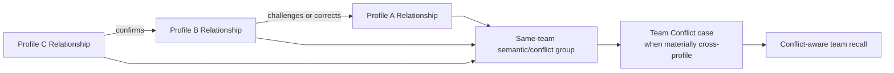
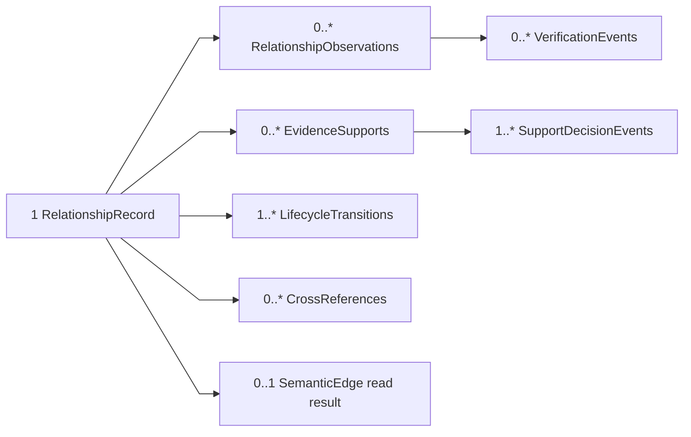
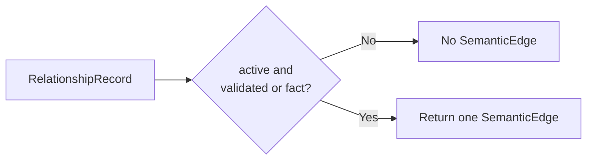
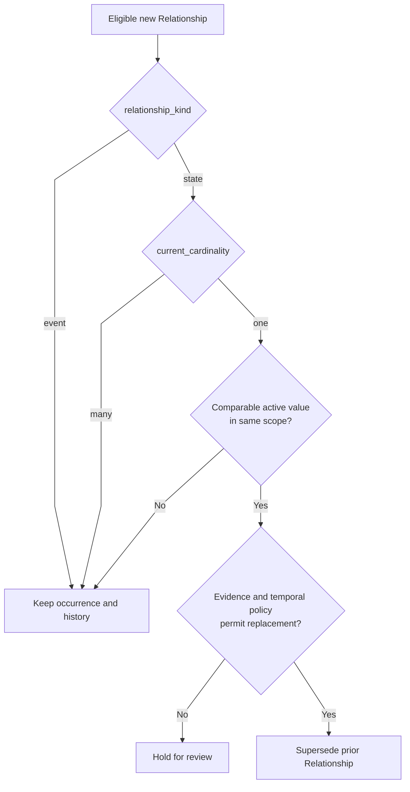
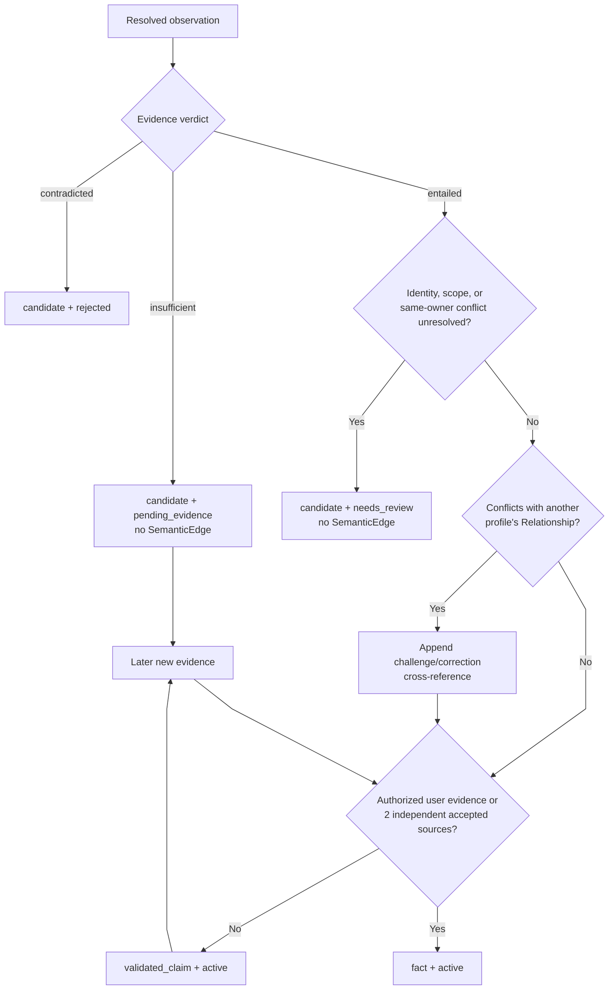
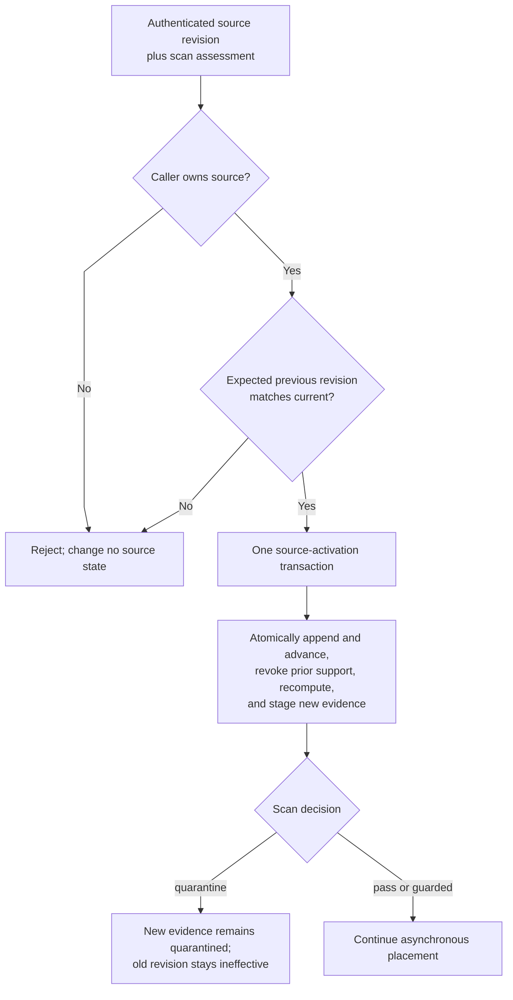
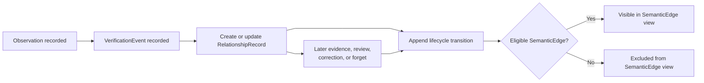
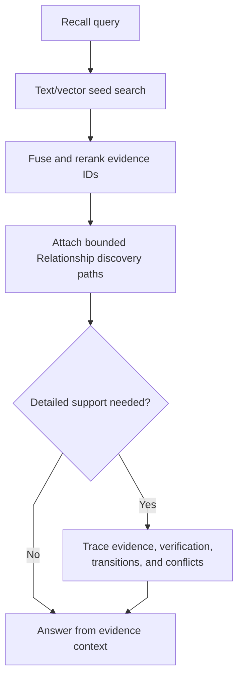
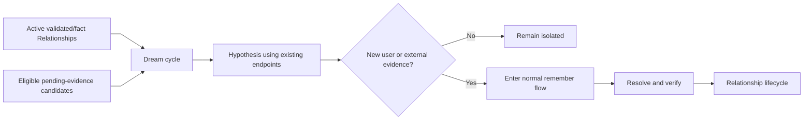

# Relationship Model And Lifecycle

This page is the single source of truth for Dense-Mem's target Relationship
architecture.

The former `Assertion` model and terminology are retired. Evidence,
verification, current knowledge, graph-shaped reads, and speculation are
separate records with one responsibility each.

## Contract Summary

```text
RelationshipObservation -> VerificationEvent -> RelationshipRecord -> SemanticEdge
```

- a `RelationshipObservation` records what one evidence submission expressed
- a `VerificationEvent` records the schema-valid verifier judgment
- a `RelationshipRecord` owns one profile's canonical
  subject-predicate-object lifecycle
- a `SemanticEdge` is the graph-shaped read view of an eligible Relationship
- a `RelationshipCrossReference` records one profile confirming, challenging,
  correcting, or adopting evidence from another profile's Relationship without
  mutating it
- a `Hypothesis` is dream-generated speculation outside active knowledge

The semantic layer is the deterministic normalization and lifecycle boundary:
it resolves verified observations to registered predicates and canonical
endpoints, computes Relationship identity, applies support/source policy, and
updates tier/status. It is not a derived-fact logic engine and does not turn
stored Relationships into new evidence.

PostgreSQL stores every durable record and serves the SemanticEdge view.
`pgvector` and PostgreSQL full-text indexes provide retrieval seeds. A graph
database is not part of the target runtime.

Aliases are identity metadata, never Relationships. Entity identity and names
are defined in
[Entity Identity And Resolution](Entity-Identity-And-Resolution).

## Canonical Vocabulary

| Term | Meaning |
| --- | --- |
| Entity | One canonical team-scoped real-world identity. |
| Entity name | Canonical, alias, or former name attached to one Entity. |
| Value | Typed scalar node such as a number, boolean, date, date-time, or string. |
| Semantic node | Storage-independent graph view of an Entity or typed Value. |
| Predicate | Canonical Relationship meaning such as `works_on`; not a prediction. |
| Relationship kind | Predicate behavior: a continuing `state` or an occurrence `event`. |
| Current cardinality | Whether one or many current objects may coexist for a subject, predicate, and scope. |
| Relationship observation | One source-specific extracted statement with exact evidence spans; its Relationship link is nullable until endpoints and predicate resolve. |
| Verification event | Append-only verifier verdict for one observation. Provider retries are operational telemetry. |
| Relationship record | Durable profile-owned semantic identity, lifecycle, and current tier/status for one Relationship. |
| Semantic edge | Read representation of one `active` `validated_claim` or `fact` Relationship. |
| Semantic group key | Server-derived key that groups equivalent Relationship meaning across profiles without merging ownership or lifecycle. |
| Conflict set | Derived group of materially incompatible authored positions connected by verified cross-references, competing single-current values, or unresolved Entity alternatives. It is not a new semantic edge or truth record. |
| Conflict case | Durable team-scoped workflow and recall-disposition record for one material cross-profile Relationship conflict set. It never owns evidence or changes an author's lifecycle. |
| Relationship cross-reference | Append-only same-team link by which one profile confirms, challenges, corrects, or adopts evidence from another profile's Relationship. It is ledger metadata, not a semantic edge. |
| Evidence source | Stable team-scoped origin owned by one authenticated profile or integration; only that owner may advance its revision. |
| Source revision | Append-only immutable snapshot in one Evidence source lineage, linked by an expected previous-revision token. |
| Evidence fragment | Immutable verbatim evidence item or bounded slice plus provenance; Relationships cite exact spans within it. |
| Source group | Server-derived provenance identity that groups fragments copied, summarized, revised, or derived from one origin so they count as one source. |
| Evidence authority | Policy classification of the submitted source and actor; it is not a verifier confidence score. |
| Evidence support | Immutable link recording that one exact fragment span and source group was accepted for a Relationship at a point in time. |
| Support decision | Append-only `grant`, `revoke`, or `reinstate` event controlling whether policy currently counts an EvidenceSupport. |
| Evidence security event | Append-only deterministic scan, model signal, quarantine, or authorized release decision for one fragment. |
| Lifecycle transition | Append-only record of a tier or status change. |
| Hypothesis | Dream-generated possibility that cannot become knowledge without new evidence entering `remember`. |

`Node` and `edge` are graph-domain terms, not database requirements. The target
semantic nodes are Entity and Value records. Evidence, observations,
verification events, transitions, reviews, Conflict cases, and Hypotheses remain
ledger/workflow records and never become semantic nodes.

The subject is an Entity. The object is exactly one Entity or typed Value.
Entities and Values are team-scoped. Relationship ownership and lifecycle are
profile-scoped inside that team.

Evidence, fragments, observations, and verification history are never promoted
or rewritten. Promotion and demotion change the tier/status of the same
RelationshipRecord and append lifecycle/support decisions. A fragment may stop
being effective because it is quarantined, explicitly superseded, or belongs to
a non-current source revision, while its bytes and provenance remain immutable.

## Profile Ownership And Team Visibility

Every RelationshipRecord has an immutable `owner_profile_id`. Ordinary writes
set it from the authenticated profile; legacy migration preserves the original
v1 owner. The owner controls that record's support decisions, supersession,
retraction, and profile-local identity corrections.

Every active team profile with `read` scope may recall and trace same-team
Relationships regardless of owner. A profile with `write` scope may:

- create or update its own RelationshipRecord through `remember`
- confirm, challenge, or correct another profile's Relationship by creating its
  own evidence-backed Relationship and cross-reference
- adopt another profile's exact same-team evidence through normal verification
- merge or split only the observations and Relationships it owns

It cannot change another profile's tier, status, support, Entity resolution, or
history. Manager role does not bypass this ownership rule; separate privacy and
security quarantine powers remain administrative workflows.

A team Conflict case may select a preferred position for conflict-aware current
reads without changing any member Relationship. This disposition is not
ownership, support, supersession, retraction, or an authored validity update.
The complete rule belongs in
[Conflicts And Corrections](Conflicts-And-Corrections#durable-team-conflict-cases).

Source currentness is a separate team-wide evidence invariant. When the
authenticated owner of an Evidence source advances its revision, system policy
makes the prior revision ineffective for every profile that adopted it and
recomputes those profiles' current Relationship states. The source owner cannot
select arbitrary Relationship IDs or edit their history; the server follows
indexed support dependencies and appends every resulting support decision and
lifecycle transition. This is not a cross-profile correction shortcut.



The cross-profile arrows above are ledger cross-references. They do not become
domain predicates or SemanticEdges.

```text
RelationshipCrossReference
  cross_reference_id
  team_id
  author_profile_id
  source_relationship_id
  source_relationship_version
  target_relationship_id
  target_relationship_version
  kind: confirms | challenges | corrects | adopts_evidence_from
  verification_event_id
  created_at
```

`source_relationship_id` belongs to the profile making the statement.
`target_relationship_id` may belong to another profile in the same team. The
server validates both IDs, evidence visibility, and ownership. Cross-references
are append-only; a later change appends another event. They do not copy evidence
IDs or text: trace follows `verification_event_id` and the source
Relationship's normalized supports. Evidence adoption creates an ordinary
support on the adopting Relationship that points to the original fragment and
source group.

## Cardinality



Repeated evidence from the same owner must not create another Relationship when
the semantic identity already exists. Accepted evidence attaches to that
profile's existing record and may change its tier or status. Another profile
creates its own RelationshipRecord; the team recall layer groups equivalent
meaning without collapsing authorship.

Candidate records have no SemanticEdge. An eligible active record has exactly
one graph-shaped edge representation when queried.

## Relationship Identity

A Relationship is identified by:

```text
team_id
owner_profile_id
subject_entity_id
predicate_key
object_entity_id OR object_value_id
polarity
valid_from
valid_to
scope_key
```

`scope_key` is a normalized optional discriminator such as environment,
repository, role, or jurisdiction when the evidence supports that scope.

The same key without `owner_profile_id` is the `semantic_group_key`. It is used
for cross-profile grouping, corroboration, and conflict comparison, never for a
cross-owner upsert.

A conflict set is broader than one semantic group. It may connect different
subject/object Entity IDs or polarities when an accepted cross-reference says
the authored positions compete, or when registered single-current behavior and
scope/time make them mutually exclusive. This is how a later Mark identity
split remains comparable with the earlier combined-Mark Relationships. The
recall service builds the set from durable Relationships, identity history, and
cross-references; no model may invent it from text similarity alone. A material
cross-profile Relationship set also has one durable team Conflict case for
versioned review, deadline, and read-disposition state. Identity-only and
same-owner placement ambiguity continue to use their existing review records.

Tier, status, confidence, evidence count, source count, verifier model,
recording time, Relationship kind, and current cardinality are not identity
fields.

These observations from one profile converge on one Relationship only after
identity and predicate resolution:

```text
Mark works on Dense-Mem.
Mark is working on Dense-Mem.
Mark Huang works on Dense-Mem.
```

`Mark Huang` must resolve to the same Entity as `Mark`, and both predicate
surfaces must resolve to `works_on`.

## Relationship Record

```json
{
  "relationship_id": "r1",
  "team_id": "team-1",
  "owner_profile_id": "profile-a",
  "semantic_group_key": "sg1",
  "subject_entity_id": "mark-1",
  "predicate_key": "works_on",
  "predicate_version": 3,
  "object_entity_id": "dense-mem",
  "object_value_id": null,
  "relationship_kind": "state",
  "current_cardinality": "many",
  "tier": "fact",
  "status": "active",
  "polarity": "+",
  "scope_key": null,
  "valid_from": null,
  "valid_to": null,
  "support_count": 3,
  "source_group_count": 2,
  "version": 4,
  "recorded_at": "2026-07-11T00:00:00Z",
  "recorded_to": null
}
```

Exactly one object form is present. The record is current materialized state;
observations, supports, verification events, and transitions explain how it
reached that state.

## SemanticEdge Read View

An edge is returned only when:

```text
status = active
tier IN (validated_claim, fact)
```

Conceptually:

```text
(Mark:Entity)-[WORKS_ON {
  relationship_id: "r1",
  owner_profile_id: "profile-a",
  tier: "fact",
  polarity: "+",
  support_count: 3,
  source_group_count: 2,
  valid_from: null,
  valid_to: null,
  version: 4
}]->(Dense-Mem:Entity)
```

This is an API/query shape derived directly from PostgreSQL. It is not a
separate durable record and does not require projection or reconciliation.



The endpoints encode subject and object. The predicate key encodes edge
meaning. The owner identifies whose knowledge lifecycle the edge represents.
Status controls whether that authored edge exists in normal reads.

Equivalent active Relationships from several profiles may therefore produce
several authored SemanticEdges. Recall groups them by semantic meaning and
returns author/corroboration metadata rather than pretending they are one
mutable record.

## Predicate Registry

A predicate is the canonical verb or relation meaning, for example `works_on`,
`uses`, or `primary_database`. Predicate aliases and behavior live in a
PostgreSQL registry:

```text
PredicateDefinition
  predicate_key
  aliases[]
  allowed_subject_kinds[]
  allowed_object_kinds[]
  relationship_kind: state | event
  current_cardinality: one | many
  lifecycle_state
  version
```

Once a predicate key is used, its semantic meaning is immutable. Additive
aliases may create a new registry version, but changing endpoint meaning,
`relationship_kind`, or `current_cardinality` requires a new key or an explicit
data migration with impact review. Each Relationship stores the applied
`predicate_version` and behavior snapshot so a registry edit cannot silently
reinterpret history.

`is_working_on` may normalize to `works_on`; the original wording remains on
the observation.

The former `policy_family` field is removed. It combined cardinality and
temporal behavior under an opaque name and was easily confused with graph
communities. All Relationships retain append-only history, so `versioned` is
not a separate policy family.

### Behavior examples

| Predicate | Kind | Cardinality | Result |
| --- | --- | --- | --- |
| `uses` | `state` | `many` | Dense-Mem may currently use PostgreSQL and Redis. |
| `primary_database` | `state` | `one` | One eligible replacement may supersede the prior current value in the same scope. |
| `works_on` | `state` | `many` | Mark may work on several current projects. |
| `released` | `event` | `many` | Supported release events coexist and are not auto-replaced. |



An unknown predicate is not a Hypothesis. It means a `remember` observation
cannot map to a registered predicate or alias. Dense-Mem preserves the
observation, returns `predicate_needs_review`, and creates no Relationship or
SemanticEdge until a server-authorized registry decision resolves it.

The verifier cannot create predicate definitions.

## Observation And Evidence

A Relationship observation is immutable processing history:

```json
{
  "observation_id": "o1",
  "relationship_id": "r1",
  "ingest_id": "ingest-1",
  "subject_ref": "person-1",
  "original_predicate": "is_working_on",
  "object_ref": "project-1",
  "polarity": "+",
  "evidence": [
    {
      "fragment_id": "f1",
      "start": 0,
      "end": 24,
      "source_group": "source:project-conversation",
      "source_key": "project-conversation",
      "source_revision": "turn-42"
    }
  ],
  "observed_at": "2026-07-11T00:00:00Z"
}
```

`relationship_id` remains null while an endpoint or predicate is unresolved.
Once both endpoints and the predicate resolve, an insufficient but
schema-valid observation may link to a candidate RelationshipRecord with
`status=pending_evidence`.

An observation is not current truth. It can be entailed, contradicted,
insufficient, quarantined, awaiting verification, or held for review without
creating a SemanticEdge.

Evidence support is granted only after a schema-valid verifier result and
deterministic server policy accept the exact span. Repeated spans and source
groups are deduplicated. The immutable support link receives an initial
`grant` event.

Support is effective only while its latest decision is `grant` or `reinstate`,
its evidence is not quarantined, and its source revision remains current. If a
correction, source revision, source review, or import rollback invalidates
current use, Dense-Mem appends a `revoke` event; it does not delete or edit the
support. A separately authorized reconsideration may append `reinstate`.
Current support and independent-source counts include only effective links.
Relationship tier/status, materialized counts, transitions, and search intent
change atomically with the source or support decision.

## Verification Events

One verifier request returns separate `entity_results` and
`relationship_results`. The closed response schema, whole-response retry
behavior, and no-coercion rule are defined in
[Memory Write Pipeline](Write-Pipeline#strict-verifier-contract).

For each observation, the verifier returns one semantic judgment:

| Dimension | Values | Purpose |
| --- | --- | --- |
| Evidence verdict | `entailed`, `contradicted`, `insufficient` | Whether submitted evidence supports the observation. |

The verifier also returns a separate bounded `security_signals` control array.
A non-empty valid array quarantines the evidence and creates no
`VerificationEvent` or semantic subset.

Stored Relationships are not verifier inputs. After a schema-valid response,
the server recomputes canonical identity and loads bounded current state for
deduplication, conflict, update, and cross-reference policy. A same-owner match
attaches support to the existing record. A cross-owner conflict creates an
append-only cross-reference and never changes the referenced owner's record.

```text
VerificationEvent
  verification_event_id
  observation_id
  evidence_verdict
  confidence
  rationale
  model
  verified_at
```

Transport retries, rate-limit retries, and schema-correction attempts remain
operational telemetry. They do not create semantic events or increase support.

One successful verification cycle appends at most one material
VerificationEvent per observation. Explicit later re-verification appends
another event with its reason and version.

## Tier And Status

Tier measures evidence maturity. Status controls participation.

| Dimension | Values |
| --- | --- |
| tier | `candidate`, `validated_claim`, `fact` |
| status | `pending_evidence`, `active`, `needs_review`, `quarantined`, `superseded`, `disputed`, `retracted`, `rejected` |

The invariant is:

```text
tier = candidate  => status != active
status = active   => tier IN (validated_claim, fact)
```

A Fragment is evidence, not a tier. A Dream is a Hypothesis, not a tier.

The verifier does not assign tier or status. Deterministic application policy
uses evidence verdict, allowed authority, source independence, conflicts,
temporal rules, and user decisions.



Promotion updates the same owner's Relationship identity. It does not create a
second edge for that owner. A cross-profile conflict does not prevent an
otherwise entailed Relationship from becoming active; both authored positions
remain active and traceable, while the team Conflict disposition controls which
support paths enter primary current recall.

## Source Independence And Fact Promotion

A Relationship becomes a direct fact when:

1. its observation is entailed by allowed authoritative user evidence; or
2. at least two genuinely independent currently effective accepted source
   groups entail it.

`Authority` classifies an allowed source and actor, not the AI verifier. The
verifier decides whether exact submitted evidence entails the observation; it
cannot make itself a source, upgrade an unauthorized source, or supply missing
evidence. The server validates both dimensions before lifecycle policy runs.

`source_type` describes origin only: `conversation`, `document`, `observation`,
or `manual`. It never establishes authority or independence. In particular,
`manual` does not mean authoritative. Client `source_group` is a bounded hint;
the server derives the group that promotion policy counts.

| `source_type` | Typical origin | Why retain it |
| --- | --- | --- |
| `conversation` | a user/assistant turn submitted by the client LLM | provenance display, conversational retention, and evaluation slices |
| `document` | a file, page, record, or imported corpus item | source locator/revision handling, document retention, and trace |
| `observation` | a bounded application, sensor, or workflow observation | distinguish measured/event provenance from authored prose |
| `manual` | an explicit user or operator entry outside normal ingestion | audit how the evidence entered the system |

These values may select retention, redaction, export, display, or evaluation
policy. Authority is a separate actor-and-source authorization decision; a
manual entry remains non-authoritative unless that separate policy allows it.

For example, one accepted commit authored by Mark may support a
`validated_claim` that Mark works on Dense-Mem when the verifier finds the
relationship entailed. A second genuinely independent accepted source may
promote that same owner's Relationship to `fact`. An allowed direct user
confirmation may qualify immediately under the authoritative-user rule. Merely
having two stored facts that make a third statement plausible does not qualify.

Two fragments are not independent merely because they are separate rows.
Mirrors, repeated conversation turns, summaries of the same document,
citations that trace to one origin, and every revision of one stable source
remain one source group.

Existing facts do not count as independent sources for a new Relationship.
Another profile's Relationship also does not automatically promote the caller's
record. The caller must explicitly adopt authorized exact evidence, and the
original source-group identity remains unchanged.
For example:

```text
fact: Mark works_on Dense-Mem
fact: Dense-Mem uses PostgreSQL

not entailed: Mark uses PostgreSQL
```

The third statement may be a useful Hypothesis, but the premises do not
logically entail it.

The v2 refactor has no automatic derived-fact rule engine. A future rule engine
would require registered deterministic rules, exact premise Relationship IDs,
cycle prevention, and automatic invalidation when a premise changes. AI
reasoning alone remains a Hypothesis.

### Stable Source Revisions

Clients that can identify source lineage may supply:

```text
source_key
source_revision
previous_source_revision
supersedes_fragment_ids[]
```

`source_key` and `source_revision` appear together. The server scopes the
canonical source identity to the authenticated team and immutable source owner.
The first revision omits `previous_source_revision`; every later revision must
name the exact current token. A mismatch changes no source pointer, support,
tier, status, or search state.

The source owner may explicitly retire its own prior fragments through
`supersedes_fragment_ids`. It cannot target fragments from another source
owner. Ordinary Relationship correction remains profile-local and does not
make shared evidence globally non-current.

All evidence items for one source in a request carry identical revision fields
and activate as one bounded batch. An idempotent retry of the same revision
converges on the existing intake result. Reusing a current revision token with
different content is a conflict and changes no state.



Activation occurs at authenticated intake. A quarantined, later
placement-failed, or insufficient replacement does not reactivate the prior
revision. A structurally invalid `remember` request is rejected before this
transaction. This favors source freshness over uninterrupted knowledge and may
intentionally create a temporary gap until the new evidence verifies.

Every affected Relationship that is otherwise lifecycle-eligible is
reevaluated from effective support. Explicit `retracted`, `rejected`,
`disputed`, or review holds are not cleared by source recomputation:

| Effective promotion basis | Current result |
| --- | --- |
| authoritative accepted support or at least two independent accepted source groups | `fact + active` |
| at least one accepted entailed support | `validated_claim + active` |
| no accepted entailed support | `candidate + pending_evidence` |

Promotion and demotion update the same Relationship identity and append a
lifecycle transition. Source activation must discover dependencies through
indexed support links and stay within a server-defined hard transaction fanout
bound. A bound breach aborts before the source pointer advances; it cannot leave a
partially activated revision.

Without a stable source identity, Dense-Mem cannot know that similar text is a
replacement. Unkeyed evidence appends a new observation and never silently
supersedes prior evidence.

## Lifecycle And History



Transitions are append-only. The RelationshipRecord is current materialized
state. Evidence and history are never deleted merely because a Relationship
becomes inactive.

State predicates with `current_cardinality=one` may supersede a comparable
prior active record owned by the same profile only when scope, time, tier, and
evidence policy permit. A profile never supersedes another profile's record;
cross-profile disagreement is represented by cross-references. Events and
multi-current state Relationships coexist.

## Normal Recall And Trace

Default recall searches:

- active `validated_claim` and `fact` Relationship rows
- PostgreSQL full-text indexes
- `pgvector` search documents
- bounded indexed Relationship expansion

It excludes candidates, observations, verifier rationale, and complete
transition history. It groups equivalent same-team authored Relationships. An
`open` or `overdue` Conflict case retains bounded material alternatives in
primary recall and requests clarification. A `resolved` case returns only the
preferred support paths in primary results for the applicable
`valid_at`/`known_at` view, plus a compact conflict reference. Every authored
position, owner, and event remains available through authorized trace.

```json
{
  "relationship_id": "r1",
  "author": {
    "profile_id": "profile-a",
    "name": "A"
  },
  "subject": "Mark",
  "predicate": "works_on",
  "object": "Dense-Mem",
  "tier": "fact",
  "polarity": "+",
  "support_count": 3,
  "source_group_count": 2,
  "valid_from": null,
  "valid_to": null,
  "trace_available": true
}
```

Trace expands `relationship_id` into the Relationship record, exact evidence
spans, support-decision history, source fragments, material verification
events, lifecycle transitions, conflicts, corrections, and supersession
lineage.



## Candidate And Dream Boundary

An insufficient candidate remains in PostgreSQL so its context is not lost. It
is excluded from default recall and the SemanticEdge view.

Dreaming may use a bounded candidate only when:

- its endpoints resolve to existing same-team Entity/Value records
- its predicate is registered
- it has a schema-valid `insufficient` VerificationEvent
- it is not contradicted, quarantined, rejected, disputed, or identity-ambiguous

Provider failures with no schema-valid verifier response remain preserved
processing work, but are not dream inputs.



A dream cannot create an Entity, Value, RelationshipRecord, predicate, support,
tier, status, or SemanticEdge. If a Hypothesis mentions a new concept, that
concept remains text until later evidence enters `remember` and normal Entity
resolution.

## Forget And Retraction

Normal forget removes the caller-owned knowledge from the active semantic graph
without rewriting history:

1. authorize the target `relationship_id` and require its owner to match the
   authenticated profile
2. append a forget/retraction decision and lifecycle transition
3. set current status to `retracted`
4. exclude the Relationship from SemanticEdge and default recall queries
5. keep Entity/Value records, evidence, verification, and trace history

An Entity is not deleted merely because it has no active Relationships.
Privacy-required content erasure is a separate redaction workflow that may
replace protected payloads with content-free tombstones while preserving
referential and audit integrity.

## Consistency And Failure Semantics

| Failure | Required result |
| --- | --- |
| Evidence transaction fails | Create no ingest or semantic state. |
| Extraction succeeds but verification fails | Preserve staged evidence and validated extraction state; expose failure; create no support or SemanticEdge. |
| Entity endpoint is ambiguous | Preserve observation/review context; create no dependent Relationship or SemanticEdge. |
| Predicate is unknown | Preserve observation; return predicate review; create no Relationship or SemanticEdge. |
| Verdict is insufficient | Preserve candidate Relationship and evidence context; create no SemanticEdge. |
| Search embedding fails | Preserve authoritative Relationship; expose degraded search state and retry the derived embedding job. |
| Same-owner knowledge conflicts with new evidence | Hold review or apply owner-authorized supersession; never use stored knowledge as self-supporting evidence. |
| Another profile's knowledge conflicts with new evidence | Preserve both eligible authored records, append a challenge/correction cross-reference, and create/update the team Conflict case in the same transaction; mutate neither target nor its support. |
| Source owner or prior revision does not match | Reject the revision update and change no source, support, tier, status, or search state. |
| Source activation transaction or fanout bound fails | Abort before advancing the source pointer; expose a bounded source-update failure. |
| Activated replacement is quarantined or fails placement | Keep the prior revision ineffective and leave affected Relationships at their recomputed lower tier/status. |

## Risks And Mitigations

| Risk | Mitigation |
| --- | --- |
| Duplicate Relationships after repeated same-owner evidence | Owner-scoped canonical identity constraint plus one current Relationship upsert. |
| Cross-profile correction mutates the target | ownership predicate on every lifecycle/support update and immutable cross-reference records |
| Team recall hides disagreement | open cases return material alternatives; resolved cases return a compact conflict reference and retain all positions in trace |
| Team disposition becomes authored state | Store preference/effective time only on the Conflict case and keep owner-scoped lifecycle predicates so a resolver cannot set A's status or validity. |
| Candidate pollutes normal recall | Candidate cannot be active; eligibility queries permit only validated claims and facts. |
| Evidence/history makes Relationship rows unbounded | Normalize observations, support decisions, verification, and transitions into separate tables. |
| Revoked support still promotes tier | Materialize effective counts in the support-decision transaction and reconcile them against latest per-support events. |
| Stored facts circularly promote new facts | Source independence accepts submitted evidence only; graph context never counts as a source. |
| Revisions masquerade as independent sources | Bind every revision to one immutable server-derived source group. |
| Stale source update replaces current evidence | Require source ownership and an exact `previous_source_revision` compare-and-set token. |
| Compromised source owner invalidates shared evidence | Restrict revision changes to the immutable source owner, append actor/reason audit, and recompute only indexed dependents. |
| Source revision fanout creates an unbounded transaction | Precompute and bound affected supports; abort before advancing the source pointer when the bound is exceeded. |
| Predicate synonyms fragment knowledge | Normalize through the versioned registry before Relationship identity is computed. |
| Registry edit rewrites history | Predicate meaning is immutable per key; behavior changes use a new key or reviewed migration, while records retain the applied version. |
| Single-current behavior removes parallel truth | Explicit `relationship_kind` and `current_cardinality` plus scope-aware review. |

## Acceptance Invariants

The refactor is incomplete until tests prove:

1. repeated equivalent observations from one profile reuse one Relationship
   record
2. independent accepted evidence adds support without duplicating that owner's
   identity
3. only active validated claims and facts appear as SemanticEdges
4. candidate, review, disputed, retracted, superseded, quarantined, and rejected
   records never appear in default recall
5. promotion changes the same Relationship identity
6. every EvidenceSupport resolves to one exact Fragment span
7. stored knowledge alone cannot create support or promote tier
8. normal recall does not load complete evidence or transition history
9. trace reconstructs evidence, verification, and lifecycle lineage
10. unknown predicates create review, not invented registry entries
11. a Hypothesis cannot create a node or edge
12. forget removes the active SemanticEdge while preserving nodes and history
13. one profile-owned Relationship has at most one graph-shaped SemanticEdge
    result
14. a registry edit cannot silently change the meaning or behavior of an
    existing Relationship
15. revoking support preserves its link/history and removes it from effective
    counts and promotion policy
16. a profile cannot change another profile's Relationship tier, status,
    support, resolution, or history
17. a cross-profile challenge preserves both authored positions and remains
    visible to conflict-aware recall
18. adopting another profile's evidence preserves the original fragment,
    author, provenance, and source-group identity
19. a verifier result contains evidence judgment but no stored-knowledge
    alignment or stored Relationship selection
20. every revision of one stable source counts as one source group
21. an exact prior-revision mismatch changes no current state
22. advancing a source revision makes the prior revision ineffective team-wide
    and appends every resulting support and lifecycle decision
23. loss of fact promotion basis demotes the same Relationship automatically
24. quarantined replacement evidence does not reactivate the old revision
25. unkeyed evidence never silently supersedes earlier evidence
26. team Conflict disposition never changes a member Relationship's owner,
    tier, status, support, or authored validity
27. open/overdue cases retain material alternatives in primary recall, while a
    resolved case suppresses only non-preferred support paths for its applicable
    current interval
28. every suppressed current position remains reconstructable through trace and
    historical `valid_at`/`known_at` recall
