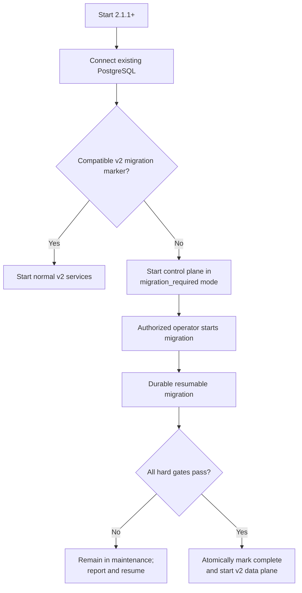
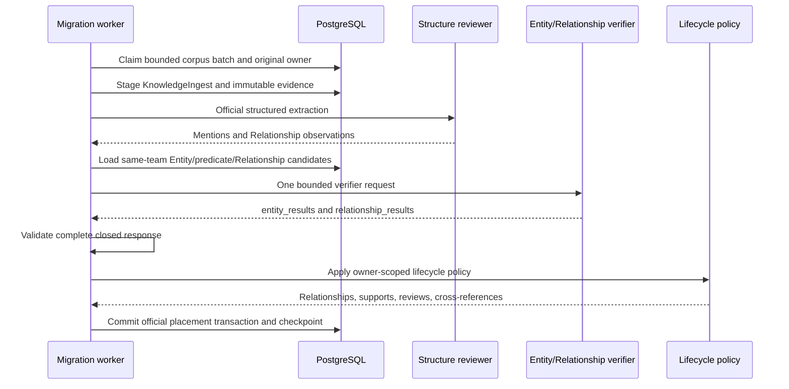

# Release Process

This page is the single source of truth for the staged PostgreSQL + `pgvector`
V2 release train, the bridge migration, automatic cutover, and the `2.2.0`
legacy-removal gate. Migration and cutover are high-blast-radius workflows:
verify backups, run them in boot-gated maintenance mode, preserve every
team/profile boundary, and fail closed when a hard gate does not pass.

## Release Principle

PostgreSQL becomes the only authority once. Dense-Mem does not dual-write
Neo4j and PostgreSQL and does not use a direct-copy shortcut around the official
v2 `remember` pipeline.

```mermaid
%%{init: {"flowchart": {"curve": "linear"}}}%%
flowchart LR
  V1["v1 current non-superseded<br/>knowledge in Neo4j"] --> Corpus["Versioned legacy corpus<br/>with team, author, provenance"]
  Corpus --> Remember["Official v2 remember pipeline"]
  Remember --> Verify["Entity and Relationship verifier"]
  Verify --> PG["PostgreSQL v2 ledger,<br/>current state, search jobs"]
  PG --> Gates["Hard migration gates"]
  Gates --> Cutover["Automatic PostgreSQL cutover"]
  Cutover --> Disconnect["Close and disconnect Neo4j"]
```



“Start clean” means the v2 semantic tables begin empty. Existing PostgreSQL
teams, profiles, API-key hashes, SSO mappings, permissions, audit/configuration,
and stable profile IDs remain in the same database.

## Bridge Release Contract

| Release | Legacy behavior |
| --- | --- |
| `2.0.x` and earlier | existing v1 runtime; an operator may remain here and delay the directional upgrade |
| `2.1.0` | release bootstrap only; no runtime authority change |
| `2.1.1` | contains the temporary boot-gated Neo4j corpus reader, official-pipeline migration control, and hard-gated automatic PostgreSQL cutover |
| `2.1.2+` within `2.1.x` | bug-fix releases for the `2.1.1` migration/cutover line; no additional planned migration phase releases |
| `2.2.0` and later | contains no Neo4j connection, driver, configuration, or migration adapter; requires a completed compatible `2.1.x` migration marker |

The `2.1.1` migration package is temporary and marked for removal in `2.2.0`.
Release notes must state that an installation upgrading from v1 must run
`2.1.1` or a later supported `2.1.x` bug-fix release, finish migration, and
only then upgrade to `2.2.0` or later.

```text
supported:   2.0.x -> 2.1.1+ bug-fix line -> migration complete -> 2.2.x+
unsupported: 2.0.x ----------------------------------------> 2.2.x+
```

Version `2.2.0+` reads the durable migration marker before starting normal
services. If it is absent or incompatible, startup fails with an actionable
message instructing the operator to run the required `2.1.x` bridge. It does not
attempt a partial compatibility mode.

## Before And After

| Before migration | After automatic cutover |
| --- | --- |
| PostgreSQL stores teams, profiles, keys, and control records | the same PostgreSQL records remain and v2 semantic/search records are added |
| Neo4j stores legacy semantic data | Neo4j is disconnected legacy backup input only |
| v1 claim/fact/fragment graph shapes | profile-owned v2 Relationships, evidence, verification, cross-profile references, and Hypotheses |
| existing legacy vectors/indexes | new v2 search documents and `pgvector` embeddings under linked embedding, search-index, and ranking versions |
| legacy runtime behavior | V2 MCP memory behavior plus first-party user/control portals; installations choosing not to migrate remain on their prior release instead of sharing the upgraded stores |

The old and new runtimes must not serve writes concurrently against the same
PostgreSQL/Neo4j stores. “Users may keep using v1” means not starting the upgrade
for that installation, not running v1 beside a migrating v2 instance.

## Boot-Gated Maintenance Mode

The cutover-capable `2.1.1+` server boots far enough to authenticate the
control portal, expose liveness and migration status, and write safe service
logs. It does not expose normal memory reads or writes until migration
completes.



MCP memory tools and user-portal memory views return a typed
`migration_required` or `migration_in_progress` response. `/health` remains
live; `/ready` remains non-success until automatic cutover. Only instance-level
control authentication may start, pause, resume, or inspect the global all-team
migration.

### Required service logs

Logs use bounded structured fields and never include evidence, prompts,
credentials, embeddings, or raw provider responses.

Required milestones include:

```text
migration_required: control URL, required backup checks, source/target versions
migration_started: run ID, corpus watermark, team/item counts
migration_progress: phase, completed/total, verifier calls, failures, ETA
migration_paused_or_failed: durable checkpoint and safe operator action
migration_validating: gate name and pass/fail counts
migration_completed: marker version and automatic cutover timestamp
neo4j_disconnect_required: close/restrict the legacy instance after backup retention
```

## Migration Phases

```mermaid
%%{init: {"flowchart": {"curve": "linear"}}}%%
flowchart LR
  Backup["1. Backup and preflight"] --> Expand["2. Add v2 PostgreSQL schema"]
  Expand --> Inventory["3. Inventory every team/profile"]
  Inventory --> Corpus["4. Build current legacy corpus"]
  Corpus --> Place["5. Run official remember placement"]
  Place --> Vectors["6. Build v2 vectors"]
  Vectors --> Validate["7. Validate all hard gates"]
  Validate --> Cutover["8. Automatic cutover"]
  Cutover --> Observe["9. Observe and disconnect Neo4j"]
```



### 1. Backup and preflight

Before migration writes:

- create PostgreSQL base/PITR backup identifiers and verify an isolated restore
- snapshot Neo4j and record database/version/count/checksum metadata
- back up required encryption/signing material separately
- verify disk, WAL, provider quota, verifier context limits, and embedding
  capacity from a representative rehearsal
- build and test a PostgreSQL-compatible v2 rollback image that never restores
  Neo4j authority
- verify no v1 or other v2 instance can write the same stores
- freeze the v2 domain, predicate registry, verifier schema, embedding contract,
  search-index profile, ranking profile, cluster-safe schema contract,
  PostgreSQL topology, and
  migration-corpus version

The control portal must not enable the Start action until required preflight
checks pass or the operator explicitly resolves a documented non-destructive
warning. A hard backup/restore failure cannot be waived.

### 2. Expand PostgreSQL

Apply additive migrations to the existing PostgreSQL database:

- install/version `pgvector`
- add v2 Entity/Value/Relationship/evidence/history/review/search/job tables
- add embedding-contract, search-index-profile, physical-build, and activation
  records
- create every new tenant-owned V2 table with non-null `team_id`, composite
  tenant keys/FKs, team-leading hot indexes, and team-scoped durable jobs
- add profile ownership and cross-profile reference constraints
- add RLS and audited migration-worker policies
- add append-only enforcement and owner-scoped semantic uniqueness
- add full-text, adjacency, and vector-supporting indexes
- add migration run, corpus, mapping, checkpoint, error, and marker tables

Existing team/profile/key/SSO/control rows are not copied, reissued, or
recreated. The migration references their stable IDs.

### 3. Inventory every team and profile

The migration covers every team. It records, by team and original owner:

```text
legacy nodes, active claims/facts/fragments, and edges
current versus superseded status
available evidence/provenance and lineage
missing/deactivated profile references
legacy predicates, object types, polarity, scope, and time
legacy embedding/index inventory
```

Knowledge with a resolvable original author retains that profile as immutable
`owner_profile_id`. The system migration actor is recorded separately as the
writer of the migration event. A missing/deactivated owner becomes an explicit
blocking inventory outcome until mapped to an existing tombstoned profile; it
is never silently reassigned to a current user.

### 4. Build the legacy corpus

Only current non-superseded v1 knowledge enters the migration corpus.
Superseded knowledge is not sent to models and does not become v2 semantic or
search state. The migration report retains its legacy IDs, counts, exclusion
reason, and checksum so the exclusion is auditable without importing the old
content.

Corpus construction preserves v1 lineage and avoids correlated duplicates:

1. prefer original active source fragments and exact provenance when available
2. attach current v1 claim/fact meaning as a migration hint, not a forced v2
   tier
3. when original fragments are absent, serialize the current legacy knowledge
   as `legacy_derived` corpus evidence with its real author and provenance gap
4. keep copies, summaries, and their originating fragment in the same source
   group
5. serialize legacy node/edge context only to help entity/predicate/relationship
   extraction; never allocate v2 IDs or copy old tiers directly

Every corpus unit has a stable hash, source legacy IDs, team ID, original owner
profile ID, source-group lineage, and migration-run version.

### 5. Run the official v2 pipeline

Migration uses the same internal application service as `remember`. It may use
an audited migration transport to preserve the original owner, but it cannot
write canonical semantic rows directly.



There is no shortcut that copies a Neo4j node into `entity_records`, copies an
edge into `relationship_records`, trusts a v1 tier, invents a predicate, or
skips the v2 verifier. Normal idempotency, duplicate prevention, source-group,
profile ownership, ambiguity, candidate, and unknown-predicate rules apply.

An `insufficient`, `ambiguous`, `needs_review`, `rejected`, or `quarantined`
official-pipeline result is a valid durable migration outcome. A provider/schema
failure, missing result, unresolved author, or uncheckpointed corpus item is
not. Migration completion requires every included corpus item to have one
terminal durable outcome.

“Terminal” here is migration-run state, not a fabricated normal placement
success. A corpus item may finish as `held_for_review` only after the official
pipeline durably creates the ordinary `awaiting_review` task and proves that no
dependent SemanticEdge/search document is active. The unresolved placement
remains visible after cutover for its owning team/profile to resolve through
the normal user workflow. This avoids an indefinite global outage while
preserving uncertainty instead of guessing or rejecting it.

Verifier batches obey the same serialized-byte and configured context/output
token budgets as ordinary placement. Oversized corpus units are deterministically
split before staging along source boundaries; independent placement outputs are
never spliced into one pretend verifier response.

### 6. Build new search documents and vectors

Legacy vectors are never copied. Eligible migrated Relationships and Entities
create new v2 search documents and embedding jobs under the persisted model,
dimensions, normalization, distance, and document-format contract.

Automatic cutover requires every migration-required vector job to be `current`.
Candidate/review/rejected records with no eligible search document are
`not_required`. Failed or stale required jobs keep the service in maintenance.

An initial community run may follow when the feature is enabled. Community is
derived and rebuildable, so an explicit configured degradation policy may allow
cutover without a current community result; it can never waive a canonical
knowledge/vector gate.

### 7. Hard validation gates

Automatic cutover occurs only when all hard gates pass:

- PostgreSQL schema/topology, `pgvector`, append-only rules, and embedding,
  search-index, and ranking contract versions valid
- zero nullable tenant rows, tenant constraints/lookups missing `team_id`, or
  cross-team semantic references
- every team and original owner accounted for
- every included corpus item has exactly one migration-terminal
  official-pipeline outcome, with every held review linked to its unresolved
  normal review task
- every excluded item is superseded and appears in the exclusion manifest
- zero cross-team visibility and zero cross-profile mutation
- zero duplicate same-owner Relationship identity
- every active endpoint resolves to a same-team Entity or Value
- every active Relationship is owned by the preserved original profile
- candidates/Hypotheses/reviews never appear as active SemanticEdges
- unknown predicates and identity ambiguity remain held, not guessed
- all required v2 vectors match current source/contract versions
- exact filtered cosine oracle and approved HNSW Recall@K checks pass
- sampled migrated trace reaches corpus lineage, verifier event, author, and
  source group
- `remember -> placement -> recall -> trace -> correction -> forget` smoke passes
- three-profile test proves A/B/C team reads and owner-only mutations

There is no operator confirmation between a passing final gate and cutover.
Gate failure leaves the data plane closed and the control/log status actionable.

Before the final gate queries run, the migration enters `finalizing`, stops new
batch claims, and waits for every lease to finish or expire. The marker
transaction locks the migration run/checkpoint, rechecks the terminal corpus,
owner, exclusion, and vector-version predicates against one database snapshot,
and aborts if any version/count changed. A previously generated report alone
cannot authorize cutover.

### 8. Automatic cutover

One PostgreSQL transaction records the compatible migration marker, final
corpus/checkpoint hashes, contract versions, and cutover time. Only after commit
does the process:

1. stop and close the Neo4j migration adapter
2. start normal placement, embedding, dream, and community schedulers
3. make `/ready` successful
4. enable V2 MCP memory tools and first-party user-portal memory views
5. log and display `neo4j_disconnect_required`

Neo4j cannot receive new truth or serve fallback reads after this point. The
operator should disconnect/network-restrict it and retain its snapshot for the
documented evidence window. Dense-Mem never deletes the instance automatically.

### 9. Observe and retire the bridge

Watch PostgreSQL health, queue age, verifier failures, vector freshness,
exact-versus-HNSW quality, conflict/clarification rates, RLS alerts, and
migration review backlog. Retain signed migration artifacts and Neo4j snapshot
checksums for the approved window.

The `2.2.0` release removes:

- Neo4j configuration parsing and secrets
- Neo4j connection/startup/readiness logic
- driver and testcontainer dependencies
- migration corpus reader, adapters, commands, portal actions, and code paths
- Compose services and network permissions for Neo4j

It retains only the PostgreSQL migration marker/version check and historical
migration reports required for audit.

## Progress And Resume Contract

Migration state lives in PostgreSQL:

```text
migration_run
phase and status
corpus version/watermark/hash
team/profile/item totals and completed counts
current checkpoint and lease owner
verifier attempts/tokens/regenerations
vector totals and freshness
terminal-outcome and exclusion counts
last error and retryability
started/completed/cutover timestamps
```

Workers use renewable leases and stable corpus/item idempotency keys. Restarting
`2.1.x` resumes from committed checkpoints. A retry does not duplicate evidence,
Entities, Relationships, supports, cross-references, or vectors.

## Rollback Boundaries

| Point | Permitted recovery |
| --- | --- |
| before migration starts | remain on v1 or restore the unchanged deployment |
| during maintenance before cutover | repair/resume `2.1.x`, or restore the verified pre-migration PostgreSQL and Neo4j backups before returning to v1 |
| after automatic cutover before new v2 writes | deploy a PostgreSQL-compatible v2 rollback build; do not restore Neo4j authority |
| after any v2 semantic write | PostgreSQL-compatible forward fix/rollback or PostgreSQL PITR according to the runbook; never point clients to stale Neo4j |

Do not truncate v2 tables, reverse-map v2 Relationships into Neo4j, or run v1
against the cut-over PostgreSQL state.

## Release Evidence

Retain:

```text
application/image digests and release versions
PostgreSQL schema and pgvector versions
predicate/verifier/embedding/search-index/ranking/corpus versions
PostgreSQL topology, node/shard versions, and connection budget
migration run/checkpoint/mapping/exclusion hashes
per-team/profile source and outcome counts
verifier token, regeneration, and failure totals
backup and isolated restore identifiers
cutover timestamp and automatic gate report
Neo4j disconnect/retention acknowledgement
```

Exclude secrets, unnecessary evidence content, prompts, and raw provider
responses.

Evaluation methodology and gate requirements belong in
[Evaluation](Evaluation). Its generated seeds, run results, and comparison
outputs are ignored local runtime data rather than release evidence.

## Database Migration Rules

Every PostgreSQL migration documents lock/rewrite/WAL/disk impact, RLS/role
changes, idempotency/restart behavior, validation queries, checkpoint keys, and
rollback boundary. Test it on empty, previous-release, and representative
restored databases. A low-lock or concurrent index operation still requires
measured CPU, disk, WAL, and query-impact evidence for the exact PostgreSQL and
`pgvector` versions.

## Risks And Mitigations

| Risk | Concrete failure mode | Mitigation |
| --- | --- | --- |
| LLM re-import changes meaning | verifier merges two same-name people or maps a legacy verb incorrectly | original corpus lineage, bounded candidates, ambiguity/review outcomes, and sampled trace validation |
| Review backlog blocks or pollutes cutover | one ambiguous legacy item either keeps every team offline or is guessed active | terminal `held_for_review` migration state, inactive semantic gate, and normal owner review after cutover |
| Shortcut bypasses v2 rules | migration copies a legacy fact edge directly as active | official application-service path only; integration test forbids direct semantic migration writes |
| Duplicate evidence promotes fact | fragment plus derived v1 fact are counted as independent | lineage-based source groups and corpus dedupe |
| Original author is lost | system migration actor becomes owner of every Relationship | explicit preserved `owner_profile_id`, separate migration actor, and per-profile count gate |
| Cross-profile overwrite | B's migrated correction supersedes A's record | owner-scoped identity/lifecycle and immutable cross-references |
| Superseded data reappears | old v1 knowledge is treated as current corpus | current-status filter plus exclusion manifest/checksum gate |
| Automatic cutover serves partial state | final verifier/vector batch changes after validation but before the marker | drain claims, lock the finalizing run, recheck gates in the marker transaction, and write only after zero blocking outcomes |
| v1 writes during migration | source changes after corpus watermark | boot-gated exclusive maintenance and explicit shared-store lock |
| Restart duplicates knowledge | migration resumes from an in-memory counter | PostgreSQL checkpoints and stable corpus/placement idempotency keys |
| 2.2 skips bridge | deployment has no v2 semantic state or legacy reader | mandatory compatible migration marker and actionable startup failure |
| Neo4j remains accidental dependency | post-cutover readiness still checks the graph | close adapter at cutover; removal tests in `2.2.0` |
| Vector build overload | new HNSW/index work exhausts disk/WAL | rehearsal, bounded workers, capacity gates, and progress telemetry |
| Cluster profile activates partially | one standby/shard lacks the required operator or index while cutover opens | topology-wide version/plan/oracle gate before activation and cutover |

## Release Checklist

- [ ] latest `2.1.x` bridge and migration-corpus versions selected
- [ ] PostgreSQL/PITR and Neo4j backups restored successfully in isolation
- [ ] PostgreSQL-compatible v2 rollback image tested against the migrated schema
- [ ] no other v1/v2 writer can access the migration stores
- [ ] additive schema/RLS/ownership migrations pass
- [ ] all teams and original profile owners inventoried
- [ ] superseded exclusion manifest reviewed and hashed
- [ ] legacy corpus lineage/source groups generated
- [ ] every included item reaches one terminal official-pipeline outcome
- [ ] all required v2 vectors are current
- [ ] semantic, ownership, trace, recall, and tenant gates pass
- [ ] automatic cutover marker and service transition succeed
- [ ] Neo4j disconnect message appears in portal and service log
- [ ] Neo4j snapshot retained and live instance restricted/disconnected
- [ ] `2.2.0` upgrade requirement documented for users
- [ ] release evidence archived without secrets or unnecessary content
