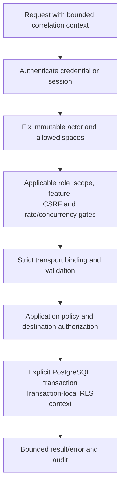
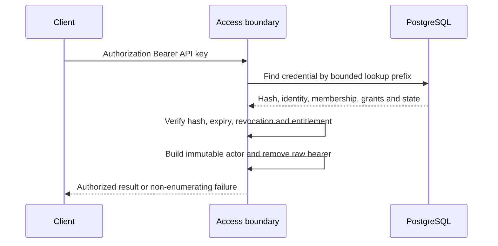
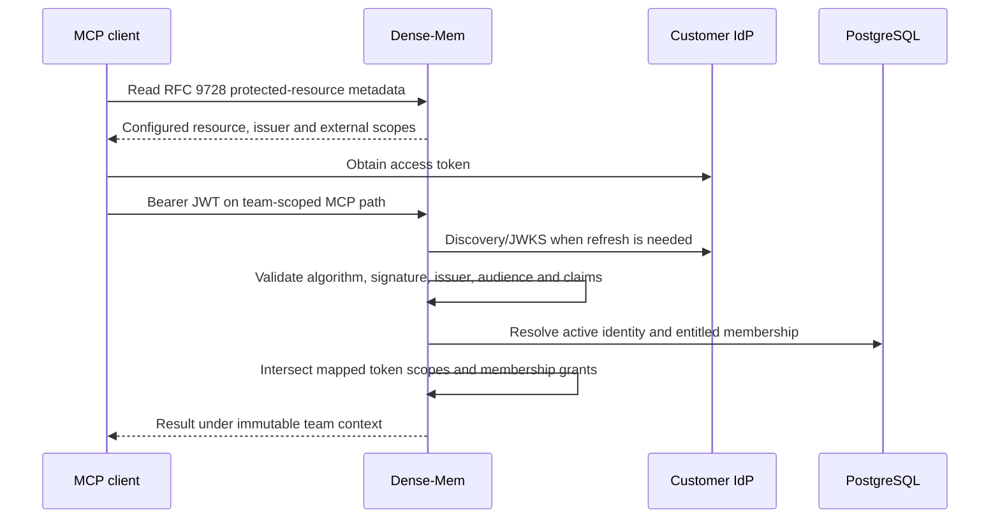
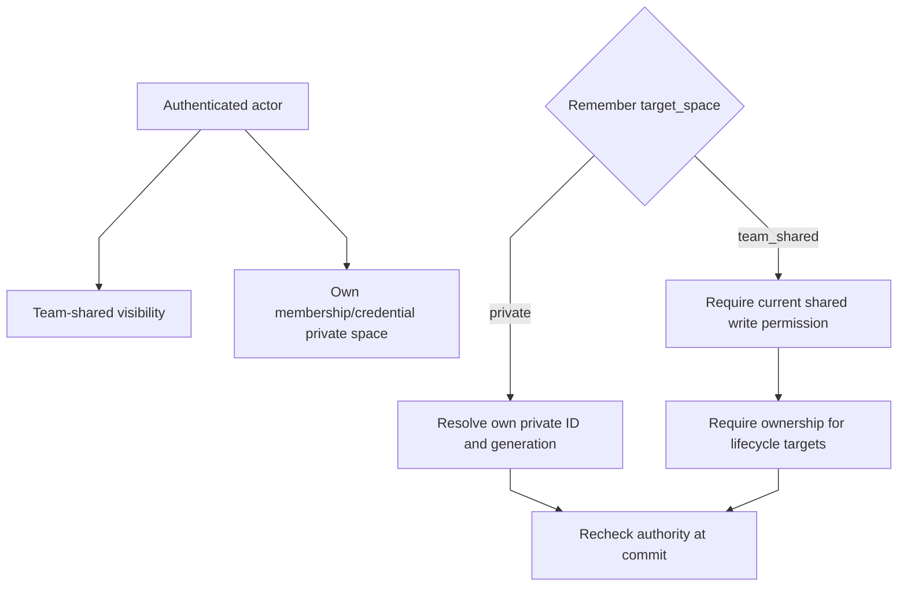

# Request Lifecycle And Security

Authentication fixes an immutable team, identity, membership, permanent owner alias, role, grants, allowed spaces, optional credential, and correlation context. Later layers can restrict this authority; user text, headers, tool arguments, and provider output cannot replace it.

## Network Surfaces

| Surface | Authentication and exposure |
| --- | --- |
| MCP on the main listener | API-key or configured OAuth bearer; intentional public HTTPS. |
| User portal | Direct API-key bearer, optional API-key portal session, or configured SSO browser session. |
| Control listener | Separate control token/administrative SSO; private or dedicated administrative ingress. |
| Metrics | Private authenticated scrape endpoint. |
| Health/readiness | Bounded probes under deployment ingress policy. |

Port numbers and public origins belong to [Configuration](Configuration); ingress procedures belong to [Public HTTPS And Redis](Public-HTTPS-And-Redis).

## Protected Request Boundary

This is a responsibility map; individual middleware ordering varies by registered route. Transports bind/translate, application owners decide policy, and storage/provider adapters implement ports. Required errors remain visible.

## API-Key Authentication

The database retains a strong password hash and bounded display/lookup metadata. Creation and rotation return raw key material once. Raw authentication material never enters provider requests, audit projections, or operational logs. See [Portals And API Keys](Portals-And-API-Keys#credentials-and-api-keys) for administration.

## OAuth Bearer Authentication For MCP

Tokens require an allowlisted asymmetric algorithm, matching public key, exact issuer/audience, subject, expiry, configured identity claim, active identity, and active membership. MCP tokens cannot auto-provision membership. Dense-Mem does not acquire, refresh, issue, or persist these access tokens.

Prefer `/teams/{team_id}/mcp`. A configured team claim and path must agree. Unscoped OAuth requires a unique active membership or the configured team claim. API-key teams must also match scoped paths.

RFC 9728 metadata and the `401` challenge's `resource_metadata` link require the configured `MCP_PUBLIC_BASE_URL`; request Host/forwarded headers cannot choose the advertised origin. Disabled providers are not advertised. Endpoint paths are in [Technical Reference](Technical-Reference#http-surface).

## Browser Session And CSRF

| Authentication | Boundary |
| --- | --- |
| Direct API key | Bearer authentication on the first-party user interface. |
| API-key portal session | Explicit opt-in exchange; opaque session references a stable credential ID. |
| Browser SSO | Separate OIDC authorization-code/PKCE session tied to the selected membership. |
| MCP | Accepts bearer credentials only; neither browser cookie authenticates MCP. |

Portal and SSO cookies use secure/HttpOnly/SameSite policy and a readable double-submit CSRF cookie. Cookie-authenticated mutations require `X-Dense-Mem-CSRF`. API-key portal sessions have an absolute seven-day lifetime and reload current credential authorization on each request. Rotation preserves the stable ID; revocation, expiry, and entitlement loss still invalidate access.

An invalid presented cookie does not silently become authenticated by another source. Portal/SSO exchanges clear the alternative browser session as implemented. Session persistence and CSRF tokens use fingerprints; the raw API key is not stored as the cookie value.

[Portals And API Keys](Portals-And-API-Keys#sign-in-and-connect) owns login procedures; [User Portal SSO](User-Portal-SSO) owns IdP setup and entitlement mapping.

## Memory Space Authorization

| Operation | Authority |
| --- | --- |
| Read/recall | Authenticated team and allowed spaces, then target authorization. |
| Remember privately / ingest session | Own active private space; team-read-only callers retain private write access. |
| Remember shared | Explicit shared target and current write permission. |
| Supersede/retract | Target ownership as well as destination permission. |
| Trace/export | Read authorization for every Evidence target and exposed provenance. |
| Ontology | Eligible shared sources; private sources excluded. |

Every API credential has its own private space through its API-client membership. SSO/OAuth use the user's selected team membership private space. Credentials issued by one SSO user remain isolated from each other and from that user's membership-private space. A manager cannot read another user's private memory merely by being a manager.

Payloads cannot provide actual team/owner/space IDs as authorization. A denied shared write is never redirected. Destination participates in replay identity. Scopes and feature visibility are rechecked for both `tools/list` and `tools/call`.

## Row And Search Isolation

Normal storage work uses explicit transactions with transaction-local team/profile RLS context. System and migration modes are separate audited entrypoints, not request-selectable options.

Scope full-text, vector, source, and topic-membership reads before IDs leave the adapter. Reauthorize during hydration and mutation. Use bound SQL values. Redis key namespacing prevents collisions; it is not an authorization boundary. See [PostgreSQL Cluster-Safe Schema](PostgreSQL-Cluster-Safe-Schema).

## Write-Time Security

Strict input validation and the initial deterministic scan precede provider work. The scan examines submitted text and provenance for supported instruction overrides, active markup, hidden controls, credential extraction, and exfiltration attacks while preserving admitted exact text.

Ordinary identifiers, punctuation, and harmless encoded notation do not reject merely for looking unusual. Initial security rejection retains content-free bounded rule/span/correlation metadata. Passing admission still requires complete assessor security review. Models cannot override deterministic rejection or choose durable state.

[Memory Write Pipeline](Write-Pipeline) owns subsequent orchestration; [Technical Reference](Technical-Reference#errors-and-client-actions) owns public error fields and client actions.

## Diagnostics, Providers, And Audit

| Surface | Exposure contract |
| --- | --- |
| Provider request | Authorized bounded task data; no raw operational credentials, request headers, or arbitrary tool access. |
| Admitted operator diagnostics | Exact admitted fields/text can remain in bounded protected captures for diagnosis. Configured operational secrets and supported serialized authentication forms are protected. |
| Initial security rejection | No request-content capture. |
| Public errors and audit | Separate bounded projections; no cross-team existence disclosure. |
| External exports | Authorized Evidence/provenance under their explicit omission/content contract. |

A field name or secret-like phrase alone does not cause masking. Registered operational credentials and authentication material must remain protected. Diagnostic capture availability, delivery observations, and retention are defined in [Telemetry](Telemetry#operation-logs-and-protected-captures).

Long-lived streams honor cancellation and configured lifetime/concurrency bounds, releasing slots on every disconnect or error. Multiple instances require distributed coordination; they cannot silently fall back to independent counters.

## Progress Notification Boundary

See [implementation status](Documentation-Maintenance#implementation-status) and the [protocol contract](Technical-Reference#optional-progress).

| Boundary | Rule |
| --- | --- |
| Request and actor | Route progress only to the originating authenticated call/session. Equal tokens from different clients never merge routing or authority. |
| Correlation token | Client metadata correlates messages; it cannot choose team, profile, destination, ownership, or another request. Treat it as untrusted caller metadata when producing diagnostics. |
| Public payload | Fixed bounded stage messages; no Evidence text, provider output/reasoning, operational credentials, or private-context details. Operator captures remain a separate exposure contract. |
| Delivery | Bound each optional write to 100 ms and the earlier phase/request deadline, outside semantic transactions. Unsupported write deadlines or delivery failure disable subsequent updates. Preserve required outcomes and existing disconnect/cancellation rules. |
| Lifetime | Stop notifications before the final response; preserve phase/operation deadlines and release stream resources on every exit. |

A progress update does not extend a request deadline or prove a commit.

| Negotiated MCP protocol | Disconnect behavior |
| --- | --- |
| `2025-11-25` | Closing the client connection can leave server processing running. |
| `2026-07-28` | The transport propagates request cancellation. |

A disconnect can lose receipt delivery after a commit under either protocol. Follow [unchanged-request recovery](Write-Pipeline#replay-and-recovery).

Envelope-token decoding preserves large integer values exactly. The token stays outside the tool arguments and canonical request hash. Eligibility logs omit its value before admission; stage-delivery diagnostics use the existing credential protector.

## Private Erasure Boundary

Erasure seals the authorized private target, advances/fences its generation, checks applicable holds, and purges the catalog-complete scope. Old receipts and unfinished jobs cannot recreate erased content. Unaffected spaces remain separate. [Portals And API Keys](Portals-And-API-Keys#private-memory-erasure) owns the request/status workflow; [Operations Runbook](Operations-Runbook#private-memory-erasure) owns operator recovery.
