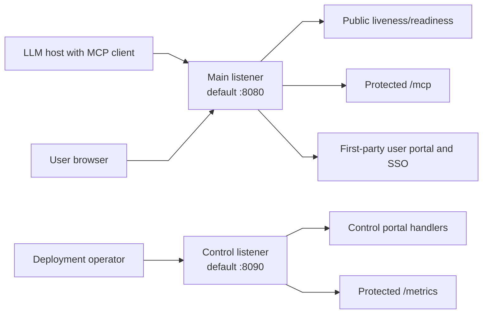
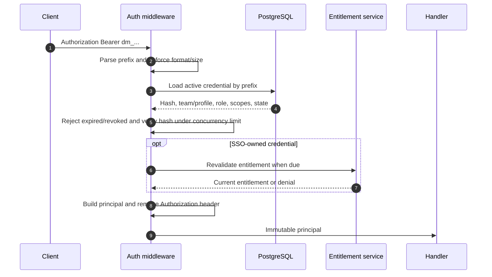
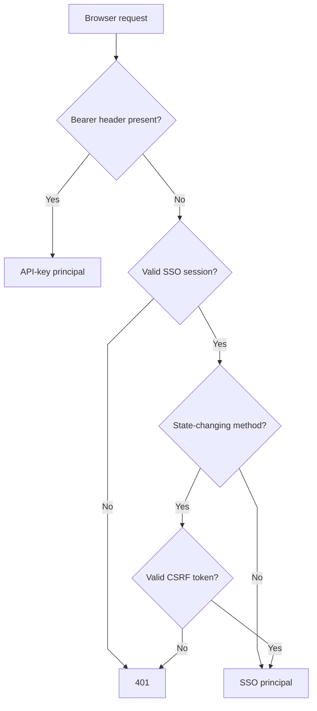
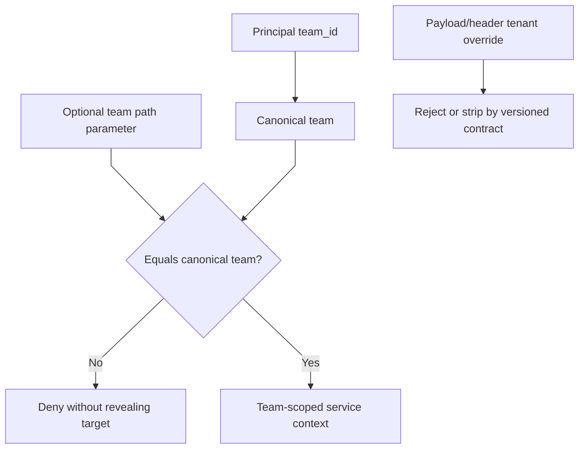
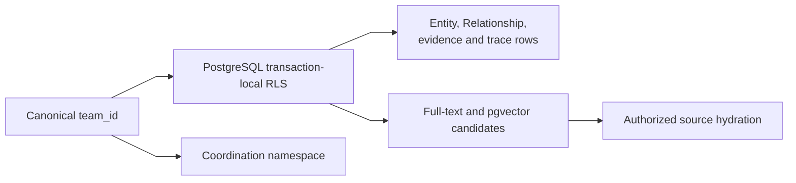
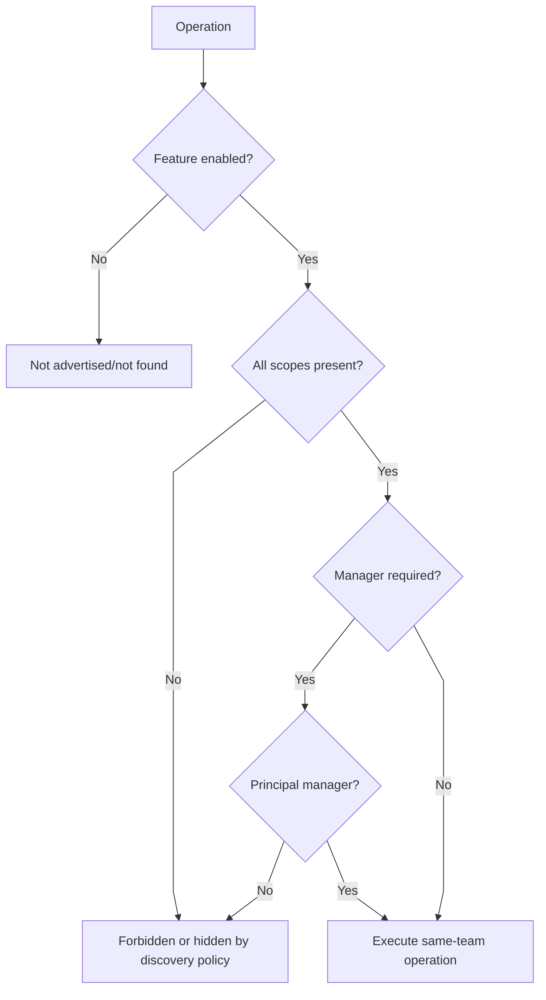
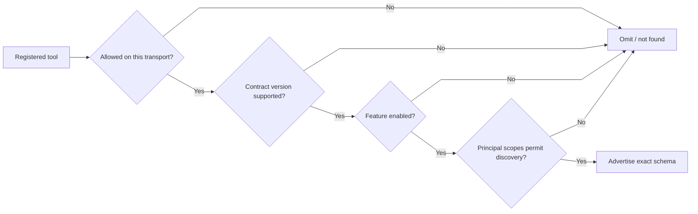
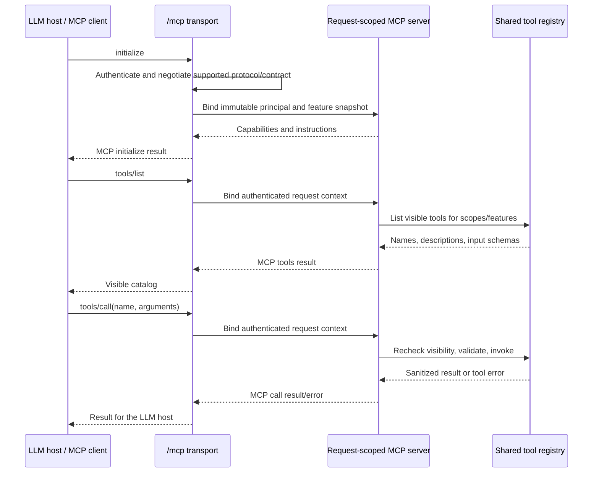
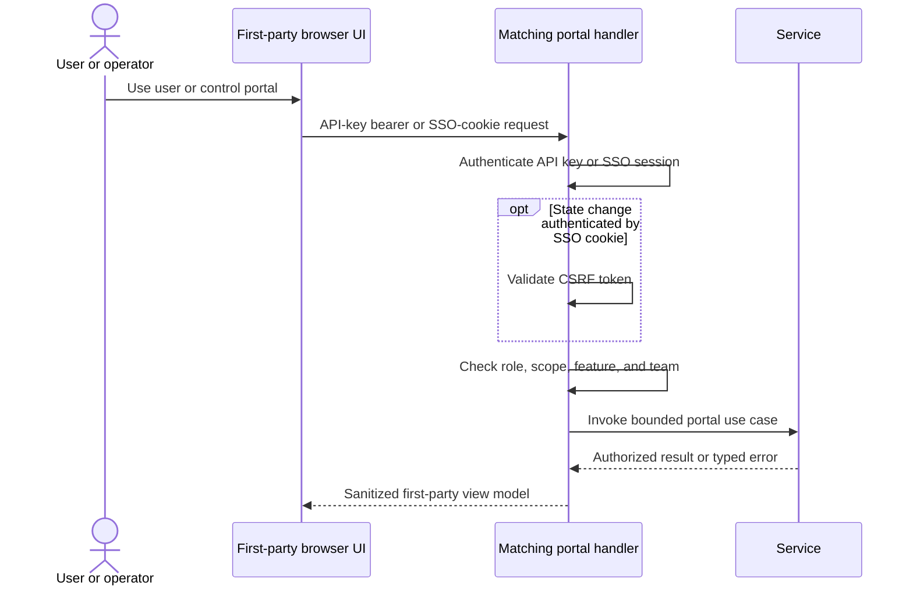

# Request Lifecycle And Security

Dense-Mem exposes an MCP memory interface, a first-party user portal, and a
private control portal. Protected requests share one identity model:
authentication fixes the team/profile; later layers may only restrict access.

This page defines the target request/security contract for the full refactor.
Key provisioning is in [Portals And API Keys](Portals-And-API-Keys).

## Network Surfaces



The control listener has separate authentication and a broader cross-team
threat model. Keep it private or behind a dedicated administrative ingress.
The user portal and control portal may use server-owned browser endpoints, but
those endpoints are implementation details of their matching UI rather than an
external memory integration contract.

## Protected Request Chain

```mermaid
%%{init: {"flowchart": {"curve": "linear"}}}%%
flowchart LR
  Request["Request"] --> Correlation["1. Correlation and safe limits"]
  Correlation --> Auth["2. Authenticate"]
  Auth --> Principal["3. Build canonical principal"]
  Principal --> CSRF["4. CSRF check for cookie mutation"]
  CSRF --> Authorize["5. Scope, role, feature,<br/>and same-team authorization"]
  Authorize --> Rate["6. Rate/concurrency limit"]
  Rate --> Bind["7. Strict bind and validation"]
  Bind --> Service["8. Application service"]
  Service --> Audit["9. Outcome audit/telemetry"]
  Audit --> Response["10. Sanitize response/error"]
```



A handler never receives the raw bearer credential and never accepts a payload
`team_id` as authority.

## Principal

```text
principal_id/profile_id
team_id
role
scopes
credential_id
authentication_method
SSO entitlement version when applicable
correlation_id
```

The principal is immutable for one request. Background work stores the actor and
team at intake, then runs under a system-worker context that still scopes every
record to that team.

## API-Key Authentication



The database stores a strong password hash, lookup prefix, bounded display
suffix, expiry, revocation, and activity metadata. Raw keys are returned once.

Authentication failures use non-enumerating public responses. Internal audit can
distinguish malformed, unknown, expired, revoked, and entitlement-denied
outcomes.

## Browser Session And CSRF

The user portal preserves two authentication paths: a Dense-Mem API key or,
when configured, an SSO browser session. API-key requests authenticate with the
bearer credential. SSO routes may authenticate a secure, HttpOnly, SameSite
session cookie; state-changing requests using that cookie require a CSRF token
bound to the session.



OIDC and entitlement behavior is in [User Portal SSO](User-Portal-SSO).

## Team Resolution



MCP/normal tool calls need no team field. Administrative routes may include a
team path solely to identify the same authorized target. Cross-team control
operations use the control-plane principal and explicit audit, not a user key.

## Row And Search Isolation



Redis namespacing is not an authorization boundary. Search over-fetch never
returns raw cross-team candidates. Every ID supplied by a provider/client is
revalidated against the principal before hydration or mutation.

Team scope grants read visibility to eligible knowledge authored by any active
same-team profile. It does not grant mutation authority. Ordinary updates to a
Relationship, support decision, supersession, forget, merge, split, or Entity
resolution additionally require the durable owner profile to equal the
authenticated profile. Cross-profile correction creates caller-owned knowledge
and an append-only same-team cross-reference.

Stable Evidence sources have separate immutable ownership. A source revision
may be advanced only by that source owner with `write` scope and an exact prior
revision token. The resulting support and status recomputation may affect every
same-team profile that adopted that source, but the caller cannot name arbitrary
Relationships or rewrite their history. System policy follows source/support
dependencies and appends the resulting events.

## Role Versus Scope

| Control | Target values | Meaning |
| --- | --- | --- |
| role | `manager`, `member` | same-team administrative authority |
| scope | `read`, `write`, `feedback:read` | operation capabilities |



| Capability | Scope | Role/policy note |
| --- | --- | --- |
| recall, trace, context, Entity/Relationship inspection | `read` | member or manager |
| remember and placement resolution | `write` | creates caller-owned knowledge; authoritative evidence additionally follows authority policy |
| advance owned source revision | `write` | exact source ownership and prior-revision compare-and-set; effects follow indexed support dependencies |
| merge/split/supersede/forget | `write` | caller-owned observations and Relationships only |
| confirm/challenge another profile | `write` | submit caller-owned evidence through normal remember; target remains immutable |
| release security quarantine | `write` | manager role also required; appends release and re-enters guarded processing |
| recall-feedback submission | `write` | feature enabled |
| stored feedback inspection | `read + feedback:read` | feature enabled; same-team/control restrictions |
| evaluation tools | `read + write` | evaluation mode; disposable teams only |
| team/profile/key administration | route-specific | manager for same-team operations |
| cross-team administration | control-plane auth | never a normal user-key capability |

Role never implies scope.

## Tool Visibility



MCP discovery and execution share one registry and the same visibility check.
The registry also declares allowed transports. Semantic memory tools are
MCP-only: HTTP tool catalogs and OpenAPI omit them, and generic HTTP execution
returns not found. Disabled, unauthorized, or transport-ineligible tools do not
leak through another catalog or execution path. The exact tool set belongs in
[Technical Reference](Technical-Reference#production-http-surface).

## MCP Memory Interface

The LLM host is the MCP client. Dense-Mem exposes the tool catalog and executes
memory operations through three MCP methods:

| MCP method | Purpose | Memory effect |
| --- | --- | --- |
| `initialize` | negotiate the MCP protocol and report server capabilities/instructions | none |
| `tools/list` | return the authenticated profile's visible tool names, descriptions, and input JSON Schemas | none |
| `tools/call` | invoke one visible tool by name with schema-validated arguments | depends on the selected tool and its scope |

`tools/list` lets the host understand that tools such as `remember`,
`recall_memory`, and `trace_memory` exist and how to call them. It is discovery,
not a recall. `tools/call` is the execution envelope used for every memory tool;
the selected tool still owns its exact input, authorization, idempotency, and
read/write behavior.



The runtime advertises supported MCP protocol versions. Do not hardcode one
protocol date in the manual as timeless.

The negotiated MCP protocol version and Dense-Mem tool contract
`dense-mem.v2.3` are
different versions. The host follows the current `tools/list` schemas and
server instructions instead of applying a cached input shape from another
Dense-Mem release.

The protocol boundary guarantees authenticated MCP semantics; it cannot prove
that a particular model produced the request because any conforming host can
implement MCP. API keys, scopes, feature visibility, strict schemas, team
isolation, and audit remain the enforceable controls.

Long-lived receive streams acquire a bounded same-principal slot, emit
heartbeats, terminate at configured duration, and release the slot on every
disconnect/error path. Redis coordinates slots across replicas when required.

## First-Party Portal Interfaces



The user portal supports same-team recall, graph/trace, review, key management,
and permitted telemetry. The control portal supports private cross-team
configuration, security, and operations. Portal handlers call the
same application services and PostgreSQL authority as MCP where their use cases
overlap, but their browser endpoints are not a supported client SDK or memory
automation interface.

This boundary does not convert API-key portal login into an HttpOnly session.
HttpOnly/SameSite cookie and CSRF requirements apply to the SSO-session path;
API-key authentication remains the bearer-key path.

## Idempotency

Write operations accept operation-scoped idempotency keys. The key binds to the
authenticated principal and a canonical request hash.

| Reuse | Result |
| --- | --- |
| same key, same request | return/recover the original operation |
| same key, different request | conflict error |
| same key, another team/profile | unrelated namespace |
| expired retention | treated according to documented operation policy |

Idempotency state is durable in PostgreSQL, not Redis.

## Rate Limits

Rate limits apply after authentication so keys/teams can be scoped. Public edge
limits apply earlier as denial-of-service defense.

In-process counters are correct only for one instance. Multi-instance
deployments require Redis/distributed coordination; an outage must not silently
weaken the promised global limit.

## Health And Readiness

| Endpoint | Meaning |
| --- | --- |
| `GET /health` | liveness; process can respond even when degraded |
| `GET /ready` | readiness; returns non-success when required dependencies/policies fail |

Readiness includes PostgreSQL migrations/RLS, `pgvector`, the persisted
embedding contract, active search-index generation/topology parity, required
provider contracts, complete Relationship text projection, placement/embedding
backlog policy, and Redis when distributed coordination is required.
Relationship vector-generation warming is an optional recall degradation after
text convergence; incomplete Relationship text projection is a readiness
failure. Optional feature outages appear as degradation unless deployment
policy makes them required.

Do not use liveness as a readiness gate.

## Error Boundary

Public errors carry code, safe message, retryability, optional bounded details,
and correlation ID. They never include:

- raw database/provider errors or queries
- stack traces
- evidence/prompts/responses
- credentials/cookies/tokens
- embeddings
- cross-team existence hints

Typed error schema is in [Technical Reference](Technical-Reference#error-contract).

## Provider Isolation

Evidence and Entity/predicate candidates are untrusted prompt data. Stored
Relationships, source authority, and source independence are not verifier
inputs. The write path uses a deterministic `pass | guarded | quarantine` scan,
bounded payloads, capability-free providers, required bounded model security
signals, structured outputs, strict allowlist validation, and independent
deterministic policy. Provider output can only escalate security handling; it
cannot clear a deterministic signal, select a stored Relationship or cross-team
ID, create support, release quarantine, or write lifecycle status/support.

## Audit

Audit high-value events:

- key/profile/team changes
- authority changes and review decisions
- source revision activation, fragment supersession, and resulting
  support/status transitions
- deterministic/model quarantine and manager release
- Entity merge/split
- Relationship retraction/supersession corrections
- Conflict case open/reopen/resolve/overdue/dismiss decisions and policy version
- memory-pack import/rollback
- runtime configuration changes
- repeated authentication/rate/security failures
- control-plane access

Audit is durable and append-only where required. Prometheus/logs are not the
audit ledger.

## Risks And Mitigations

| Risk | Concrete failure mode | Mitigation |
| --- | --- | --- |
| Tenant override | payload chooses another team's Entity | immutable principal, strict schema, same-team ID validation |
| Raw key leak | downstream log/provider receives Authorization | auth middleware removes header and sensitive-value tests |
| Cookie CSRF | browser session mutates memory cross-site | SameSite/secure cookie and required CSRF token |
| Discovery/execution drift | `tools/list` advertises a tool that `tools/call` then hides, or execution bypasses discovery policy | one registry and the same visibility/scope predicate for both methods |
| HTTP bypass exposes a second memory contract | generic tool execution or OpenAPI publishes an MCP-only semantic memory tool | transport allowlist on catalog, execution, and schema generation plus not-found conformance tests |
| Portal backend becomes an integration API | external clients depend on browser implementation details and bypass the intended MCP contract | same-origin portal boundary, no public SDK/OpenAPI/CORS contract, API-key-or-SSO authentication, and CSRF for SSO-cookie mutations |
| Redis outage weakens limits | replicas fall back to independent counters | distributed-required readiness failure |
| Search candidate leakage | global vector search exposes another team's text | internal filtering and authorized hydration before return |
| System-worker privilege leak | placement or embedding worker writes the wrong team | stored team on every job, explicit system transaction mode, source-version predicates, and audit |
| Error enumeration | wrong-team ID returns different detail | non-enumerating public errors and internal audit only |
| Cross-profile overwrite | write-scoped B retracts A's Relationship by ID | immutable principal profile, owner predicate on mutation, and caller-owned correction links |
| Quarantine override | ordinary writer releases a malicious fragment | require manager role plus `write`, append actor/reason, and re-enter only as guarded |
| Source-key takeover | a writer advances another integration's source and demotes team knowledge | bind source identity to immutable owner and require exact prior-revision compare-and-set |

## Acceptance Invariants

1. request data cannot override authenticated team
2. raw credentials never reach services/providers/logs
3. `tools/list` and `tools/call` use the same registry, feature visibility, and
   scope policy
4. every durable, full-text, vector, and adjacency access is team-scoped
5. role and scopes are checked independently
6. write idempotency is durable
7. multi-instance limits do not silently fall back
8. background workers preserve original team scope
9. public errors cannot reveal cross-team existence
10. same-team read visibility never authorizes cross-profile lifecycle,
    support, or identity mutation
11. user/control portal handlers remain first-party views and do not become a
    public memory automation contract
12. user-portal API-key login remains supported alongside configured SSO;
    HttpOnly session and CSRF semantics apply only to cookie-authenticated SSO
    requests
13. only a manager with `write` can release quarantine, and release cannot bypass
    guarded scanning/model policy
14. a source revision can be advanced only by its immutable source owner and an
    exact expected prior token
15. semantic memory tools are visible and executable through MCP only; HTTP
    catalogs, generic execution, and OpenAPI cannot expose them
