# Request Lifecycle And Security

Dense-Mem exposes an MCP memory interface, a first-party user portal, and a
private control portal. Protected requests share one identity model:
authentication fixes the team, actor identity, membership, permanent owner
alias, and optional credential; later layers may only restrict access.

This page describes the current request and authorization boundaries.

## Current Remember execution

After authentication and strict binding, Remember scans the request and
serializes its scoped retry key. It prepares authorized duplicate/candidate
context, assesses the complete response, embeds required documents, and commits
accepted effects in one fenced transaction. Duplicate-detection embeddings can
precede assessment. The originating call returns the terminal result; earlier
cancellation and source/space/version races remain authoritative.
Key provisioning is in [Portals And API Keys](Portals-And-API-Keys).

## Network Surfaces

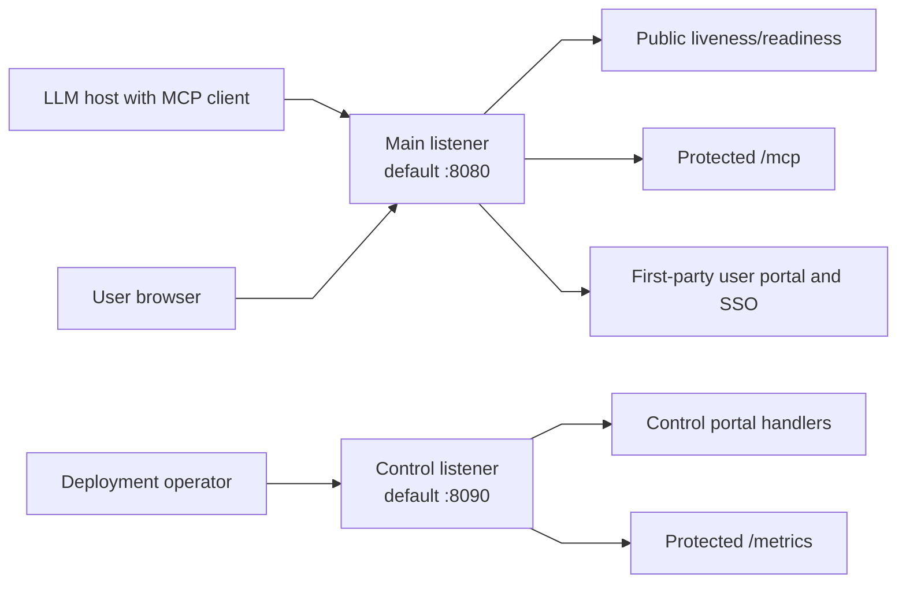

The control listener has separate authentication and a broader cross-team
threat model. Keep it private or behind a dedicated administrative ingress.
The user portal and control portal may use server-owned browser endpoints, but
those endpoints are implementation details of their matching UI rather than an
external memory integration contract.

## Protected Request Chain

```mermaid
%%{init: {"flowchart": {"curve": "linear"}}}%%
flowchart LR
  Request["Request"] --> Correlation["1. Correlation and safe limits"]
  Correlation --> Auth["2. Authenticate"]
  Auth --> Principal["3. Build canonical principal"]
  Principal --> CSRF["4. CSRF check for cookie mutation"]
  CSRF --> Authorize["5. Scope, role, feature,<br/>and same-team authorization"]
  Authorize --> Rate["6. Rate/concurrency limit"]
  Rate --> Bind["7. Strict bind and validation"]
  Bind --> Service["8. Application service"]
  Service --> Audit["9. Outcome audit/telemetry"]
  Audit --> Response["10. Sanitize response/error"]
```

A handler never receives the raw bearer credential and never accepts a payload
`team_id` as authority.

## Access Application Boundary

After authentication fixes the principal, access policy is applied through one
application API. That boundary owns identity, credential, SSO/OAuth/SCIM,
portal-session, entitlement, rate-limit, cleanup, and redacted access-audit
use cases. Its consumer-owned ports cover persistence and coordination; the
transport layer does not call PostgreSQL, Redis, or process-local stores
directly.

```text
MCP/HTTP middleware and portal handlers
                 │ immutable principal + access use case
                 ▼
       access application policy
                 │ narrow ports
                 ▼
 PostgreSQL repositories / Redis or in-process coordination
```

The adapters remain interchangeable implementations. Redis and process memory
coordinate limits, stream slots, and leases only; PostgreSQL remains
authoritative for identity, credentials, sessions, audit, and durable state.

## Principal

```text
team_id
identity_id
membership_id
owner_id
role
grants
credential_id (optional)
authentication_method
SSO entitlement version when applicable
correlation_id
```

The principal is immutable for one request. Background work stores the actor and
team at intake, then runs under a system-worker context that still scopes every
record to that team.

## API-Key Authentication

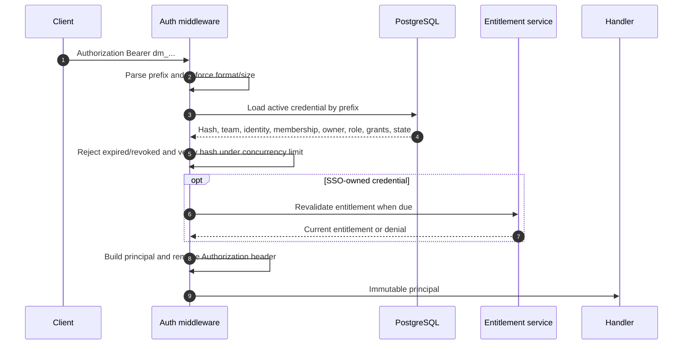

The database stores a strong password hash, lookup prefix, bounded display
suffix, expiry, revocation, and activity metadata. Raw keys are returned once.

Authentication failures use non-enumerating public responses. Internal audit can
distinguish malformed, unknown, expired, revoked, and entitlement-denied
outcomes.

## OAuth Bearer Authentication For MCP

Dense-Mem can also act as an OAuth protected resource for MCP. It accepts a
customer IdP access token only in the `Authorization: Bearer` header on
`/mcp` or `/teams/{team_id}/mcp`; it never issues, refreshes, or persists that
token. Browser SSO and API-key portal cookies are not MCP credentials, even
when the browser and MCP client use the same identity.

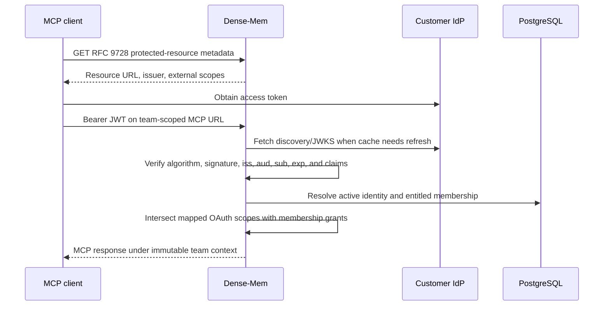

An unscoped OAuth request is valid only when the identity has exactly one
active Dense-Mem membership or the configured token claim selects one. A
multi-team client should use `/teams/{team_id}/mcp`; a path/claim mismatch or
an unentitled team fails closed. API-key bearer authentication remains valid on
both MCP paths, and its immutable team must match a scoped path.

RFC 9728 metadata is available at
`/.well-known/oauth-protected-resource/mcp` and
`/.well-known/oauth-protected-resource/teams/{team_id}/mcp`. An OAuth-enabled
deployment links the matching metadata document from a `401` challenge with
`WWW-Authenticate: Bearer resource_metadata="..."`. Metadata responses use
`Cache-Control: no-store`; disabled providers are not advertised. Both the
document and challenge link require `MCP_PUBLIC_BASE_URL`; request Host and
forwarded headers are never an origin fallback. `/ui` separately uses its own
browser origin when the setting is empty so a user can still copy a scoped MCP
URL for manual configuration.

## Browser Session And CSRF

The user portal preserves direct Dense-Mem API-key authentication and browser
sessions. A user may explicitly exchange an API-key bearer login for an opaque
server-side portal session. When configured, SSO has its own browser session.
Portal and SSO sessions use secure, HttpOnly, SameSite cookies plus a readable
double-submit CSRF cookie; state-changing requests using either cookie require
the `X-Dense-Mem-CSRF` header. The portal session is fixed at seven days and
reloads current API-key authorization on every request.

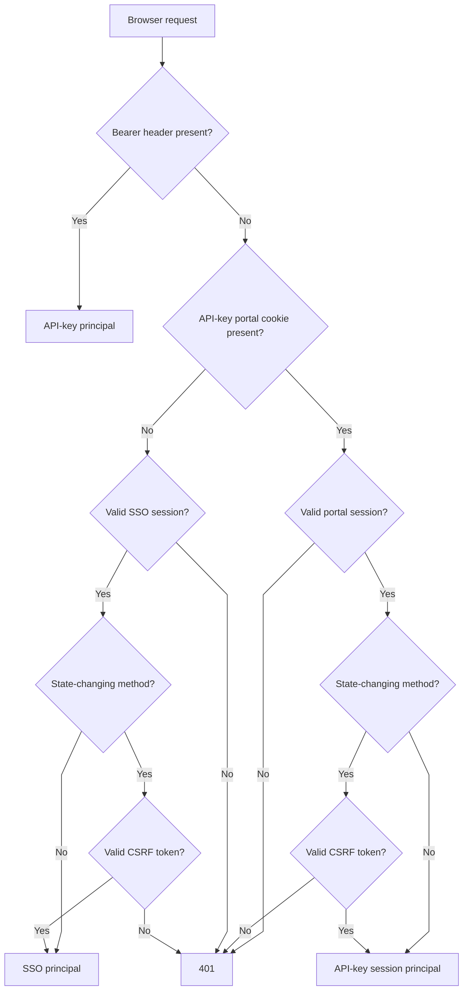

OIDC and entitlement behavior is in [User Portal SSO](User-Portal-SSO).

## Team Resolution

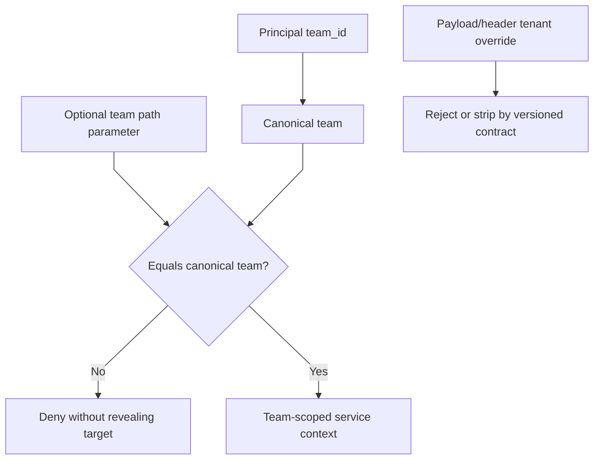

MCP/normal tool calls need no team field. Administrative routes may include a
team path solely to identify the same authorized target. Cross-team control
operations use the control-plane principal and explicit audit, not a user key.

## Row And Search Isolation

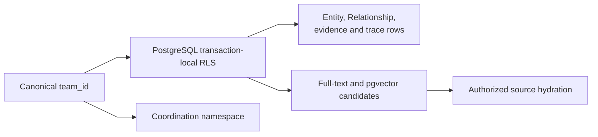

Redis namespacing is not an authorization boundary. Search over-fetch never
returns raw cross-team candidates. Every ID supplied by a provider/client is
revalidated against the principal before hydration or mutation.

Team scope permits eligible shared knowledge reads across owners; private
records additionally require the allowed space. It does not grant mutation
authority. Ordinary Relationship correction, evidence retraction, supersession,
and their support/lifecycle changes require the durable owner alias to equal the
authenticated actor's owner alias. Cross-owner correction creates caller-owned knowledge
and an append-only same-team cross-reference.

Stable Evidence sources have separate immutable ownership. A source revision
may be advanced only by that source owner with `write` scope and an exact prior
revision token. The resulting support and status recomputation may affect every
same-team owner that adopted that source, but the caller cannot name arbitrary
Relationships or rewrite their history. System policy follows source/support
dependencies and appends the resulting events.

## Role Versus Scope

| Control | Values | Meaning |
| --- | --- | --- |
| role | `manager`, `member` | same-team administrative authority |
| scope | `read`, `write`, `feedback:read` | operation capabilities |

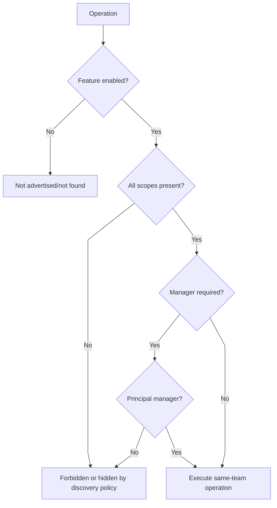

| Capability | Scope | Role/policy note |
| --- | --- | --- |
| recall, trace, context, Entity/Relationship inspection | `read` | member or manager |
| remember, retraction, and owned correction | `write` | submits caller-owned evidence/proposals or applies authorized owned lifecycle work; authoritative evidence additionally follows authority policy |
| advance owned source revision | `write` | exact source ownership and prior-revision compare-and-set; effects follow indexed support dependencies |
| evidence replacement/retraction | `write` | Owned evidence IDs; canonical support/lifecycle changes follow accepted server policy. |
| confirm/challenge another owner | `write` | submit caller-owned evidence through normal remember; target remains immutable |
| submit corrected safe evidence | `write` | Follow the returned remediation and retain a complete new operation when input changes. |
| recall-feedback submission | `write` | feature enabled |
| stored feedback inspection | `read + feedback:read` | feature enabled; same-team/control restrictions |
| evaluation tools | `read + write` | compiled into the evaluation image only; disposable teams only |
| team/credential administration | route-specific | manager for same-team operations |
| cross-team administration | control-plane auth | never a normal user-key capability |

Role never implies scope.

## Tool Visibility

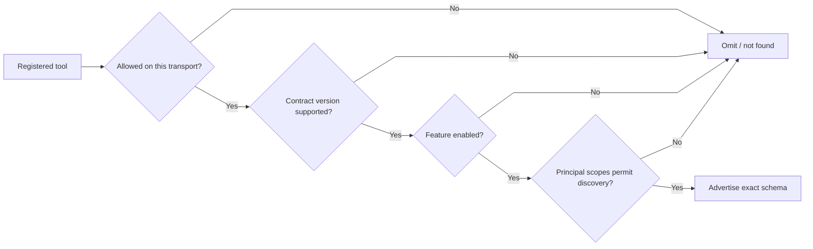

MCP discovery and execution share one registry and the same visibility check.
The registry also declares allowed transports. Semantic memory tools are
MCP-only: removed generic HTTP discovery/execution routes must stay absent.
Disabled, unauthorized, or transport-ineligible tools do not leak through
another catalog or execution path. The exact tool set belongs in
[Technical Reference](Technical-Reference#production-http-surface).

## MCP Memory Interface

The LLM host is the MCP client. Dense-Mem exposes the tool catalog and executes
memory operations through three MCP methods:

| MCP method | Purpose | Memory effect |
| --- | --- | --- |
| `initialize` | negotiate the MCP protocol and report server capabilities/instructions | none |
| `tools/list` | return the authenticated profile's visible tool names, descriptions, and input JSON Schemas | none |
| `tools/call` | invoke one visible tool by name with schema-validated arguments | depends on the selected tool and its scope |

`tools/list` lets the host understand that tools such as `remember`,
`recall_memory`, and `trace_memory` exist and how to call them. It is discovery,
not a recall. `tools/call` is the execution envelope used for every memory tool;
the selected tool still owns its exact input, authorization, idempotency, and
read/write behavior.

### Remember admission boundary

After transport validation and immutable principal binding, Remember enters the
`internal/remember/service` application boundary. The boundary converts the
strict request, validates each proposal's evidence indexes, scans evidence and structured
proposal values, and records only bounded security-rejection metadata on an
admission failure. A successful call invokes one request-owned processor; the
MCP result is returned only after assessment, required embedding, and the
fenced transaction produce a terminal result. The port does not expose
concrete provider or storage adapters. Control-only attempt reads use
the same team/profile scope and never serve as a public polling contract.

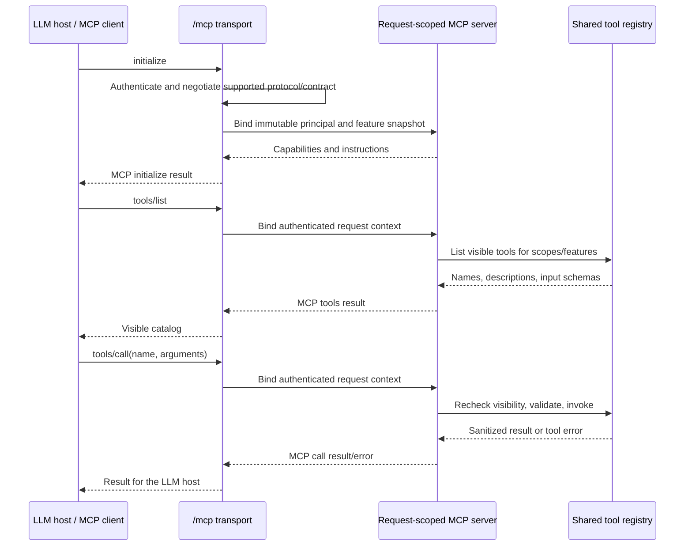

The runtime advertises supported MCP protocol versions. Do not hardcode one
protocol date in the manual as timeless.

The negotiated MCP protocol version is distinct from Dense-Mem's current closed
tool schema. The host follows the current `tools/list` schemas and server
instructions instead of applying a cached input shape from another Dense-Mem
release.

The protocol boundary guarantees authenticated MCP semantics; it cannot prove
that a particular model produced the request because any conforming host can
implement MCP. API keys, scopes, feature visibility, strict schemas, team
isolation, and audit remain the enforceable controls.

Long-lived receive streams acquire a bounded same-principal slot, emit
heartbeats, terminate at configured duration, and release the slot on every
disconnect/error path. Redis coordinates slots across replicas when required.

## First-Party Portal Interfaces

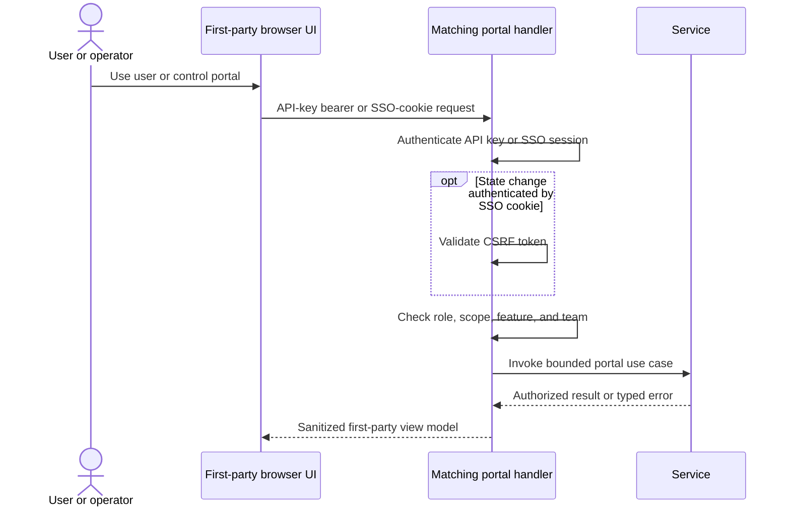

The user portal supports same-team recall, graph/trace, Remember Attempts, key
management, and permitted telemetry. The control portal supports private cross-team
configuration, security, and operations. Portal handlers call the
same application services and PostgreSQL authority as MCP where their use cases
overlap, but their browser endpoints are not a supported client SDK or memory
automation interface.

The browser only takes the portal-cookie path after an explicit user opt-in;
the direct bearer path remains available for API clients and users who do not
opt in. If a portal or SSO cookie is presented but invalid, authentication
fails closed instead of falling through to another cookie path.

## Idempotency

Write operations accept operation-scoped idempotency keys. The server derives
the scope from the operation kind, authenticated namespace, and, when the
contract defines target-scoped retries, the immutable target identity. Within
that scope, the raw key binds to a canonical request hash.

| Reuse | Result |
| --- | --- |
| same key, same scope, same request | return/recover the original operation |
| same key, same scope, different request | conflict error |
| same raw key, different target for a target-scoped operation | unrelated namespace |
| same raw key, another team/profile | unrelated namespace |
| expired retention | treated according to documented operation policy |

Idempotency state is durable in PostgreSQL, not Redis.

## Rate Limits

Rate limits apply after authentication so keys/teams can be scoped. Public edge
limits apply earlier as denial-of-service defense.

In-process counters are correct only for one instance. Multi-instance
deployments require Redis/distributed coordination; an outage must not silently
weaken the promised global limit.

## Health And Readiness

| Endpoint | Meaning |
| --- | --- |
| `GET /health` | liveness; process can respond even when degraded |
| `GET /ready` | readiness; returns non-success when required dependencies/policies fail |

Readiness includes PostgreSQL schema and RLS, `pgvector`, the persisted
embedding contract, active search-index generation/topology parity, required
provider contracts, complete Relationship text projection, and Redis when
distributed coordination is required. Current Remember writes require vectors
before commit; derived search drift is reported by the optional document-centric
`search_convergence` projection and never acknowledged as a normal write queue.
Incomplete Relationship text projection is still a readiness failure.

Do not use liveness as a readiness gate.

Maintenance reconciliation runs with durable state and source/document/contract
fences. It is separate from a successful Remember write. Operators inspect
convergence and bounded failure guidance; a maintenance failure cannot be
reported as successful recovery.

## Error Boundary

Public errors carry code, safe message, retryability, optional bounded details,
and correlation ID. They never include:

- raw database/provider errors or queries
- stack traces
- evidence/prompts/responses
- credentials/cookies/tokens
- embeddings
- cross-team existence hints

Embedding failure codes are closed and bounded. The terminal Remember result
contains every required search state; operator-only convergence exposes allowlisted codes
such as `provider_quota_exhausted`, affected teams, guidance, run state, and
metrics. Provider messages, response bodies, request text, and credentials are
not copied into those surfaces.

Typed error schema is in
[Technical Reference](Technical-Reference#authentication-errors-and-audit).

## Provider Isolation

Submitted evidence and proposal values are untrusted data. Strict binding and
the initial deterministic scan precede provider work. An initial security
rejection retains only bounded rule/span/correlation metadata and does not send
the content to a model.

The assessor receives exact submitted evidence, allowed grounding boundaries,
bounded authorized candidate/predicate/duplicate context, and explicit
known-evidence context when supplied. It receives no operational credentials,
authentication headers, tools, or cross-team/private data outside the
authenticated allowlist.

Every submitted evidence item receives security review. The server validates
the complete response and all references before applying durable policy.
Unsupported proposals can be `not_stored` while safe evidence is stored.
A security rejection fails the batch; required failures cannot partially
commit canonical state. Complete regeneration is bounded within the request.

## Operator Diagnostics And Credential Protection

One root logger protects configured operational secrets and request
authentication material before console or PostgreSQL output. Protection covers
supported serialized forms. A field name or secret-like user text alone does
not trigger masking.

After schema validation and the initial scan, admitted user fields can remain
exact in bounded authorized operator diagnostics, including later provider or
validation failures. Initial security rejection remains content-free.
Protected body captures are loaded only by authorized control detail routes and
honor expiry, availability/truncation, and applicable erasure/hold rules.

This operator contract does not broaden public errors, metric labels, audit
projections, or exports. See [Telemetry](Telemetry).

## Audit

Audit high-value events:

- key/profile/team changes
- authority changes and submission terminal outcomes
- source revision activation, direct evidence supersession/retraction, and resulting
  support/status transitions
- deterministic intake rejection audits, assessor security rejection decisions, and
  control-only failure-artifact expiry
- Entity merge/split
- Relationship retraction/supersession corrections
- Conflict case open/reopen/resolve/overdue/dismiss decisions and policy version
- memory-pack export authorization and omission reporting
- runtime configuration changes
- repeated authentication/rate/security failures
- control-plane access

Audit is durable and append-only where required. Prometheus/logs are not the
audit ledger.

## Risks And Mitigations

| Risk | Concrete failure mode | Mitigation |
| --- | --- | --- |
| Tenant override | payload chooses another team's Entity | immutable principal, strict schema, same-team ID validation |
| Raw key leak | downstream log/provider receives Authorization | auth middleware removes header and sensitive-value tests |
| Cookie CSRF | browser session mutates memory cross-site | SameSite/secure cookie and required CSRF token |
| Browser cookie reaches MCP | an SSO browser tab appears to authenticate an MCP client without a bearer credential | MCP auth ignores portal cookies and requires an API-key or verified OAuth bearer header |
| OAuth team confusion | a multi-team JWT is used against the wrong team resource | team-scoped resource URL, optional claim/path equality, active-membership lookup, and non-enumerating denial |
| Discovery/execution drift | `tools/list` advertises a tool that `tools/call` then hides, or execution bypasses discovery policy | one registry and the same visibility/scope predicate for both methods |
| HTTP bypass exposes a second memory contract | generic HTTP tool discovery or execution is reintroduced and publishes an MCP-only semantic memory tool | route registration keeps generic HTTP discovery/execution absent plus conformance tests |
| Portal backend becomes an integration API | external clients depend on browser implementation details and bypass the intended MCP contract | same-origin portal boundary, no public SDK or CORS contract, API-key-or-SSO authentication, and CSRF for SSO-cookie mutations |
| Redis outage weakens limits | replicas fall back to independent counters | distributed-required readiness failure |
| Search candidate leakage | global vector search exposes another team's text | internal filtering and authorized hydration before return |
| System-worker privilege leak | a non-Remember scheduler writes the wrong team | stored team on every work row, explicit system transaction mode, source-version predicates, and audit |
| Error enumeration | wrong-team ID returns different detail | non-enumerating public errors and internal audit only |
| Cross-profile overwrite | write-scoped B retracts A's Relationship by ID | immutable principal profile, owner predicate on mutation, and caller-owned correction links |
| Quarantine bypass | a writer tries to release or reuse malicious quarantined input | no release tool or raw quarantine payload; bounded terminal/audit metadata remains and replacement is a fresh complete submission |
| Recalled prompt injection | returned evidence asks a host to export environment variables | returned evidence is untrusted data; client action/tool policy and least privilege remain mandatory |
| Source-key takeover | a writer advances another integration's source and demotes team knowledge | bind source identity to immutable owner and require exact prior-revision compare-and-set |
| Private erasure crosses a space | deleting one SSO-owned credential removes profile-private or team-shared knowledge | seal and generation-fence the exact credential-private space, delete through a catalog-complete manifest, and verify zero rows before completion |

## Verification

Exercise authentication, team/owner/space isolation, strict schemas, feature
visibility, cancellation, private erasure, credential protection, and operator
capture access through real supported callers. Required PostgreSQL/RLS behavior
needs database-backed tests. Public errors must not reveal inaccessible IDs.

## Canonical Identity Context

Authentication resolves every supported credential or session to an immutable actor, team membership,
permanent owner alias, role/governance state, and optional credential before MCP
or portal application services run. `credentials` and `team_memberships` are
the current runtime authority; `ownership_aliases` preserve semantic owner IDs
without rewriting append-only history. Effective grants for credential auth
are bounded by both membership grants and credential scopes.

For SSO, the stable external actor and selected membership supply the owner
alias; `credential_id` is absent. For direct API-key and portal-session auth,
the credential is present and a standard API credential's stable ID is also its
permanent owner alias. Team, identity, membership, and credential IDs are never
substituted for `owner_id` by request payloads or provider output. `team_admin`
never grants another owner's mutation authority. System actors preserve the
`system` actor kind.

System and migration modes are never request-selectable. Startup schema work
uses its own controlled boundary.

## Memory Space Authorization

Authentication fixes the team, membership, credential, effective scopes, and
allowed memory-space set before an application service runs. The set is derived
from the immutable credential binding and membership policy; request payloads,
headers, MCP arguments, and provider output cannot add or replace a space.

An SSO profile context may authorize its profile-private space plus team-shared.
A private-bound credential may authorize its credential-private space plus
team-shared. A shared-only or read-only integration authorizes team-shared only
unless policy explicitly grants a private binding; read-only still cannot
mutate. Team-manager role does not grant access to another member's private
space. PostgreSQL RLS and every repository query enforce this set, including
hydration, trace, conflict handling, and applicable background jobs. Remember
writes to the authenticated private space when present, otherwise shared.
Current recall related graph/community/Hypothesis frontiers remain shared-only.

## Private-Memory Erasure Boundary

Private-memory erasure is an asynchronous, irreversible first-party portal
operation. Every accepted request requires an `Idempotency-Key` header and the
exact body:

```json
{"acknowledge_irreversible": true}
```

Private-memory erasure idempotency is target-scoped. Control erasure includes
the exact target space ID in its scope; owner erasure uses the authenticated
target identity that resolves the space. Reusing the same raw key for the same
target and canonical request returns the original operation. A different
canonical request within that target scope returns `409 Conflict`. Reusing the
same raw key for another eligible target creates a separate operation and
returns `202 Accepted` with a different operation ID.

The `202 Accepted` response identifies the durable operation; it does not mean
deletion has completed. The request atomically seals the target private space
and advances its generation, so old or concurrent writers cannot repopulate
it. A fenced worker rechecks legal holds and ownership, deletes the exact
catalog manifest, verifies zero remaining rows, scrubs private audit payloads,
and then completes the operation. Worker failures use bounded backoff and enter
terminal `failed` after five claims instead of retrying forever. Profile-private
erasure reopens an empty space at the new generation. Deleting an accepted
SSO-owned credential disables that credential immediately and retires only its
`credential_private` space; its profile-private and team-shared spaces remain
intact. A legal hold blocks physical execution of every private purge. The SSO
credential-delete path still disables the bearer and seals the exact space
before recording the queued operation, so a held credential cannot continue to
authenticate while its content awaits authorized hold release.
