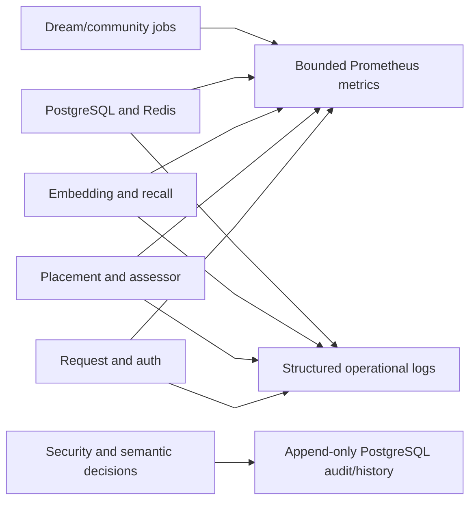

# Telemetry

Telemetry must show whether evidence is processing, semantic state is correct,
search is current, recall is useful, and tenant/security boundaries hold. It
must not expose evidence, provider payloads, vectors, credentials, or
high-cardinality record IDs as metric labels.

This page defines the target metrics/operations contract for the PostgreSQL +
`pgvector` refactor.

## Signal Ownership



| Signal | Use | Authority |
| --- | --- | --- |
| metrics | rates, latency, backlog, saturation, alerting | operational observation |
| structured logs | correlation and bounded failure context | operational observation |
| append-only audit/domain history | actor and semantic/security decision trace | PostgreSQL durable record |
| recall feedback/evaluation | judged usefulness and quality regression | quality evidence, not automatic policy |

Metrics/logs never substitute for the durable placement, assessment/verification,
Relationship, transition, or audit record.

## Label Rules

Allowed labels are bounded enums or deployment identifiers:

```text
operation
transport
outcome
status_code_class
method
action
reason
class
stage
processing_state
search_state
verdict
relationship_status
from_status
to_status
provider_kind
model_alias
branch
branch_count
mode
fusion_mode
conflict_state
error_code
coordination_mode
job_kind
work_class
generation_state
gate_state
kind
invariant
document_kind
k_bucket
path
backend
purpose
query_class
severity
state
phase
gate
```

Never label metrics with:

```text
team_id, profile_id, entity_id, relationship_id, ingest_id
query/evidence/name/source text
API key suffix or client IP
provider response/prompt
vector values
raw SQL
```

When team-level troubleshooting is authorized, use bounded database reports or
correlation-scoped logs, not permanent metric labels.

## Request And Authentication

```text
densemem_http_requests_total{operation,transport,outcome,status_code_class}
densemem_http_request_duration_seconds{operation,transport,outcome}
densemem_http_request_bytes{operation}
densemem_http_response_bytes{operation}
densemem_auth_attempts_total{method,outcome,reason}
densemem_auth_duration_seconds{method,outcome}
densemem_rate_limit_decisions_total{operation,outcome,coordination_mode}
densemem_sse_streams{state,coordination_mode}
```

Separate rejected authentication, authorization, validation, rate limit,
dependency, and internal failures. Never place raw error strings in labels.

## Remember And Placement

```text
densemem_remember_intake_total{outcome}
densemem_remember_intake_duration_seconds{outcome}
densemem_placement_items{processing_state}
densemem_placement_oldest_seconds{processing_state}
densemem_placement_claims_total{outcome}
densemem_placement_stage_duration_seconds{stage,outcome}
densemem_placement_lease_lost_total{stage}
densemem_placement_attempts_total{outcome}
densemem_review_tasks{kind,state}
densemem_review_oldest_seconds{kind}
densemem_review_expired_total{kind}
```

Quarantined, failed, and awaiting-review work is distinct from a worker
backlog. A high review age does not mean adding placement workers will help.

## Integrated Assessor

```text
densemem_provider_requests_total{provider_kind,model_alias,outcome}
densemem_provider_request_duration_seconds{provider_kind,model_alias,outcome}
densemem_provider_cooldown_seconds{provider_kind}
densemem_assessor_requests_total{provider_kind,model_alias,outcome}
densemem_assessor_request_duration_seconds{provider_kind,model_alias,outcome}
densemem_assessor_input_tokens{provider_kind,model_alias,outcome}
densemem_assessor_output_tokens{provider_kind,model_alias,outcome}
densemem_assessor_candidate_context_bytes{outcome}
densemem_assessor_candidate_truncations_total{kind}
densemem_assessor_responses_total{outcome}
densemem_assessor_validation_failures_total{class}
densemem_assessor_result_items{kind}
densemem_assessment_persistence_total{outcome}
densemem_assessment_reuse_total{reason}
densemem_assessor_duplicate_request_prevented_total{reason}
densemem_verification_events_total{verdict}
densemem_relationship_confidence_gate_total{gate_state}
```

`class` is bounded, for example:

```text
json_parse
json_schema
coverage
duplicate_ref
unknown_ref
candidate_allowlist
predicate_allowlist
security_signal_allowlist
security_signal_span
cross_array_dependency
size_limit
```

Invalid attempts count as provider/validation telemetry only. They do not
increment material `VerificationEvent` counts.

The compatibility-named `densemem_assessor_requests_total` counter records
assessor conversations, not individual malformed-response correction turns.
Provider request/response and validation counters expose bounded per-turn
outcomes. Assessment reuse covers restart, lease reclaim, pause/resume, and
semantic commit retry after a valid result persists. Alert when conversation
bounds fail, persistence/reuse errors appear, or terminal invalid-response rate
changes by model, prompt revision, or local contract hash.

`gate_state` is the bounded public policy outcome:
`meets_write_threshold`, `below_write_threshold`, or `not_applicable`. Never
put raw confidence, the configured threshold, team ID, prompt text, or rationale
in metric labels. Authorized audit rows retain the exact internal decision.

## Entity And Relationship Outcomes

```text
densemem_entity_resolution_total{action,outcome}
densemem_entity_ambiguity_total{reason}
densemem_entity_corrections_total{kind,outcome}
densemem_relationship_outcomes_total{relationship_status}
densemem_relationship_transitions_total{from_status,to_status}
densemem_relationship_cross_references_total{kind,outcome}
densemem_relationship_owner_denials_total{operation}
densemem_predicate_resolution_total{outcome}
densemem_relationship_support_total{outcome}
densemem_source_revisions_total{outcome}
densemem_source_support_revocations_total{outcome}
densemem_relationship_support_loss_total{from_status,to_status,reason}
densemem_semantic_invariant_failures_total{invariant}
```

Transition label combinations are bounded by closed enums. If the combination
space becomes excessive, record detailed transitions in PostgreSQL reports and
keep only outcome counts in Prometheus.

Hard alerts:

- active Relationship has no effective support
- SemanticEdge references unresolved endpoint
- duplicate canonical active Relationship identity
- append-only mutation rejected
- cross-team ID/row detected
- cross-profile Relationship mutation detected

## Conflict Cases And Nightly Review

```text
densemem_relationship_conflict_cases{status}
densemem_relationship_conflict_oldest_open_seconds{status}
densemem_relationship_conflict_events_total{action,outcome}
densemem_relationship_conflict_evaluations_total{stage,outcome}
densemem_relationship_conflict_review_runs_total{outcome}
densemem_relationship_conflict_review_duration_seconds{outcome}
densemem_relationship_conflict_review_cases{outcome}
densemem_relationship_conflict_review_lease_recoveries_total
```

Case-count `status` is a closed set: `open`, `overdue`, `resolved`, or
`dismissed`; the oldest-open metric emits only `open` or `overdue`. Evaluation
`stage` is `write` or `nightly`; event `action` is bounded to the durable
case-event enum. Metrics never contain case, team, profile, Relationship,
position, evidence, source, or query IDs. Durable events and run rows are the
audit/debug source; metrics are aggregates only.

Hard alerts include a resolution without one qualifying position, any attempted
authored Relationship mutation by the Conflict worker, exhausted review
attempts, and no successful nightly run beyond the release-defined window.
Overdue count/age is an operational escalation, not authority to choose a
winner.

## Embedding Jobs And Search Freshness

```text
densemem_embedding_jobs{search_state,work_class}
densemem_embedding_oldest_pending_seconds{work_class}
densemem_embedding_jobs_total{outcome}
densemem_embedding_duration_seconds{outcome}
densemem_embedding_source_version_mismatch_total
densemem_embedding_contract_mismatch_total{reason}
densemem_search_index_builds_total{strategy,outcome}
densemem_search_index_build_duration_seconds{strategy,outcome}
densemem_search_index_profile_mismatch_total{reason}
densemem_search_documents{kind,search_state}
densemem_search_freshness_seconds{kind}
densemem_search_projection_generations{kind,generation_state}
densemem_search_projection_remaining{kind,generation_state}
densemem_search_projection_batches_total{kind,outcome}
densemem_relationship_vector_gate{gate_state}
```

Search backlog is derived-state lag, not loss of committed knowledge.
Dashboards show placement completion beside search freshness so operators do
not conflate them. `work_class` is the bounded enum `foreground` or
`generation`; generation IDs and team IDs remain out of metric labels.

## Recall Branches

```text
densemem_recall_requests_total{mode,fusion_mode,outcome}
densemem_recall_duration_seconds{mode,fusion_mode,outcome}
densemem_recall_branch_duration_seconds{branch,outcome}
densemem_recall_branch_candidates{branch}
densemem_recall_results{mode}
densemem_recall_degraded_total{branch,reason}
densemem_recall_frontier_results{kind}
densemem_recall_relationship_vector_gate_total{gate_state}
densemem_recall_adjacency_edges
densemem_recall_adjacency_stopped_total{reason}
densemem_recall_deduplicated_total{branch_count}
densemem_recall_conflicts_total{conflict_state}
densemem_recall_clarifications_total{reason}
densemem_recall_trace_duration_seconds{outcome}
```

Branches include bounded enums such as `full_text`, `vector_exact`,
`vector_hnsw`, `vector_halfvec_hnsw`, `entity_seed`, `adjacency`, `community`,
and `hypothesis`.

Diagnostics may record per-request branch detail in short-retention logs keyed
by correlation ID. Do not put query text or result IDs in metrics.

`fusion_mode` is a closed enum such as `rrf` or `branch_priority`;
ranking-contract versions belong in the stored recall event and structured log,
not a Prometheus label. The ranking contract is defined in
[Vector Search And Ranking](Vector-Search-And-Ranking).

## Vector Quality Sampling

Production or pre-release sampling may compare approximate results with exact
filtered search under strict budget:

```text
densemem_vector_oracle_runs_total{document_kind,outcome}
densemem_vector_oracle_recall_at_k{document_kind,k_bucket}
densemem_vector_oracle_rank_overlap{document_kind,k_bucket}
densemem_vector_hnsw_tuples_scanned{document_kind}
densemem_vector_query_duration_seconds{path,outcome}
densemem_vector_query_semaphore_wait_seconds{path}
densemem_vector_exact_rerank_candidates{path}
```

Do not use unbounded `k` labels; expose a fixed set such as 5, 10, and 20.
Sampling excludes query/evidence content from logs and honors the same actor
scope.

An ANN latency improvement with Recall@K loss is a regression, not a success.

## PostgreSQL

Collect infrastructure metrics through the approved PostgreSQL exporter and
application pool:

```text
densemem_postgres_pool_connections{state}
densemem_postgres_pool_wait_seconds
densemem_postgres_transactions_total{operation,outcome}
densemem_postgres_transaction_duration_seconds{operation,outcome}
densemem_postgres_lock_timeouts_total{operation}
densemem_postgres_deadlocks_total
densemem_postgres_query_duration_seconds{query_class,outcome}
densemem_postgres_rows_total{query_class}
densemem_postgres_topology_info{topology,role}
densemem_postgres_replica_lag_seconds{role}
densemem_postgres_profile_parity{contract_kind}
```

Infrastructure dashboards also cover availability, replication/PITR, WAL
archive, disk, checkpoints, vacuum/analyze, table/index bloat, temp spill, slow
queries, deployment-wide connection saturation, standby cancellation/lag, shard
profile parity, and HNSW index size/build status.

`query_class` is a code-owned bounded name such as
`relationship_by_subject`—never raw SQL.

## Redis Coordination

```text
densemem_coordination_mode{backend}
densemem_redis_operations_total{purpose,outcome}
densemem_redis_operation_duration_seconds{purpose,outcome}
densemem_redis_required_unavailable
```

Redis exporter signals cover connectivity, memory, evictions, latency, and
rejected connections. An alert is critical when distributed coordination is
required; in an intentional one-process mode, absence of Redis is not an error.

## Dream And Community Jobs

```text
densemem_dream_runs_total{outcome}
densemem_dream_inputs{kind}
densemem_dream_outputs_total{outcome}
densemem_dream_rejected_total{reason}
densemem_community_runs_total{outcome}
densemem_community_input_nodes
densemem_community_input_edges
densemem_community_count
densemem_community_duration_seconds{outcome}
```

Bounded dream rejection reasons include unknown endpoint, unknown predicate,
source version changed, duplicate, and schema invalid. Community metrics refer
to an in-worker analytical graph, not a semantic projection.

## Security And Audit

Alert/report:

```text
densemem_security_events_total{kind,severity,outcome}
densemem_injection_scans_total{decision,severity}
densemem_model_security_signals_total{stage,kind}
densemem_cross_team_denials_total{operation}
densemem_rls_denials_total{query_class}
densemem_quarantine_total{reason}
densemem_quarantine_releases_total{outcome}
densemem_audit_append_failures_total{operation}
densemem_key_operations_total{operation,outcome}
```

Security decisions requiring actor, target, and before/after context belong in
append-only PostgreSQL audit records. Metrics contain only bounded categories.
Source keys, revision tokens, evidence spans, rule IDs, and actor/profile IDs
must not become metric labels.

## Dashboards

### Service overview

- request rate/errors/latency by operation
- write/read/trace readiness
- PostgreSQL, assessor, embedding, and required Redis health
- service replica count and coordination mode

### Knowledge write

- intake and placement throughput/age
- stage latency and lease loss
- assessor call count, input/output tokens, latency, 429, invalid output,
  persistence, and retry-time reuse
- positive-support gate pass/hold/not-applicable outcomes
- Entity actions/ambiguity and Relationship status/support outcomes
- source revision activation, support revocation, and automatic pending-state transition
- owner-mutation denials and cross-profile correction outcomes
- review task count/age/expiry
- Conflict case status/age, write-versus-nightly outcomes, overdue escalation,
  run duration, and lease recovery

### Search and recall

- embedding pending/failed age
- document freshness by kind
- Relationship projection text progress, generation/foreground queue age, and
  vector-gate state
- recall latency/result count/degraded branches
- exact versus HNSW query latency
- sampled ANN Recall@K
- vector-query semaphore wait and exact-rerank candidate count
- adjacency edges/stopped reasons
- fusion mode, authored conflicts, and clarification rate

### Storage

- pool/transactions/locks/deadlocks
- slow query classes/plans
- WAL/disk/checkpoint/vacuum/bloat
- vector-index size/build/scan cost
- topology role, total connection budget, replica lag, and shard/profile parity
- Redis health only where used

### Optional analysis

- dream/community due, run, rejection/error, input/output, staleness

### Security

- auth/authorization/rate-limit denials
- cross-team/RLS denials
- quarantine and audit failures
- deterministic scan decisions, model security-signal stage, and quarantine
  release denials
- key/session/SSO anomalies

## Alert Policy

| Alert | Example trigger |
| --- | --- |
| PostgreSQL unavailable | readiness fails or transaction errors exceed window |
| placement backlog | oldest queued/processing item above SLO |
| assessor contract regression | invalid/schema ratio or five-turn conversation-bound violation above baseline after model/prompt change |
| assessment reuse failure | a restart/lease/commit retry calls the assessor after a valid result persisted |
| confidence-gate shift | pass/hold ratio moves beyond the evaluated model/prompt baseline |
| semantic review expiry backlog | due semantic tasks remain open beyond the expiry-worker SLO |
| injection anomaly | quarantine/model-signal ratio shifts beyond the evaluated baseline or unauthorized release is nonzero |
| source revision failure | stale/unowned/fanout outcomes exceed the source-update SLO or support/status reconciliation fails |
| search backlog | oldest pending or failed document above SLO |
| vector quality regression | sampled Recall@K below gate |
| recall latency/error | p95/p99 or error rate above profile SLO |
| hard semantic invariant | any active-without-support, duplicate-edge, cross-team, or append-only finding |
| Redis coordination loss | required backend unavailable |
| audit failure | append failure nonzero |
| backup/PITR risk | WAL archive or restore verification stale |

Alerts link to [Operations Runbook](Operations-Runbook) and name a bounded
signal, not “system unhealthy.”

## Retention And Privacy

| Data | Target retention |
| --- | --- |
| aggregate metrics | operational policy |
| structured request/error logs | shortest incident-useful window |
| operation records | configured 1–365 days |
| security audit/domain history | durable policy |
| recall feedback detail | configured bounded window |
| generated evaluation runtime data | local ignored retention defined by [Evaluation](Evaluation#source-versus-runtime-boundary) |

Redact secrets before emission. Evidence, names, queries, rationales, provider
payloads, and vectors are opt-out by default and should not enter normal logs.

## Risks And Mitigations

| Risk | Concrete failure mode | Mitigation |
| --- | --- | --- |
| High-cardinality outage | `team_id`/`relationship_id` labels exhaust Prometheus | closed label allowlist and CI metric inspection |
| Evidence leak | provider response or query is logged on parse failure | log validation class/pointers and byte counts only |
| Search lag mistaken for truth loss | embedding backlog triggers repeated remember calls | paired processing/search dashboards and API semantics |
| ANN regression hidden | latency dashboard improves while relevant results disappear | exact-oracle Recall@K sampling and release alert |
| Invalid attempts counted as decisions | assessor parse failures inflate semantic verdict counts | separate provider/validation and material-event metrics |
| Retry savings are overstated | provider calls fall but restart paths still make duplicate assessor requests | compare claim, request, persisted-assessment, and reuse counters; alert on any post-persist request |
| Confidence labels expose team policy | a metric series contains team-specific thresholds or raw scores | expose only bounded gate state; keep exact confidence/threshold in authorized audit rows |
| Review expiry is treated as acceptance | an expired-task counter is consumed as a support signal | metrics remain observational; lifecycle writes require persisted assessment and deterministic policy |
| Detector details leak through labels | rule ID, evidence span, or source key creates a high-cardinality security metric | expose bounded decision/kind enums only and keep details in authorized audit rows |
| Source support loss is invisible | a revision removes final support but operators see only ordinary transition counts | dedicated revision, support-revocation, and pending-transition counters linked by audit correlation ID in logs |
| Projection appears complete too early | aggregate pending count falls while one team still has failed generation work | durable per-team generation checks plus bounded aggregate generation-state and oldest-job-class telemetry |
| Backfill hides foreground starvation | total embedding throughput looks healthy while live writes wait behind release jobs | separate foreground/generation age and count metrics with fairness alerts |
| Redis over-alerts | intentional one-process mode reports Redis down | explicit coordination-mode metric and topology-aware alert |
| Metric becomes authority | dashboard count used to correct knowledge | trace PostgreSQL records; metrics are observation only |
| Profile conflict disappears in aggregation | recall looks healthy while one author's correction is consistently hidden | authored-conflict and clarification measures plus stored recall events |
| Nightly resolution is invisible | B becomes preferred after a run but operators see only a recall-rank change | case event/run counters, status/age dashboard, and durable policy-versioned events |
| Conflict IDs leak through metrics | one time series is created per case/Relationship | closed status/action/stage/outcome labels only; IDs remain in authorized PostgreSQL rows/log correlation |
| Per-process pool looks healthy while database saturates | every service replica stays below its local cap but aggregate connections exhaust PostgreSQL | topology-aware aggregate pool dashboard and deployment budget alert |
| Cluster vector profile diverges | one shard/replica serves an absent or older search index | bounded parity metric plus readiness/activation gate |

## Telemetry Acceptance

1. no metric label contains tenant, record, evidence, query, or secret data
2. processing and search freshness are separately visible
3. invalid assessor attempts and material verification events are distinct
4. PostgreSQL full-text/vector/adjacency branches have separate latency/error
   signals
5. exact-vs-HNSW quality is measurable
6. hard semantic/tenant invariants page on any nonzero finding
7. Redis alerts depend on declared topology
8. dashboards and alerts link to an actionable runbook
9. profile conflicts and owner-mutation denials are observable without profile-ID labels
10. vector-query concurrency, replica lag, and cluster search-profile parity are
    observable without tenant/profile labels
11. deterministic scans, model security signals, quarantine releases, source
    revisions, support revocations, and automatic pending transitions are separately
    observable with bounded labels
12. Conflict placement case updates, nightly review, status age, overdue
    escalation, run failure, and lease recovery are observable without
    case/team/profile IDs
13. telemetry cannot resolve or mutate a Conflict case and never substitutes
    for its durable event history
14. Relationship text projection, generation/foreground queue fairness, and
    whole-team vector-gate state are observable without team or generation IDs
15. assessor conversation and provider-turn counts, tokens, latency,
    validation, durable retry classes, persistence, and retry-time reuse prove
    the bounded conversation contract without claim-ID labels
16. confidence-gate pass/hold and semantic review expiry are visible without
    raw confidence, team thresholds, or team IDs
