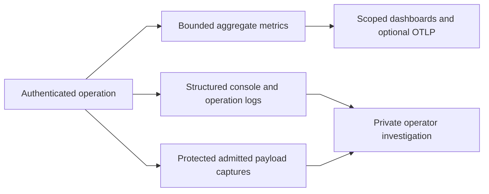
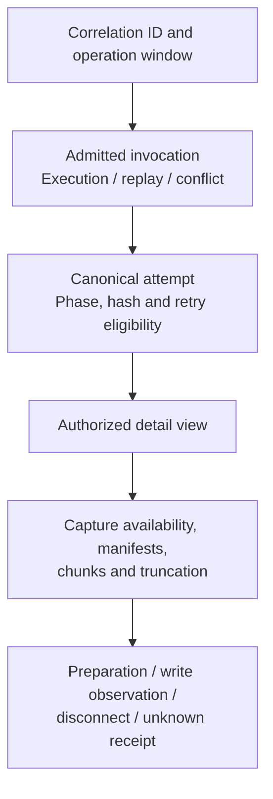

# Telemetry

Telemetry explains operational health and cost. PostgreSQL trace, lifecycle, conflict, and audit records establish individual durable outcomes. A metric counter alone cannot prove memory state or delivery.

## Observation Surfaces



## Active Metrics

| Family | Current signals |
| --- | --- |
| HTTP | `densemem_http_requests_total`, `densemem_http_request_duration_seconds`. |
| Embeddings | `densemem_embedding_requests_total`, `densemem_embedding_errors_total`, `densemem_embedding_duration_seconds`, `densemem_embedding_tokens_total`. |
| Remember | `densemem_remember_acknowledgements_total`, `densemem_remember_acknowledgement_duration_seconds`. |
| Recall | `densemem_recall_requests_total`, `densemem_recall_duration_seconds`, `densemem_recall_results`. |
| Feedback | `densemem_recall_feedback_total`, `densemem_recall_feedback_quality_score`. |
| Assessment | `densemem_assessor_requests_total`, `densemem_assessor_duration_seconds`, `densemem_assessor_tokens_total`, `densemem_assessor_validation_failures_total`, `densemem_assessor_validation_field_failures_total`, `densemem_assessor_terminal_failures_total`. |
| Usage/cost | `densemem_ai_operation_tokens_total`, `densemem_ai_operation_cost_usd_total`, `densemem_ai_operation_items_total`, `densemem_ai_operation_unpriced_total`. |

The source collector and ordered dashboard catalog define exact audience, scope, labels, and prerequisites. Queries, source text, operational credentials, result IDs, and comments do not belong in metric labels. System-only assessor series have no team/profile labels.

## Operation Logs And Protected Captures

One process logger supplies structured console output and the PostgreSQL operation-log sink. The sink is required for readiness; gaps and recovery remain visible. Startup/pre-attachment output is console-only and is not claimed as persisted history.



| Private route | Investigation |
| --- | --- |
| `/control/api/logs` | Severity, correlation, request/attempt, and bounded classification filters. |
| `/control/api/remember-invocations` | Admitted call list. |
| `/control/api/teams/{teamId}/remember-invocations/{invocationId}` | Selected invocation detail and authorized captures. |
| `/control/api/remember-attempts` | Canonical attempt diagnostics. |
| `/control/api/teams/{teamId}/remember-attempts/{attemptId}` | Selected attempt detail. |

Admitted exact fields/text can remain in bounded protected diagnostics. Initial security rejection is content-free. Configured operational credentials and authentication material are protected in supported serialized forms; field names or secret-like user phrases alone do not trigger masking. Public errors, audit, metrics, and exports retain separate exposure contracts.

Remember body captures expire after seven days, subject to applicable holds and erasure. Unavailable, expired, or truncated captures are incomplete evidence. A captured response write does not prove caller delivery. Operation-log retention is configured separately in [Configuration](Configuration#telemetry-and-logging).

Ontology diagnostics join trusted team/actor, correlation, operation, run/batch/assessment, and provider-exchange identities. Complete protected DEBUG chunks are stdout-only and independent of optional telemetry. Preserve the full operation window and validate manifest hashes and chunk counts; missing required chunks cannot establish a diagnosis. Successful publication observations occur after transaction/audit success. Rejected assessment receipts can include bounded server-owned validation identifiers; absence does not imply success.

### Remember Progress Diagnostics

Remember progress uses the process logger and configured level policy. [MCP Clients](MCP-Clients#remember-progress) describes user-visible status.

| Event | Level and evidence |
| --- | --- |
| `mcp_progress_eligibility` | DEBUG: response mode, protocol and eligibility reason; no token value before admission. |
| `mcp_progress_sending` / `mcp_progress_delivered` | DEBUG: trusted team/profile and correlation, request/invocation identity, protected token, stage, sequence, write budget and delivery duration. |
| `mcp_progress_delivery_failed` | WARN: causal error, elapsed time, reason and disabled state; correlate with the terminal MCP and HTTP delivery events. |

Collect the complete server console operation window, including `remember_request_payload` and `ai_exchange_payload` at DEBUG. Reconstruct protected chunks by exchange/direction and verify counts/hashes. Required provider bodies are console-only and remain available with optional telemetry disabled; the control log summary alone cannot prove complete capture. Use existing phase, processing-failure and invocation events for cause, retry eligibility, canonical attempt, request hash and final outcome. Initial security rejection remains content-free.

## Migration Observations

Capture startup migration events with the console logger at INFO or more verbose. Before the operation-log sink attaches, they are console-only. See [logging configuration](Configuration#telemetry-and-logging) for `LOG_LEVEL` and [PostgreSQL settings](Configuration#postgresql-and-pgvector) for migration deadlines.

All event names below start with `evidence_only_migration_`. Group an execution by `migration_execution_id`.

| Event suffix | Meaning |
| --- | --- |
| `started`, `progress` | Current phase/work unit, elapsed time, metric/unit, completed/total/remaining counts, and last meaningful progress time. |
| `heartbeat` | Liveness every ten seconds; does not advance `last_progress_at`. |
| `wait` | Current wait type/event and blocker count, without query text. |
| `completed`, `skipped` | The final `completed` record carries the verified outcome and receipt. `skipped` identifies no newly attempted migration work; receipt verification still follows. |
| `blocked`, `failed`, `cancellation_requested`, `capture_incomplete` | Bounded failure or cancellation information and diagnostic-capture state. Cancellation request alone does not establish rollback. |

~~~mermaid
%%{init: {"flowchart": {"curve": "linear"}}}%%
flowchart TB
  Observe["Phase + count observations<br/>Attempted transaction-local work"] --> Verify["Verify this execution's outcome"]
  Verify -->|"committed"| Commit["Committed receipt<br/>Durable result"]
  Verify -->|"rolled_back"| Rollback["Transaction aborted<br/>No durable cutover"]
  Verify -->|"not_started"| Absent["No cutover<br/>transaction started"]
  Verify -->|"unconfirmed"| Unknown["Inspect retained state<br/>Outcome unknown"]
~~~

Only `completed` with `transaction_outcome=committed` and a verified receipt establishes the durable result. `committed_work` identifies new committed work; `previous_commit_verified` identifies an already-applied or concurrent winner's receipt. `rolled_back` requires PostgreSQL to report this attempt's transaction aborted. Missing or unreconciled outcome evidence remains `unconfirmed`.

| Metric | Count meaning |
| --- | --- |
| `counted` | Exact counted rows. |
| `affected` | PostgreSQL command row count; it does not measure rows scanned or values changed. |
| `matched` | Matching legal holds. |
| `verified` | Retained fingerprints whose equality check passed. |
| `completed` with unit `tables` | Completed table work units, including checked absent tables. |

Unknown totals and remaining work stay unknown. Long SQL statements can have no intermediate row count. Repeated observations are coalesced to at most once per second; phase/table boundaries and final counts are retained. ETA is unavailable.

A committed migration can have incomplete capture. `capture_reason` records notice-capture problems; `wait_observation_unavailable` separately records wait-probe degradation and remains set if sampling later recovers. The first failed wait sample reports `wait_observation_failure_reason`; it does not overwrite an existing notice-capture reason. Preserve the complete console window and investigate each reported cause. `collection_queries` counts additional client round trips, while `sql_notices` counts captured database notices.

Collect one startup execution from the bundled stack:

~~~bash
docker compose -f examples/docker-compose.base.yml logs --no-color --no-log-prefix server |
  jq -Rc --arg run "$MIGRATION_EXECUTION_ID" \
    'fromjson? | select(.migration_execution_id == $run)'
~~~

Set `MIGRATION_EXECUTION_ID` to the observed execution ID. WARN-level filtering hides INFO progress. Wait observations do not authorize terminating blockers. Follow [Operations Runbook](Operations-Runbook#evidence-only-cutover) for cutover, recovery, and subsequent organization rebuilding.

## Dashboard States

| State | Meaning |
| --- | --- |
| `ready` | Verified available value, including a supported zero. |
| `inactive` | No activity or a disabled feature under the catalog's rules. |
| `unavailable` | Failed/missing source, usage, or pricing. |
| `unsupported` | That audience/scope does not support the measurement. |

Partial failures retain successful items and mark degradation. Missing Prometheus series, unknown usage, failed ledger reads, and unpriced work must not become invented zeroes. Operator-only diagnostics/cost/assessor items are not exposed as user cards.

## Cost Rate Card

The control telemetry pricing panel configures optional verifier input/output, embedding input, and per-model rates. [Configuration](Configuration#telemetry-and-logging) owns the setting keys. Prices are USD per million tokens and are estimates, not provider invoices.

The server snapshots rates through the normal configuration cache. Missing/invalid rates or unavailable usage leave affected work unpriced. Provider-reported usage and tokenizer estimates retain their source labels. Mixed-owner background accounting remains at supported team scope; do not fabricate per-profile allocations. Report unavailable usage explicitly.

## Query Examples

```promql
sum by (outcome) (
  rate(densemem_recall_requests_total{team_id="<team-uuid>"}[5m])
)
```

```promql
histogram_quantile(0.95,
  sum by (le) (rate(densemem_recall_duration_seconds_bucket{team_id="<team-uuid>"}[5m]))
)
```

Use bounded windows and supported scope labels. `TELEMETRY_PROMETHEUS_JOB` adds the configured job selector to dashboard queries. Diagnose changes with activity, latency, errors, and source readiness together.

## Enterprise Exports

OTLP is opt-in and requires telemetry. Traces and metrics use independent OTLP/HTTP protobuf destinations. LangSmith can receive traces; use a compatible metrics destination for metrics. Destination/header configuration is owned by [Configuration](Configuration#enterprise-exports).

| Export | Content and limits |
| --- | --- |
| OTLP | Allowlisted content-free operation metadata. No queries, Evidence bodies, raw result IDs, or credentials. Trace queue 2048, batches 512; export/shutdown bounds five seconds; metrics every 60 seconds. |
| Audit NDJSON | Control-admin download; default page 100, maximum 1000 events and 1 MiB. |
| Diagnostic JSON | Control-admin sanitized operational bundle, capped at 1 MiB. |

Downloads have five-second execution/write bounds and explicit truncation where applicable. Audit pages use a captured high-water mark and continuation cursor so concurrent appends cannot change a page sequence. These exports are not memory packs or database backups. Keep administrative ingress private.

## Diagnose Without Inventing State

Follow [Operations Runbook](Operations-Runbook) for incidents. Use authorized trace/conflict views for individual Evidence, and use [Evaluation](Evaluation) for retrieval-quality comparisons. A healthy scrape does not prove the PostgreSQL diagnostic sink or every derived projection is healthy.
