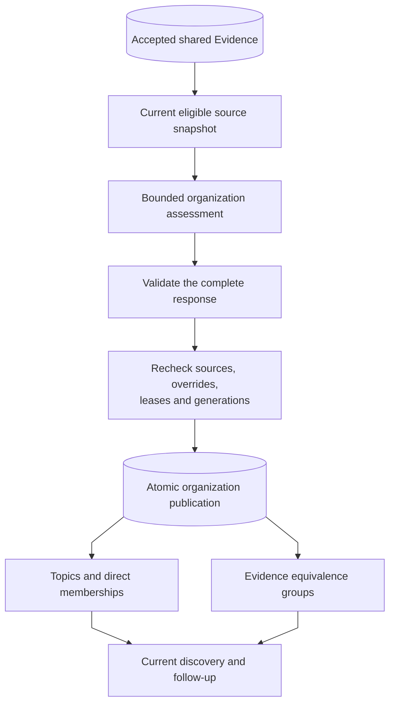
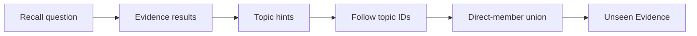
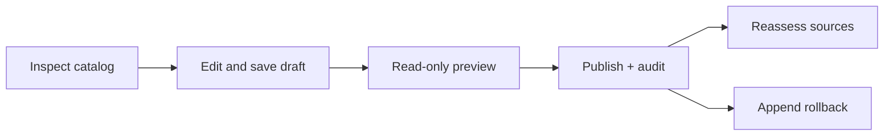

# Topics And Organization

Topics organize eligible team-shared Evidence directly. Topic membership, equivalence, and hierarchy are derived metadata; none creates submitted Evidence or establishes factual support. Private Evidence is excluded.

## Organization Boundary

Publication cannot create or edit canonical Evidence. Models propose; deterministic validation and publication policy decide.

## Discover And Follow A Topic

A parent topic does not implicitly select its children. For example, if Operations is the parent of Deployments, filtering Operations retrieves its direct Evidence only. Request both topic IDs to select both direct membership sets.

Counts and selection apply visibility, lifecycle, temporal eligibility, freshness, and known-Evidence exclusions. Related-topic hints report truncation. Missing, foreign, retired, or stale selected topics return the same bounded `topic_unavailable` outcome.

## Enablement And Freshness

| Condition | Effect |
| --- | --- |
| Organization enabled | Current eligible publications can participate in recall; maintenance can be admitted under its controls. |
| Maintenance paused | Existing eligible publications remain readable. |
| Organization disabled | Topic reads stop; ordinary Evidence recall remains available. |
| Evidence, definitions, or overrides change | Dependency fingerprints invalidate affected derived state. |
| A publication's source or generation changes during assessment | Fenced publication cannot overwrite newer state. |

Maintenance uses existing bounded scheduling, concurrency, provider backoff, and complete-response validation. Request context limits constrain individual model calls. There is no cumulative token allowance or spending budget. Exact controls are in [Configuration](Configuration#ontology-maintenance); operator procedures are in [Operations Runbook](Operations-Runbook#ontology-maintenance).

## Evidence-Only Cutover

The one-time migration `20261110010000` resets derived organization before normal Evidence-based maintenance resumes.

| State | Cutover behavior |
| --- | --- |
| Topics, IDs, assignments, equivalence, overrides, publications, assessments, drafts, and derived queues | Cleared together through the explicit reset inventory. Manual organization is not retained. |
| Original Evidence, fingerprints, provenance, lifecycle, conflicts, legal holds, and unrelated security/audit history | Retained and checked by the migration. |
| Maintenance settings, pause state, and usage accounting | Retained; discovery cursors and leases reset. |
| Existing eligible shared Evidence | Rediscovered in active spaces and current generations without resubmission. Private and unavailable sources remain excluded. |
| Already-applied cutover | Skipped; current organization remains intact. |

Rebuilding runs after startup when maintenance is enabled, unpaused, and has model capacity. Rediscover topic handles afterward; rebuilt organization can differ. Ordinary publication and override rules below continue to apply. [Operations Runbook](Operations-Runbook#evidence-only-cutover) owns execution and recovery.

## Manager Workflow

Managers use the user portal's **Ontology** section. Inspection requires read access; saving and publication commands require write access. Drafts belong to their creator.

| Operation | Constraint |
| --- | --- |
| Define a topic | Optional active topic parent; cycles and chains over 32 links reject. |
| Classify Evidence | Eligible shared source and current version required. |
| Group / keep separate | Preserve all original source handles and compatibility rules. |
| Pin / remove override | Manager overrides are locks; definitions are pinned by default. |
| Preview | Uses publication validation and reports bounded examples and affected-source counts. |
| Publish / rollback | Rechecks versions and eligibility; commits revision, audit, receipt, and draft completion together. |

The editor supports topics, assignments, Evidence groups, and overrides. It has no Entity-class, predicate-concept, or factual-inference workflow. A stale draft stays open: refresh its versions, review the changes, then save and preview again.

First-party management interfaces are under `/ui/api/ontology`; they do not replace the MCP memory contract. See [Portals And API Keys](Portals-And-API-Keys) for access and [Telemetry](Telemetry) for diagnostics.
