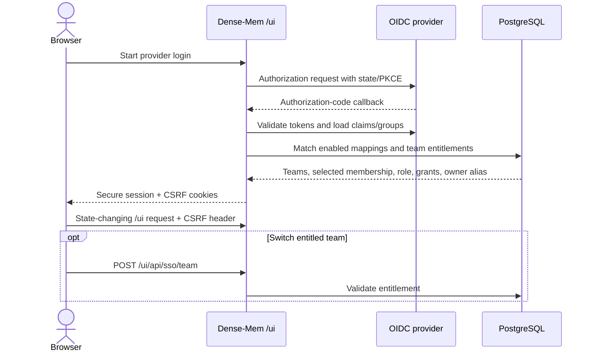

# User Portal SSO

This page is the source of truth for Dense-Mem browser SSO, OIDC provider
configuration, team entitlements, SSO-owned credentials, and troubleshooting.
For the surrounding portal surfaces, see
[Portals And API Keys](Portals-And-API-Keys).
For request authentication and tenant enforcement, see
[Request Lifecycle And Security](Request-Lifecycle-And-Security).

This page defines the target browser SSO contract. Provider-specific setup is
version-sensitive; verify it against the deployed Dense-Mem release and the
provider's current documentation.

This page defines the SSO cookie-session contract. The user portal also
supports direct API-key authentication and an explicit, separate API-key portal
session described below; an API-key login is never converted into an SSO
session.

When SSO is configured, the user portal adds public SSO endpoints under the main
Dense-Mem public base URL.

Register this redirect URI with the OIDC provider:

```text
https://<dense-mem-host>/ui/api/sso/callback
```

This value is derived from `SSO_PUBLIC_BASE_URL`, so a deployment with:

```text
SSO_PUBLIC_BASE_URL=https://dense-mem.example.com
```

uses:

```text
https://dense-mem.example.com/ui/api/sso/callback
```

Dense-Mem exposes these user-portal SSO endpoints:

| Method | Path | Purpose |
| --- | --- | --- |
| `GET` | `/ui/api/sso/providers` | Lists enabled SSO providers for the login screen. |
| `GET` | `/ui/api/sso/start/:providerId` | Starts OIDC login and redirects to the provider. |
| `GET` | `/ui/api/sso/callback` | Receives the OIDC authorization code callback. |
| `POST` | `/ui/api/sso/team` | Switches the current SSO browser session to another entitled team. |
| `POST` | `/ui/api/sso/credential` | Creates the current SSO member's owned credential and one-time API key for the selected team. |
| `POST` | `/ui/api/sso/credential/rotate` | Rotates the current SSO member's owned credential key for the selected team. |
| `POST` | `/ui/api/sso/logout` | Clears the local Dense-Mem SSO session cookies. |

## API-Key Portal Session

The API-key login screen has an opt-in “Keep me signed in for 7 days” checkbox.
After the direct bearer key is validated, the UI calls:

| Method | Path | Purpose |
| --- | --- | --- |
| `POST` | `/ui/api/session` | Exchanges the current direct API-key bearer for an opaque portal session. Body is exactly `{"remember":true}` or `{"remember":false}`. |
| `GET` | `/ui/api/session` | Reads the current portal session, direct bearer session, or SSO session. |
| `POST` | `/ui/api/session/logout` | Deletes the presented portal session and clears its cookies. |

All three authenticated modes use one session response shape:

```json
{
  "data": {
    "team": {},
    "membership": {
      "team_id": "...",
      "name": "...",
      "grants": ["read"],
      "role": "member"
    },
    "credential": null,
    "teams": [{ "team": {}, "membership": {} }],
    "personal_credential": null
  }
}
```

`credential: null` identifies an SSO browser session. A non-null credential
with a locally held bearer identifies direct API-key auth; a non-null
credential without a locally held bearer identifies an API-key portal-cookie
session. The response does not expose `auth_method`, capability flags, or the
permanent owner alias.

The server stores only SHA-256 fingerprints of the session and CSRF tokens.
The browser receives a host-only `dense_mem_ui_session` cookie (`HttpOnly`,
`SameSite=Lax`, `Path=/ui`) and a readable `dense_mem_ui_csrf` cookie on the
same path. State-changing requests send the CSRF value in
`X-Dense-Mem-CSRF`. The server-side session always expires seven days after
creation; the checkbox controls only whether the browser cookies persist past
the current browser session. Expiry is absolute, not sliding.

The API-key portal session points to the stable credential ID. Rotation replaces key
material in place, so an active portal session survives rotation. Revocation,
expiration, inactive/deleted teams, role/scopes, and SSO-owned-key entitlement
are checked again on each request. The API-key exchange clears SSO browser
cookies, and an SSO callback clears portal cookies.

Portal sessions are stored in PostgreSQL under a dedicated `NOLOGIN`
`dense_mem_portal_session_system` role. The application login receives only
`EXECUTE` on the four bounded session functions; setting the transaction-local
`app.tx_mode` marker alone does not grant direct access to the session table.
The bundled Compose deployment runs migrations with the same database login as
the server. Deployments that separate migration and runtime logins must grant
the runtime login those function privileges without granting it direct table
access.



Do not use `/ui/api/sso/logout` as an OIDC post-logout redirect URI. It is a
local API endpoint, not a browser landing page. The target contract does not
perform RP-initiated OIDC logout with `post_logout_redirect_uri` unless a later
version explicitly adds it.

SSO sessions and API keys are separate authentication sources. One SSO identity
can be entitled to multiple teams, and the same provider group or role can map
to many Dense-Mem teams. Dense-Mem creates one membership with a permanent
owner alias per entitled team, and `/ui` shows a team selector for those teams.

The SSO membership has no API key material. Authentication resolves its actor
identity, membership, and permanent owner alias before application services
run; the team ID and membership ID are not substituted for the owner alias.

SSO manager sessions see the Team tab and can manage same-team credentials like
a manager API-key login. Credentials created from the Team tab use ordinary API
keys.

SSO member sessions see the My credential tab. Each SSO identity can own at
most one active personal credential per team. That credential is stored with
SSO ownership metadata so `/ui` can find it. Future bearer-token login with its
key uses the standard API-key
format rather than the browser session. When SSO authentication is configured,
the auth middleware revalidates the SSO-owned key's current entitlement, so a
revoked external entitlement can deny a still-present local key. It is not a
hybrid cookie-and-bearer login.

The current SSO entitlement limits what the member can create or rotate from
`/ui`:

| SSO entitlement on selected team | My credential behavior |
| --- | --- |
| Manager | Use the Team tab instead of My credential. |
| Member with read/write permission | Can create a read/write or read-only personal API key. Can rotate only if the existing personal key also has write scope. |
| Member with read-only permission | Can create a read-only personal API key. Cannot rotate it from `/ui`. |

If the provider requires a post-logout redirect URI, use the portal URL:

```text
https://<dense-mem-host>/ui
```

### SSO Login Visibility

The user portal shows SSO login only when public SSO is ready:

- `SSO_PUBLIC_BASE_URL` is an absolute `http` or `https` URL.
- At least one SSO provider is enabled.
- The provider has a valid issuer URL and client ID.
- If the provider uses `Client secret env`, that environment variable exists
  and is not empty.

When these conditions are not met, `/ui` should only show API-key login and
`GET /ui/api/sso/providers` should return no public providers. This is
intentional for deployments such as the hosted demo.

### Provider Fields

Configure providers in the control portal SSO section.

| Field | Meaning |
| --- | --- |
| Name | Display name shown on the user portal login screen. |
| Kind | Use `OIDC` for standards-based OIDC providers. Use provider-specific kinds only when Dense-Mem has a provider-specific integration. |
| Issuer URL | Provider issuer base URL, without `/.well-known/openid-configuration`. |
| Client ID | OIDC application client ID. |
| Client secret env | Environment variable name that contains the client secret. Leave empty for public PKCE clients. |
| Scopes | Login scopes requested during the browser flow. Use at least `openid`, `profile`, and `email`. |
| Group claims | Claim names that contain group, role, or entitlement values. |
| Groups endpoint | Optional endpoint used when group claims are not present or when SSO entitlement refresh needs a provider lookup. |
| Groups scopes | Scopes for the groups endpoint. If a groups endpoint is configured, these are also requested during browser login. |
| Enabled | Enables the provider for login after the rest of the setup is correct. |

Group mappings connect provider group values to Dense-Mem teams:

| Mapping field | Meaning |
| --- | --- |
| Team | Dense-Mem team to grant access to. |
| Group | Exact group or role value from the provider claim. |
| Permission | Dense-Mem API scopes for member mappings, such as read-only or read/write. Manager mappings always grant read/write. |
| Role | Dense-Mem membership role, either member or manager. Manager role grants the `/ui` Team tab for that team. |
| Status | Disable a mapping without deleting it. |

### Microsoft Entra ID / Azure AD SCIM Directory Automation

One Dense-Mem deployment is one organization boundary. An Entra provider can
have one SCIM connector. The connector provisions durable users, groups, and
group memberships; it does not create a second organization or a second
authorization store.

Set up the provider first, using the tenant's discovered OIDC issuer, the
application client ID, the Entra tenant ID, and `oid` as the stable identity
claim. Register the normal user callback:

```text
https://<dense-mem-user-host>/ui/api/sso/callback
```

Then configure a directory connector from that provider's SSO panel. Dense-Mem
shows the connector ID and its bearer token plus OAuth client credentials once.
Store those values in the Entra provisioning application or a secret manager;
they cannot be read back from Dense-Mem. Rotate them from the control portal if
they are lost or suspected exposed.

Set `SCIM_PUBLIC_BASE_URL` to the dedicated HTTPS base URL that fronts the main
listener. The connector's SCIM base is:

```text
https://<scim-host>/scim/v2/<connector-id>
```

The OAuth client-credentials token endpoint is:

```text
https://<scim-host>/scim/oauth/token
```

The SCIM service accepts either the connector bearer token or an OAuth access
token issued for that connector. It supports SCIM 2.0 `Users` and `Groups`,
including PATCH and exact equality filters used by ordinary Entra provisioning.
Bulk provisioning, a gallery-specific shortcut, workload identity federation,
and multiple connectors for one provider are not part of this version.

Configure a full-match RE2 pattern with named `team` and `role` captures, then
map each allowed role capture to a Dense-Mem member or manager entitlement. For
example:

```text
^ActiveDirectoryGroup(?P<team>.+?)(?P<role>Readonly|Member|Manager)Permission$
```

With the matching entitlement map, a group named
`ActiveDirectoryGroupResearchManagerPermission` can create or bind the `Research` team and
grant its current members manager access. The connector previews its plan before
activation and enforces the configured auto-team cap.

The lifecycle is deliberate:

1. `disabled` has no directory authority.
2. `observe` accepts provisioning state and shows the proposed bindings,
   candidates, and durable issues without changing authorization.
3. `active` requires the current preview version and applies that initial
   reconciliation atomically. SCIM becomes the authority for that provider's
   user/team entitlements.

While a connector is active, the OIDC login proves the user identity only.
Dense-Mem does not grant user-portal teams from OIDC group claims, UserInfo, or
a configured Graph/groups endpoint. It requires an active SCIM user and a
current durable SCIM membership that matches the selected team membership. Existing user
sessions and SSO-owned API keys perform that same durable check, so removing a
membership or deactivating a SCIM user denies access on the next request.

The connector treats the external group ID as durable. A later display-name
rename never rebinds a group, moves a team, renames a team, or changes a role.
An exact manual group-to-team mapping wins over automation. Otherwise, an
unambiguous normalized active team name can be previewed as an exact-name
binding; a newly created directory team stays marked directory-managed. Removing
a group archives only a directory-created team. Exact-name, manual, and adopted
teams remain active but lose the removed directory access. An operator may adopt
a directory-created team to make it manual before that removal.

### Control Portal SSO

The control portal keeps the break-glass `CONTROL_PORTAL_TOKEN`, and can also
use an enabled OIDC provider plus explicitly configured control-admin group IDs.
Set `CONTROL_PUBLIC_BASE_URL` to the dedicated HTTPS administrative ingress and
register this separate callback with the selected provider:

```text
https://<control-host>/control/auth/callback
```

Control-group membership is not a user-team mapping. It grants only control
portal access. A control SSO session is checked against the active configured
admin group on every use; when its provider has an active SCIM connector, the
identity must also remain an active SCIM user. Keep the control listener private
or behind dedicated administrative ingress, and retain the break-glass token
outside browser-accessible configuration.

### Generic OIDC Group And Role Mapping

Dense-Mem is not tied to a specific SSO vendor. A provider without an active
SCIM connector can use stable group, role, or entitlement values through one of
these paths:

- ID-token claims
- UserInfo claims
- a configured groups endpoint

Set `Group claims` to the claim names that contain the values you want to map.
Dense-Mem accepts common claim shapes:

| Claim shape | Dense-Mem group values |
| --- | --- |
| `["admin", "writer"]` | `admin`, `writer` |
| `"admin"` | `admin` |
| `{ "admin": {...}, "writer": {...} }` | `admin`, `writer` |

The group mapping `Group` field must exactly match one emitted value. This can
be an IdP group name, a role key, an application role, or any stable entitlement
string your provider emits.

For claim-only providers, leave `Groups endpoint` and `Groups scopes` empty.
Claim-derived entitlements are cached for the browser SSO session lifetime. For
providers that do not emit usable group or role claims, configure
`Groups endpoint` and the delegated or client-credential scopes it needs.

Examples:

| Provider style | Typical `Group claims` |
| --- | --- |
| Generic OIDC group claims | `groups` |
| Entra ID or Azure AD groups | `groups` or provider-specific group endpoint |
| Application roles | `roles` |
| ZITADEL project roles | `urn:zitadel:iam:org:project:<project_id>:roles, urn:zitadel:iam:org:project:roles` |

Use `LOG_LEVEL=debug` during setup and read `id_token_claim_names`,
`userinfo_claim_names`, and `groups` in the SSO callback logs to confirm the
right claim names and emitted values.

### Example: ZITADEL Cloud With Project Roles

For hosted ZITADEL, use the ZITADEL instance that owns the application as the
issuer URL:

```text
https://<instance>.us1.zitadel.cloud
```

If you have multiple ZITADEL URLs, use the one whose
`/.well-known/openid-configuration` issuer matches the application client ID.

In ZITADEL:

1. Create or open the project used for Dense-Mem.
2. Create a web application that uses Authorization Code with PKCE.
3. Add the Dense-Mem redirect URI:

   ```text
   https://<dense-mem-host>/ui/api/sso/callback
   ```

4. Copy the application client ID.
5. Create project roles for Dense-Mem access.

Example project role:

| ZITADEL role field | Example |
| --- | --- |
| Key | `dense-mem-admin` |
| Display name | `Dense-Mem Admin` |
| Group | `dense-mem` |

Dense-Mem matches the role key from the token claim. The ZITADEL role group is
only a ZITADEL-side organizer unless your emitted claim contains that value.

Assign the role to each user that should access Dense-Mem. For example, assign
your own user the `dense-mem-admin` role before testing login.

In Dense-Mem, configure the provider:

| Dense-Mem field | Value |
| --- | --- |
| Name | `ZITADEL` |
| Kind | `OIDC` |
| Issuer URL | `https://<instance>.us1.zitadel.cloud` |
| Client ID | ZITADEL application client ID |
| Client secret env | Empty for a public PKCE app, or an environment variable name for a confidential app secret. |
| Scopes | `openid, profile, email` |
| Group claims | `urn:zitadel:iam:org:project:<project_id>:roles, urn:zitadel:iam:org:project:roles` |
| Groups endpoint | Empty when using ZITADEL role claims. |
| Groups scopes | Empty when using ZITADEL role claims. |
| Enabled | Checked after the provider, roles, and mappings are ready. |

If ZITADEL does not emit role claims, enable `Assert Roles on Authentication`
on the project for UserInfo role claims, or `User Roles Inside ID Token` on the
application for ID-token role claims. When required by your ZITADEL setup, add
the project audience scope to `Scopes`:

```text
urn:zitadel:iam:org:project:id:<project_id>:aud
```

Create a Dense-Mem group mapping whose `Group` value is the ZITADEL role key:

| Dense-Mem mapping field | Example |
| --- | --- |
| Team | `Mark` |
| Group | `dense-mem-admin` |
| Permission | Not shown for `Manager`; manager implies read/write. |
| Role | `Manager` |
| Status | `enabled` |

With debug logging enabled, a successful claim read should show the ZITADEL role
claim names and a group value matching the role key:

```json
{
  "configured_group_claims": [
    "urn:zitadel:iam:org:project:<project_id>:roles",
    "urn:zitadel:iam:org:project:roles"
  ],
  "groups": ["dense-mem-admin"],
  "groups_from_userinfo": true
}
```

### SSO Troubleshooting

Set `LOG_LEVEL=debug` while setting up SSO. The callback response now returns a
safe setup hint, and the server log has provider and claim details.

| Browser message | What to check |
| --- | --- |
| `sso setup failed: no groups found in configured claims` | `Group claims` does not match the token or UserInfo claim names, or the provider is not emitting the expected group or role claims. |
| `sso setup failed: group lookup failed` | The groups endpoint, delegated scopes, or client credentials are wrong. |
| `sso setup failed: no mapping matched the user groups` | The Dense-Mem mapping `Group` value does not exactly match the emitted role or group value. |
| `sso setup failed: no enabled team entitlement matched` | A mapping exists, but it is disabled or does not grant an enabled team entitlement. |
| `sso access denied` | The provider is disabled, the session is invalid, or entitlement validation failed after setup. |

For claim-based setups, the usual fix is:

1. Read `id_token_claim_names` and `userinfo_claim_names` in the debug log.
2. Put the provider's group or role claim names in `Group claims`.
3. Set the Dense-Mem mapping `Group` to the emitted group or role value.
4. Confirm the user is assigned that group, role, or entitlement in the IdP.

ZITADEL example references:

- [Retrieve User Roles in ZITADEL](https://zitadel.com/docs/guides/integrate/retrieve-user-roles)
- [Claims in ZITADEL](https://zitadel.com/docs/apis/openidoauth/claims)
- [Applications in ZITADEL](https://zitadel.com/docs/guides/manage/console/applications-overview)

## Related Configuration

The canonical setting names and defaults remain in
[Configuration](Configuration#authentication-limits-and-sso). This page owns the setup process
and behavior; the configuration page owns the setting reference.
