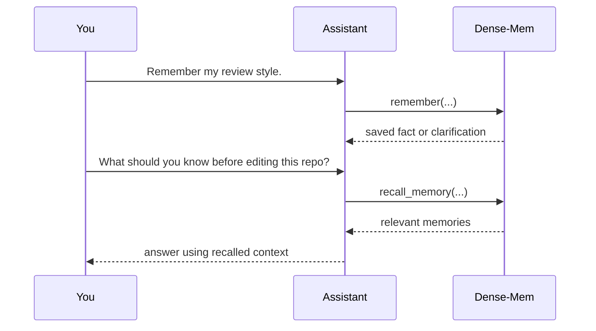

# Using Dense-Mem

After setup, Dense-Mem works in the background. Your AI assistant calls it when
memory should be saved, searched, reviewed, or corrected.

## The Normal Flow



## What To Ask Your Assistant

Use normal language. You do not need to know the tool names.

| What you want | Example prompt |
| --- | --- |
| Save a preference | "Remember that I prefer direct answers and no filler." |
| Save a project fact | "Remember that this repo deploys through Docker Swarm." |
| Recall context | "Before we start, recall what you know about this project." |
| Check memory health | "Review my stored memories and tell me if anything needs clarification." |
| Correct a memory | "Replace the old deployment note with this new one." |

## What Dense-Mem Returns

Dense-Mem can return several kinds of memory:

| Kind | Meaning |
| --- | --- |
| Fact | A promoted memory that passed checks and is active. |
| Claim | A candidate memory that has evidence but may not be promoted. |
| Fragment | The original text used as evidence. |
| Clarification | A question the assistant should ask before changing memory. |

For normal use, facts are the most important. Claims and fragments help explain
where a memory came from.

## Example: Personal Preference

You say:

```text
Remember that I prefer code reviews to start with bugs and risks before style notes.
```

Later you ask:

```text
Review this pull request using my usual review style.
```

The assistant can recall the preference and structure the review around bugs and
risks first.

## Example: Project Setup

You say:

```text
Remember that the Dense-Mem local control portal should stay bound to 127.0.0.1.
```

Later you ask:

```text
Help me update the Docker setup.
```

The assistant can recall that the portal should stay local and avoid suggesting
an unsafe public bind.

## Example: Conflicting Memory

You say:

```text
Remember that I want long detailed answers.
```

If Dense-Mem already has an active fact that you prefer concise answers, it
should not silently choose one. It can return a clarification so the assistant
asks:

```text
Which preference should I keep: concise answers or long detailed answers?
```

After you answer, the assistant can confirm which memory should stay active.

## Teams And Profiles

Dense-Mem keys are tied to a team and a named profile.

Use this when you want separate memory spaces:

| Situation | Suggested setup |
| --- | --- |
| One person, one assistant | One team, one profile |
| One person, multiple roles | One team, one profile per role |
| Multiple projects | One team per project |
| Automation that should only read | Read-only profile key |

Do not share a write key with tools that should only search memory.

## Daily Operator Commands

List teams:

```bash
docker compose exec server /app/list-teams
```

List profiles in a team:

```bash
docker compose exec server /app/list-team-profiles --team-id "<team-id>"
```

Rotate a profile key:

```bash
docker compose exec server /app/rotate-team-profile-key \
  --team-id "<team-id>" \
  --profile-id "<profile-id>"
```

## When To Use The Control Portal

Use the local control portal to:

- create teams
- create named profiles
- create read-only or read-write API keys
- rotate keys
- remove keys
- review or update IP ban settings

The portal is not a memory browser. It does not show every fact, claim, or graph
node.
