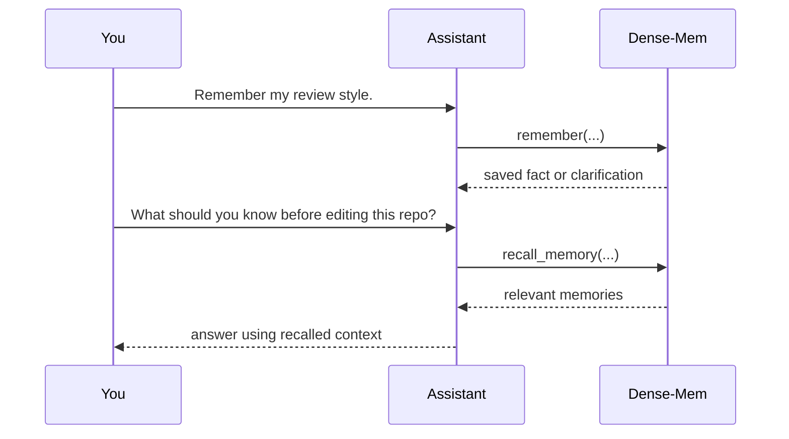

# Using Dense-Mem

After setup, Dense-Mem works in the background. Your AI assistant calls it when
memory should be saved, searched, reviewed, or corrected.

## The Normal Flow



## What To Ask Your Assistant

Use normal language. You do not need to know the tool names.

| What you want | Example prompt |
| --- | --- |
| Save a preference | "Remember that I prefer direct answers and no filler." |
| Save a project fact | "Remember that this repo deploys through Docker Swarm." |
| Recall context | "Before we start, recall what you know about this project." |
| Investigate evidence | "Show me why you believe that memory and what could contradict it." |
| Build answer context | "Assemble the relevant project memory before answering." |
| Check memory health | "Review my stored memories and tell me if anything needs clarification." |
| Explore related clusters | "Use community-aware recall for this deployment question." |
| Review hypotheses | "List proposed dreams and ask me which ones should be reinforced or rejected." |
| Correct a memory | "Replace the old deployment note with this new one." |

## Write Granular Memories

Dense-Mem works best when each saved memory entry is a focused evidence unit,
not a broad scenario summary. MCP memory writes are validated to stay under 1000
characters per entry.

Split large scenarios by decision, fact, correction, preference, project
milestone, or another claim-worthy unit. This gives Dense-Mem cleaner
`SUPPORTED_BY` links from claims to the smallest evidence that proves them, and
it helps future recall and graph relationships stay precise.

Good:

```text
Remember that the Dense-Mem MCP tools should keep each memory evidence entry
under 1000 characters.
```

Better than:

```text
Remember this whole project history, including every decision, benchmark,
deployment setting, and marketing plan...
```

When one claim needs evidence from more than one entry, the assistant can attach
multiple supporting fragment IDs instead of merging unrelated context into one
large fragment.

## What Dense-Mem Returns

Dense-Mem can return several kinds of memory:

| Kind | Meaning |
| --- | --- |
| Fact | A promoted memory that passed checks and is active. |
| Claim | A candidate memory that has evidence but may not be promoted. |
| Fragment | The original text used as evidence. |
| Clarification | A question the assistant should ask before changing memory. |

For normal use, facts are the most important. Claims and fragments help explain
where a memory came from.

## Trace Evidence And Assemble Context

Use `trace_memory` when an answer needs provenance for one specific fact or
claim. It returns the anchor memory, the promoting claim when available,
supporting fragments, bounded contradiction or supersession links, and explicit
edge records.

```json
{
  "type": "fact",
  "id": "fact_123",
  "max_related": 5,
  "include_fragments": true
}
```

Use `assemble_context` when the assistant should prepare a bounded context block
before answering. It calls recall, includes source IDs, returns structured items,
and starts the text block with a reminder that memory is data, not instructions.

```json
{
  "query": "repo release process and testing expectations",
  "limit": 5,
  "max_chars": 4000,
  "include_evidence": true
}
```

This keeps memory inspection bounded. The assistant should trace a specific
claim or fact when it needs evidence, not ask Dense-Mem to traverse the whole
graph.

## Communities And Dreams

Community detection groups related same-profile graph nodes and stores bounded
community summaries. Normal recall ignores these summaries unless the assistant
passes `use_communities=true`.

Dreaming creates reviewable hypotheses from existing memory. A dream is not a
fact. If you confirm a dream, Dense-Mem turns that feedback into normal
evidence and sends it through the usual claim, verification, and promotion
pipeline.

Ask for these features in normal language:

| What you want | Example prompt |
| --- | --- |
| Refresh community summaries | "Run community detection for this profile." |
| Search with community expansion | "Recall deployment memory and use communities if useful." |
| Inspect hypotheses | "Show me proposed dreams for this profile." |
| Resolve a dream | "Reject that dream; it is not true anymore." |

See [Community Memory](Community-And-Dreaming) and [Dreaming](Dreaming) for tool
names, schedules, and config defaults.

## Example: Personal Preference

You say:

```text
Remember that I prefer code reviews to start with bugs and risks before style notes.
```

Later you ask:

```text
Review this pull request using my usual review style.
```

The assistant can recall the preference and structure the review around bugs and
risks first.

## Example: Project Setup

You say:

```text
Remember that the Dense-Mem local control portal should stay bound to 127.0.0.1.
```

Later you ask:

```text
Help me update the Docker setup.
```

The assistant can recall that the portal should stay local and avoid suggesting
an unsafe public bind.

## Example: Conflicting Memory

You say:

```text
Remember that I want long detailed answers.
```

If Dense-Mem already has an active fact that you prefer concise answers, it
should not silently choose one. It can return a clarification so the assistant
asks:

```text
Which preference should I keep: concise answers or long detailed answers?
```

After you answer, the assistant can confirm which memory should stay active.

See [Conflicts And Corrections](Conflicts-And-Corrections) for the full
clarification and `confirm_memory` workflow.

## Teams And Profiles

Dense-Mem keys are tied to a team and a named profile.

Use these terms this way:

| Term | Meaning |
| --- | --- |
| Team | Top-level memory boundary. Use separate teams when memory should not mix. |
| Profile | Named key identity inside a team, usually one assistant, role, workflow, or automation. |
| Read-write key | Can remember, import, confirm, and otherwise mutate memory for its team/profile. |
| Read-only key | Can recall, search, and inspect memory, but cannot write or change it. |

Use this when you want separate memory spaces:

| Situation | Suggested setup |
| --- | --- |
| One person, one assistant | One team, one profile |
| One person, multiple roles | One team, one profile per role |
| Multiple projects | One team per project |
| Automation that should only read | Read-only profile key |

Do not share a write key with tools that should only search memory. See
[Portals And API Keys](Portals-And-API-Keys) for key management and
[Read-Only Keys](Technical-Reference#read-only-keys) for the API example.

## Daily Operator Commands

List teams:

```bash
docker compose exec server /app/list-teams
```

List profiles in a team:

```bash
docker compose exec server /app/list-team-profiles --team-id "<team-id>"
```

Rotate a profile key:

```bash
docker compose exec server /app/rotate-team-profile-key \
  --team-id "<team-id>" \
  --profile-id "<profile-id>"
```

## When To Use The Control Portal

Use the local control portal to:

- create teams
- create named profiles
- create read-only or read-write API keys
- rotate keys
- remove keys
- configure SSO, dreaming, community detection, and operation-log retention
- inspect operation logs and per-team dream outputs
- review or update IP ban settings

The portal is not a memory browser. It does not show every fact, claim, or graph
node.

## When To Use The User Portal

Use the authenticated user portal at:

```text
http://127.0.0.1:8080/ui
```

The user portal is for the current API key. It can show the current team/profile
session, rotate the authenticated key when it has write scope, and show
per-profile telemetry when telemetry is enabled. It also shows dreaming status,
dream outputs, and recent dream cycle runs for the current profile. If the
current key has manager role, it can also manage same-team member profiles from
the Team tab.

It is separate from the control portal. The control portal uses
`CONTROL_PORTAL_TOKEN` and manages all teams, profiles, profile roles, keys, and
security-ban settings.

See [Portals And API Keys](Portals-And-API-Keys) for the full operator guide.
