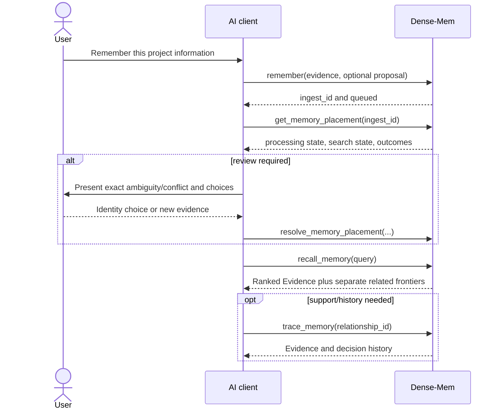

# Using Dense-Mem

Dense-Mem exposes its external memory tools through MCP. Contract
`dense-mem.v2.3.2` accepts evidence, optionally accepts structured hints, and
processes semantic placement asynchronously. The user and control portals are
first-party product interfaces, not alternative memory automation contracts.

This is the user workflow. Exact fields and limits belong in
[Technical Reference](Technical-Reference).

## Normal Write And Read Flow



`remember` acknowledges durable evidence intake. It does not promise immediate
semantic acceptance or a current vector. `processing_state=completed` can
coexist with `search_state=pending`; committed full-text/adjacency/current-state
reads remain distinct from vector freshness.

## What To Ask

| Goal | Example prompt |
| --- | --- |
| Save knowledge | “Remember this evidence: Mark works on Dense-Mem. Dense-Mem uses PostgreSQL.” |
| Recall context | “Before editing, recall Dense-Mem’s database architecture.” |
| Follow Relationships | “Show Relationships connected to Dense-Mem.” |
| Inspect support | “Trace the database Relationship and show accepted evidence.” |
| Resolve identity | “Show placements waiting for me to identify which Mark.” |
| Replace specific evidence | “That deployment target is wrong; replace the exact evidence item I authored.” |
| Retract evidence | “The source was withdrawn; retract the exact evidence item I authored.” |
| Forget an edge | “Forget the selected Relationship, but preserve audit history.” |
| Review speculation | “List related dreams and keep them labeled Hypotheses.” |

## Evidence First

Smallest write:

```json
{
  "evidence": [
    {
      "content": "Mark works on Dense-Mem. Dense-Mem uses PostgreSQL.",
      "source_type": "conversation",
      "source": "conversation:project-overview",
      "source_group": "conversation:project-overview",
      "idempotency_key": "project-overview-turn-1"
    }
  ]
}
```

Dense-Mem extracts Entity mentions and Relationship observations. A `proposal`
can reduce extraction ambiguity, but remains a hint.

Do not:

- use a name as `entity_id` or invent server IDs
- claim source independence when items share an origin
- send a sentence as one Entity
- set predicate definitions, lifecycle status, support, or lifecycle behavior
- model an alias as an edge
- omit known discriminators for a name such as `Mark`

## Replace Or Retract Evidence

To replace a particular current evidence item you own, submit its UUID in the
replacement item's `supersedes_evidence_ids`. This is direct targeting; it is
not the source-revision workflow. Each replacement needs its own idempotency
key, and a request cannot combine `supersedes_evidence_ids` with
`previous_source_revision`.

```json
{
  "evidence": [
    {
      "content": "Dense-Mem uses PostgreSQL as its only durable authority.",
      "source_type": "manual",
      "supersedes_evidence_ids": ["<owned-current-evidence-uuid>"],
      "idempotency_key": "postgres-authority-correction-20260729"
    }
  ]
}
```

Dense-Mem verifies that each target is a unique current evidence UUID owned by
the authenticated profile. It appends the supersession event and retires the
target atomically at intake; the target remains retired if the new evidence is
later quarantined or does not produce an active Relationship.

When no replacement exists, use `retract_evidence` instead of deleting data:

```json
{
  "evidence_ids": ["<owned-current-evidence-uuid>"],
  "reason": "The source was withdrawn.",
  "idempotency_key": "postgres-source-withdrawn-20260729"
}
```

Retraction writes an append-only lifecycle decision and reports the affected,
pending, and retained active Relationship counts. Current recall excludes the
retired evidence, while a historical `known_at` query before the event can still
inspect the prior state.

## Structured Hint Example

```json
{
  "evidence": [
    {
      "content": "Mark works on Dense-Mem. Dense-Mem uses PostgreSQL.",
      "source_type": "conversation",
      "source_group": "conversation:project-overview"
    }
  ],
  "proposal": {
    "entities": [
      {
        "ref": "mark",
        "name": "Mark",
        "entity_kind": "person",
        "identity_context": {
          "team": "Dense-Mem"
        }
      },
      {
        "ref": "dense_mem",
        "name": "Dense-Mem",
        "entity_kind": "product",
        "aliases": ["DM"]
      },
      {
        "ref": "postgresql",
        "name": "PostgreSQL",
        "entity_kind": "product"
      }
    ],
    "relationships": [
      {
        "proposal_id": "mark_works_on_dense_mem",
        "subject_ref": "mark",
        "predicate": "works_on",
        "object_ref": "dense_mem",
        "polarity": "+",
        "modality": "statement",
        "evidence": [
          {
            "evidence_index": 0,
            "start": 0,
            "end": 23
          }
        ]
      },
      {
        "proposal_id": "dense_mem_uses_postgresql",
        "subject_ref": "dense_mem",
        "predicate": "uses",
        "object_ref": "postgresql",
        "polarity": "+",
        "modality": "statement",
        "evidence": [
          {
            "evidence_index": 0,
            "start": 25,
            "end": 50
          }
        ]
      }
    ]
  }
}
```

Spans use Unicode code-point offsets, start inclusive and end exclusive. The
integrated assessor may split/reject/normalize hints, resolves Entities and
registered predicates, and evaluates Relationship support.

## Read The Terminology

```text
Entity record       stable real-world identity
entity_id           opaque identifier for that Entity
Entity node         graph-shaped view of the Entity record
Predicate           registered meaning such as works_on
Relationship        one profile's canonical subject-predicate-object lifecycle
SemanticEdge        active supported Relationship as a graph read
Cross-reference     same-team confirmation/challenge/correction link; not an edge
Observation         what one evidence submission expressed
VerificationEvent  Relationship judgment derived from the persisted assessor result
Hypothesis          isolated dream speculation
```

An edge and a Relationship are closely related but not interchangeable:
Relationship includes lifecycle/history references; SemanticEdge is only its
eligible compact graph shape. Full definitions belong in
[Relationship Model And Lifecycle](Relationship-Model-And-Lifecycle).

## Entity Reuse And Homonyms

Existing memory:

```text
entity_id: ent_dense_mem
canonical name: Dense-Mem
alias: DM
```

New evidence:

```text
DM uses Redis.
```

Expected: reuse `ent_dense_mem`, preserve/add `DM` as supported name metadata,
and create/update `uses`. No `DM` node or alias edge.

For `Mark`:

- one materially plausible supplied candidate and no contradiction → reuse
- multiple plausible candidates → `identity_needs_review`
- later contradictory context → show ambiguity and split impact to the client
- confirmed different person → create a new team-visible Entity and move only
  selected caller-owned observations

The client must not silently choose or create from display text.

## Placement Outcomes

Poll `get_memory_placement` and inspect:

- processing: `queued`, `processing`, `awaiting_review`, `completed`, `failed`
- vector search: `not_required`, `pending`, `current`, `failed`
- per-item category, reason, IDs, status, bounded assessment policy, and review
  task

Raw model confidence and the team's exact threshold are internal. The placement
contract exposes only `meets_write_threshold`, `below_write_threshold`, or
`not_applicable`, plus a bounded reason and assessment-policy version.

Important categories:

| Category | What the client does |
| --- | --- |
| `relationship_active` | may use in normal recall according to relevance |
| `relationship_pending_evidence` | do not present as known; excluded from default recall |
| `identity_needs_review` | present supplied candidates and discriminator question |
| `predicate_needs_review` | show original wording and server-supplied registry options |
| `relationship_needs_review` | show current/proposed evidence and impact |
| `relationship_rejected` / `evidence_quarantined` / `processing_failed` | do not use as knowledge; follow safe guidance |

The canonical table is
[Technical Reference](Technical-Reference#placement-contract).

## Resolve A Review

Use the exact returned item and candidate:

```json
{
  "ingest_id": "ing_01J...",
  "placement_item_id": "item_1",
  "placement_item_version": 3,
  "action": "select_entity",
  "entity_ref": "person_1",
  "candidate_entity_id": "ent_mark_huang",
  "idempotency_key": "resolution-1"
}
```

Selecting a returned Entity or predicate option is a durable deterministic
decision. It reapplies the persisted assessment with zero AI calls. If the
current session does not exactly identify a supplied option, ask the user the
returned question rather than guessing.

`accept`, `correct`, and `confirm_new_entity` require exact new evidence. That
evidence becomes a new placement item and receives one bounded assessor
conversation; a bare acceptance or client-supplied confidence cannot grant
support. Every semantic review includes stable ID/version, kind, state, bounded
question/options/guidance, and `expires_at`. After seven days an unanswered task
expires. Expiry never activates knowledge or directly creates a Hypothesis: a
structurally complete Relationship stays pending, while unresolved structure
remains Evidence plus Observation only.

No resolution action edits an edge directly. See
[Conflicts And Corrections](Conflicts-And-Corrections).

## Recall Evidence Context

```json
{
  "query": "Dense-Mem database architecture",
  "limit": 10,
  "relationship_limit": 5,
  "community_limit": 3,
  "known_evidence_ids": [],
  "known_relationship_ids": [],
  "expand_from_entity_ids": []
}
```

Default recall returns same-team active-supported evidence contexts in
`results[]`. Relationships remain the durable semantic graph and appear in the
separate correlation-ranked `related_relationships[]` frontier. When enabled,
derived clusters appear only in `related_communities[]`. Recall excludes
assessor history and pending Relationships from primary results. Server policy
may include matching Hypotheses in `related_hypotheses`. Required `conflicts[]` is empty
when no material disagreement applies. An open/overdue case returns bounded
alternatives and a question; a resolved case returns preferred current evidence
plus a compact status/trace reference. Recall has no `raw_evidence` field:
evidence text enters `results[]` only after final support-path eligibility.

Use bounded `related_relationships[]` for discovery; Entity expansion touches
direct Relationships only and does not recursively fetch every neighbor. If one
part remains uncertain, make a narrower recall and pass the
evidence UUIDs already seen in `known_evidence_ids` plus Relationship UUIDs
already seen in `known_relationship_ids` to expose different context,
optionally with `expand_from_entity_ids` for specific anchors. Use
`search_states` and `degradations[]` to distinguish lexical-only Relationship
discovery while vectors warm. See [Recall Ranking](Recall-Ranking).

## Trace Evidence

```json
{
  "relationship_id": "r1",
  "include_evidence_content": true,
  "include_verification": true,
  "include_transitions": true,
  "max_depth": 2,
  "max_edges": 24,
  "predicate_keys": ["uses", "works_on"],
  "topic": "Dense-Mem architecture"
}
```

Trace loads the Relationship, accepted spans, VerificationEvents, transitions,
conflicts/corrections, and bounded current SemanticEdges. Use trace for sources,
conflict, correction, forget, or high-stakes answers.

## Correct And Forget

A correction supplies new evidence and appends history. It does not edit the
old evidence. A correction to another profile creates caller-owned knowledge
and a cross-reference during placement; it never directly changes the other
profile's record. When recall returns an open Conflict case, place its
`conflict_id` and expected version on the relevant Relationship proposal in a
normal `remember` call. Dense-Mem derives the position from the new assessed
evidence; there is no bare vote or cross-profile resolve action. Nightly
Conflict review owns any automatic stale-state closure.

`forget` takes a caller-owned `relationship_id` and authorized reason. It appends a
retraction, removes that Relationship from active/default reads in the same
PostgreSQL transaction, and keeps Entity/Value nodes plus evidence and decision
history.

`forget` is Relationship lifecycle, not evidence lifecycle. Use
`retract_evidence` to remove an authored evidence item from current recall while
preserving its provenance and trace lineage.

Every write-scoped profile may merge or split its own Entity resolutions after
a dry-run impact preview. It cannot move another profile's observations. See
[Conflicts And Corrections](Conflicts-And-Corrections#cross-profile-corrections).

## Communities And Dreams

Community discovery is disabled by default and uses its own bounded
`related_communities[]` frontier. It never consumes or reranks Evidence or
Relationship slots.

Dreams are Hypotheses between existing endpoints using registered predicates.
They appear separately. Confirming one requires new independent evidence
through `remember`. Dreaming cannot create an Entity, Value, predicate,
Relationship, support, or active edge.

See [Community Memory](Community-And-Dreaming) and [Dreaming](Dreaming).

## Teams, Roles, And Scopes

| Term | Meaning |
| --- | --- |
| Team | top-level memory isolation boundary |
| Profile | named client identity inside one team |
| Manager | same-team administration; still needs operation scope |
| Member | normal memory use |
| `read` | recall and inspect |
| `write` | remember and resolve; merge/split/supersede own knowledge; create evidence-backed corrections to other profiles |
| `feedback:read` | authorized stored-feedback inspection |

Use read-only keys for automation that must never mutate memory.

## Risk

| Failure mode | Mitigation |
| --- | --- |
| client treats a pending Relationship as active knowledge | use typed categories and default recall only |
| client guesses which Mark | present server candidates and collect discriminator evidence |
| client assumes vector pending means write failed | distinguish processing from search state and trace by ID |
| client promotes a dream from plausibility | require independent evidence through normal `remember` |
