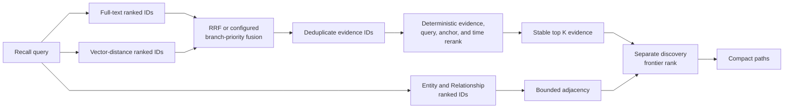
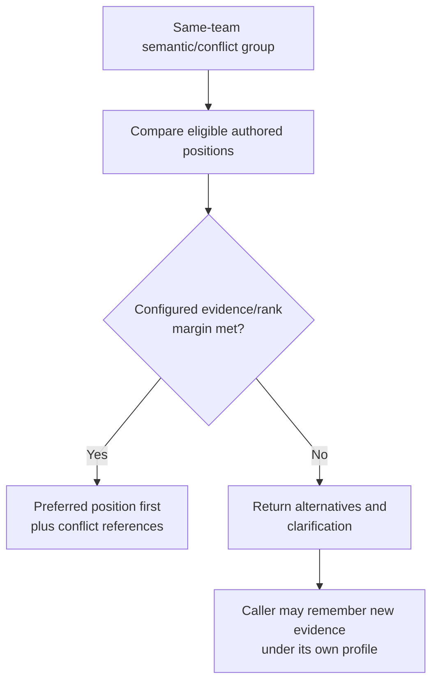

# Vector Search And Ranking

This page is the single source of truth for Dense-Mem's target embedding and
distance meaning, candidate fusion, reciprocal-rank fusion, and post-fusion
reranking contract. Exact/ANN execution, HNSW, `halfvec`, index lifecycle, and
vector-search topology belong in
[ANN, HNSW, And Halfvec](ANN-HNSW-And-Halfvec). The recall branch sequence and
public result shape remain in [Recall Ranking](Recall-Ranking). Runtime settings
and defaults remain in
[Configuration](Configuration#postgresql-search-and-recall).

## Why Ranking Has Stages

Full-text search and vector search return different score scales. A PostgreSQL
text rank is not numerically comparable to a cosine similarity. Dense-Mem
therefore combines stable evidence rank positions, then applies bounded
knowledge-aware reranking. Entity lookup, Relationship search, and adjacency
expansion use the same ranking primitives only for the separate discovery
frontier.



Hard authorization, status/tier eligibility, validity, and required exact
anchors run before or during candidate hydration. Reranking cannot restore a
candidate rejected by a hard gate.

## Embeddings

An embedding model converts a search document or query into a fixed-length
vector:

```text
query vector q    = [q1, q2, ... qn]
document vector d = [d1, d2, ... dn]
```

Provider adapter, model, dimensions, text normalization, document format, and
vector normalization form one persisted embedding contract. Query and document
vectors must use the same contract version. Mixed versions are excluded, not
compared approximately. The active search-index generation references that
contract and carries its compatible cosine pgvector operator class.

The vector represents model-defined semantic position. Individual dimensions
do not have stable human-readable meanings and must not be exposed as an
explanation of why knowledge is true.

## Cosine Similarity And Distance

Cosine similarity measures the angle between two non-zero vectors:

```text
dot(q, d) = sum(qi * di)

norm(q) = sqrt(sum(qi^2))
norm(d) = sqrt(sum(di^2))

cosine_similarity(q, d) = dot(q, d) / (norm(q) * norm(d))
cosine_distance(q, d) = 1 - cosine_similarity(q, d)
```

Higher similarity means closer direction. Lower distance means a nearer search
result.

### Worked example

```text
q = [1, 2]
d = [2, 1]

dot(q, d) = (1 * 2) + (2 * 1) = 4
norm(q) = sqrt(1 + 4) = sqrt(5)
norm(d) = sqrt(4 + 1) = sqrt(5)

cosine_similarity = 4 / 5 = 0.8
cosine_distance = 1 - 0.8 = 0.2
```

Reference points:

| Vector relationship | Cosine similarity | Cosine distance |
| --- | ---: | ---: |
| same direction | `1` | `0` |
| orthogonal | `0` | `1` |
| opposite direction | `-1` | `2` |

Production embedding distributions may occupy only part of this mathematical
range. Dense-Mem does not assign universal meaning such as “distance below 0.2
is relevant.” Retrieval uses rank plus evaluation-calibrated limits.

### Unit-normalized vectors

If both vectors have norm `1`, cosine similarity equals their dot product:

```text
norm(q) = norm(d) = 1
cosine_similarity(q, d) = dot(q, d)
```

Dense-Mem does not assume a model returns unit vectors from its name. The
embedding adapter declares and validates normalization behavior. Changing it
creates another contract and requires a vector rebuild.

## Vector Candidate Boundary

The initial target search contract uses cosine distance. Lower distance is
nearer, and diagnostic cosine similarity is `1 - distance`. PostgreSQL returns
an ordered, authorized list of candidate IDs and exact diagnostic distances;
it does not decide tier, truth, conflict, or final recall order.

The matching pgvector operators, exact/ANN routing, HNSW and `halfvec` strategy,
candidate exact rerank, dimension limits, and database-load controls are defined
only in [ANN, HNSW, And Halfvec](ANN-HNSW-And-Halfvec). This page consumes the
resulting candidate list.

## Candidate Lists

Each enabled initial retrieval branch returns ordered, authorized evidence IDs
and branch metadata:

```text
branch name
evidence_id
rank starting at 1
optional diagnostic raw score or distance
source/search-document version
optional relationship_id path hints
```

Relationship and Entity branches return compact path candidates for discovery
ranking after the evidence budget is fixed. They do not map back into the
initial evidence fusion score.

Raw scores remain diagnostics. Fusion consumes branch rank because:

- text-rank scales vary with query and corpus
- cosine distance has a different direction and distribution
- approximate indexes may change distances or candidate coverage without
  changing semantic truth

## Reciprocal Rank Fusion

When RRF is enabled, one candidate's base score is:

```text
rrf_score(candidate) =
  sum(branch_weight / (rrf_k + rank_in_branch))
```

Only one `(branch, evidence_id)` entry contributes per branch. `rrf_k` controls
how strongly the first few positions dominate; branch weights control the
relative importance of retrieval paths. Both belong to one versioned ranking
contract.

### Worked RRF example

This illustrative example uses `rrf_k = 60` and equal branch weights:

| Evidence | Full-text rank | Vector rank |
| --- | ---: | ---: |
| A | 1 | 4 |
| B | 3 | 2 |

```text
A = 1/(60+1) + 1/(60+4)
  = 0.032018

B = 1/(60+3) + 1/(60+2)
  = 0.032002
```

A ranks above B by a small margin because the full-text branch placed it first.
This does not make A truer; it makes A the stronger direct evidence retrieval
candidate before deterministic reranking.

### RRF disabled

The control portal may disable RRF through a versioned runtime ranking contract.
The system then uses the contract's explicit deterministic branch order, for example
exact anchor, full text, then vector, with stable first-seen
deduplication. The resulting global position is `priority_rank`, starting at
one, and its numeric base is `priority_score = 1 / (1 + priority_rank)`. This
score reflects only the configured ordinal list; it never averages
incomparable raw scores or chooses an implicit fallback.

A contract that disables RRF without a valid branch order is rejected. Fusion
mode and ranking-contract version remain internal telemetry, not public recall
fields.

## Deterministic Post-Fusion Reranking

RRF measures retrieval agreement. Post-fusion reranking applies bounded
query-derived and support signals before selected evidence is hydrated:

```text
final_score =
  rrf_or_priority_score
  * exact_anchor_weight
  * phrase_or_precise_match_weight
  * bounded_support_weight
  * temporal_intent_weight
```

Every multiplier has a tested lower/upper bound. No factor can rescue an
irrelevant candidate or suppress a material conflict completely.

| Factor | Contract |
| --- | --- |
| temporal | exclude invalid intervals in the branch query, then favor the requested/current applicable state only when the query asks for it |
| exact anchor | boost only after one candidate satisfies every required identifier |
| phrase or precise match | boost only from terms and phrases parsed from the caller query |
| support | small capped boost from effective accepted source groups; relationship count alone never adds more votes |

Stable ties resolve by final score, branch rank, query/support signals,
applicable recency, and evidence ID. Exact ordering and factor values belong to
the active versioned profile.

The initial v2 target uses deterministic reranking. A future cross-encoder or
LLM reranker must be a separate optional stage with its own model/schema,
latency/cost budget, failure behavior, and offline evaluation. It cannot change
tier, status, evidence, or provenance.

## Cross-Profile Conflict Reranking

Relationships are profile-owned and team-readable. Recall ranking is
evidence-first, but discovery paths and trace keep authored Relationship
positions visible without merging authors or lifecycle.

Material conflict sets are then formed from verified `challenges`/`corrects`
cross-references, incompatible same-owner or cross-owner single-current values,
and unresolved Entity alternatives already recorded by identity resolution.
They may therefore contain several semantic-group keys, such as the combined-
Mark and split-Mark positions. Vector similarity alone cannot declare two
Relationships conflicting.

For equivalent positions in discovery or trace:

- return the strongest position first
- expose the contributing author positions and trace handles
- count corroboration only when accepted source groups are independent
- never create support or promote another profile's Relationship automatically

For conflicting positions:

- retain every material eligible alternative in a conflict set
- use each position's exact evidence, tier, temporal applicability, source
  independence, and correction/confirmation cross-references
- prefer the better-supported applicable position when the configured margin is
  met
- return conflict refs even when one position ranks first
- produce a clarification when the margin is not met or identity remains
  ambiguous



A profile's correction cannot down-rank another profile merely by labeling it
wrong. Its challenge contributes only after normal evidence verification and
cross-reference validation. Several profiles copying one source remain one
source group.

## Runtime Control

The running service uses one complete ranking contract captured at request
start. Today that contract is loaded from startup configuration. Control-portal
management uses the same complete contract shape when enabled; it must not edit
individual live variables.

The contract contains:

```text
fusion mode: rrf | branch_priority
RRF enabled state, k, and branch weights
branch enablement, priority, and over-fetch
exact-filtered versus HNSW thresholds and scan budgets
deterministic rerank enabled state and bounded factor weights
cross-profile preference and clarification margins
contract source/version, creator, reason, and activation time when portal-managed
```

Startup validation rejects invalid or incomplete contracts before serving
traffic. Portal activation, when enabled, is atomic; in-flight recalls retain
the contract captured at request start and rollback activates a prior complete
version. Provider credentials, model dimensions, and hard memory/byte/time caps
remain startup configuration and cannot be weakened by the portal. Query-time
ANN controls belong to this ranking contract; physical index construction belongs
to the linked search-index generation in
[ANN, HNSW, And Halfvec](ANN-HNSW-And-Halfvec#separate-versioned-contracts).

## Degradation

The active ranking contract declares required and optional branches:

| Condition | Result |
| --- | --- |
| required branch fails | fail recall with the branch error |
| optional branch fails | omit it and report degradation |
| RRF enabled but fewer branches succeed | fuse successful allowed branches and report the missing branches |
| RRF disabled | use the explicit branch-priority contract |
| deterministic reranker fails invariant validation | fail; do not return unreranked results silently |
| optional future model reranker fails | use the declared deterministic fallback and report degradation, or fail when configured required |

## Evaluation

Every ranking-contract change is evaluated against fixed and representative
corpora before activation. Required measurements include:

- Recall@K against exact filtered vector and labeled retrieval truth
- MRR and nDCG for ordered relevance
- hard-anchor success and false-positive rate
- profile-conflict preference accuracy and clarification rate
- same-source duplicate resistance
- p50/p95/p99 latency, database work, and provider cost
- approximate HNSW Recall@K against the exact cosine-distance oracle

The evaluation procedure and release gates belong in [Evaluation](Evaluation).

## Risks And Mitigations

| Risk | Concrete failure mode | Mitigation |
| --- | --- | --- |
| Distance direction reversed | highest cosine distance is treated as best | cosine-specific query tests and ascending `<=>` order |
| Index/operator mismatch | cosine HNSW index exists but query uses L2 | fixed cosine contract plus plan/readiness validation |
| Raw scores mixed | text rank `0.4` is averaged with cosine similarity `0.8` | fuse rank positions with RRF or named branch priority |
| RRF toggle changes behavior silently | portal disables RRF and replicas choose different fallbacks | atomic versioned ranking contract, explicit branch order, and internal telemetry |
| Majority overrides evidence | copied weak memory from several profiles outranks one primary source | source-group dedupe, bounded corroboration, and evidence-aware conflict rerank |
| Challenge censors another author | unsupported “wrong” link removes A from recall | target remains immutable; retain conflict refs and require verified challenge evidence |
| ANN filter loses team results | HNSW selects global neighbors before tenant filtering | exact path for bounded sets, iterative scans, over-fetch, and exact Recall@K gate |
| Rerank hides relevant claim | a high tier multiplier overwhelms query relevance | bounded factors and relevance/evaluation invariants |

## Acceptance Invariants

1. cosine distance is calculated and ordered consistently with the active
   search-index generation
2. exact filtered search is the vector quality oracle
3. raw scores from different branches are never averaged directly
4. RRF uses stable one-based ranks, versioned weights, and deterministic ties
5. disabling RRF activates one explicit branch-priority contract
6. control-portal ranking changes are atomic, audited, and versioned
7. reranking cannot restore an unauthorized, inactive, temporally invalid, or
   candidate source row
8. same-source copies do not gain independent-source or cross-profile boosts
9. material conflicting authored positions remain traceable and visible
10. insufficient conflict margin produces clarification rather than invented
    certainty
11. optional model reranking cannot change knowledge lifecycle or provenance
12. public results omit ranking-contract and embedding-contract versions; those
    values remain internal telemetry and evaluation metadata
