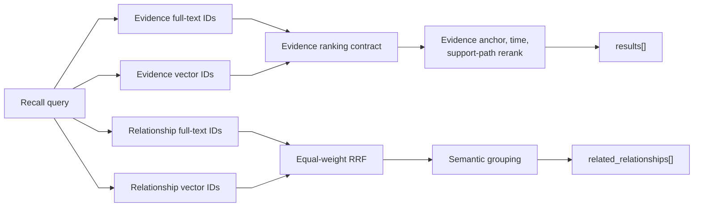
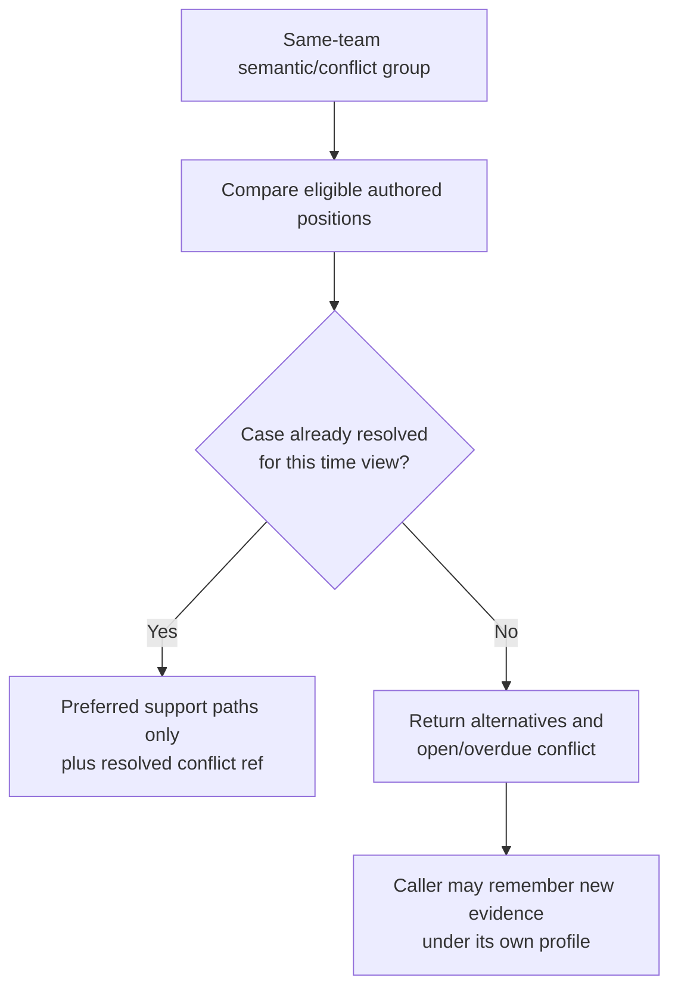

# Vector Search And Ranking

This page is the single source of truth for Dense-Mem's target embedding and
distance meaning, candidate fusion, reciprocal-rank fusion, and post-fusion
reranking contract. Exact/ANN execution, HNSW, `halfvec`, index lifecycle, and
vector-search topology belong in
[ANN, HNSW, And Halfvec](ANN-HNSW-And-Halfvec). The recall branch sequence and
public result shape remain in [Recall Ranking](Recall-Ranking). Runtime settings
and defaults remain in
[Configuration](Configuration#postgresql-search-and-recall).

For v2.6.1 writes, every required search document is embedded inline before
the semantic transaction. A completed Remember or correction therefore exposes
only `current` or `not_required`; `pending` and `failed` are legacy drift states
used by document-centric reconciliation, not client-visible write outcomes.

## Why Ranking Has Stages

Full-text search and vector search return different score scales. A PostgreSQL
text rank is not numerically comparable to a cosine similarity. Dense-Mem
therefore fuses stable rank positions. Evidence and Relationship candidates use
separate frontiers and limits; one cannot promote an item in the other.



Hard authorization, status/effective-support eligibility, validity, and required exact
anchors run before or during candidate hydration. Reranking cannot restore a
candidate rejected by a hard gate.

## Embeddings

An embedding model converts a search document or query into a fixed-length
vector:

```text
query vector q    = [q1, q2, ... qn]
document vector d = [d1, d2, ... dn]
```

Provider adapter, model, dimensions, text normalization, query construction,
and vector normalization form one persisted numerical embedding contract.
Query and document vectors must use the same contract version. Mixed versions
are excluded, not compared approximately. The active search-index generation
references that contract and carries its compatible cosine pgvector operator
class.

Each `source_kind` has a separate text
`projection_format_version`. Changing Relationship projection text therefore
re-embeds Relationships only; it does not change the numerical embedding
contract, Evidence documents or vectors, query construction, or the active
HNSW generation. The format-2 migration belongs in
[Data Model And Storage](Data-Model-And-Storage#relationship-projection-generation).

The vector represents model-defined semantic position. Individual dimensions
do not have stable human-readable meanings and must not be exposed as an
explanation of why knowledge is true.

## Cosine Similarity And Distance

Cosine similarity measures the angle between two non-zero vectors:

```text
dot(q, d) = sum(qi * di)

norm(q) = sqrt(sum(qi^2))
norm(d) = sqrt(sum(di^2))

cosine_similarity(q, d) = dot(q, d) / (norm(q) * norm(d))
cosine_distance(q, d) = 1 - cosine_similarity(q, d)
```

Higher similarity means closer direction. Lower distance means a nearer search
result.

### Worked example

```text
q = [1, 2]
d = [2, 1]

dot(q, d) = (1 * 2) + (2 * 1) = 4
norm(q) = sqrt(1 + 4) = sqrt(5)
norm(d) = sqrt(4 + 1) = sqrt(5)

cosine_similarity = 4 / 5 = 0.8
cosine_distance = 1 - 0.8 = 0.2
```

Reference points:

| Vector relationship | Cosine similarity | Cosine distance |
| --- | ---: | ---: |
| same direction | `1` | `0` |
| orthogonal | `0` | `1` |
| opposite direction | `-1` | `2` |

Production embedding distributions may occupy only part of this mathematical
range. Dense-Mem does not assign universal meaning such as “distance below 0.2
is relevant.” Retrieval uses rank plus evaluation-calibrated limits.

### Unit-normalized vectors

If both vectors have norm `1`, cosine similarity equals their dot product:

```text
norm(q) = norm(d) = 1
cosine_similarity(q, d) = dot(q, d)
```

Dense-Mem does not assume a model returns unit vectors from its name. The
embedding adapter declares and validates normalization behavior. Changing it
creates another contract and requires a vector rebuild.

## Vector Candidate Boundary

The target search contract uses cosine distance. Lower distance is nearer, and
diagnostic cosine similarity is `1 - distance`. PostgreSQL returns an ordered,
authorized list of candidate IDs and exact diagnostic distances; it does not
decide lifecycle status, truth, conflict, or final recall order.

The matching pgvector operators, exact/ANN routing, HNSW and `halfvec` strategy,
candidate exact rerank, dimension limits, and database-load controls are defined
only in [ANN, HNSW, And Halfvec](ANN-HNSW-And-Halfvec). This page consumes the
resulting candidate list.

## Candidate Lists

Each enabled retrieval branch returns ordered, authorized source IDs and branch
metadata:

```text
branch name
source_kind
source_id
rank starting at 1
optional diagnostic raw score or distance
source/search-document version
```

Evidence branches return Evidence IDs. Relationship branches return
Relationship IDs from projection-format-2 documents. Direct Entity adjacency
may add Relationship candidates to the Relationship frontier, but no
Relationship or Entity signal maps back into the Evidence fusion score.

Raw scores remain diagnostics. Fusion consumes branch rank because:

- text-rank scales vary with query and corpus
- cosine distance has a different direction and distribution
- approximate indexes may change distances or candidate coverage without
  changing semantic truth

## Reciprocal Rank Fusion

For a configured Evidence RRF branch and for the fixed Relationship fusion, one
candidate's base score is:

```text
rrf_score(candidate) =
  sum(branch_weight / (rrf_k + rank_in_branch))
```

Only one `(branch, source_id)` entry contributes per branch. `rrf_k` controls
how strongly the first few positions dominate. Evidence branch weights belong
to the versioned Evidence ranking contract.

Relationship discovery always uses equal weight for its full-text and vector
branches. It has no lifecycle, support, source, authority, profile,
corroboration, community, or popularity multiplier. Stable ties resolve by RRF
score, best individual branch rank, earliest Relationship creation time, then
Relationship UUID.

### Worked RRF example

This illustrative example uses `rrf_k = 60` and equal branch weights. It applies
equally to two Evidence candidates or two Relationship candidates:

| Candidate | Full-text rank | Vector rank |
| --- | ---: | ---: |
| A | 1 | 4 |
| B | 3 | 2 |

```text
A = 1/(60+1) + 1/(60+4)
  = 0.032018

B = 1/(60+3) + 1/(60+2)
  = 0.032002
```

A ranks above B by a small margin because the full-text branch placed it first.
This does not make A truer; it makes A the stronger correlation candidate under
the two retrieval branches.

### RRF disabled

The control portal may disable Evidence RRF through a versioned runtime ranking
contract. The system then uses the contract's explicit deterministic Evidence
branch order, for example exact anchor, full text, then vector, with stable first-seen
deduplication. The resulting global position is `priority_rank`, starting at
one, and its numeric base is `priority_score = 1 / (1 + priority_rank)`. This
score reflects only the configured ordinal list; it never averages
incomparable raw scores or chooses an implicit fallback.

A contract that disables RRF without a valid branch order is rejected. Fusion
mode and ranking-contract version remain internal telemetry, not public recall
fields. This switch does not disable or reweight the fixed Relationship RRF
contract.

## Evidence Post-Fusion Reranking

Evidence RRF measures retrieval agreement. Evidence post-fusion reranking
applies bounded query-derived and support-path signals before selected Evidence
is hydrated:

```text
final_score =
  rrf_or_priority_score
  * exact_anchor_weight
  * phrase_or_precise_match_weight
  * bounded_support_weight
  * temporal_intent_weight
```

Every multiplier has a tested lower/upper bound. No factor can rescue an
irrelevant candidate or suppress a material conflict completely.

| Factor | Contract |
| --- | --- |
| temporal | exclude invalid intervals in the branch query, then favor the requested/current applicable state only when the query asks for it |
| exact anchor | boost only after one candidate satisfies every required identifier |
| phrase or precise match | boost only from terms and phrases parsed from the caller query |
| support | small capped boost from effective accepted source groups; relationship count alone never adds more votes |

Stable ties resolve by final score, branch rank, query/support signals,
applicable recency, and evidence ID. Exact ordering and factor values belong to
the active versioned profile.

The current contract uses deterministic reranking. A future cross-encoder or
LLM reranker must be a separate optional stage with its own model/schema,
latency/cost budget, failure behavior, and offline evaluation. It cannot change
lifecycle status, effective support, evidence, or provenance.

Relationship discovery does not use this post-fusion formula. After
equal-weight RRF, it applies only hard eligibility, Conflict disposition,
deterministic semantic grouping, and `relationship_limit`. This keeps
correlation rank independent from truth and provenance.

## Cross-Profile Conflict Reranking

Relationships are profile-owned and team-readable. Recall ranking is
evidence-first, but related Relationships and trace keep authored Relationship
positions visible without merging authors or lifecycle.

Material conflict sets are then formed from verified `challenges`/`corrects`
cross-references, incompatible same-owner or cross-owner single-current values,
and unresolved Entity alternatives already recorded by identity resolution.
They may therefore contain several semantic-group keys, such as the combined-
Mark and split-Mark positions. Vector similarity alone cannot declare two
Relationships conflicting. A material cross-profile Relationship set also has
a durable team Conflict case; the case persists workflow and disposition, while
the set remains derived from authoritative Relationship/evidence state.

For equivalent positions in discovery or trace:

- return the strongest position first
- expose the contributing author positions and trace handles
- count corroboration only when accepted source groups are independent
- never create support or promote another profile's Relationship automatically

For conflicting positions:

- retain every material eligible alternative in a conflict set
- use each position's exact evidence, lifecycle eligibility, temporal applicability, source
  independence, and correction/confirmation cross-references
- resolve only in nightly review, when exactly one temporally applicable position
  meets the pre-TTL strong quorum or post-TTL automatic floor
- for an `open` or `overdue` case, budget evidence from every material position
  into primary recall and produce a clarification
- for a `resolved` case, include only preferred support paths in primary recall
  for the applicable current interval and return a compact resolved case ref
- preserve every non-preferred Relationship and its evidence in authorized
  trace and in historical `valid_at`/`known_at` views



A profile's correction cannot down-rank another profile merely by labeling it
wrong. Its challenge contributes only after normal evidence assessment,
confidence gating, and cross-reference validation. Several profiles copying one
source remain one source group. Validated cross-references, source independence, and applicable
recency may order otherwise eligible evidence within the bounded conflict view;
none can substitute for the automatic-resolution floor, and recency cannot
break a tie between two qualifying positions. The floor, deadline, time basis,
and new-conflict-episode behavior are defined in
[Conflicts And Corrections](Conflicts-And-Corrections#deterministic-resolution-policy).

Conflict disposition is applied after branch fusion and before final evidence
hydration. The service over-fetches and backfills so removing a suppressed
support path does not silently shrink `limit`. It never drops an Evidence
fragment globally: when one fragment also supports an unrelated eligible
Relationship, that independent path may still return the fragment. The final
PostgreSQL hydration step is authoritative; a stale text/vector hit cannot enter
`results[]` without an active eligible support path. A `known_at` query ignores
case events recorded later than the requested knowledge time, and `valid_at`
applies the position/effective interval that was visible in that historical
view.

## Runtime Control

The running service uses one complete ranking contract captured at request
start. Today that contract is loaded from startup configuration. Control-portal
management uses the same complete contract shape when enabled; it must not edit
individual live variables.

The contract contains:

```text
fusion mode: rrf | branch_priority
Evidence RRF enabled state, k, and branch weights
Evidence branch enablement, priority, and over-fetch
Relationship RRF k and lexical/vector over-fetch with fixed equal weights
exact-filtered versus HNSW thresholds and scan budgets
deterministic rerank enabled state and bounded factor weights
cross-profile qualification and clarification policy
contract source/version, creator, reason, and activation time when portal-managed
```

Startup validation rejects invalid or incomplete contracts before serving
traffic. Portal activation, when enabled, is atomic; in-flight recalls retain
the contract captured at request start and rollback activates a prior complete
version. Provider credentials, model dimensions, and hard memory/byte/time caps
remain startup configuration and cannot be weakened by the portal. Query-time
ANN controls belong to this ranking contract; physical index construction belongs
to the linked search-index generation in
[ANN, HNSW, And Halfvec](ANN-HNSW-And-Halfvec#separate-versioned-contracts).

## Degradation

The active ranking contract declares required and optional branches:

| Condition | Result |
| --- | --- |
| required branch fails | fail recall with the branch error |
| optional branch fails | omit it and report degradation |
| RRF enabled but fewer branches succeed | fuse successful allowed branches and report the missing branches |
| RRF disabled | use the explicit branch-priority contract |
| deterministic reranker fails invariant validation | fail; do not return unreranked results silently |
| optional future model reranker fails | use the declared deterministic fallback and report degradation, or fail when configured required |
| Relationship text projection incomplete at startup | fail readiness; incomplete lexical Relationship recall is not served |
| Relationship generation is `embedding` | disable the complete team Relationship vector branch, use lexical Relationship ranking, and return `relationship_vector_warming` degradation |
| Relationship generation is `failed` | keep lexical Relationship ranking, keep the complete vector branch disabled, and return `relationship_vector_failed` degradation |
| one foreground Relationship vector is pending after generation activation | keep that document lexical-eligible and vector-ineligible under its individual `search_state` |
| an Evidence or Relationship document is drifted or missing its current vector | keep valid document text in lexical recall, exclude the missing vector, and report the bounded drift class while document-centric reconciliation attempts recovery |

The failed-vector path is intentionally asymmetric: lexical text is durable
and independently queryable, but a failed or stale vector cannot be treated as
current. Reconciliation uses the active provider/model/dimensions and fenced
source/document hashes; it never changes the ranking contract or compares mixed
vector versions.

## Evaluation

Every ranking-contract change is evaluated against fixed and representative
corpora before activation. Required measurements include:

- Recall@K against exact filtered vector and labeled retrieval truth
- MRR and nDCG for ordered relevance
- hard-anchor success and false-positive rate
- profile-conflict preference accuracy and clarification rate
- same-source duplicate resistance
- Relationship correlation MRR/nDCG without lifecycle or provenance weighting
- parity between complete lexical-only Relationship ranking and vector-gated rollout
- p50/p95/p99 latency, database work, and provider cost
- approximate HNSW Recall@K against the exact cosine-distance oracle

The evaluation procedure and release gates belong in [Evaluation](Evaluation).

## Risks And Mitigations

| Risk | Concrete failure mode | Mitigation |
| --- | --- | --- |
| Distance direction reversed | highest cosine distance is treated as best | cosine-specific query tests and ascending `<=>` order |
| Index/operator mismatch | cosine HNSW index exists but query uses L2 | fixed cosine contract plus plan/readiness validation |
| Raw scores mixed | text rank `0.4` is averaged with cosine similarity `0.8` | fuse rank positions with RRF or named branch priority |
| RRF toggle changes behavior silently | portal disables RRF and replicas choose different fallbacks | atomic versioned ranking contract, explicit branch order, and internal telemetry |
| Majority overrides evidence | copied weak memory from several profiles outranks one primary source | source-group dedupe, bounded corroboration, and evidence-aware conflict rerank |
| Challenge censors another author | unsupported "wrong" link removes A from recall | placement cannot mutate the target; retain conflict refs and require verified challenge evidence plus nightly resolution |
| Resolved case hides unrelated support | a fragment supporting A and another current Relationship is removed globally | apply disposition to the relevant Relationship support path and backfill from over-fetch |
| Current winner rewrites history | B's resolved position is returned for a `valid_at` before the change or `known_at` before B arrived | evaluate case events and effective intervals bitemporally before hydration |
| ANN filter loses team results | HNSW selects global neighbors before tenant filtering | exact path for bounded sets, iterative scans, over-fetch, and exact Recall@K gate |
| Relationship truth leaks into correlation rank | source count or lifecycle metadata moves a weak semantic match above a closer match | fixed equal-weight lexical/vector RRF and hard prohibition on Relationship post-fusion boosts |
| Partial projection biases Relationship RRF | already rebuilt rows receive a vector contribution while other rows cannot | gate the entire team Relationship vector branch on a current projection generation |

## Acceptance Invariants

1. cosine distance is calculated and ordered consistently with the active
   search-index generation
2. exact filtered search is the vector quality oracle
3. raw scores from different branches are never averaged directly
4. RRF uses stable one-based ranks, versioned weights, and deterministic ties
5. disabling RRF activates one explicit branch-priority contract
6. control-portal ranking changes are atomic, audited, and versioned
7. reranking cannot restore an unauthorized, inactive, unsupported, or
   temporally invalid source row
8. same-source copies do not gain independent-source or cross-profile boosts
9. material conflicting authored positions remain traceable and visible
10. zero or multiple qualifying conflict positions produce clarification rather
    than invented certainty
11. optional model reranking cannot change knowledge lifecycle or provenance
12. open/overdue Conflict cases retain bounded returned material positions in
    primary recall and signal any truncation without choosing a winner
13. resolved cases suppress only non-preferred support paths for the applicable
    current interval and return a bounded conflict reference
14. a suppressed path remains available through trace and the correct historical
    `valid_at`/`known_at` view
15. conflict filtering cannot globally suppress an Evidence fragment that has
    another eligible support path
16. public results omit ranking-contract and embedding-contract versions; those
    values remain internal telemetry and evaluation metadata
17. Relationship lexical/vector fusion uses equal weights and no lifecycle,
    support, source, authority, profile, or popularity boost
18. Relationship vector fusion is disabled for the complete team until its
    projection generation is current
19. Relationship projection changes do not change the numerical embedding
    contract, Evidence vectors, or HNSW generation
