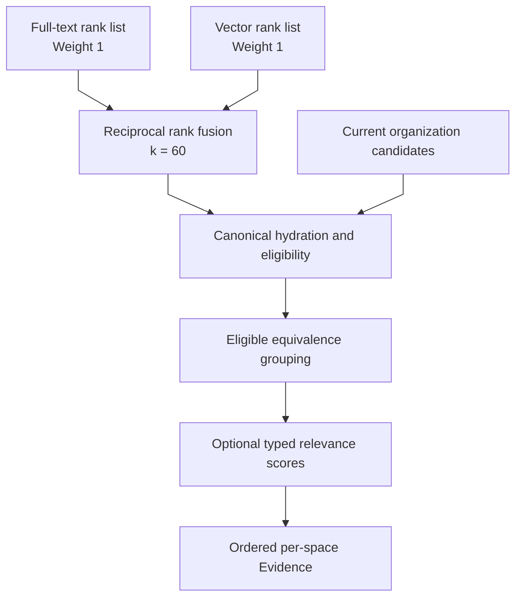

# Vector Search And Ranking

This page owns similarity and fusion mathematics. [Recall Ranking](Recall-Ranking) owns eligibility and retrieval behavior; [ANN, HNSW, And Halfvec](ANN-HNSW-And-Halfvec) owns index execution.

## Embeddings And Distance

Document and question vectors must share the active embedding contract: model/vector space, dimensions, and compatible format. For nonzero vectors:

```text
cosine_similarity(a, b) = dot(a, b) / (norm(a) * norm(b))
cosine_distance(a, b) = 1 - cosine_similarity(a, b)
```

Lower distance means closer embedding-space similarity. It is not a calibrated probability or a judgment that a source is true.

## Candidate Fusion



For lexical/vector branch ranks starting at 1:

```text
score(id) = sum(1 / (60 + branch_rank))
```

Equal fused candidate scores use immutable Evidence ID as a stable tie-breaker. Current organization candidates can fill the candidate set. For approximate vector search, eligible organization-discovered sources can be evaluated with full-precision vectors in the existing vector channel; they are not factual graph expansion.

| Candidate | Lexical rank | Vector rank | RRF score |
| --- | ---: | ---: | ---: |
| A | 1 | 4 | 0.032018 |
| B | 3 | 2 | 0.032002 |

A ranks slightly ahead of B. A higher rank is not stronger source authority.

## Optional Typed Reranking

When a typed decision provider and the recall task are enabled, it scores an authorized hydrated shortlist of at most 50 Evidence items per space. Stable original-order ties preserve deterministic ordering. Optional failure keeps the original ranking with an explicit degradation; cancellation remains a failure.

Provider confidence, relevance scores, and generative assessment confidence have separate meanings. None can override lifecycle or visibility. [Configuration](Configuration#typed-decision-providers) owns provider and task settings.

## Memory-Space Fusion

Per-space results use equal-weight RRF with constant 60. Equal scores prefer private, then team-shared, then immutable Evidence ID. This combines only already authorized branches; it never widens access or joins private Evidence into shared organization.

## Change And Measurement

There is no public ranking mode, RRF toggle, or mutable ranking-contract API. Policy changes require code review and the applicable deterministic evaluation. Observational feedback does not automatically train ranking or alter weights.

Measure candidate recall against an exact scoped oracle when changing approximation. Full-precision reranking cannot recover a useful row absent from the candidate pool. Compare quality, latency, resource use, and explicit degradations under identical seed/suite and provider identities; see [Evaluation](Evaluation).
