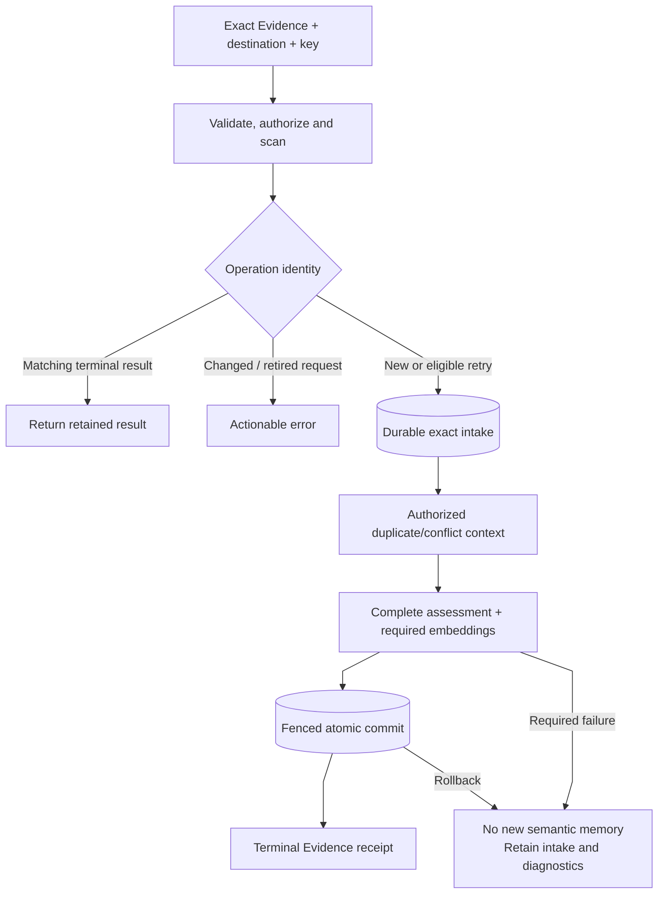
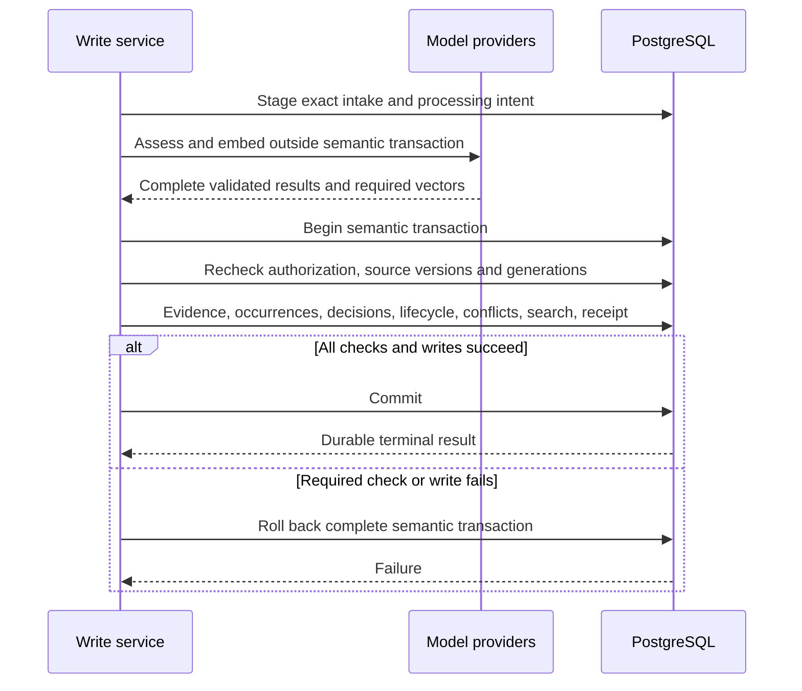
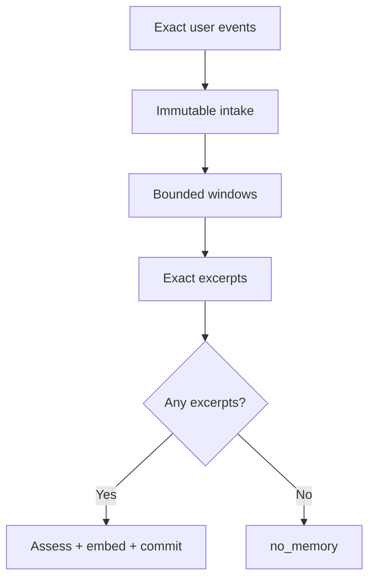

# Memory Write Pipeline

Remember stages exact input and intent, performs required provider work, then commits accepted memory and its terminal receipt atomically. A successful call does not leave required assessment or embedding work for a background worker.

## End-To-End Flow

Authentication and the security boundary are defined in [Request Lifecycle And Security](Request-Lifecycle-And-Security). Public fields and examples belong to [Technical Reference](Technical-Reference#remember).

## Exact Intake And Duplicate Handling

| Stage | Behavior |
| --- | --- |
| Admission | Reject invalid or retired fields before provider work; initial security rejection retains content-free bounded metadata. |
| Durable staging | Retain exact input, provenance, intended destination, operation identity, and recovery state. Staging is not accepted searchable memory. |
| Exact duplicate resolution | Reuse only within the authorized owner/space and applicable lifecycle fences. |
| Semantic duplicate assessment | Use a bounded authorized candidate set; optional typed decisions can resolve sufficiently certain tasks. |
| Occurrence preservation | Retain exact submitted text and provenance even when canonical Evidence is reused. |

Duplicate candidate embeddings can precede assessment. Required final embeddings can reuse prepared vectors when compatible. One Remember request is not guaranteed to make exactly one embedding HTTP call.

## Complete Assessment

The assessor receives exact submitted Evidence and bounded authorized equivalence/conflict context. Stored context is read-only; it never becomes newly submitted Evidence. Providers cannot choose the authenticated owner or destination, commit state, or invent allowed references.

Validate complete security, equivalence, and Evidence-conflict results. Missing, duplicate, unknown, or out-of-allowlist results invalidate the whole response. Regenerate the complete response within the existing bound of three provider turns; never splice valid pieces from invalid responses.

Optional typed decision providers resolve only supported tasks under server-owned probability and validation policy. An uncertain valid decision can route to generation; required transport, malformed-response, refusal, or generative failures remain visible.

## Atomic Commit And Deadlines

The 180-second operation budget bounds required processing. Assessment has a 160-second phase bound; embedding and commit have their existing bounded phases within the total deadline. Earlier context cancellation and remaining time still apply. Provider timeouts cannot extend a phase or operation deadline.

Background search reconciliation repairs derived state after later changes. It does not finish the required foreground work of a successful Remember call.

## Replay And Recovery

| Situation | Action |
| --- | --- |
| Retryable failure or unknown delivery | Resend the unchanged complete request and retained key. |
| Same key, changed target/content/provenance | Conflict; do not mutate the saved request to force replay. |
| Retired operation contract | Inspect retained outcome and follow non-retryable `retired_contract` guidance before an intentional new operation. |
| Required provider/embedding/commit failure | No new accepted semantic memory; durable intake can remain for recovery. |
| Client timeout/disconnect | Receipt delivery can be unknown even if a commit occurred. |

A lost response is not proof of rollback. The Python client does not automatically retry or generate replacement operation keys. See [Framework Integrations](Framework-Integrations#failures-and-unknown-outcomes).

## Private Session Intake

`ingest_session` is private-only and feature-gated. External framework/app/user/session identifiers are provenance, not authorization. Earlier context is read-only. Immutable event text and timestamps cannot be changed on retry; a changed event rejects the batch before staging. Required processing is atomic across the request, while exact raw intake remains recoverable.

An empty extraction is a valid explicit no-memory outcome. Accepted or duplicate event counts alone do not prove that memory was stored. Framework adapters can batch multiple requests; their partial-progress rules are in [Framework Integrations](Framework-Integrations).
