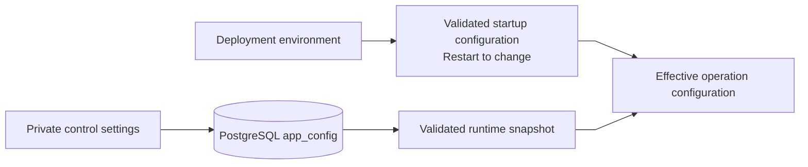

# Configuration

Startup environment variables configure connections, providers, listeners, and hard bounds. PostgreSQL-backed runtime settings configure supported operator policy. This page owns setting names and defaults; procedures belong to [Operations Runbook]({{ '/Operations-Runbook/' | relative_url }}).

## Sources And Precedence

Compose forwards a selected set of environment variables. Use a deployment override for additional startup variables. Runtime keys are not automatically environment overrides. Examples can explicitly choose values different from application defaults.

## Required Startup Settings

| Setting | Requirement |
| --- | --- |
| `POSTGRES_DSN` or PostgreSQL components | Writable single-primary database. |
| `AI_API_URL`, `AI_API_KEY` | Embedding endpoint and credential. |
| `AI_API_EMBEDDING_MODEL`, `AI_API_EMBEDDING_DIMENSIONS` | Explicit model and positive compatible dimensions. |
| `AI_VERIFIER_MODEL` | Explicit assessment model. |
| `CONTROL_PORTAL_TOKEN` | Control access in the bundled setup. |

Review the matching [environment example](https://github.com/markhuangai/dense-mem/blob/152448a4c4c4192a7492ad3ae2ca311fcb82851a/examples/.env.example). Keep credentials private.

## Listeners

| Variable | Default | Meaning |
| --- | --- | --- |
| `HTTP_ADDR` | `:8080` | Main listener. |
| `CONTROL_HTTP_ADDR` | `:8090` | Separate control listener. |
| `DENSE_MEM_PORT` | `8080` in Compose | Published main port. |
| `CONTROL_PORTAL_BIND` | `127.0.0.1` in expert Compose | Published control address; base Compose fixes loopback. |
| `CONTROL_PORTAL_PORT` | `8090` in Compose | Published control port. |

## PostgreSQL And pgvector

| Variable | Application default | Meaning |
| --- | --- | --- |
| `POSTGRES_DSN` | Empty | Full DSN; otherwise construct from components. |
| `POSTGRES_HOST`, `POSTGRES_USER`, `POSTGRES_PASSWORD`, `POSTGRES_DB` | Required for component configuration | Connection components. |
| `POSTGRES_PORT` | `5432` | Database port. |
| `POSTGRES_SSLMODE` | `disable` | Driver TLS mode; configure for deployment. |
| `POSTGRES_MAX_OPEN_CONNS` | `25` | Per-process pool bound. |
| `POSTGRES_MAX_IDLE_CONNS` | `10` | Idle pool target. |
| `POSTGRES_CONN_MAX_LIFETIME_SECONDS` | `1800` | Connection lifetime. |
| `POSTGRES_MIGRATION_TIMEOUT_SECONDS` | `0` | No overall migration deadline; positive values are limited to 86400 seconds. Shutdown still cancels. |
| `POSTGRES_SLOW_QUERY_THRESHOLD_MS` | `200` | Positive slow-query threshold. |
| `POSTGRES_HOST_PORT` | `15432` in evaluation Compose | Evaluation-only published port. |

Startup requires a writable primary and rejects unsupported replica/distributed topology, including separate `POSTGRES_READ_DSN` configuration. Migration phase/count updates and liveness heartbeats follow the [migration observation contract]({{ '/Telemetry/#migration-observations' | relative_url }}). The image healthcheck has a 30-minute start period; extend startup/rollout grace for longer migrations. Budget connections across all replicas.

## Embedding Provider And Contract

| Variable | Application default | Meaning |
| --- | --- | --- |
| `AI_API_URL`, `AI_API_KEY` | Required | OpenAI-compatible embedding endpoint/key. |
| `AI_API_EMBEDDING_MODEL`, `AI_API_EMBEDDING_DIMENSIONS` | Required | Model and response dimensions. |
| `AI_API_EMBEDDING_TIMEOUT_SECONDS` | `30` | Provider ceiling within operation deadline. |
| `AI_API_EMBEDDING_MAX_CONCURRENCY` | `8` | Process-wide provider concurrency. |
| `AI_API_EMBEDDING_MAX_BATCH_ITEMS` | `256` | Texts per upstream HTTP request. |

An application batch preserves ordered results across upstream chunks. A failed chunk fails the whole batch; transient retries share the existing bounded retry allowance. Use 100 items where required by providers such as Workers AI BGE-M3.

Changing the configured model or dimensions is not an online vector migration. Startup checks the persisted contract. See [ANN, HNSW, And Halfvec]({{ '/ANN-HNSW-And-Halfvec/#contract-and-index-decision-guide' | relative_url }}).

## Search Index Construction

Bootstrap derives strategy from dimensions and persists compatible embedding/index/projection identities. Current construction uses HNSW `m=16`, `ef_construction=64`, query bootstrap `ef_search=40`, and a 200-candidate bound; execution can raise query search breadth for that bound. These are server-owned parameters, not a public ranking mode.

Physical limits and strategies are owned by [ANN, HNSW, And Halfvec]({{ '/ANN-HNSW-And-Halfvec/' | relative_url }}).

## Assessor

| Variable | Application default | Meaning |
| --- | --- | --- |
| `AI_VERIFIER_API_URL` | Embedding base URL | Assessment endpoint; explicitly separate URLs do not inherit the embedding key. |
| `AI_VERIFIER_API_KEY` | Embedding key when using its endpoint | Assessment credential. |
| `AI_VERIFIER_MODEL` | Required | Assessment model. |
| `AI_REMEMBER_MODEL` | Verifier model | Optional Remember/session model override. |
| `AI_VERIFIER_DISABLE_TEMPERATURE` | `false` | Omit the temperature argument. |
| `AI_VERIFIER_TIMEOUT_SECONDS` | `60` | Provider timeout within remaining operation/phase budget. |
| `AI_VERIFIER_MAX_CONCURRENCY` | `5` | Process-wide provider gate. |
| `AI_VERIFIER_MAX_INPUT_TOKENS` | `200000` | Complete assessment request/history bound. |
| `AI_VERIFIER_MAX_OUTPUT_TOKENS` | `65536` | Response acceptance bound. |
| `AI_VERIFIER_MAX_CANDIDATE_CONTEXT_TOKENS` | `50000` | Candidate-context bound. |
| `AI_VERIFIER_TOKENIZER` | `o200k_base` | Accounting tokenizer. |

Set limits that the configured model supports. Bounds include schema, instructions, context, and regeneration history. Processing order and complete-response retries are defined in [Memory Write Pipeline]({{ '/Write-Pipeline/' | relative_url }}).

## Typed Decision Providers

These startup settings are independent; enabled decision providers never inherit credentials:

| Variable | Default or requirement |
| --- | --- |
| `AI_DECISION_PROVIDER` | `disabled`; supported enabled values are `openai` and `typesafe`. |
| `AI_DECISION_API_URL`, `AI_DECISION_API_KEY`, `AI_DECISION_MODEL` | Required when enabled. |
| `AI_DECISION_MAX_INPUT_TOKENS` | Explicit positive per-request limit when enabled. |
| `AI_DECISION_MAX_QUESTION_INPUT_TOKENS` | Explicit positive limit; OpenAI defaults it to the configured input limit. Cannot exceed request limit. |
| `AI_DECISION_TIMEOUT_SECONDS` | `10`; maximum 86400. |
| `AI_DECISION_MAX_CONCURRENCY` | `4`; maximum 128. |
| `AI_DECISION_LONG_CONTEXT_ENABLED` | `false`; TypeSafe only. |

TypeSafe configuration is capped at 64000 request / 32000 question tokens by default, or 262000 for both with explicit long-context opt-in. These are configured request ceilings, not measurements of provider capability or latency.

**Settings → Decisions** stores six independent preferences and optional input budget overrides.

| Capability | Key |
| --- | --- |
| Intake | `DECISION_DEDUPLICATION_ENABLED`, `DECISION_SECURITY_REVIEW_ENABLED`, `DECISION_CONFLICT_REVIEW_ENABLED` |
| Organization | `DECISION_TOPIC_ASSIGNMENT_ENABLED`, `DECISION_COMMUNITY_PLACEMENT_ENABLED` |
| Recall | `DECISION_RECALL_RERANKING_ENABLED` |

Missing preferences default true after successful settings load. Effective enablement requires a configured Decision provider. Explicit false persists. On refresh failure the last valid snapshot is marked stale. Required work fails when no valid snapshot is available.

Set `DECISION_MAX_INPUT_TOKENS` for a request and `DECISION_MAX_QUESTION_INPUT_TOKENS` for its shared state plus one question. Each override must be a positive integer, and the question limit cannot exceed the request limit. Clearing an override restores its startup `AI_DECISION_*` value. New operations use the saved settings within five seconds.

The portal displays the effective limits and any saved value that exceeds the active provider's ceiling. Correct or clear an invalid override before starting Decision work. OpenAI's model input capacity does not establish its Decisions endpoint limit. Requests are bounded to 64 MiB, and operator diagnostics explicitly report when the 16 MiB capture limit prevents retaining a payload.

These runtime settings describe [application revision `9b12233d4e7d`](https://github.com/markhuangai/dense-mem/blob/9b12233d4e7d3763c03f3a55a4477e5b46f0fdfa/adr/0022-authoritative-decision-api-and-runtime-token-budgets.md). Check the application revision in your deployment before using them.

## Recall Search Modes

| Startup variable | Default | Effect |
| --- | --- | --- |
| `RECALL_EXPANSION_ENABLED` | `false` | Adds bounded term and current shared Topic expansion before optional reranking. |
| `RECALL_DISABLE_QUERY_EMBEDDING` | `false` | Runs the lexical Recall arm without embedding the question. Remember still requires write embeddings. |

See [Recall Ranking]({{ '/Recall-Ranking/' | relative_url }}).

## Topic Maintenance

These are runtime `app_config` keys edited in the control portal:

| Key | Default or bound |
| --- | --- |
| `TOPIC_MAINTENANCE_ENABLED` | `false`. |
| `TOPIC_MAINTENANCE_CADENCE_HOURS` | `12`; accepts 12 or 24. |
| `TOPIC_MAINTENANCE_START_TIME_LOCAL` | `03:00`, strict HH:MM. |
| `TOPIC_MAINTENANCE_MODEL` | Empty; optional composed-model override. |
| `TOPIC_MAINTENANCE_MAX_CONCURRENCY` | `1`; range 1–8. |
| `TOPIC_MAINTENANCE_TEAM_MAX_CONCURRENCY` | `1`; range 1–8. |
| `TOPIC_MAINTENANCE_TEAM_OVERRIDES_JSON` | Empty list; at most 128 unique team overrides, each concurrency 1–8. |
| `TOPIC_MAINTENANCE_CONTEXT_WINDOW_TOKENS` | Empty until configured; 1–1000000000, and must leave room for output. |
| `APP_TIMEZONE` | General runtime timezone, bootstrapped from the startup value (`Local` when unset). |

Configure the model's full request context, including response headroom. The Topic storage upgrade migrates all eight supported `ONTOLOGY_MAINTENANCE_*` settings to the corresponding `TOPIC_MAINTENANCE_*` keys. See [Topics And Organization]({{ '/Topics-And-Organization/' | relative_url }}) and [Operations Runbook]({{ '/Operations-Runbook/#topic-maintenance' | relative_url }}).

## Redis, Rate Limits, And Streams

| Variable | Default |
| --- | --- |
| `REDIS_ADDR`, `REDIS_PASSWORD` | Empty. |
| `REDIS_DB` | `0`. |
| `REDIS_TLS_ENABLED`, `DISTRIBUTED_COORDINATION_REQUIRED` | `false`. |
| `HTTP_MAX_BODY_BYTES` | `1048576`. |
| `AUTH_VERIFY_MAX_CONCURRENCY` | `8`. |
| `RATE_LIMIT_PER_MINUTE` | `100`. |
| `SSE_HEARTBEAT_SECONDS`, `SSE_MAX_DURATION_SECONDS` | `30`, `300`. |
| `SSE_MAX_CONCURRENT_STREAMS` | `10`. |

Multiple instances require shared coordination. Redis failure cannot silently switch a distributed deployment to independent process counters. Deployment procedures are in [Public HTTPS And Redis]({{ '/Public-HTTPS-And-Redis/' | relative_url }}).

## Runtime SSO, OAuth, And Private Memory

| Runtime key | Default |
| --- | --- |
| `SSO_PUBLIC_BASE_URL`, `SCIM_PUBLIC_BASE_URL`, `CONTROL_PUBLIC_BASE_URL`, `MCP_PUBLIC_BASE_URL` | Empty. |
| `SSO_ENTITLEMENT_CACHE_TTL_SECONDS` | `300`. |
| `SSO_SESSION_TTL_SECONDS` | `28800`. |
| `SSO_STATE_TTL_SECONDS` | `600`. |
| `SSO_HTTP_TIMEOUT_SECONDS` | `10`. |
| `SSO_COOKIE_SECURE` | Derived from SSO public URL; set true for public HTTPS. |
| `PRIVATE_MEMORY_RETENTION_DAYS` | `0` disables scheduled retention; allowed 0–36500. |

Use canonical origins without credentials, queries, or fragments. The MCP base permits local HTTP for localhost/127.0.0.1. SCIM/control ingress uses HTTPS. Provider secrets are environment-backed references, not exposed runtime values. See [User Portal SSO]({{ '/User-Portal-SSO/' | relative_url }}).

## Private Session Ingestion

`SESSION_INGEST_ENABLED` is a startup boolean, default `false`. Restart after changes. Intake reuses configured extraction/assessment, tokenizer, provider-concurrency, and embedding owners. Missing required capabilities make the tool unavailable. Disablement stops new intake while preserving compatible durable history.

## Recall Feedback

| Runtime key | Default |
| --- | --- |
| `RECALL_FEEDBACK_ENABLED` | `false`. |
| `RECALL_FEEDBACK_RETENTION_DAYS` | `30`; range 1–365. |

Feedback behavior belongs to [Recall Feedback]({{ '/Recall-Feedback/' | relative_url }}).

## Telemetry And Logging

| Startup variable | Default |
| --- | --- |
| `LOG_LEVEL` | `trace`; accepts trace/debug/info/warn/warning/error/fatal. |
| `TELEMETRY_ENABLED` | `false`. |
| `TELEMETRY_PROMETHEUS_URL`, `TELEMETRY_PROMETHEUS_JOB` | Empty. |
| `TELEMETRY_QUERY_TIMEOUT_SECONDS` | `5`. |
| `TELEMETRY_SCRAPE_TOKEN` | Required when telemetry is enabled. |

`fatal` records severity without exiting. `OPERATION_LOG_RETENTION_DAYS` is a runtime key, default 30, range 1–365. Rate-card keys are `TELEMETRY_COST_VERIFIER_INPUT_USD_PER_MILLION_TOKENS`, `TELEMETRY_COST_VERIFIER_OUTPUT_USD_PER_MILLION_TOKENS`, `TELEMETRY_COST_EMBEDDING_INPUT_USD_PER_MILLION_TOKENS`, and `TELEMETRY_COST_MODEL_PRICES_JSON`. Operational interpretation belongs to [Telemetry]({{ '/Telemetry/' | relative_url }}).

## Enterprise Exports

| Startup variable | Default or requirement |
| --- | --- |
| `OTLP_ENABLED` | `false`; requires telemetry and at least one endpoint. |
| `OTLP_TRACE_ENDPOINT`, `OTLP_METRIC_ENDPOINT` | Empty; full independent HTTP(S) destination URLs. |
| `OTLP_TRACE_HEADERS_FILE`, `OTLP_METRIC_HEADERS_FILE` | Empty; explicitly mounted JSON header files. |
| `AUDIT_EXPORT_ENABLED`, `DIAGNOSTIC_BUNDLE_ENABLED` | `false`; gate private administrative downloads. |

Destination URLs reject credentials, queries, and fragments. Header files allow at most 16 valid headers within 8192 bytes. Values participate in operational credential protection and are not exposed in config serialization. Export bounds and content contracts belong to [Telemetry]({{ '/Telemetry/#enterprise-exports' | relative_url }}).
