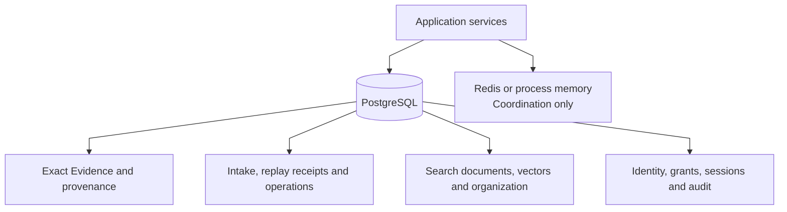
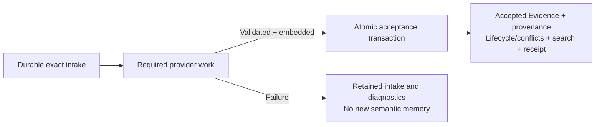

# Data Model And Storage

PostgreSQL with pgvector is the only durable authority. This page owns storage families and durability; [Evidence Model And Lifecycle]({{ '/Evidence-Model-And-Lifecycle/' | relative_url }}) owns memory meaning and lifecycle policy.

## Storage Responsibilities

| Storage family | Examples and responsibility |
| --- | --- |
| Exact source memory | `knowledge_ingests`, `evidence_fragments`, `evidence_occurrences`, `evidence_sources`, `evidence_source_revisions`. |
| Decisions and lifecycle | Assessment decisions, `evidence_lifecycle_operations`, `evidence_lifecycle_events`, Evidence-conflict cases/positions/events. |
| Request recovery | Remember attempts/intents, session events/extraction checkpoints, scoped operation identity and terminal receipts. |
| Search | Evidence `search_documents`, embedding contracts, index/projection generations, and reconciliation state. |
| Topics | Topic definitions, direct memberships, Community placement, Evidence equivalence, immutable publications, and maintenance state. Historical override payloads remain available in history. |
| Access and operations | Teams, identities, memberships, credentials, spaces, sessions, settings, audit, operation logs, and erasure state. |

The factual graph and Neo4j have no executable production or evaluation path. Historical migration inputs are not a second runtime authority.

## Source Retention And Acceptance

Normal lifecycle actions append history instead of rewriting accepted text. Exact and semantic reuse retain original occurrences. Source pointers and current views do not replace source-revision or lifecycle history.

Provider calls occur outside the authoritative semantic transaction. Authorization, source versions, space generations, and operation identity are rechecked before commit. See [Memory Write Pipeline]({{ '/Write-Pipeline/' | relative_url }}).

## Derived State

| Projection | Recovery rule |
| --- | --- |
| Search document/vector | Reconcile against current source version, document hash, embedding contract, and generation. |
| Topic assignment/equivalence | Reassess eligible current shared sources with dependency and publication fences. |
| Operational aggregates | Recompute through their owner; expose collection failures rather than stale success. |

The one-time [Evidence-only cutover]({{ '/Topics-And-Organization/#evidence-only-cutover' | relative_url }}) clears derived organization through an explicit inventory. [Operations Runbook]({{ '/Operations-Runbook/#evidence-only-cutover' | relative_url }}) separates migration completion from subsequent rebuilding.

Rebuildability is not permission to omit required foreground work. Remember success requires its required search embeddings and receipt to commit. Derived metadata never becomes newly submitted Evidence.

## Isolation And Private Erasure

Team, owner, memory-space, and generation fields participate in constraints, query scope, and RLS. Both candidate queries and hydration enforce visibility. [PostgreSQL Cluster-Safe Schema]({{ '/PostgreSQL-Cluster-Safe-Schema/' | relative_url }}) owns the database mechanics; [Request Lifecycle And Security]({{ '/Request-Lifecycle-And-Security/' | relative_url }}) owns policy.

Private erasure and retention use a catalog-complete inventory, seal the target, fence stale writers, honor holds, and verify completion. Erasure covers exact intake and session checkpoints as well as accepted memory. Use the storage inventory for the authoritative list of affected tables.

## Backup And Operations

Use PostgreSQL backup/restore for recovery. Redis restart must not lose canonical memory. Search and organization reconciliation, migration boundaries, and restore verification are in [Operations Runbook]({{ '/Operations-Runbook/' | relative_url }}).
