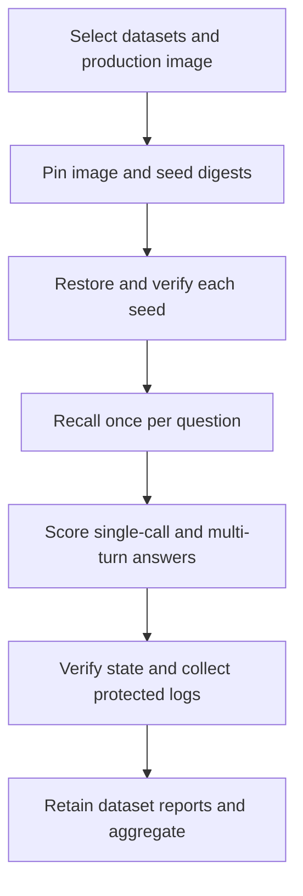

# Evaluation

Public QA evaluation scores five saved PostgreSQL datasets through the
production runtime and the supported MCP Recall and Trace tools. A full run
expects 10,000 answers from 5,000 questions across two answer policies.

The hosted workflow is available on `main`. [PR #794](https://github.com/markhuangai/dense-mem/pull/794)

## Image Boundary And Tool Surface

The hosted runner uses a digest-pinned Dense-Mem production image. Each dataset
job boots its own pinned PostgreSQL seed in fresh writable storage. The runner
verifies authenticated scope, source mappings, canonical Evidence, and search
state before and after scoring. Topic organization stays disabled and drained during the
run. Build or refresh the saved seeds with the documented local Docker builder.
[Repository evaluation guide](https://github.com/markhuangai/dense-mem/blob/main/tests/eval/README.md)

## Current Evidence Evaluation

The published packs are HotpotQA, MuSiQue, 2WikiMultiHopQA, NQ Rear, and PopQA.
Each contributes 1,000 locked questions. The single-call and multi-turn policies
share the initial Recall. The multi-turn policy may make supported follow-up
calls within its memory-call budget. Scoring uses the locked answer aliases,
citations and canonical source mappings.

## Validate And Smoke-Test

Use `mode=fixtures` in **Run evaluation** on `main`, or `evaluation=fixtures`
in **Production image E2E** on the validated own-PR branch. The hosted fixture
builds one synthetic seed, boots it, and scores four answers. It exercises
cutoff, protected log capture, and cleanup with a deterministic provider.

## Matched Campaign And Comparison

For a live reading, open **Actions → Run evaluation → Run workflow** on
`main` and select a production image. Select at least one dataset.
`seed_version` defaults to `latest`. Use a dated suffix to reproduce a specific
published seed. The workflow resolves each selected seed to a digest before
model work.

Set `answer_workers` between 4 and 10. With ten workers, at most two
datasets score concurrently. Each dataset expects 2,000 answers across
both policies and preserves its own numeric report. The aggregate keeps
the full selected denominator when a seed, score, capture or cleanup is
incomplete.

| Report | What to read |
| --- | --- |
| `evaluation-<dataset>-off` | Both policies, Recall@1/5/10, all-support recovery, exact match, F1, valid citations, timing and usage. |
| `evaluation-comparison` | Selected totals, immutable inputs, missing datasets, and the campaign outcome. |
| Dataset job logs | Protected wire exchanges, retry decisions, deadlines, and capture failures. |

Numeric artifacts are retained for two days. The model deadline is 330 minutes
per dataset. A verified pre-cutoff result can finish protected capture within
the 360-minute job limit. A failed job may still provide partial scores and
diagnostics.

## Change Gate And Artifacts

Quality, ranking, placement, semantic assessment or review, embeddings, search
documents, migration placement, and performance changes require the
deterministic 1k comparison unless the linked issue records explicit
maintainer approval of a waiver and replacement verification.

Keep generated seeds, downloaded corpora, databases, and protected captures in
ignored storage. Replace the [committed overall baseline](https://github.com/markhuangai/dense-mem/blob/152448a4c4c4192a7492ad3ae2ca311fcb82851a/tests/eval/baseline.json)
only after a complete, verified campaign across all five datasets. The current
baseline describes the recorded source revisions and limitations.
