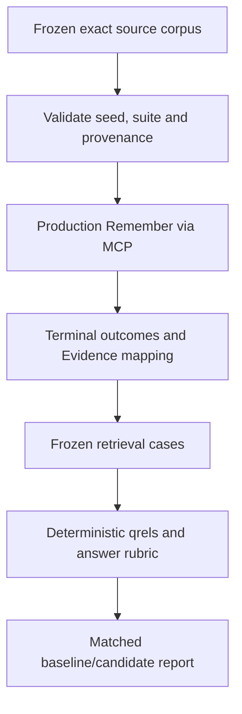

# Evaluation

Evaluation enters through real MCP Remember and recall paths on a dedicated stack. Deterministic qrels score retrieval; the matched Evidence-only campaign additionally scores retained and candidate terminal answers under its frozen rubric.

## Topic Assignment And Community Placement Comparison

Issue #824 defines the measured release gate. It compares validated baseline and candidate application image digests using one unchanged parent seed per dataset. The five datasets are HotpotQA, MuSiQue, 2WikiMultiHopQA, NQ Rear, and PopQA. [Approved comparison scope](https://github.com/markhuangai/dense-mem/issues/824)

1. After current-head CI and production-image E2E pass, prepare isolated baseline and candidate derivatives using the repository's `prepare-topics` seed command. Freeze the application image digests, baseline revision, and five parent seed digests in its input lock.
2. Verify the ten prepared seed manifests through the trusted own-PR `production-image-e2e.yml` dispatch with `evaluation=live` and the paired seed lock. All arms must use the same exact inputs. Candidate coverage requires current direct membership for each eligible saved Evidence item and a terminal Community placement for each Topic. Seeds must be paused and drained with usage reconciled.
3. Score both policies across all 5,000 locked questions on GitHub-hosted runners. Use matching shard checkpoints for interrupted scoring. Compare the lexical-only arm, disputed CLIMATE-FEVER evidence, and matched fresh Remember imports separately.

An uncategorized result remains valid in production and fails the stricter assigned-seed gate. Partial runs cannot replace the overall baseline. Expanded ranking can become the default after the paired results show improved multi-hop and two-sided recovery with single-hop quality and isolation preserved.

Commands, locks, prerequisites, and recovery details live with the source. Use the guide that matches the validated application revision. [Evaluation implementation and runbook](https://github.com/markhuangai/dense-mem/tree/main/tests/eval)

## Image Boundary And Tool Surface

The separate `evaluation` image adds only `eval_list_knowledge_refs` and `eval_run_recall_case`. Production cannot expose them through a runtime flag. `examples/docker-compose.evaluation.yml` owns the dedicated stack; keep it separate from ordinary memory use.

## Current Evidence Evaluation



The public six-axis cohort covers SciFact, MS MARCO, HotpotQA, MuSiQue, QASPER, and LongMemEval oracle retrieval. Preserve source identity, original text, row order, suite/qrels, scorer, prompts/rubric, provider settings, and runtime/image hashes.

Corpus items are plain Evidence plus permitted provenance. Split rather than truncate content above the 999-code-point intake bound. Retired graph proposals and bypass fields such as legacy `claims` or `auto_promote` cannot be used with the current runner.

## Validate And Smoke-Test

```bash
go run ./cmd/eval-runner --mode validate \
  --seed "<approved-seed-manifest>" \
  --suite "<approved-suite-jsonl>" \
  --out "<ignored-validation-directory>"
```

The runner requires explicit approved seed/suite paths. A lightweight smoke cohort is available:

```bash
go run ./cmd/eval-seedgen --preset local_eval_100 \
  --out tests/eval/seeds/local_eval_100 \
  --suite tests/eval/suites/local_eval_100.jsonl
```

Its 100 rows/25 sanity cases test composition, terminal import, mapping, recall, and scoring. Smoke evidence does not replace the deterministic 1k comparison.

## Matched Campaign And Comparison

The repository's [Evidence-only campaign protocol](https://github.com/markhuangai/dense-mem/blob/152448a4c4c4192a7492ad3ae2ca311fcb82851a/tests/eval/evidence-only-v5.md) owns the frozen retained-baseline/candidate modes, thresholds, answer policies, time budget, and recovery limits. It reuses sealed baseline captures without starting a retired graph runtime.

```bash
PAIR_CONFIG="$PWD/tests/eval/runs/evidence-only-v5/pair.json" \
  tests/eval/scripts/run_full_public_rag_eval_until_done.sh
```

Prepare and inspect the approved ignored pair configuration before starting. Do not silently restart/extend a bounded campaign or change identity after inspecting candidate outcomes.

For compatible same-identity baseline/candidate runs, the generic comparison remains:

```bash
go run ./cmd/eval-runner --mode compare \
  --baseline-run "<ignored-baseline-directory>" \
  --candidate-run "<ignored-candidate-directory>" \
  --out "<ignored-comparison-directory>"
```

| Report | Preserve |
| --- | --- |
| Intake | Every original outcome, supported recovery, failed import, and mapping. |
| Retrieval | Recall@K, MRR, nDCG, complete support, bad/unmapped references, and degradations. |
| Answers | Accuracy, exact citations, claim support, coverage, and memory-call limits per policy. |
| Operations | Native readiness/organization/projection completeness, elapsed time, usage, and unavailable values. |
| Identity | Source/image, seed/suite/capture, runner/scorer/rubric, provider, and effective configuration hashes. |

Native incompleteness remains incomplete even if an issue-specific acceptance rule passes. Do not turn unavailable usage into zero cost or arm durations into an unsupported speedup claim. The [committed overall baseline](https://github.com/markhuangai/dense-mem/blob/152448a4c4c4192a7492ad3ae2ca311fcb82851a/tests/eval/baseline.json) describes only its recorded source revisions and limitations; it is not a fresh result for every later commit.

## Change Gate And Artifacts

Quality, ranking, placement, semantic assessment/review, embeddings, search-document, migration-placement, or performance changes require the deterministic 1k comparison unless the linked issue records explicit maintainer approval of a waiver and replacement verification. Another ticket's waiver does not transfer.

Documentation-only changes do not change retrieval behavior and do not require that campaign. Keep generated seeds/suites, imports, databases, full runs, protected captures, and comparisons in ignored paths. Commit reproducible generators, locks, provenance, validation, scoring, and required fixtures. Replace only the latest overall measured baseline; historical reports belong with their verified issue/PR evidence.
