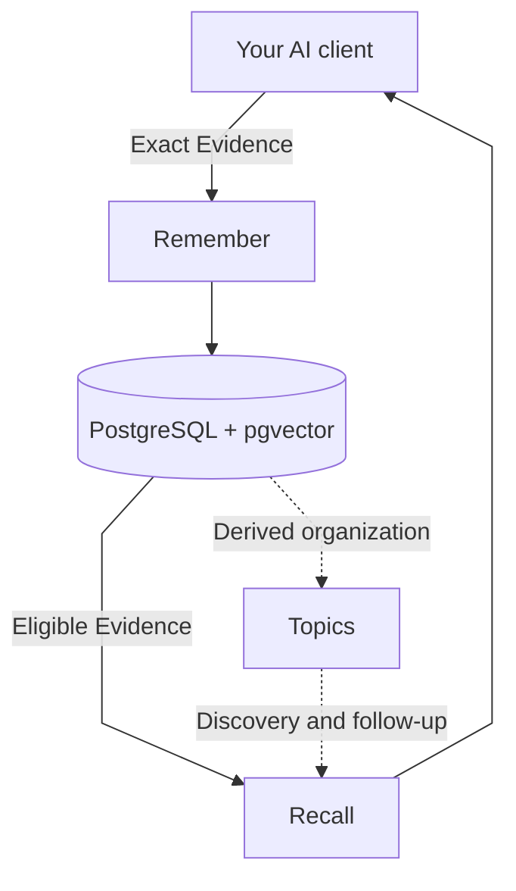

# Dense-Mem

Dense-Mem stores exact Evidence with provenance and a governed lifecycle. AI clients decide when to save or retrieve memory; the server owns authorization, assessment, persistence, and retrieval.

This site describes the approved Evidence-only target architecture and contract `dense-mem.v2.8.0`. [Implementation status]({{ '/Documentation-Maintenance/#implementation-status' | relative_url }}) identifies gaps between the target and inspected code. Check the connected server's authenticated `tools/list` before using tool arguments; a deployed image can lag the source.

The repository [README](https://github.com/markhuangai/dense-mem) is the short entry point. The documentation site owns detailed explanations; [deployment examples](https://github.com/markhuangai/dense-mem/blob/main/examples/README.md) and [development scripts](https://github.com/markhuangai/dense-mem/blob/main/scripts/README.md) keep file-specific instructions beside their sources.

## Start Here

| Goal | Read |
| --- | --- |
| Set up a server or try disposable memory | [Quick Start]({{ '/Quick-Start/' | relative_url }}), [Hosted Demo]({{ '/Hosted-Demo/' | relative_url }}) |
| Use memory from an AI client | [Using Dense-Mem]({{ '/Using-Dense-Mem/' | relative_url }}), [MCP Clients]({{ '/MCP-Clients/' | relative_url }}) |
| Integrate Python, Google ADK, or LangChain | [Framework Integrations]({{ '/Framework-Integrations/' | relative_url }}) |
| Understand the current model | [Evidence Model And Lifecycle]({{ '/Evidence-Model-And-Lifecycle/' | relative_url }}), [Topics And Organization]({{ '/Topics-And-Organization/' | relative_url }}) |
| Understand execution and storage | [Architecture]({{ '/Architecture/' | relative_url }}), [Memory Write Pipeline]({{ '/Write-Pipeline/' | relative_url }}), [Data Model And Storage]({{ '/Data-Model-And-Storage/' | relative_url }}) |
| Inspect the tool contract | [Technical Reference]({{ '/Technical-Reference/' | relative_url }}) |
| Understand search | [Recall Ranking]({{ '/Recall-Ranking/' | relative_url }}), [Vector Search And Ranking]({{ '/Vector-Search-And-Ranking/' | relative_url }}), [ANN, HNSW, And Halfvec]({{ '/ANN-HNSW-And-Halfvec/' | relative_url }}) |
| Correct, retract, export, or give feedback | [Conflicts And Corrections]({{ '/Conflicts-And-Corrections/' | relative_url }}), [Memory Packs]({{ '/Memory-Packs/' | relative_url }}), [Recall Feedback]({{ '/Recall-Feedback/' | relative_url }}) |
| Administer access | [Portals And API Keys]({{ '/Portals-And-API-Keys/' | relative_url }}), [User Portal SSO]({{ '/User-Portal-SSO/' | relative_url }}), [Request Lifecycle And Security]({{ '/Request-Lifecycle-And-Security/' | relative_url }}) |
| Operate a deployment | [Configuration]({{ '/Configuration/' | relative_url }}), [Public HTTPS And Redis]({{ '/Public-HTTPS-And-Redis/' | relative_url }}), [Operations Runbook]({{ '/Operations-Runbook/' | relative_url }}), [Telemetry]({{ '/Telemetry/' | relative_url }}) |
| Develop or maintain documentation | [Development And Testing]({{ '/Development-And-Testing/' | relative_url }}), [Evaluation]({{ '/Evaluation/' | relative_url }}), [PostgreSQL Cluster-Safe Schema]({{ '/PostgreSQL-Cluster-Safe-Schema/' | relative_url }}), [Documentation Maintenance]({{ '/Documentation-Maintenance/' | relative_url }}) |

## Choose The Right Memory

| Input or action | Meaning |
| --- | --- |
| Remember | Submit exact source text to an explicit private or team-shared destination. |
| Ingest session | Submit exact user-authored events to private memory; the server selects verbatim excerpts. |
| Recall | Retrieve authorized, eligible Evidence and useful current topic hints. |
| Trace | Inspect the provenance and lifecycle of a returned Evidence ID. |
| Topics | Organize shared Evidence without creating new claims or submitted Evidence. |

PostgreSQL is the durable authority. Redis or process memory coordinates requests and workers. Dense-Mem preserves sources and disagreement; a retrieved item is not a guarantee that its contents are true.
