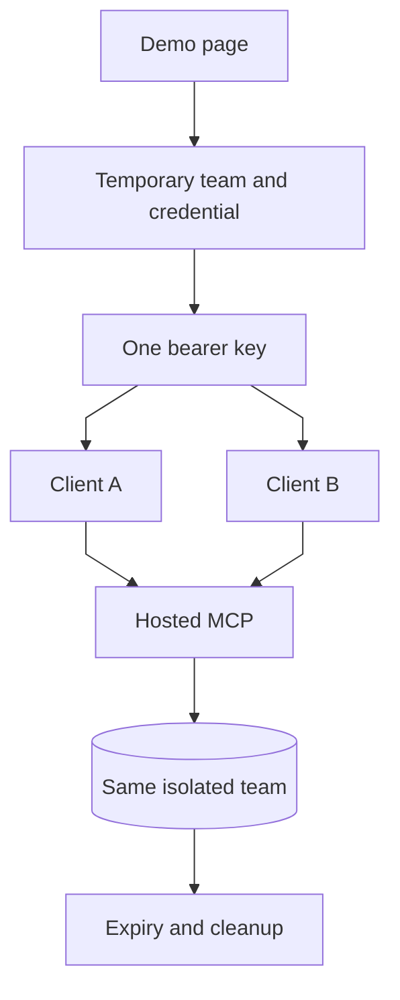

# Hosted Demo

Try disposable memory at [demo-dense-mem.markhuang.ai](https://demo-dense-mem.markhuang.ai). The demo provisions a temporary isolated team and credential. Its UI/runtime owns current expiry and quotas; it is not a production backup or durability service.

## Shared Demo Workspace

Use only disposable test data. Keep the generated key private. Public demo access does not grant the deployment control plane or establish access to another team's memory.

## Test The Current Contract

1. Generate a temporary key and copy the provided MCP endpoint into a client.
2. Inspect authenticated `tools/list`; verify the running demo supports the Evidence-only schema before using these examples.
3. Submit a short exact note to `team_shared`, retaining the complete request and key. Inspect the terminal outcome.
4. Recall the note from a second client using the same credential. Trace its returned Evidence ID when provenance is needed.
5. If testing correction, submit an owned exact replacement through the [supported correction workflow]({{ '/Conflicts-And-Corrections/#replace-owned-evidence' | relative_url }}).

A separately provisioned temporary team should not see the first team's data. Multiple clients sharing one credential share its authorization and private space as well as its team access; that is not a cross-user private-isolation test.

## Interpret The Result

| Observation | Meaning |
| --- | --- |
| Tool hidden or old schema | The demo's deployed version/gates differ; use its discovered contract. |
| Stored result | Required foreground work completed for that operation. |
| Explicit `no_memory` session outcome | No excerpt was selected; not pending work. |
| Empty/degraded recall | Inspect limits, visibility, time view, and degradation before concluding the source is absent. |
| Expired team/key | The temporary workspace can be cleaned without recovery. |

Continue with [Quick Start]({{ '/Quick-Start/' | relative_url }}) for a durable self-hosted installation.
