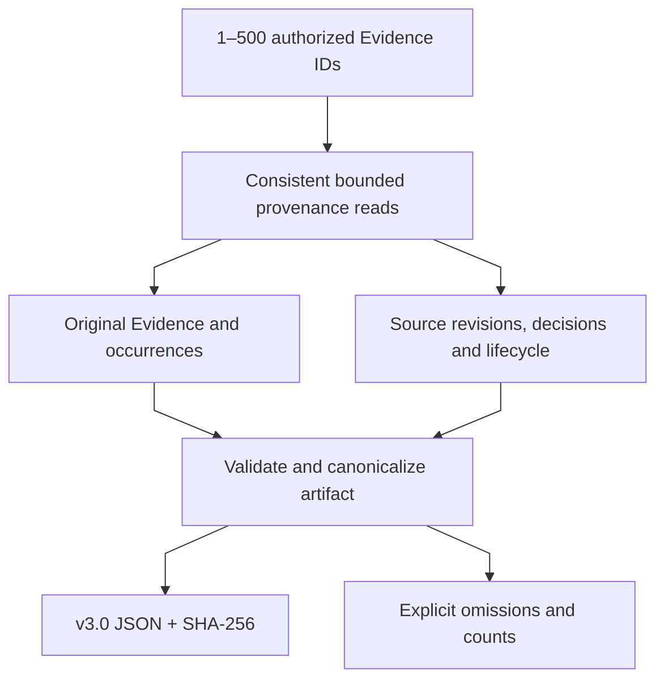
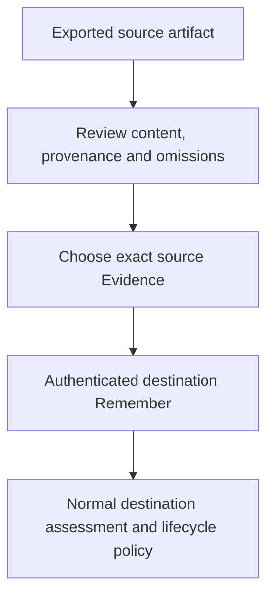

# Memory Packs

A memory pack is a read-only export of selected authorized Evidence and provenance. The current artifact format is `dense-mem.memory-pack.v3.0`.

## Export Boundary

Select Evidence IDs returned by supported memory tools. Export derives visibility from authentication and does not write memory. Complete arguments and result fields are in [Technical Reference]({{ '/Technical-Reference/#export_memory_pack' | relative_url }}).

## Artifact Contents

| Included | Meaning |
| --- | --- |
| Evidence and content hashes | Exact authorized source content when requested and available. |
| Occurrences | Original submitted text, source, authorship, and provenance. |
| Source revisions | Source identity, revision tokens, envelopes, and lineage. |
| Decisions and lifecycle | Bounded retained acceptance and lifecycle history. |
| Format, source metadata, counts, and omissions | Portable context and explicit limits. |

`include_evidence` controls source-content inclusion. Omitted/truncated content and bounded history remain explicit. Verify the returned canonical hash, counts, and all omission reasons before relying on the artifact. Export IDs and source metadata are provenance, never destination authorization.

Credentials, authentication material, raw embeddings, search documents, operational logs, and Redis state are outside this artifact. Factual graph records are absent.

## Use At A Destination

There is no automatic import or identity-copy operation. A destination submission requires its own explicit memory destination and operation key. It does not inherit source owners, IDs, lifecycle decisions, or permissions.

## Recovery Boundary

A pack is not a database backup. It omits operational state and can contain bounded or omitted source/history data. Use [Operations Runbook]({{ '/Operations-Runbook/#backup' | relative_url }}) for backup and restore.
