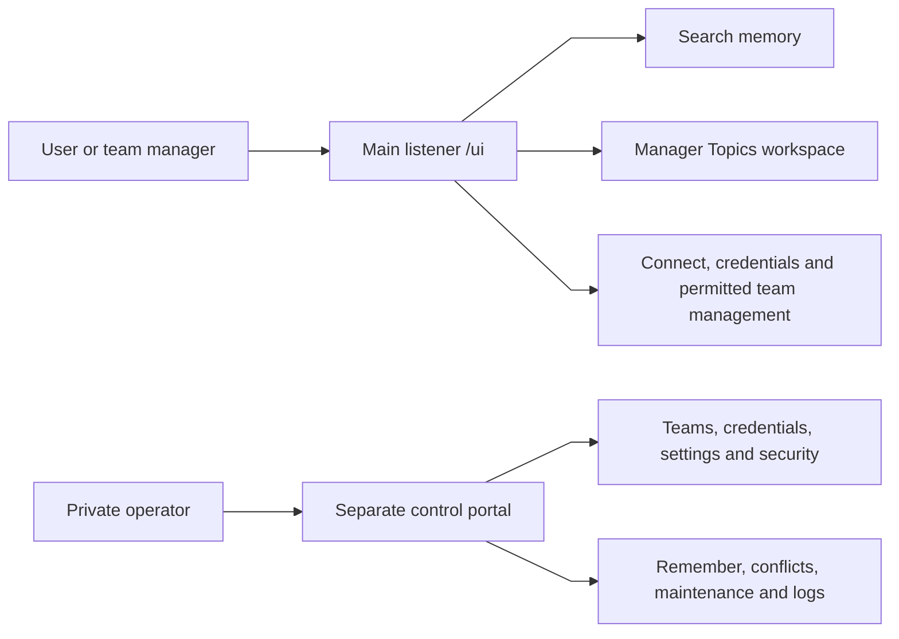
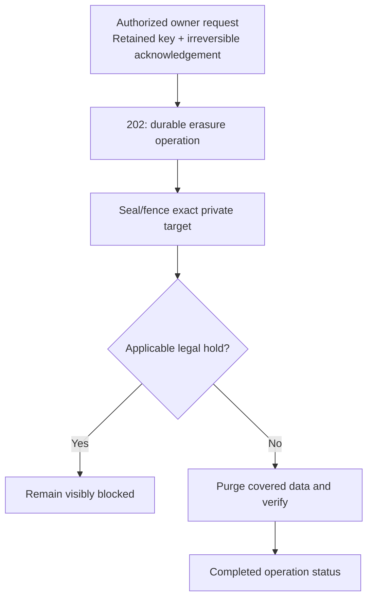

# Portals And API Keys

Use the user portal for your team workspace and the separate private control portal for deployment administration. Browser interfaces are first-party product surfaces; external memory integrations use MCP.

## Portal Responsibilities

| Portal | Default local URL | Authentication |
| --- | --- | --- |
| User | `http://127.0.0.1:8080/ui` | API key, opt-in API-key portal session, or configured SSO. |
| Control | `http://127.0.0.1:8090/` | Control-plane token or configured administrative SSO. |

A user credential does not grant control access. Keep the control listener private. [Request Lifecycle And Security]({{ '/Request-Lifecycle-And-Security/' | relative_url }}) owns the authentication and authorization rules.

## Sign In And Connect

1. Open `/ui` and sign in with an API key or an available SSO provider.
2. Select an entitled team when using SSO.
3. Open **Connect** and copy the full team UUID and MCP endpoint.
4. Configure your MCP host with a bearer API key or supported OAuth token; a browser cookie is not an MCP credential.

The API-key login can opt into **Keep me signed in for 7 days**. The portal exchanges the validated key for an opaque session. Logout clears that session. Cookie/CSRF behavior is defined in [Request Lifecycle And Security]({{ '/Request-Lifecycle-And-Security/#browser-session-and-csrf' | relative_url }}).

| First-party session route | Purpose |
| --- | --- |
| `POST /ui/api/session` | Exchange direct bearer authentication, with exactly `{"remember":true}` or `{"remember":false}`. |
| `GET /ui/api/session` | Current team, membership, optional credential, entitled teams, personal credentials, `memory_access`, and configured MCP base. |
| `POST /ui/api/session/logout` | End the API-key portal session. |

The connection URL uses `MCP_PUBLIC_BASE_URL` when configured. Otherwise the UI labels a browser-origin fallback. An SSO team switch refreshes team and endpoint together. Configure the canonical HTTPS origin in production; see [Configuration]({{ '/Configuration/#runtime-sso-oauth-and-private-memory' | relative_url }}).

## Credentials And API Keys

| Concept | Behavior |
| --- | --- |
| Credential identity | Stable credential/API-client membership with a separate private space. |
| Raw key | Returned once on creation/rotation; retain it privately. |
| Role | Member or manager; controls permitted team administration. |
| Scopes | Read/write grants; shared writes still require current write permission. |
| `memory_access` | Effective private/shared read/write capability shown by the portals. |

Credentials issued by one SSO user have independent private spaces. The issuing user's SSO/OAuth membership-private space remains separate. No memory-binding selector is needed or accepted.

## Create And Rotate

1. In the control portal, select a team and create a credential, or use permitted same-team credential management in `/ui`.
2. Choose bounded scopes, role, expiry, and rate policy appropriate to the caller.
3. Save the one-time raw key privately and connect a client.
4. Rotate the selected credential when needed, then replace its key in clients.
5. Verify client access before revoking an unrelated credential.

Rotation replaces key material in place, preserving identity and private-space ownership. The previous raw key becomes invalid. An existing API-key portal session follows the stable credential ID and survives rotation, subject to current authorization.

Team managers use `/ui/api/team/credentials` and its per-credential routes. A current API-key credential can rotate through `POST /ui/api/credential/rotate`. Control administration uses `/control/api/teams/{teamId}/credentials` and per-credential routes.

## SSO-Owned Credentials

SSO members use **My credentials**; managers use **Team**. Operations address a selected stable credential ID, not an arbitrary newest key.

| Route under `/ui/api/sso` | Purpose |
| --- | --- |
| `GET /credentials` | List owned credentials in the selected team. |
| `POST /credentials` | Create an owned credential and return its key once. |
| `GET /credentials/{credentialId}` | Inspect one owned credential. |
| `POST /credentials/{credentialId}/rotate` | Rotate the selected writable credential. |
| `DELETE /credentials/{credentialId}` | Disable it and queue private-space erasure/retirement. |

Creation and rotation cannot exceed current membership grants. Team-read-only members can create read-only credentials and write their own private memory; existing rotation/deletion routes retain their required write scopes. API-key portal sessions do not mint SSO-owned credentials.

IdP configuration, claim/group mapping, directory provisioning, and entitled-team selection belong to [User Portal SSO]({{ '/User-Portal-SSO/' | relative_url }}).

## Private-Memory Erasure

| Route | Target |
| --- | --- |
| `DELETE /ui/api/credential/private-memory` | Current credential's private memory. |
| `DELETE /ui/api/sso/private-memory` | Selected SSO membership's private memory. |
| `GET /ui/api/private-memory/erasures/{operationId}` | Owner-visible operation status. |

Erasure and SSO-owned credential deletion require a retained `Idempotency-Key` and exactly `{"acknowledge_irreversible":true}`. Poll the returned owner-visible erasure operation until its terminal status; this is separate from synchronous Remember/session processing.

Deleting a credential disables that credential and retires its own private space. It does not erase the issuing user's separate space or team-shared memory. Expiry alone does not erase history. Retention, migration-copy lineage, and applicable holds are handled by the privacy owner; see [Operations Runbook]({{ '/Operations-Runbook/#private-memory-erasure' | relative_url }}).

## Control Workspace

| Task | Canonical procedure |
| --- | --- |
| Configure providers, maintenance, public origins, or telemetry | [Configuration]({{ '/Configuration/' | relative_url }}) |
| Diagnose Remember or search convergence | [Operations Runbook]({{ '/Operations-Runbook/' | relative_url }}) |
| Inspect Evidence conflicts | [Conflicts And Corrections]({{ '/Conflicts-And-Corrections/#operator-inspection-and-decision' | relative_url }}) |
| Review operation logs, protected captures, and metrics | [Telemetry]({{ '/Telemetry/' | relative_url }}) |
| Organize shared Evidence | [Topics And Organization]({{ '/Topics-And-Organization/' | relative_url }}) |

The control portal also manages teams, security settings/bans, retention, legal holds, and administrative audit access. It has no factual graph explorer, Dream workspace, or mutable RRF policy editor.
