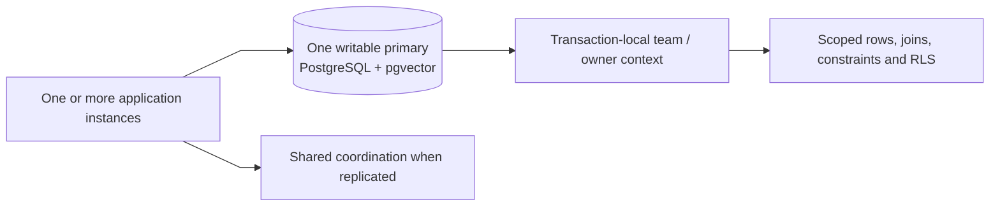

# PostgreSQL Cluster-Safe Schema

The supported runtime uses one writable PostgreSQL primary. Explicit tenant keys, transactions, and RLS enforce isolation. This schema does not imply support for sharding or replica reads.

## Supported Topology

Startup rejects standby/read-only connections, detected Citus/pg_shard configurations, and separate replica-read configuration. Route every instance to the writable primary.

## Transaction And Key Boundaries

| Mechanism | Invariant |
| --- | --- |
| Request transaction | Immutable authenticated team and owner context, applied transaction-locally. |
| Tenant-owned keys and joins | Include team and applicable owner/space dimensions; a valid foreign UUID cannot establish an unrelated tenant link. |
| RLS | Enforces permitted row visibility and mutations inside the explicit transaction. |
| System/migration modes | Separate audited infrastructure entrypoints; never selected by a request field. |
| Space generation | Fences stale writes, jobs, retries, and projections after erasure or replacement. |

Candidate full-text, vector, source, and topic-membership queries are scoped before returning IDs. Hydration and mutation reauthorize those IDs. Scope policy is owned by [Request Lifecycle And Security]({{ '/Request-Lifecycle-And-Security/' | relative_url }}).

## Versioned Search And Organization

Search writes retain source version/hash and embedding/index/projection identities. An older derived result cannot overwrite a newer source or generation. Physical index behavior is described in [ANN, HNSW, And Halfvec]({{ '/ANN-HNSW-And-Halfvec/' | relative_url }}).

Ontology publication rechecks shared-source dependencies, overrides, leases, and generations. Provider work does not hold the publication transaction open. Private sources cannot enter organization.

## Durable Work

| Work | Durable authority |
| --- | --- |
| Remember and session intake | Exact staging and terminal receipts; required semantic work completes synchronously. |
| Ontology maintenance | PostgreSQL runs, attempts, source progress, leases, and publication history. |
| Search reconciliation | Current source/contract fences and bounded recovery outcomes. |
| Private erasure/retention | Sealed target, generation fences, holds, operation progress, and completion verification. |

Redis wakeups or short coordination leases do not replace these durable records.

## Migrations And Proof

Startup serializes ordered migrations under a PostgreSQL session lock. Deployed migrations remain immutable. Every schema change needs lock/rewrite analysis, RLS and constraint review, and an explicit recovery or irreversible boundary.

Migration `20261110010000` resets organization with an explicit `TRUNCATE ... RESTRICT` inventory in the same transaction as its preservation checks and receipt. Unexpected retained dependencies or applicable holds block the transaction. The migration-history guard accepts only explicitly approved hash transitions for this cutover; other deployed migration files remain immutable. See [cutover semantics]({{ '/Topics-And-Organization/#evidence-only-cutover' | relative_url }}) and [operating procedure]({{ '/Operations-Runbook/#evidence-only-cutover' | relative_url }}).

Real PostgreSQL integration tests must prove tenant joins, RLS, transaction atomicity, concurrency, idempotency, generation fencing, and migration preservation. Mocked repository calls do not establish those guarantees. Commands and deployment procedures belong to [Development And Testing]({{ '/Development-And-Testing/' | relative_url }}) and [Operations Runbook]({{ '/Operations-Runbook/' | relative_url }}).
