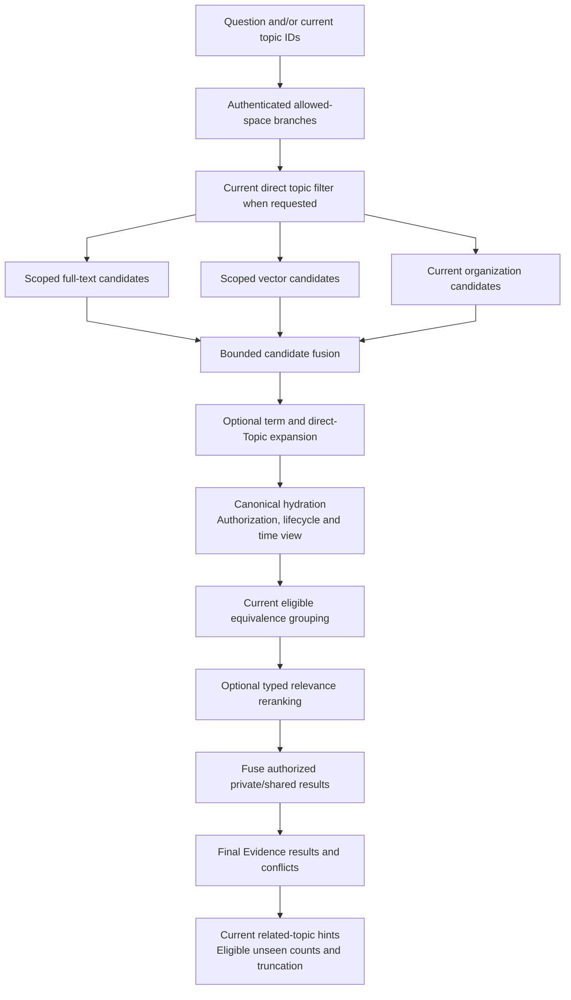

# Recall Ranking

Recall returns eligible authorized Evidence, bounded Evidence conflicts, current related-topic hints, search states, and explicit degradations. Array order conveys rank; scores and provider attempts are not public result fields.

With `RECALL_EXPANSION_ENABLED=true`, Recall takes up to five initial authorized hits per space. One bounded expansion uses distinctive terms and, for current shared Evidence, direct Topic peers. Candidate limits and a discount for broad Topics constrain expansion. Up to two qualifying expansion hits can enter the top ten. The optional Decision API reranks the authorized shortlist with same-space bridge context outside the database transaction. If that call fails, Recall reports the degradation and returns the deterministic order. Expanded ranking defaults to off pending the paired quality comparison.

## Retrieval Flow

A question embedding is reused across authorized branches. With `RECALL_DISABLE_QUERY_EMBEDDING=true`, Recall uses the lexical arm. Explicit topic selection searches shared Evidence only. Candidate selection and counting are scoped before IDs leave the adapter. Hydration checks authorization and eligibility again. See [Recall Search Modes]({{ '/Configuration/#recall-search-modes' | relative_url }}).

## Eligibility

| Check | Consequence |
| --- | --- |
| Team, space, and active generation | No cross-team or unbound private reads. |
| Accepted source and Evidence lifecycle | Staged, retracted, superseded, or otherwise ineligible content cannot enter the current result set. |
| Source revision and requested time view | Current and temporal reads use the applicable source/lifecycle history. |
| Known Evidence IDs | Exclude seen sources and applicable equivalent results. |
| Organization freshness | Only eligible current groups/memberships affect recall. |

Evidence does not need a factual Relationship or support edge to be recalled. [Evidence Model And Lifecycle]({{ '/Evidence-Model-And-Lifecycle/' | relative_url }}) owns lifecycle and time semantics.

## Topics And Equivalence

When enabled, current organization can add source candidates and group equivalent shared Evidence while retaining alternate IDs and truncation. Private Evidence does not enter organization.

A topic-only query retrieves eligible direct members without a question embedding. A question plus topic IDs restricts retrieval to that direct-membership union. No descendant expansion occurs.

`related_topics` is a bounded follow-up surface with IDs, names, descriptions, eligible Evidence counts, and rank. Its budget is separate from the primary Evidence limit. Read [Topics And Organization]({{ '/Topics-And-Organization/#discover-and-follow-a-topic' | relative_url }}) for selection, pause, and enablement semantics.

## Authorized Space Branches

Ordinary recall can search shared and allowed private memory independently, then fuse the authorized results. Private-only visibility never grants access to shared topics. Each result retains `space_kind`.

[Vector Search And Ranking]({{ '/Vector-Search-And-Ranking/' | relative_url }}) owns fusion mathematics and tie-breaking. [ANN, HNSW, And Halfvec]({{ '/ANN-HNSW-And-Halfvec/' | relative_url }}) owns physical candidate execution.

## Failure And Degradation

| Situation | Result |
| --- | --- |
| Query embedding unavailable | Explicit vector degradation can accompany lexical results. |
| Optional organization or topic hints unavailable | Explicit degradation; ordinary Evidence retrieval can remain useful. |
| Explicit selected topic missing, foreign, or stale | Bounded `topic_unavailable`; refresh current authorized topic IDs. |
| Optional typed relevance reranking fails | Keep original ranking and report degradation; cancellation still fails. |
| Required search, canonical hydration, or conflict read fails | Typed error; never fabricate an empty success. |
| Optional private-space branch fails | Explicit branch degradation can accompany successful shared results. |

Read `search_states.evidence` and `degradations` before drawing conclusions from missing results. A successful lexical-only response does not establish full vector-search quality.

## Trace And Feedback

Use a returned `evidence_id` for bounded trace or export. Honor omissions and truncation. Recall feedback is voluntary and observational; the tool does not prompt for mandatory feedback. Exact schemas are in [Technical Reference]({{ '/Technical-Reference/#recall_memory' | relative_url }}).
