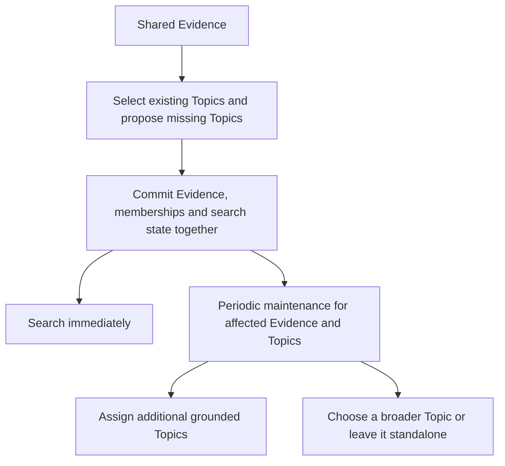
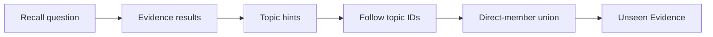
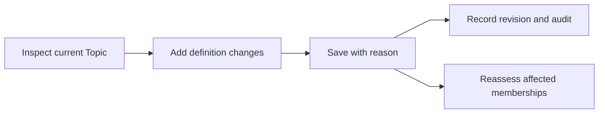

# Topics And Organization

Topics organize eligible team-shared Evidence. The editor and storage behavior below describes the relational Topics source. Check the revision of your installed image for availability. [Relational Topics and Offline Upgrades](https://github.com/markhuangai/dense-mem/blob/8b94038237b7291fe5b1eb97958fa7b4cf4c3175/adr/0021-relational-topics-and-offline-upgrades.md)

## Organization Boundary

Remember can assign several direct Topics to each Evidence item. It sends a scoped shortlist of up to 20 existing Topics. When the optional Decision API is enabled for Topic assignment, candidates with a match probability of at least 0.80 are selected. An uncovered probability of at least 0.80 invokes structured generation for missing subjects. With no matches and an uncovered probability below 0.80, the Evidence remains searchable as uncategorized. Generation also handles absent candidates. A required provider or input-budget failure returns a typed error before publication.

The scheduler also revisits older eligible Evidence when inputs change or an assessment is due. When enabled, a Community Decision places a Topic under its selected parent at a probability of at least 0.80 and otherwise records a standalone result. Evidence equivalence is evaluated independently and preserves each passage's exact text and provenance. The Decision thresholds describe [application revision `9b12233d4e7d`](https://github.com/markhuangai/dense-mem/blob/9b12233d4e7d3763c03f3a55a4477e5b46f0fdfa/adr/0022-authoritative-decision-api-and-runtime-token-budgets.md) and depend on the deployed application revision.

## Discover And Follow A Topic

A parent topic does not implicitly select its children. For example, if Operations is the parent of Deployments, filtering Operations retrieves its direct Evidence only. Request both topic IDs to select both direct membership sets.

Counts and selection apply visibility, lifecycle, temporal eligibility, freshness, and known-Evidence exclusions. Related-topic hints report truncation. Missing, foreign, retired, or stale selected topics return the same bounded `topic_unavailable` outcome.

## Enablement And Freshness

| Condition | Effect |
| --- | --- |
| Organization enabled | Remember assigns Topics before returning. The scheduler also processes eligible existing Evidence and Community placement. |
| Maintenance paused | Remember still assigns Topics. Existing Topics and memberships remain readable. |
| Organization disabled | Topic reads stop; ordinary Evidence recall remains available. |
| Evidence or Topic definitions change | Dependency fingerprints invalidate affected derived state. |
| A publication's source or generation changes during assessment | Fenced publication cannot overwrite newer state. |

Maintenance uses bounded scheduling, concurrency, provider backoff, and complete-response validation. Request context limits constrain individual model calls. See [Configuration]({{ '/Configuration/#topic-maintenance' | relative_url }}) and [Operations Runbook]({{ '/Operations-Runbook/#topic-maintenance' | relative_url }}).

## Topic Storage Upgrade

Current Topics, direct memberships, and equivalences use scoped relational records. The upgrade keeps Topic IDs and earlier versions, declared parents, placement outcomes, and committed receipts. It uses the newest still-current settled placement, including standalone. A Topic with no current settled placement uses its declared parent.

Follow the offline [upgrade procedure]({{ '/Operations-Runbook/#topic-storage-upgrade' | relative_url }}).

## Evidence-Only Cutover

The one-time migration `20261110010000` resets derived organization before normal Evidence-based maintenance resumes.

| State | Cutover behavior |
| --- | --- |
| Topics, IDs, assignments, equivalence, overrides, publications, assessments, drafts, and derived queues | Cleared together through the explicit reset inventory. Manual organization is not retained. |
| Original Evidence, fingerprints, provenance, lifecycle, conflicts, legal holds, and unrelated security/audit history | Retained and checked by the migration. |
| Maintenance settings, pause state, and usage accounting | Retained; discovery cursors and leases reset. |
| Existing eligible shared Evidence | Rediscovered in active spaces and current generations without resubmission. Private and unavailable sources remain excluded. |
| Already-applied cutover | Skipped; current organization remains intact. |

Rebuilding after the earlier Evidence-only reset runs after startup when maintenance is enabled, unpaused, and has model capacity. Rediscover topic handles after that reset. See [Operations Runbook]({{ '/Operations-Runbook/#evidence-only-cutover' | relative_url }}).

## Manager Workflow

Managers open **Topics** in the team portal. The catalog and history require read access. Editing requires write access.

Select **New topic** or edit an existing Topic. Set its label, description, aliases, and optional parent. Add the changes, enter a reason, and select **Save**. The portal sends the bounded list to `POST /ui/api/topics/edits` with an operation key and the expected version of each record. Changes take effect when the save completes. The scheduler can revisit affected memberships on its normal cadence.

On a 409, refresh the records and review the current values before applying changes again. The original owner can inspect a migrated draft in **History**. Authorized exact replays of previously committed legacy commands still return their recorded results.

See [Portals And API Keys]({{ '/Portals-And-API-Keys/' | relative_url }}) for access and [Telemetry]({{ '/Telemetry/' | relative_url }}) for diagnostics.
