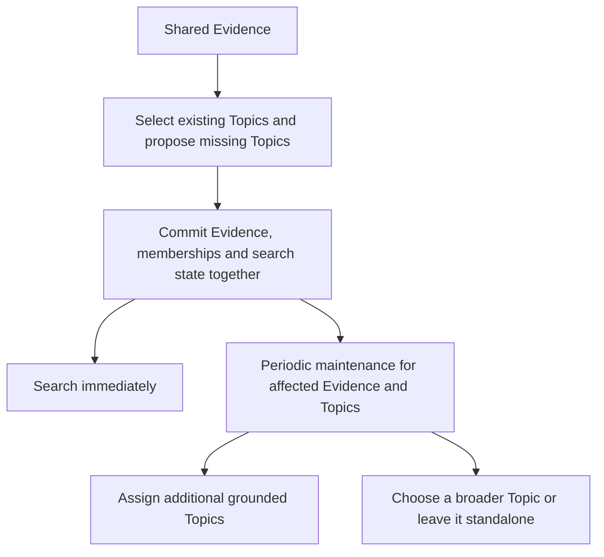
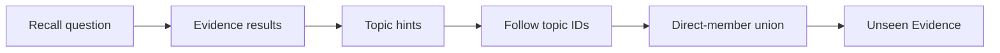
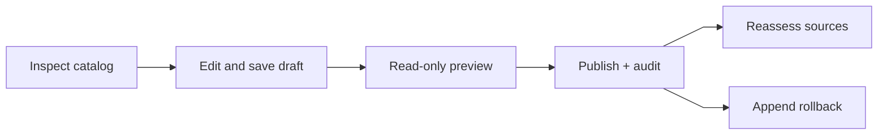

# Topics And Organization

Topics organize eligible team-shared Evidence. These routes and settings describe source behavior for the Topic assignment and Community placement release. Use the documentation for your installed image to verify deployment availability.

## Organization Boundary

Remember can assign several direct Topics to each Evidence item. It sends a scoped shortlist of up to 20 existing Topics. When the optional Decision API is enabled for Topic assignment, it checks each candidate and checks for uncovered meaning. Structured generation handles uncertainty, uncovered meaning, and absent candidates. It can select existing Topics and propose new ones in the same response. A valid unclear result remains searchable as uncategorized. A required provider failure returns a typed error before publication.

The scheduler also revisits older eligible Evidence when inputs change or an assessment is due. Community placement chooses an active broader Topic or records a standalone result. Evidence equivalence is evaluated independently and preserves each passage's exact text and provenance.

## Discover And Follow A Topic

A parent topic does not implicitly select its children. For example, if Operations is the parent of Deployments, filtering Operations retrieves its direct Evidence only. Request both topic IDs to select both direct membership sets.

Counts and selection apply visibility, lifecycle, temporal eligibility, freshness, and known-Evidence exclusions. Related-topic hints report truncation. Missing, foreign, retired, or stale selected topics return the same bounded `topic_unavailable` outcome.

## Enablement And Freshness

| Condition | Effect |
| --- | --- |
| Organization enabled | Remember assigns Topics before returning. The scheduler also processes eligible existing Evidence and Community placement. |
| Maintenance paused | Remember still assigns Topics. Existing Topics and memberships remain readable. |
| Organization disabled | Topic reads stop; ordinary Evidence recall remains available. |
| Evidence or Topic definitions change | Dependency fingerprints invalidate affected derived state. |
| A publication's source or generation changes during assessment | Fenced publication cannot overwrite newer state. |

Maintenance uses bounded scheduling, concurrency, provider backoff, and complete-response validation. Request context limits constrain individual model calls. See [Configuration]({{ '/Configuration/#topic-maintenance' | relative_url }}) and [Operations Runbook]({{ '/Operations-Runbook/#topic-maintenance' | relative_url }}).

## Topic Storage Upgrade

The startup migration preserves existing Topic IDs, revisions, direct memberships, Evidence equivalence, Community hierarchy, and frozen receipts. It moves eight maintenance settings to their new keys. Historical override records remain readable in publication history. Previously published associations are retained at cutover and follow ordinary eligibility and reassessment after startup.

Before upgrading, stop incompatible writers and verify a restorable PostgreSQL backup. The compatible application finishes the migration before opening listeners. See [Operations Runbook]({{ '/Operations-Runbook/#topic-storage-upgrade' | relative_url }}).

## Evidence-Only Cutover

The one-time migration `20261110010000` resets derived organization before normal Evidence-based maintenance resumes.

| State | Cutover behavior |
| --- | --- |
| Topics, IDs, assignments, equivalence, overrides, publications, assessments, drafts, and derived queues | Cleared together through the explicit reset inventory. Manual organization is not retained. |
| Original Evidence, fingerprints, provenance, lifecycle, conflicts, legal holds, and unrelated security/audit history | Retained and checked by the migration. |
| Maintenance settings, pause state, and usage accounting | Retained; discovery cursors and leases reset. |
| Existing eligible shared Evidence | Rediscovered in active spaces and current generations without resubmission. Private and unavailable sources remain excluded. |
| Already-applied cutover | Skipped; current organization remains intact. |

Rebuilding after the earlier Evidence-only reset runs after startup when maintenance is enabled, unpaused, and has model capacity. Rediscover topic handles after that reset. See [Operations Runbook]({{ '/Operations-Runbook/#evidence-only-cutover' | relative_url }}).

## Manager Workflow

Managers use **Topics** in the team portal. Inspection requires read access. Saving and publication commands require write access. Drafts belong to their creator.

| Operation | Constraint |
| --- | --- |
| Define a Topic | Active optional parent within a 32-link hierarchy without cycles. |
| Preview | Uses publication validation and reports bounded examples and affected-source counts. |
| Publish / rollback | Rechecks versions and eligibility. Commits revision, audit, receipt, and draft completion together. |

The editor supports Topic definitions and their optional broader Topic. Remove retired edits from a historical draft before reuse. A stale draft stays open so the manager can refresh its versions and review it again.

First-party management interfaces are under `/ui/api/topics`. See [Portals And API Keys]({{ '/Portals-And-API-Keys/' | relative_url }}) for access and [Telemetry]({{ '/Telemetry/' | relative_url }}) for diagnostics.
