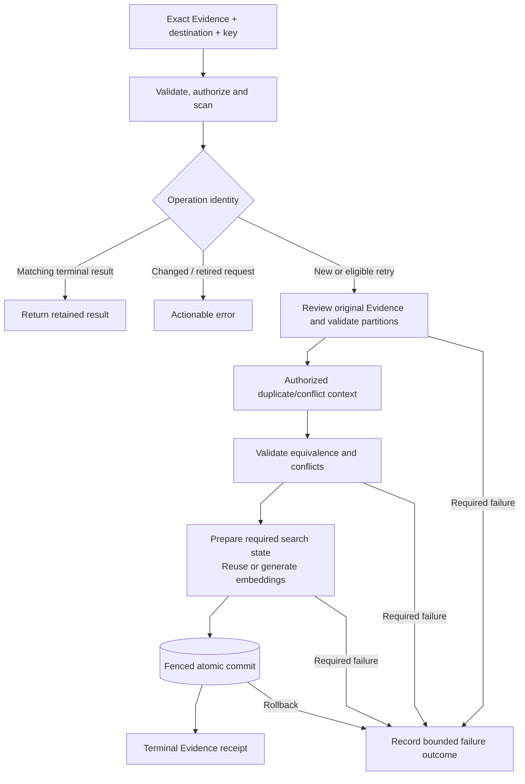
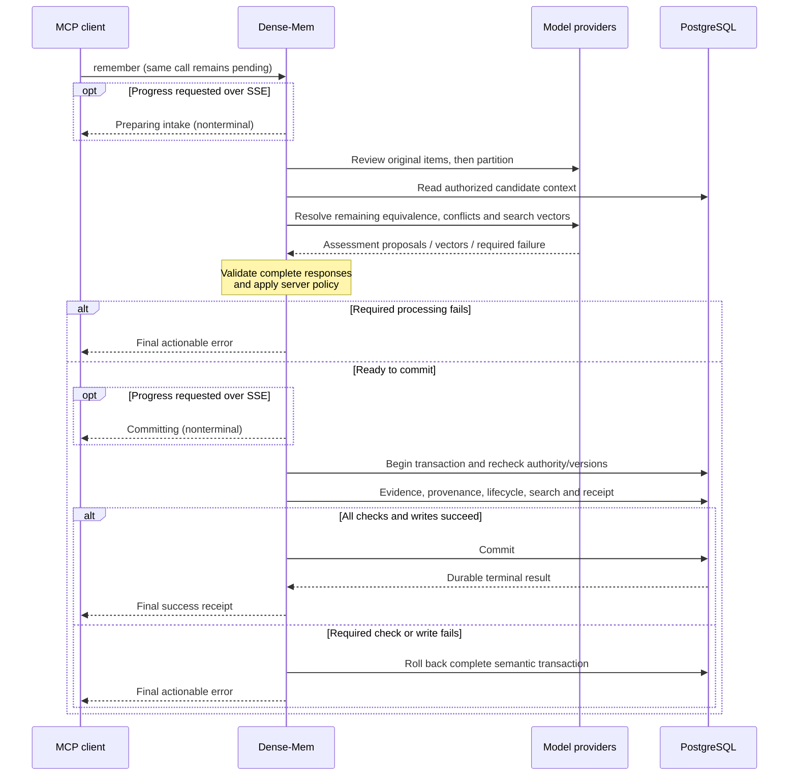
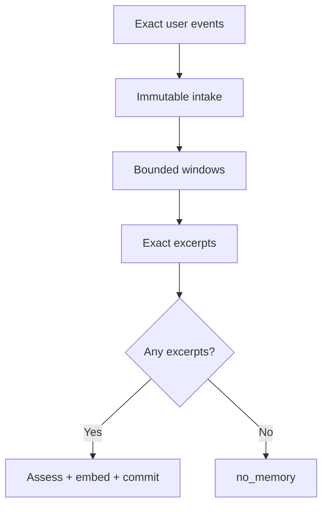

# Memory Write Pipeline

Remember performs required provider work, then commits the exact original input, accepted Evidence, search state, and terminal receipt atomically. The intake order below depends on the deployed image. [PR #777](https://github.com/markhuangai/dense-mem/pull/777)

## End-To-End Flow

Authentication and the security boundary are defined in [Request Lifecycle And Security]({{ '/Request-Lifecycle-And-Security/' | relative_url }}). Public fields and examples belong to [Technical Reference]({{ '/Technical-Reference/#remember' | relative_url }}).

## Exact Intake And Duplicate Handling

| Stage | Behavior |
| --- | --- |
| Admission | Reject invalid or retired fields before provider work; initial security rejection retains content-free bounded metadata. |
| Partitioning | Validate server-enumerated boundary IDs and preserve exact text, order, and original spans. |
| Exact duplicate resolution | Reuse only within the authorized owner/space and applicable lifecycle fences. |
| Semantic duplicate assessment | Use a bounded authorized candidate set; optional typed decisions can resolve sufficiently certain tasks. |
| Occurrence preservation | Retain exact submitted text and provenance even when canonical Evidence is reused. |

Duplicate candidate embeddings can precede assessment. Required final embeddings can reuse prepared vectors when compatible. One Remember request is not guaranteed to make exactly one embedding HTTP call.

## Complete Assessment

With Decision API Security Review enabled, the Decision API reviews every original item before partitioning. If every hazard probability is at most 1%, generation only proposes partitions. If any valid score exceeds 1%, generation reviews the Evidence and proposes partitions in one call. With Security Review disabled, generation handles both directly. A rejection stops the operation before embedding work.

After partitioning, Dense-Mem looks up authorized candidates. If enabled, the typed deduplication decision can resolve eligible equivalence tasks. Generation assesses remaining equivalence tasks and Evidence conflicts. Stored context is read-only. Authenticated owners, destinations, and allowed references are decided by the server.

Missing, duplicate, unknown, or out-of-allowlist results invalidate the complete response. Invalid structured generation responses can receive up to three turns including the first call. Required provider failures return a typed error.

## Atomic Commit And Deadlines

The application owns actual stage transitions; the MCP transport translates them into optional notifications. [Technical Reference]({{ '/Technical-Reference/#optional-progress' | relative_url }}) owns the complete wire examples.

Notifications follow reached preparation, duplicate checking, assessment, search preparation and commit boundaries. Duplicate-candidate embedding can precede equivalence and conflict assessment. Cached or empty embedding work adds no provider call. Regeneration does not repeat the assessment notification. Notifications add no model calls and never imply accepted memory. Notify before entering the semantic transaction; no network notification delivery belongs inside it. A retained-result replay returns directly without simulated processing.

Optional notification writes follow the [bounded delivery rules]({{ '/Request-Lifecycle-And-Security/#progress-notification-boundary' | relative_url }}). Required processing still owns its terminal outcome; a broken response stream can make receipt delivery unknown.

The 180-second operation budget bounds required processing. Assessment has a 160-second phase bound; embedding and commit have their existing bounded phases within the total deadline. Earlier context cancellation and remaining time still apply. Provider timeouts and optional progress delivery cannot extend a phase or operation deadline.

Background search reconciliation repairs derived state after later changes. It does not finish the required foreground work of a successful Remember call.

## Replay And Recovery

| Situation | Action |
| --- | --- |
| Retryable failure or unknown delivery | Resend the unchanged complete request and retained key. |
| Same key, changed target/content/provenance | Conflict; do not mutate the saved request to force replay. |
| Retired operation contract | Inspect retained outcome and follow non-retryable `retired_contract` guidance before an intentional new operation. |
| Required provider/embedding/commit failure | Review the returned failure and follow its retry guidance. Accepted Evidence is published only by a successful commit. |
| Client timeout/disconnect | Receipt delivery can be unknown even if a commit occurred. |

A lost response is not proof of rollback. The Python client does not automatically retry or generate replacement operation keys. See [Framework Integrations]({{ '/Framework-Integrations/#failures-and-unknown-outcomes' | relative_url }}).

Disconnect cancellation follows the [negotiated protocol]({{ '/Request-Lifecycle-And-Security/#progress-notification-boundary' | relative_url }}). Preserve the request and key whenever the final receipt is unavailable.

## Private Session Intake

`ingest_session` is private-only and feature-gated. External framework/app/user/session identifiers are provenance, not authorization. Earlier context is read-only. Immutable event text and timestamps cannot be changed on retry; a changed event rejects the batch before staging. Required processing is atomic across the request, while exact raw intake remains recoverable.

An empty extraction is a valid explicit no-memory outcome. Accepted or duplicate event counts alone do not prove that memory was stored. Framework adapters can batch multiple requests; their partial-progress rules are in [Framework Integrations]({{ '/Framework-Integrations/' | relative_url }}).
